# Northstar POS Architecture Diagrams & Technical Blueprints

**Document**: System Architecture Blueprints & Visual Workflows  
**System**: Point of Sale & Retail Management Platform  
**Target Architecture**: Cloudflare Workers, Cloudflare D1 (SQLite), Cloudflare R2, React 19 + TypeScript + Vite, Dexie.js (IndexedDB v4)  
**Date**: November 9, 2026  
**Auditor**: Google Antigravity (Gemini 3.8 Flash High)

---

## 1. High-Level Application Architecture

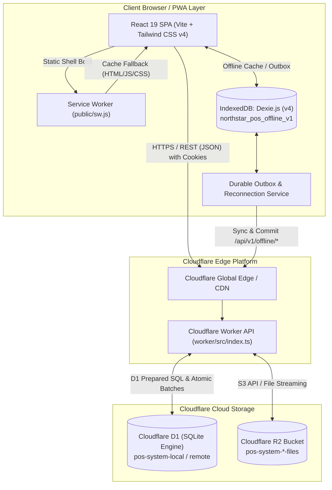

---

## 2. Frontend Component & Feature Architecture

```mermaid
graph TD
    App["App Root (main.tsx)"] --> Providers["Providers (providers.tsx)"]
    Providers --> QueryClient["TanStack Query Provider"]
    Providers --> AuthProv["AuthProvider (AuthContext.tsx)"]
    Providers --> Router["React Router 7 (router.tsx)"]

    Router --> AuthLayout["AuthLayout"]
    AuthLayout --> LoginPage["LoginPage"]
    AuthLayout --> RegisterPage["RegisterPage"]
    AuthLayout --> ForgotPwPage["ForgotPasswordPage"]

    Router --> ProtectedRoute["ProtectedRoute"]
    ProtectedRoute --> DashboardLayout["DashboardLayout"]
    DashboardLayout --> Header["Header (Search, OfflinePill, UserMenu)"]
    DashboardLayout --> Sidebar["Sidebar (RBAC Filtered Navigation)"]
    DashboardLayout --> MobileNav["MobileNavigation"]
    DashboardLayout --> Outlet["Route Outlet"]

    Outlet --> DashPage["DashboardPage (/dashboard)"]
    Outlet --> PosPage["PosPage (/pos)"]
    Outlet --> ProdPage["ProductsPage (/products)"]
    Outlet --> CatPage["CategoriesPage (/categories)"]
    Outlet --> CustPage["CustomersPage (/customers)"]
    Outlet --> CustAccPage["CustomerAccountPage (/customers/:id/account)"]
    Outlet --> SupPage["SuppliersPage (/suppliers)"]
    Outlet --> SupAccPage["SupplierAccountPage (/suppliers/:id/account)"]
    Outlet --> SalesPage["SalesPage (/sales)"]
    Outlet --> InvPage["InvoicesPage (/invoices)"]
    Outlet --> StockPage["InventoryPage (/inventory)"]
    Outlet --> PurchPage["PurchasesPage (/purchases)"]
    Outlet --> PayPage["PaymentsPage (/payments)"]
    Outlet --> SupPayPage["SupplierPaymentsPage (/supplier-payments)"]
    Outlet --> PermGuard["PermissionGuard"]

    PermGuard --> LedgerPage["LedgerPage (/ledger)"]
    PermGuard --> ExpPage["ExpensesPage (/expenses)"]
    PermGuard --> StaffPage["StaffPage (/staff)"]
    PermGuard --> StaffDetPage["StaffDetailsPage (/staff/:id)"]
    PermGuard --> SettingsPage["SettingsPage (/settings)"]
```

---

## 3. Frontend-to-Backend Communication & Offline Outbox Architecture

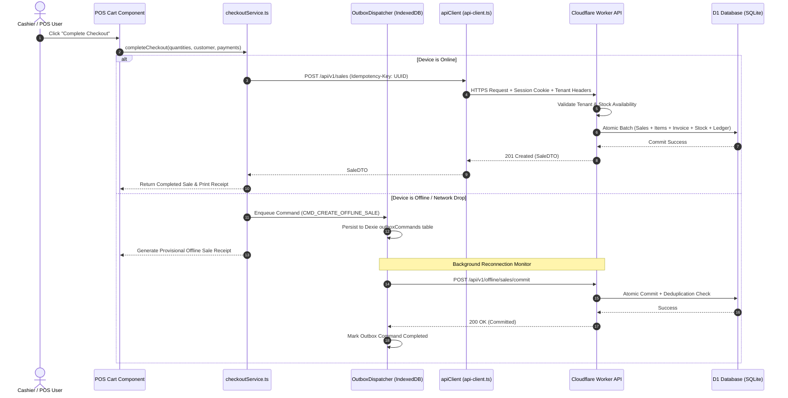

---

## 4. Backend Request Lifecycle & Cloudflare Worker Architecture

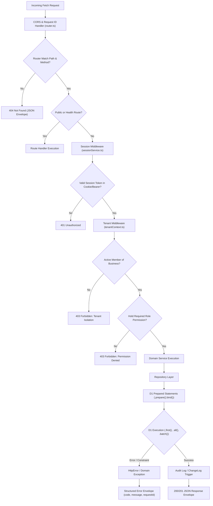

---

## 5. Authentication, Multi-Tenancy & RBAC Flow

```mermaid
graph TD
    subgraph GlobalIdentity ["Global Identity Context"]
        User["User Account (users table)"]
        Credentials["Password Hash (PBKDF2-SHA256)"]
        User --> Credentials
    end

    subgraph BusinessTenancy ["Multi-Tenant Boundary"]
        BizA["Business A (Retail Store)"]
        BizB["Business B (Supermarket)"]
        MemberA["business_members (Role: Manager)"]
        MemberB["business_members (Role: Cashier)"]
        User --> MemberA --> BizA
        User --> MemberB --> BizB
    end

    subgraph BranchAccess ["Branch Scoping"]
        Branch1["Branch 1 (Main Outlet)"]
        Branch2["Branch 2 (Express Outlet)"]
        MemberBranches["member_branches table"]
        MemberA --> MemberBranches
        MemberBranches --> Branch1
        MemberBranches --> Branch2
    end

    subgraph RBACValidation ["Permission Gate (ROLE_PERMISSIONS)"]
        Role{"Role in Active Business"}
        Role -->|Owner| PermAll["All Permissions (Full Control)"]
        Role -->|Admin| PermAdmin["Staff, Catalog, Operations, Reports (No Settings)"]
        Role -->|Manager| PermMgr["Catalog, Operations, Adjustments, Reports"]
        Role -->|Cashier| PermCashier["POS Sales, Payment Collection, Catalog Read"]
        Role -->|Accountant| PermAcct["Ledgers, Payments, Disbursals, Expenses, Reports"]
        Role -->|Inventory Manager| PermInv["Catalog Write, Stocktake, Purchases, Receipts"]
    end
```

---

## 6. State Management & Data Ownership

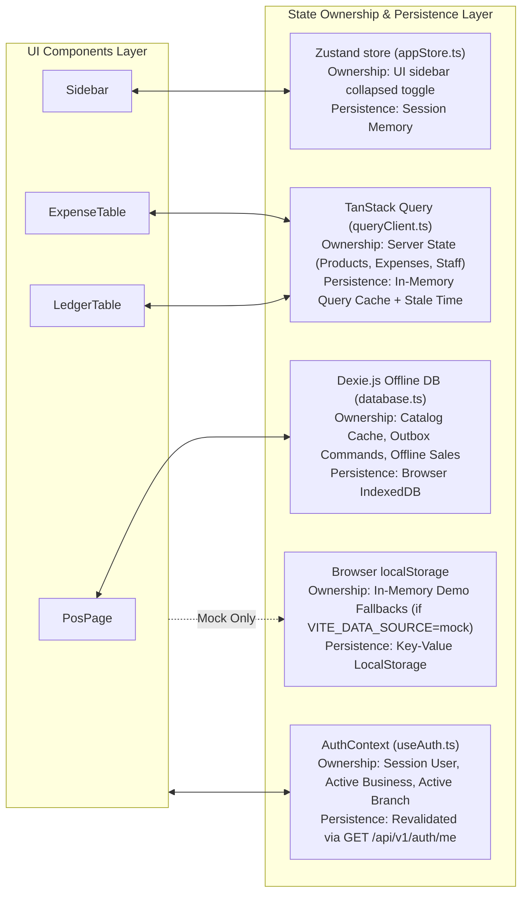

---

## 7. Complete Entity Relationship Diagram (ERD) — 46 Database Tables

```mermaid
erDiagram
    businesses ||--o{ branches : "has"
    businesses ||--o{ business_members : "employs"
    businesses ||--o{ business_settings : "configures"
    businesses ||--o{ categories : "classifies"
    businesses ||--o{ products : "sells"
    businesses ||--o{ customers : "serves"
    businesses ||--o{ suppliers : "sources_from"
    businesses ||--o{ sales : "records"
    businesses ||--o{ invoices : "issues"
    businesses ||--o{ payments : "receives"
    businesses ||--o{ customer_ledger_transactions : "tracks_ar"
    businesses ||--o{ purchases : "orders"
    businesses ||--o{ goods_receipts : "receives_stock"
    businesses ||--o{ supplier_payments : "disburses"
    businesses ||--o{ supplier_ledger_transactions : "tracks_ap"
    businesses ||--o{ inventory_balances : "maintains"
    businesses ||--o{ stock_movements : "audits"
    businesses ||--o{ stock_adjustments : "adjusts"
    businesses ||--o{ stock_counts : "audits_stock"
    businesses ||--o{ expense_categories : "categorizes_costs"
    businesses ||--o{ expenses : "spends"
    businesses ||--o{ audit_logs : "logs"
    businesses ||--o{ devices : "registers"
    businesses ||--o{ sync_change_log : "replicates"
    businesses ||--o{ offline_authorizations : "authorizes"
    businesses ||--o{ device_stock_allocations : "reserves"
    businesses ||--o{ staff_invitations : "invites"
    api_rate_limits ||--o{ devices : "throttles"

    users ||--o{ business_members : "joins"
    users ||--o{ sessions : "authenticates"
    users ||--o{ password_reset_tokens : "requests"
    users ||--o{ files : "uploads"

    business_members ||--o{ member_branches : "assigned_to"
    branches ||--o{ member_branches : "staffed_by"
    branches ||--o{ inventory_balances : "stores"
    branches ||--o{ sales : "transacts"

    categories ||--o{ products : "groups"
    suppliers ||--o{ supplier_products : "supplies"
    products ||--o{ supplier_products : "supplied_by"
    products ||--o{ inventory_balances : "counted_in"
    products ||--o{ stock_movements : "tracked_in"

    sales ||--o{ sale_items : "contains"
    sales ||--o| invoices : "generates"
    sales ||--o{ sale_returns : "refunds"
    sale_returns ||--o{ sale_return_items : "contains"
    customers ||--o{ sales : "purchases"
    customers ||--o{ payments : "pays"
    customers ||--o{ customer_ledger_transactions : "statement"

    payments ||--o{ payment_allocations : "allocates"
    invoices ||--o{ payment_allocations : "settled_by"
    payment_methods ||--o{ payments : "uses"

    purchases ||--o{ purchase_items : "contains"
    purchases ||--o{ goods_receipts : "fulfilled_by"
    goods_receipts ||--o{ goods_receipt_items : "contains"
    suppliers ||--o{ purchases : "bills"
    suppliers ||--o{ supplier_payments : "paid_by"
    supplier_payments ||--o{ supplier_payment_allocations : "allocates"
    purchases ||--o{ supplier_payment_allocations : "settled_by"
    suppliers ||--o{ supplier_ledger_transactions : "statement"

    stock_counts ||--o{ stock_count_items : "counts"
    expense_categories ||--o{ expenses : "classifies"
    devices ||--o{ device_registrations : "registers_history"
    devices ||--o{ device_stock_allocations : "holds_quota"
```

---

## 8. Business Workflow Diagrams

### Workflow A — Product Catalog & Pricing Setup
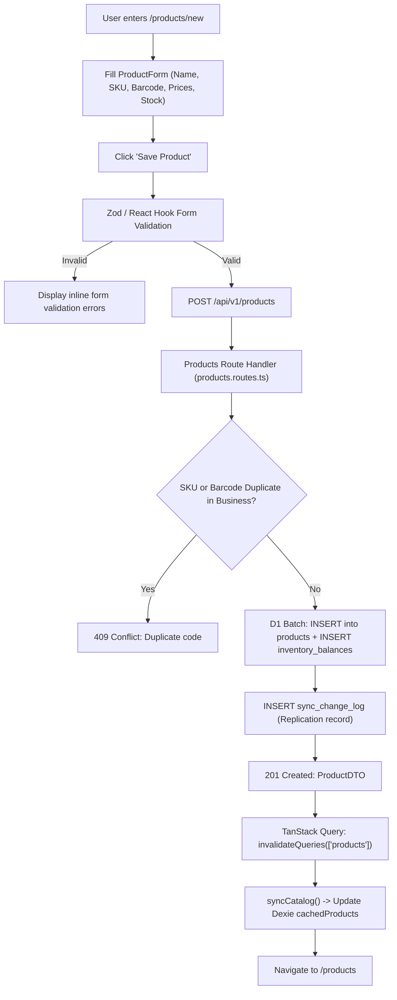

### Workflow B & C — Customer & Supplier Creation
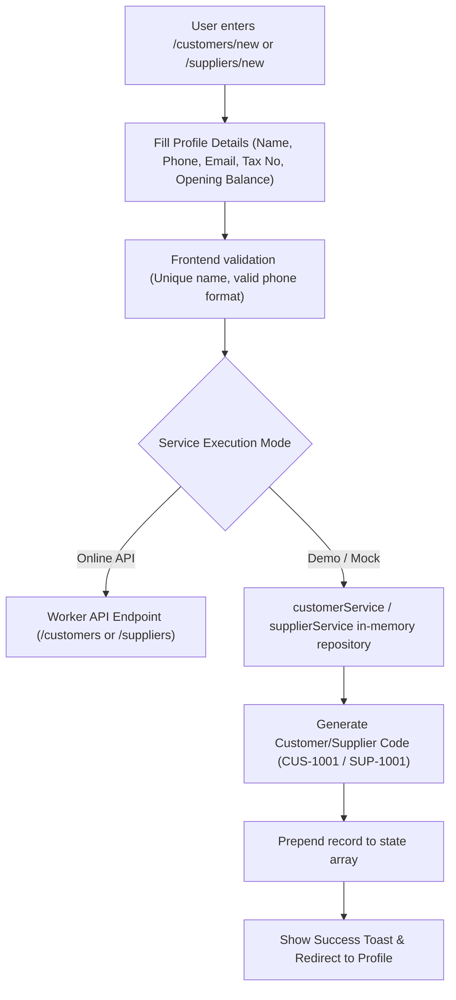

### Workflow D — POS Checkout & Atomic Settlement
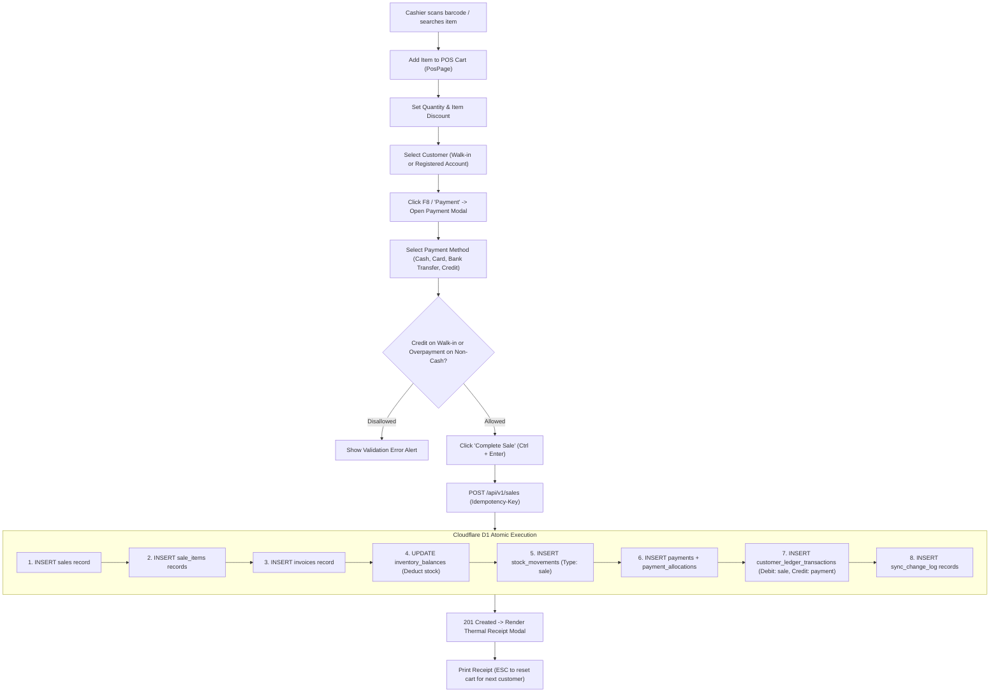

### Workflow E & F — Customer Payment & Ledger Reconciliation
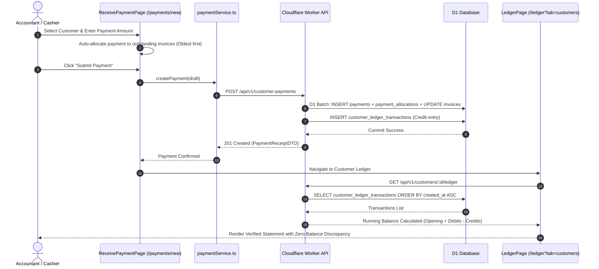

### Workflow G & H — Purchases & Goods Receiving (Three-Way Match)
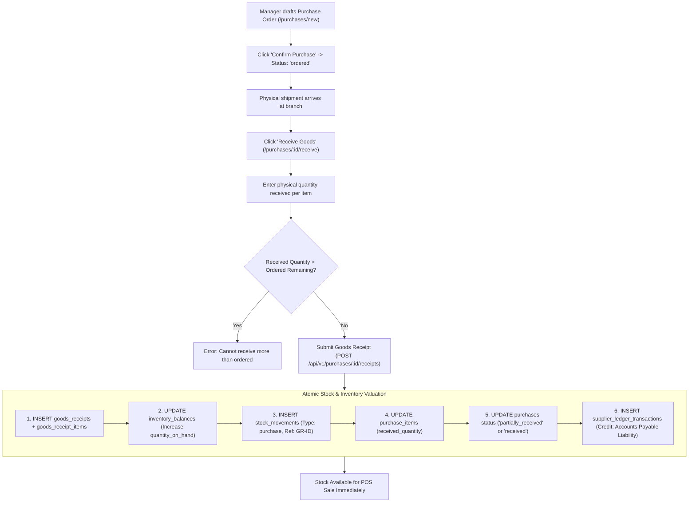

### Workflow I & J — Supplier Payments & Accounts Payable Settlement
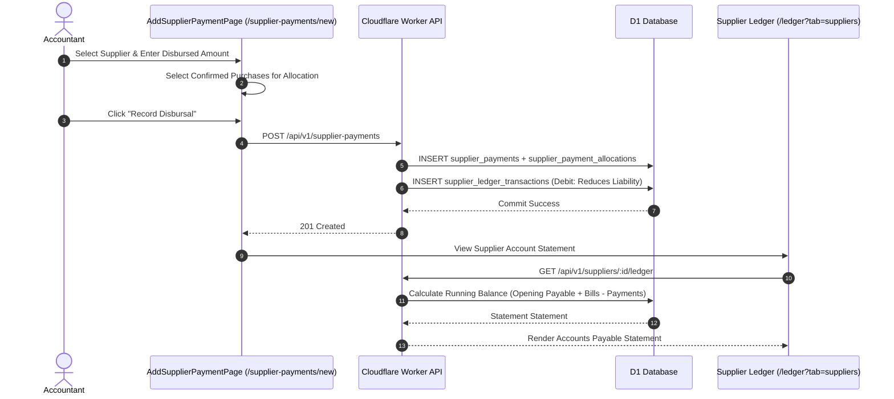

### Workflow K — Inventory Stock Count & Discrepancy Reconciliation
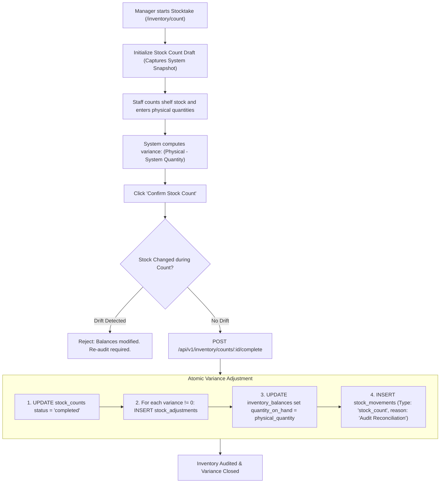

### Workflow L — Financial Reporting & Analytics Aggregation
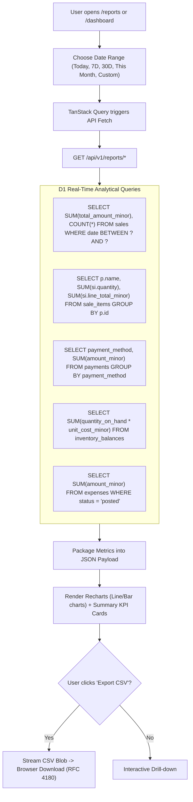

