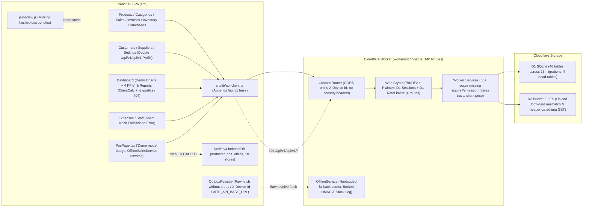

# Northstar POS — Independent Deep Code Audit, QA, Security Review & Release-Readiness Assessment

**Repository**: `c:\projects\pos-system`  
**Audit Date**: 2026-11-10  
**Git Branch & Commit**: `main` @ `a23bceb` (`checkpoint before POS remediation`)  
**Working Tree Before Audit**: Clean (`nothing to commit, working tree clean`)  
**Audit Mode**: 100% Read-Only Independent Verification (zero source, test, migration, or configuration edits performed)  
**Final Release Classification**: **A. NOT READY**

---

## 1. Executive Summary

Northstar POS contains a substantial full-stack engineering foundation: a TypeScript + Cloudflare Workers backend (`worker/src/index.ts`) registering **140 HTTP route handlers**, a Cloudflare D1 SQLite schema comprising **46 tables across 15 SQL migrations**, native Web Crypto PBKDF2-SHA256 authentication, multi-tenant business/branch context resolution, integer minor-unit (`paise`) storage in core backend tables, a React 19 + TypeScript SPA frontend (`src/`), and an offline subsystem built with Dexie v4 (`IndexedDB`) plus an automated suite of **75 Vitest files (508 tests)** executing against local SQLite and `fake-indexeddb`.

However, **an independent line-by-line inspection contradicts prior remediation claims that the application is `"Production Ready"`**. Critical integration, financial, security, inventory, and offline-synchronization defects remain active in the checked-in codebase, and automated passing tests frequently mask real runtime breakage through URL/fetch mocks or silent mock fallbacks:

1. **Broken Live Integration Paths (`P0`)**:
   - [`src/lib/api-client.ts`](file:///c:/projects/pos-system/src/lib/api-client.ts#L8-L131) already appends `/api/v1` inside `getBaseUrl()`, yet [`customerService.ts`](file:///c:/projects/pos-system/src/features/customers/services/customerService.ts#L18-L95), [`supplierService.ts`](file:///c:/projects/pos-system/src/features/suppliers/services/supplierService.ts#L35-L168), [`settingsService.ts`](file:///c:/projects/pos-system/src/features/settings/services/settingsService.ts#L61-L80), [`fileService.ts`](file:///c:/projects/pos-system/src/features/files/services/fileService.ts#L34), [`outbox.registry.ts`](file:///c:/projects/pos-system/src/lib/offline/outbox/outbox.registry.ts#L60), and [`reconnectionService.ts`](file:///c:/projects/pos-system/src/lib/offline/reconnectionService.ts#L16) construct URLs starting with `/api/v1/...` or invoke raw `fetch('/api/v1/...')`. Against a live Worker via `apiClient`, Customers, Suppliers, Settings, and File Content resolve to `/api/v1/api/v1/...` (**HTTP 404**).
   - [`paymentService.ts`](file:///c:/projects/pos-system/src/features/payments/services/paymentService.ts#L232-L235) sends `invoiceId: a.saleId` (`sale_*`), whereas [`customerPayments.service.ts`](file:///c:/projects/pos-system/worker/src/features/customer-payments/customerPayments.service.ts#L163-L177) queries `FROM invoices WHERE id = ?` (`inv_*`), causing customer payment allocation to fail with **HTTP 400**.
2. **Client-Trusted Pricing/Discounts & Inventory Corruption (`P0`)**:
   - [`SalesService.completeSale`](file:///c:/projects/pos-system/worker/src/features/sales/sales.service.ts#L267-L275) unconditionally accepts client-submitted `unitPriceMinor`, line `discountMinor`, and line `taxMinor` without RBAC or server-side catalog verification, and computes fixed discounts via float multiplication ([`money.ts`](file:///c:/projects/pos-system/worker/src/lib/money.ts#L69-L74)).
   - [`SalesService.completeSale`](file:///c:/projects/pos-system/worker/src/features/sales/sales.service.ts#L672-L688) executes `INSERT INTO inventory_balances ... VALUES (..., line.quantity) ON CONFLICT DO UPDATE SET quantity_on_hand = quantity_on_hand - excluded.quantity_on_hand`. When no prior `inventory_balances` row exists for `(branch_id, product_id)`, the first sale **creates positive stock (`+line.quantity`) instead of `-line.quantity`**, contradicting the recorded negative stock movement.
3. **Offline POS & Multi-Device Synchronization Failures (`P0`)**:
   - [`PosPage.tsx`](file:///c:/projects/pos-system/src/features/pos/pages/PosPage.tsx#L39-L45) renders a hardcoded `"Demo mode"` pill and **is not connected** to [`OfflineSalesService`](file:///c:/projects/pos-system/src/lib/offline/sales/offlineSales.service.ts), `/offline/authorizations`, `SyncClient`, or an outbox queue indicator.
   - [`OfflineService.createAuthorization`](file:///c:/projects/pos-system/worker/src/features/offline/offline.service.ts#L227-L235) HMAC-signs all authorized `productIds`, while [`commitOfflineSale`](file:///c:/projects/pos-system/worker/src/features/offline/offline.service.ts#L355-L368) verifies the HMAC against only the subset of `items` in a single checkout, breaking subset/reordered carts with **403**. Furthermore, [`offline.routes.ts`](file:///c:/projects/pos-system/worker/src/features/offline/offline.routes.ts#L17-L24) uses a hardcoded fallback signing secret `'dev-offline-signing-secret-key-32chars'`, lacks `pos_sale` permission guards, [`devices.id` vs installation UUID](file:///c:/projects/pos-system/worker/src/features/offline/offline.service.ts#L88) mismatches, offline quotas (`max_transactions`, `max_total_amount_minor`, `allow_discounts`) are never enforced, [`computePayloadHash`](file:///c:/projects/pos-system/src/lib/offline/outbox/outbox.dispatcher.ts#L11-L13) drops nested `items[]` properties due to `JSON.stringify(payload, Object.keys(payload).sort())`, and offline commit change-log events omit `quantityOnHand`, causing peer [`SyncClient`](file:///c:/projects/pos-system/src/lib/offline/sync/sync.client.ts#L264) instances to **overwrite peer stock to `0`**.
4. **Authorization Gaps, Silent Mock Fallbacks & Financial Inconsistencies (`P1`)**:
   - **60+ authenticated Worker routes** lack `requirePermission(...)`, including all Customers CRUD routes, all Suppliers CRUD routes, all Invoices routes, all Sync routes, Offline authorization/commit routes, all Files routes, and most GET financial/inventory routes.
   - [`expenseService.ts`](file:///c:/projects/pos-system/src/features/expenses/services/expenseService.ts#L72-L343), [`staffService.ts`](file:///c:/projects/pos-system/src/features/staff/services/staffService.ts#L80-L245), [`customerService.ts`](file:///c:/projects/pos-system/src/features/customers/services/customerService.ts#L98-L135), and [`supplierService.ts`](file:///c:/projects/pos-system/src/features/suppliers/services/supplierService.ts#L110-L183) silently swallow API/network/auth errors and return fabricated in-memory arrays (masked in [`DashboardPage.tsx`](file:///c:/projects/pos-system/src/features/dashboard/pages/DashboardPage.tsx#L31-L90), [`ReportsPage.tsx`](file:///c:/projects/pos-system/src/features/reports/pages/ReportsPage.tsx#L19-L59), and frontend tests).
   - [`voidSale`](file:///c:/projects/pos-system/worker/src/features/sales/sales.service.ts#L776-L1010) fails to reverse/void rows in `payments`, `payment_methods`, or `payment_allocations`, causing payment collection reports to over-count voided sales.
   - Multiple security, tenancy, cache-isolation, and deployment readiness gaps remain (`sessions.token` stored in plaintext, zero IndexedDB/localStorage wipe on logout or tenant switch, `queryKeys` missing `businessId`/`branchId`, `wrangler.jsonc` containing `<STAGING_D1_DATABASE_ID_PLACEHOLDER>` and `<PROD_D1_DATABASE_ID_PLACEHOLDER>`, missing `ForgotPasswordPage` backend, unauthenticated/dead-table drift).

**Bottom Line**: Do **not** deploy Northstar POS to real shop traffic or process live money/inventory until P0 and P1 defects are resolved and verified through real-Worker integration and browser QA testing.

---

## 2. Audit Scope

This independent audit examined the entire repository at `c:\projects\pos-system`:
- **Frontend SPA (`src/`)**: Routing, auth context, permission guards, API client, TanStack Query keys/hooks, all 23 business feature modules, layouts, CSV exports, Service Worker (`public/sw.js`), PWA manifest, and Dexie offline subsystem (`src/lib/offline/`).
- **Cloudflare Worker Backend (`worker/src/`)**: Router, middleware, auth/crypto/sessions, tenant/branch resolution, RBAC permission matrix, all 17 backend feature directories, repositories, services, validation, and utilities.
- **Database Schema & Migrations (`worker/migrations/`)**: All 15 SQL migration files (`0001` through `0015`) and local Wrangler D1 migration status.
- **Deployment & Build Config**: `package.json`, `tsconfig.json`, `tsconfig.worker.json`, `vite.config.ts`, `wrangler.jsonc`, `.env.example`, and `worker/seed_dev.sql`.
- **Automated Tests (`tests/`)**: All 75 Vitest test files, mocking patterns, D1 SQLite test harnesses, `fake-indexeddb` harnesses, and test execution outputs.
- **Documentation (`docs/`, `README.md`)**: Accuracy comparison of claims in `README.md`, `docs/PROJECT_COMPREHENSIVE_ANALYSIS.md`, and `docs/REMEDIATION_AND_HARDENING_REPORT.md` against actual code and command outputs.

---

## 3. Audit Limitations

The following areas **could not be executed or verified at runtime** within this audit environment and are explicitly reported as **`NOT TESTED`** (never converted to `PASS` or `FAIL`):

1. **Interactive Browser QA (`NOT TESTED`)**: No headless or interactive browser session was driven against concurrent `vite` + `wrangler dev --port 8787` servers with live login, DOM interaction, page reloads, offline DevTools throttling, or network waterfall inspection. Client-server runtime integration failures reported in this document were proven via static inspection of exact URL construction, payload contracts, and Vitest test logs.
2. **Remote Cloudflare Edge / Staging / Production Runtime (`NOT TESTED`)**: No staging or production Cloudflare account, remote D1 database, remote R2 bucket, or Cloudflare Pages deployment exists with real IDs (`wrangler.jsonc` contains placeholder D1 IDs), and audit rules strictly prohibit provisioning or touching remote resources.
3. **Production Load, Concurrency & Soak Benchmarking (`NOT TESTED`)**: No k6, Artillery, Autocannon, or Cloudflare isolate stress-test harness is present in the repository; D1 contention, high-SKU report query latency, and concurrent cashier throughput under production scale are unverified.
4. **NPM Registry Vulnerability Audit (`NOT TESTED` / Blocked)**: Executing `npm audit --json` failed with `getaddrinfo ENOTFOUND registry.npmjs.org` because external package registry DNS/network access is unavailable in this environment.
5. **Physical POS Hardware Peripherals (`NOT TESTED`)**: Receipt thermal printers (`ESC/POS` / `window.print()`), hardware barcode scanners, and cash drawers were not physically tested.

---

## 4. Git and Project Baseline

Directly observed command outputs and manifest versions:

| Baseline Item | Verified Value | Evidence / Source |
|---|---|---|
| Branch | `main` (`origin/main` up to date) | `git status` |
| Latest Commit | `a23bceb checkpoint before POS remediation` | `git log -1 --oneline` |
| Working Tree State | Clean prior to audit report creation | `git status` |
| Node / Package Manager | `npm` (`pos-system@0.0.0`, `"type": "module"`) | [`package.json`](file:///c:/projects/pos-system/package.json#L1-L48) |
| Frontend Runtime Deps | `react ^19.3.1`, `react-router-dom ^7.18.5`, `@tanstack/react-query ^5.107.1`, `dexie ^4.4.7`, `react-hook-form ^7.91.0`, `zod ^4.6.7`, `zustand ^5.1.0`, `recharts ^3.10.1`, `lucide-react ^1.70.0` | [`package.json`](file:///c:/projects/pos-system/package.json#L18-L29) |
| Removed Dependencies | `better-auth` and `kysely-d1` are confirmed **not present** in `package.json` | [`package.json`](file:///c:/projects/pos-system/package.json#L18-L47) |
| Dev Tooling | `typescript ~7.0.2`, `vite ^8.3.6`, `vitest ^5.1.0`, `oxlint ^1.90.0`, `wrangler ^4.158.0`, `jsdom ^31.0.0`, `fake-indexeddb ^6.2.8` | [`package.json`](file:///c:/projects/pos-system/package.json#L30-L47) |
| Local D1 Migrations | `wrangler d1 migrations list pos-system-local --local`: `No migrations to apply!` (all 15 applied locally) | `npm run db:status:local` |
| Docs Footprint | **105 `.md` files** under `docs/` (`3` top-level analysis/remediation docs + `102` step/plan reports in subdirs) | Workspace scan |

---

## 5. Verified Architecture

The actual runtime architecture differs materially from architectural diagrams in `docs/ARCHITECTURE_DIAGRAMS.md`. Specifically:
- `apiClient` mounts `baseURL = <origin>/api/v1` (or `VITE_API_BASE_URL`), causing services that prepend `/api/v1/...` to hit **404 `/api/v1/api/v1/...`**.
- **Customer & Supplier profile sub-tabs**, **Dashboard widgets**, **Expenses**, **Staff**, and **Reports** retain either static demo arrays, client-side computation over `?limit=100` lists, wrong endpoint URLs (`/reports/export/csv`), or silent `catch` mock fallbacks.
- **POS Checkout** calls online `POST /sales` exclusively; **`OfflineSalesService`**, **HMAC offline authorizations**, and **`OutboxService` are completely disconnected from `PosPage.tsx`**.
- **`SyncClient` & `OutboxRegistry`** issue raw `fetch('/sync/...')` / `fetch('/api/v1/offline/sales/commit')` calls inconsistently, bypassing `apiClient` context/origin logic in the outbox handler.

---

## 6. Project Inventory

Exact 16-area inventory verified directly from repository source files:

| Area | Actual implementation | Main files | Audit status |
|---|---|---|---|
| **Frontend** | React 19 SPA with React Router 7, Tailwind CSS v4, TanStack Query v5, React Hook Form + Zod, Recharts, Zustand (`appStore` sidebar only). Mixes genuine Worker calls with double-prefixed URLs, mock fallbacks, and hardcoded demo sections. | [`src/app/router.tsx`](file:///c:/projects/pos-system/src/app/router.tsx), [`src/lib/api-client.ts`](file:///c:/projects/pos-system/src/lib/api-client.ts), [`src/features/`](file:///c:/projects/pos-system/src/features/) | **FAIL** |
| **Backend** | Custom zero-dependency Cloudflare Worker HTTP router exposing **140** registered route entries across 17 feature modules + core auth/health routes. Zero external frameworks (`better-auth`/`kysely-d1` removed). | [`worker/src/index.ts`](file:///c:/projects/pos-system/worker/src/index.ts), [`worker/src/router.ts`](file:///c:/projects/pos-system/worker/src/router.ts), [`worker/src/features/`](file:///c:/projects/pos-system/worker/src/features/) | **PARTIAL** |
| **Authentication** | Email/password login + bootstrap via Web Crypto PBKDF2-SHA256 (`100,000` iterations), D1 `sessions` with plaintext hex tokens, `__session` cookie (`HttpOnly`, `SameSite=Lax`, conditional `Secure`) or `Bearer` token. Password recovery UI is fake; no reset API exists (`password_reset_tokens` unused). Staff invite accept UI missing. | [`worker/src/auth/crypto.ts`](file:///c:/projects/pos-system/worker/src/auth/crypto.ts), [`worker/src/auth/sessionService.ts`](file:///c:/projects/pos-system/worker/src/auth/sessionService.ts), [`worker/src/routes/auth.routes.ts`](file:///c:/projects/pos-system/worker/src/routes/auth.routes.ts), [`src/features/auth/pages/AuthPages.tsx`](file:///c:/projects/pos-system/src/features/auth/pages/AuthPages.tsx) | **FAIL** |
| **Authorization** | 6 roles (`owner`, `admin`, `manager`, `cashier`, `inventory_manager`, `accountant`) mapping to 15 permissions. Enforced inconsistently: 60+ Worker routes lack `requirePermission`; `Sidebar`/`Header` fallback missing role to `'owner'`; only 7/40+ SPA routes wrapped in `PermissionGuard`. | [`worker/src/auth/tenantContext.ts`](file:///c:/projects/pos-system/worker/src/auth/tenantContext.ts), [`worker/src/middleware/authMiddleware.ts`](file:///c:/projects/pos-system/worker/src/middleware/authMiddleware.ts), [`src/lib/permissions.ts`](file:///c:/projects/pos-system/src/lib/permissions.ts), [`src/layouts/components/Sidebar.tsx`](file:///c:/projects/pos-system/src/layouts/components/Sidebar.tsx#L13) | **FAIL** |
| **Database** | Cloudflare D1 (SQLite 3): **46 tables** and **53 explicit indexes** across **15 migrations** (`0001`–`0015`). Enforces `business_id` on tenant entities, uses minor integer units mostly, but contains 4 dead tables, negative/positive initial-sale stock bug, float `REAL` CHECK risk, and non-atomic checks. | [`worker/migrations/0001_businesses_and_branches.sql`](file:///c:/projects/pos-system/worker/migrations/0001_businesses_and_branches.sql) through [`0015_rate_limiting.sql`](file:///c:/projects/pos-system/worker/migrations/0015_rate_limiting.sql) | **PARTIAL** |
| **Offline storage** | Dexie v4 (`northstar_pos_offline`, 10 tables) + `public/sw.js` (`APP_SHELL` missing hashed assets). No user/tenant wipe runs on logout or business switch (`clearScopedCache` omits offline sales/auth/allocs and is never called in app). | [`src/lib/offline/database.schema.ts`](file:///c:/projects/pos-system/src/lib/offline/database.schema.ts), [`src/lib/offline/database.ts`](file:///c:/projects/pos-system/src/lib/offline/database.ts), [`public/sw.js`](file:///c:/projects/pos-system/public/sw.js) | **FAIL** |
| **Synchronization** | Durable outbox + device registration + change log exist as isolated libraries/Worker endpoints, but have broken HMAC verification, broken canonical hash (`Object.keys(payload).sort()` strips nested array items), relative raw `fetch`, un-enforced quotas, peer stock zeroing on offline commits, and are not wired into `PosPage.tsx`. | [`src/lib/offline/outbox/outbox.dispatcher.ts`](file:///c:/projects/pos-system/src/lib/offline/outbox/outbox.dispatcher.ts), [`src/lib/offline/outbox/outbox.registry.ts`](file:///c:/projects/pos-system/src/lib/offline/outbox/outbox.registry.ts), [`src/lib/offline/sync/sync.client.ts`](file:///c:/projects/pos-system/src/lib/offline/sync/sync.client.ts), [`worker/src/features/offline/offline.service.ts`](file:///c:/projects/pos-system/worker/src/features/offline/offline.service.ts) | **FAIL** |
| **Inventory** | Branch stock balances, movement ledger, adjustments, and stock counts exist in Worker & D1, plus MWA cost on goods receipts. However: online checkout inserts `+qty` on missing `inventory_balances` row; offline sale skips `track_inventory` & missing balance rows; `/inventory/adjustments` & `/counts` APIs have no UI callers. | [`worker/src/features/sales/sales.service.ts`](file:///c:/projects/pos-system/worker/src/features/sales/sales.service.ts#L672-L688), [`worker/src/features/inventory/`](file:///c:/projects/pos-system/worker/src/features/inventory/), [`src/features/inventory/services/inventoryService.ts`](file:///c:/projects/pos-system/src/features/inventory/services/inventoryService.ts) | **FAIL** |
| **Sales** | Atomic D1 `batch` creates `sales`, `sale_items`, `invoices`, `payments`, `payment_methods`, `payment_allocations`, `customer_ledger_transactions`, stock updates, and `idempotency_keys`. **Critical gaps**: unconditionally trusts client `unitPriceMinor`/`discountMinor`/`taxMinor`; `voidSale` leaves payments active; frontend maps all sales as `'completed'`. | [`worker/src/features/sales/sales.service.ts`](file:///c:/projects/pos-system/worker/src/features/sales/sales.service.ts), [`src/features/sales/services/salesService.ts`](file:///c:/projects/pos-system/src/features/sales/services/salesService.ts), [`src/features/pos/pages/PosPage.tsx`](file:///c:/projects/pos-system/src/features/pos/pages/PosPage.tsx) | **FAIL** |
| **Purchases** | D1 PO lifecycle (`draft`, `ordered`, `partially_received`, `received`, `cancelled`) + Goods Receipts partial/full intake. Flaws: receives `'draft'` POs directly; MWA cost overwrites global `products.purchase_price_minor`; frontend drops `ordered`->`confirmed` mismatch & lacks `await` on `confirmPurchase`. | [`worker/src/features/purchases/`](file:///c:/projects/pos-system/worker/src/features/purchases/), [`worker/src/features/goods-receipts/goodsReceipts.service.ts`](file:///c:/projects/pos-system/worker/src/features/goods-receipts/goodsReceipts.service.ts), [`src/features/purchases/`](file:///c:/projects/pos-system/src/features/purchases/) | **PARTIAL** |
| **Customer ledger** | Worker AR subledger computes running balances in minor units for sales, payments, and voids; omits `opening_balance_minor` in reports. Frontend ledger fetches real API, but `customerService` double-prefixes `/api/v1/api/v1/customers`, returns mock sub-histories, hardcodes `advanceBalance: 0`, and `paymentService` sends `saleId` for `invoiceId`. | [`worker/src/features/customer-ledger/`](file:///c:/projects/pos-system/worker/src/features/customer-ledger/), [`worker/src/features/customer-payments/`](file:///c:/projects/pos-system/worker/src/features/customer-payments/), [`src/features/customers/`](file:///c:/projects/pos-system/src/features/customers/), [`src/features/payments/services/paymentService.ts`](file:///c:/projects/pos-system/src/features/payments/services/paymentService.ts) | **FAIL** |
| **Supplier ledger** | Worker AP subledger posts bills on **Goods Receipt** and credits on **Supplier Payment**; omits PO discount/tax apportionment & counts `'ordered'` POs in payable totals. Frontend double-prefixes `/api/v1/api/v1/suppliers`, hardcodes `advanceBalance: 0`, drops split payment methods, and uses mock history on details tabs. | [`worker/src/features/supplier-ledger/`](file:///c:/projects/pos-system/worker/src/features/supplier-ledger/), [`worker/src/features/supplier-payments/`](file:///c:/projects/pos-system/worker/src/features/supplier-payments/), [`src/features/suppliers/`](file:///c:/projects/pos-system/src/features/suppliers/), [`src/features/supplier-payments/`](file:///c:/projects/pos-system/src/features/supplier-payments/) | **FAIL** |
| **Settings** | Worker routes (`GET/PATCH/PUT /settings`) persist `businesses` + `business_settings` in D1. Frontend [`SettingsPage.tsx`](file:///c:/projects/pos-system/src/features/settings/pages/SettingsPage.tsx) is wired to [`settingsService.ts`](file:///c:/projects/pos-system/src/features/settings/services/settingsService.ts), which double-prefixes `/api/v1/api/v1/settings` -> **404**. | [`worker/src/features/settings/`](file:///c:/projects/pos-system/worker/src/features/settings/), [`src/features/settings/`](file:///c:/projects/pos-system/src/features/settings/) | **FAIL** |
| **Reports** | Worker implements **16** SQL report endpoints (`reports.service.ts`), though `expenses`/`netProfit` remain hardcoded `isAvailable: false`, voided payments & non-tracked stock have SQL flaws. Frontend `ReportsPage`/`ReportDetailPage` bypass 15 of 16 APIs, recompute client-side over `?limit=100`, call wrong URL `/reports/export/csv`, and fail CSV neutralization. | [`worker/src/features/reports/`](file:///c:/projects/pos-system/worker/src/features/reports/), [`src/features/reports/`](file:///c:/projects/pos-system/src/features/reports/), [`src/features/dashboard/pages/DashboardPage.tsx`](file:///c:/projects/pos-system/src/features/dashboard/pages/DashboardPage.tsx) | **FAIL** |
| **Deployment** | `wrangler.jsonc` targets Cloudflare Workers + D1 + R2. `env.staging` & `env.production` hold placeholder D1 IDs (`<STAGING_...>`), omit `ALLOWED_ORIGINS` & `AUTH_SECRET` bindings, and have no CI/CD workflow or Pages config. Local `pos-system-local` is cleanly isolated. | [`wrangler.jsonc`](file:///c:/projects/pos-system/wrangler.jsonc), [`package.json`](file:///c:/projects/pos-system/package.json) | **FAIL** |
| **Automated tests** | Vitest `5.1.0`: **75 files / 508 tests pass** (`tsc`, `vite build`, `oxlint` also pass with 19 warnings). High reliance on D1 SQLite unit suites and mocked UI services; masks live 404 URL bugs, client-mock fallbacks, and untested real Worker-to-React flows. | [`tests/`](file:///c:/projects/pos-system/tests/) (`75` test files) | **PARTIAL** |

---

## 7. Frontend Audit

### 7.1 Audit of All 23 Required Frontend Modules

| # | Module | Primary Files | Actual Implementation & Broken/Incomplete Interactions | Status |
|---|---|---|---|---|
| 1 | **Dashboard** | [`DashboardPage.tsx`](file:///c:/projects/pos-system/src/features/dashboard/pages/DashboardPage.tsx), [`dashboardDemo.ts`](file:///c:/projects/pos-system/src/features/dashboard/data/dashboardDemo.ts) | Fetches `/reports/dashboard` silently swallowing errors (`.catch(() => {})`, L37) and patches **only 4 KPI cards** (`sales`, `balance`, `stock`, `products`, L40–56). Sales trend chart (`salesByRange`), Top-selling products, Payment breakdown donut, Low-stock (`"12 items"`), Recent activity, Recent sales table, and `"Export sales"` (`exportDemoSales`, L20–29) **all render hardcoded demo data**. Displays obsolete notice claiming expenses tables are pending (L63). | **FAIL** |
| 2 | **Products** | [`ProductsPage.tsx`](file:///c:/projects/pos-system/src/features/products/pages/ProductsPage.tsx), [`ProductForm.tsx`](file:///c:/projects/pos-system/src/features/products/components/ProductForm.tsx), [`productService.ts`](file:///c:/projects/pos-system/src/features/products/services/productService.ts) | Integrated with `/products` (`GET/POST/PUT/DELETE`), Dexie fallback on network error, and TanStack Query (`useProducts`). Limitations: fetches fixed `?limit=100` without pagination; `createProduct` hardcodes `openingStock` & doesn't map backend image R2 field cleanly without [`fileService.ts`](file:///c:/projects/pos-system/src/features/files/services/fileService.ts) fixes; archived stock adjustments depend on `inventoryService`. | **PARTIAL** |
| 3 | **Categories** | [`CategoriesPage.tsx`](file:///c:/projects/pos-system/src/features/categories/pages/CategoriesPage.tsx), [`categoryService.ts`](file:///c:/projects/pos-system/src/features/categories/services/categoryService.ts) | Real CRUD against `/categories` + Dexie offline read fallback (`mapCachedCategoryToWithStats`). Visual `color`/`icon` metadata stored only in volatile in-memory `clientMetadata` `Map` (L35), lost across reloads; client CSV export (`exportCategoriesCsv`) lacks CWE-1236 formula escaping. | **PARTIAL** |
| 4 | **Customers** | [`CustomersPage.tsx`](file:///c:/projects/pos-system/src/features/customers/pages/CustomersPage.tsx), [`CustomerDetailsPage.tsx`](file:///c:/projects/pos-system/src/features/customers/pages/CustomerDetailsPage.tsx), [`customerService.ts`](file:///c:/projects/pos-system/src/features/customers/services/customerService.ts) | **Broken live API paths**: calls `/api/v1/customers*` via `apiClient` (`baseUrl` already has `/api/v1`) -> hits `/api/v1/api/v1/customers*` (**404**, L18,36,55,69,82,95). Furthermore: `getCustomerById('walk-in')` returns mock data (L29–31); `getCustomerPurchaseHistory` and `getCustomerPaymentHistory` return hardcoded `invoiceMockData`/`paymentMockData` unconditionally (L118–124); `getCustomerFinancialSummary` & ledger silently fall back to mocks on error (L98–135). | **FAIL** |
| 5 | **Suppliers** | [`SuppliersPage.tsx`](file:///c:/projects/pos-system/src/features/suppliers/pages/SuppliersPage.tsx), [`SupplierDetailsPage.tsx`](file:///c:/projects/pos-system/src/features/suppliers/pages/SupplierDetailsPage.tsx), [`supplierService.ts`](file:///c:/projects/pos-system/src/features/suppliers/services/supplierService.ts) | **Broken live API paths**: calls `/api/v1/suppliers*` via `apiClient` -> `/api/v1/api/v1/suppliers*` (**404**, L35,50,70,83,95,107,168). `getSupplierPurchaseHistory` & `getSupplierPaymentHistory` return mock arrays unconditionally (L130–136); `getSupplierFinancialSummary`, ledger, & supplier products silently fall back to mocks on catch (L110–183). | **FAIL** |
| 6 | **POS Checkout** | [`PosPage.tsx`](file:///c:/projects/pos-system/src/features/pos/pages/PosPage.tsx), [`checkoutService.ts`](file:///c:/projects/pos-system/src/features/pos/services/checkoutService.ts) | Calls `POST /sales` online with `Idempotency-Key` (`L269-L273`). **Major defects**: (a) renders `"Demo mode"` pill and hardcoded `"Cashier: Ayesha Khan"` (`PosPage.tsx:39`); (b) **unwired from `OfflineSalesService` / `/offline/*` / outbox**; (c) `Ctrl+Enter` shortcut (`L38`) inside payment modal sets `confirmOpen=true` directly with empty/stale `draftPayments`, allowing zero-payment submission attempt; (d) `cart` persists in `sessionStorage('pos-cart')` (`L26`) across user sign-out/switch; (e) `completeCheckout` reads `customerId === 'walk-in'` lookup which returns mock in [`customerService.ts:29`](file:///c:/projects/pos-system/src/features/customers/services/customerService.ts#L29). | **FAIL** |
| 7 | **Sales** | [`SalesPage.tsx`](file:///c:/projects/pos-system/src/features/sales/pages/SalesPage.tsx), [`SaleDetailsPage.tsx`](file:///c:/projects/pos-system/src/features/sales/pages/SaleDetailsPage.tsx), [`salesService.ts`](file:///c:/projects/pos-system/src/features/sales/services/salesService.ts) | Lists & views `/sales` (`?limit=100`), supports voiding (`POST /sales/:id/void`). **Bugs**: [`mapWorkerSaleToCheckoutSale`](file:///c:/projects/pos-system/src/features/sales/services/salesService.ts#L82-L100) hardcodes `status: 'completed'` (ignoring `voided`/`partially_returned` from D1) and static `'Northstar Market'` receipt header; `getSaleByInvoiceNumber` scans only first 100 sales (`L125-L128`). | **FAIL** |
| 8 | **Invoices** | [`InvoicesPage.tsx`](file:///c:/projects/pos-system/src/features/invoices/pages/InvoicesPage.tsx), [`InvoiceDetailsPage.tsx`](file:///c:/projects/pos-system/src/features/invoices/pages/InvoiceDetailsPage.tsx), [`invoiceService.ts`](file:///c:/projects/pos-system/src/features/invoices/services/invoiceService.ts) | Delegates list/lookup to `salesService` (`/sales`, `/invoices/:id/sale`). Inherits identical `status: 'completed'` and hardcoded `businessSnapshot` mapping bug (`invoiceService.ts:83-101`); omits backend `paymentStatus` filter/columns on live `invoices` table (`/invoices` endpoint is never called for listing). | **PARTIAL** |
| 9 | **Customer Payments** | [`PaymentsPage.tsx`](file:///c:/projects/pos-system/src/features/payments/pages/PaymentsPage.tsx), [`ReceivePaymentPage.tsx`](file:///c:/projects/pos-system/src/features/payments/pages/ReceivePaymentPage.tsx), [`paymentService.ts`](file:///c:/projects/pos-system/src/features/payments/services/paymentService.ts) | **`createCustomerPayment` sends broken allocation ID**: maps `allocations: [{ invoiceId: a.saleId }]` (`paymentService.ts:232-235`), whereas Worker [`customerPayments.service.ts:163`](file:///c:/projects/pos-system/worker/src/features/customer-payments/customerPayments.service.ts#L163) requires `invoices.id` (`inv_*`), rejecting allocations with **400**. Also, `getOutstandingInvoices()` and `getCustomerPayments()` call synchronous in-memory/localStorage helpers instead of live API endpoints. | **FAIL** |
| 10 | **Customer Ledger** | [`LedgerPage.tsx`](file:///c:/projects/pos-system/src/features/ledger/pages/LedgerPage.tsx), [`CustomerAccountPage.tsx`](file:///c:/projects/pos-system/src/features/customers/pages/CustomerAccountPage.tsx), [`customerLedgerService.ts`](file:///c:/projects/pos-system/src/features/customers/services/customerLedgerService.ts) | Live API endpoints (`/customers/:id/ledger` and `/ledger/summary`) work structurally, but [`fetchCustomerLedgerSummary`](file:///c:/projects/pos-system/src/features/customers/services/customerLedgerService.ts#L187) hardcodes `advanceBalance: 0` instead of reading unallocated advances; `fetchCustomerLedger` maps all non-invoice/payment types (`void`, `credit_note`, `adjustment`) to `'opening'` (`L160`); navigation requires `reports_view` (`navigation.ts:41`), locking out `cashier` roles despite `collect_payments`. | **FAIL** |
| 11 | **Purchases** | [`PurchasesPage.tsx`](file:///c:/projects/pos-system/src/features/purchases/pages/PurchasesPage.tsx), [`AddPurchasePage.tsx`](file:///c:/projects/pos-system/src/features/purchases/pages/AddPurchasePage.tsx), [`purchaseService.ts`](file:///c:/projects/pos-system/src/features/purchases/services/purchaseService.ts) | **Workflow breaks**: (a) [`mapWorkerPurchaseToPurchase`](file:///c:/projects/pos-system/src/features/purchases/services/purchaseService.ts#L142) rewrites `'ordered'` -> `'confirmed'`, mismatched against TypeScript union / filters; (b) [`AddPurchasePage.tsx:49`](file:///c:/projects/pos-system/src/features/purchases/pages/AddPurchasePage.tsx#L49) calls `if (shouldConfirm) confirmPurchase(saved.id)` **without `await`** before `navigate()`, creating race condition / swallowed errors; (c) line 23 calls sync `getPurchaseById` (empty after reload on edit). | **FAIL** |
| 12 | **Goods Receiving** | [`GoodsReceiptPage.tsx`](file:///c:/projects/pos-system/src/features/purchases/pages/GoodsReceiptPage.tsx), [`purchaseService.ts`](file:///c:/projects/pos-system/src/features/purchases/services/purchaseService.ts#L356-L402) | `createGoodsReceipt` reads `find(purchaseId)` from in-memory `purchases` array (throws `'Purchase not found.'` on page reload unless list was fetched first!), sends POST `/purchases/:id/receipts`, hardcodes `receivedBy: 'Ayesha Khan'` (`L396`), and does not support GET `/goods-receipts` persistence across reload in `getGoodsReceipts()`. | **FAIL** |
| 13 | **Supplier Payments** | [`SupplierPaymentsPage.tsx`](file:///c:/projects/pos-system/src/features/supplier-payments/pages/SupplierPaymentsPage.tsx), [`AddSupplierPaymentPage.tsx`](file:///c:/projects/pos-system/src/features/supplier-payments/pages/AddSupplierPaymentPage.tsx), [`supplierPaymentService.ts`](file:///c:/projects/pos-system/src/features/supplier-payments/services/supplierPaymentService.ts) | [`createSupplierPayment`](file:///c:/projects/pos-system/src/features/supplier-payments/services/supplierPaymentService.ts#L174-L186) sends only `draft.methodBreakdown[0]` (silently dropping split payment methods & amounts), while `getOutstandingSupplierPurchases()` / `getSupplierAdvanceBalance()` read local in-memory arrays rather than live Worker APIs. | **FAIL** |
| 14 | **Supplier Ledger** | [`SupplierAccountPage.tsx`](file:///c:/projects/pos-system/src/features/suppliers/pages/SupplierAccountPage.tsx), [`supplierLedgerService.ts`](file:///c:/projects/pos-system/src/features/suppliers/services/supplierLedgerService.ts) | Live endpoints `/suppliers/:id/ledger` & `/ledger/summary` integrated, but [`fetchSupplierLedgerSummary`](file:///c:/projects/pos-system/src/features/suppliers/services/supplierLedgerService.ts#L166) hardcodes `advanceBalance: 0` and maps `void`/`debit_note`/`adjustment` entries to `'opening'` (`L148`); `LedgerPage` CSV export lacks formula neutralization. | **FAIL** |
| 15 | **Inventory** | [`InventoryPage.tsx`](file:///c:/projects/pos-system/src/features/inventory/pages/InventoryPage.tsx), [`InventoryMovementsPage.tsx`](file:///c:/projects/pos-system/src/features/inventory/pages/InventoryMovementsPage.tsx), [`inventoryService.ts`](file:///c:/projects/pos-system/src/features/inventory/services/inventoryService.ts) | Fetches `/inventory/balances` and `/inventory/movements`, **but** helper functions `getProductStock()`, `getLowStockProducts()`, `getInventoryStatistics()`, and `recordStockChanges()` operate purely on `localStorage` (`northstar.inventory-*`), causing split state between pages and reloads. | **PARTIAL** |
| 16 | **Stock Adjustments** | [`StockCountPage.tsx`](file:///c:/projects/pos-system/src/features/inventory/pages/StockCountPage.tsx), [`inventoryService.ts`](file:///c:/projects/pos-system/src/features/inventory/services/inventoryService.ts) | **Dead Backend Integration**: Worker exposes `POST /inventory/adjustments`, `GET/POST /inventory/counts`, and `POST /inventory/counts/:id/complete`, yet frontend `StockCountPage` and `inventoryService` save stock adjustments & cycle counts to `localStorage` (`COUNTS_KEY`) and **never call** `/inventory/adjustments` or `/inventory/counts`. | **FAIL** |
| 17 | **Reports & Analytics** | [`ReportsPage.tsx`](file:///c:/projects/pos-system/src/features/reports/pages/ReportsPage.tsx), [`ReportDetailPage.tsx`](file:///c:/projects/pos-system/src/features/reports/pages/ReportDetailPage.tsx), [`reportService.ts`](file:///c:/projects/pos-system/src/features/reports/services/reportService.ts) | Bypasses 15 of 16 `/api/v1/reports/*` APIs; computes analytics in JS over 9 `?limit=100` client fetches; [`downloadReportCsv`](file:///c:/projects/pos-system/src/features/reports/services/reportService.ts#L31) hits wrong path `/reports/export/csv` (Worker route is `/reports/export`); [`getSalesSummary`](file:///c:/projects/pos-system/src/features/reports/services/reportService.ts#L113) uses tax-inclusive `totalAmount` as `netSales`; hardcodes expenses/gross profit unavailable (`ReportsPage.tsx:29,49`). | **FAIL** |
| 18 | **Staff & User Mgmt** | [`StaffPage.tsx`](file:///c:/projects/pos-system/src/features/staff/pages/StaffPage.tsx), [`StaffDetailsPage.tsx`](file:///c:/projects/pos-system/src/features/staff/pages/StaffDetailsPage.tsx), [`staffService.ts`](file:///c:/projects/pos-system/src/features/staff/services/staffService.ts) | UI components & modals exist, **but every API method in `staffService.ts` wraps requests in `try/catch` and silently falls back to mutable `mockStaff` / `mockInvitations`** (`staffService.ts:80-245`), hiding auth/network failures; invitation **acceptance flow** (`/staff/invitations/accept`) has zero frontend UI. | **FAIL** |
| 19 | **Roles & Permissions** | [`permissions.ts`](file:///c:/projects/pos-system/src/lib/permissions.ts), [`PermissionGuard.tsx`](file:///c:/projects/pos-system/src/app/PermissionGuard.tsx), [`Sidebar.tsx`](file:///c:/projects/pos-system/src/layouts/components/Sidebar.tsx), [`router.tsx`](file:///c:/projects/pos-system/src/app/router.tsx) | [`Sidebar.tsx:13`](file:///c:/projects/pos-system/src/layouts/components/Sidebar.tsx#L13) & [`Header.tsx:18`](file:///c:/projects/pos-system/src/layouts/components/Header.tsx#L18) default missing `activeBusiness.role` to `'owner'`, whereas [`PermissionGuard.tsx:16`](file:///c:/projects/pos-system/src/app/PermissionGuard.tsx#L16) defaults to `'cashier'`; only **7 routes** (`/ledger`, `/expenses`, `/reports*`, `/staff*`, `/settings`) use `PermissionGuard` in `router.tsx:29` — POS, Products, Purchases, Inventory, Payments, Sales are unguarded in Router. | **FAIL** |
| 20 | **Business Settings** | [`SettingsPage.tsx`](file:///c:/projects/pos-system/src/features/settings/pages/SettingsPage.tsx), [`settingsService.ts`](file:///c:/projects/pos-system/src/features/settings/services/settingsService.ts) | Rich 5-tab UI built, **but broken against live Worker**: `settingsService.ts` calls `/api/v1/settings` via `apiClient` -> `/api/v1/api/v1/settings` (**404**, L61,80). Settings also aren't consumed by receipt footers or POS tax calculations dynamically. | **FAIL** |
| 21 | **Branch / Location Mgmt** | [`Header.tsx`](file:///c:/projects/pos-system/src/layouts/components/Header.tsx), [`AuthContext.tsx`](file:///c:/projects/pos-system/src/features/auth/context/AuthContext.tsx) | **No UI exists** to switch active Business or active Branch after login, nor to create/edit/archive branches. `Header` displays neither current business switcher nor branch badge. Switching business via `setActiveBusiness` fails to reset `activeBranch` ([`AuthContext.tsx:53-57`](file:///c:/projects/pos-system/src/features/auth/context/AuthContext.tsx#L53-L57)). | **FAIL** |
| 22 | **Authentication & Account** | [`AuthPages.tsx`](file:///c:/projects/pos-system/src/features/auth/pages/AuthPages.tsx), [`AuthContext.tsx`](file:///c:/projects/pos-system/src/features/auth/context/AuthContext.tsx), [`ProtectedRoute.tsx`](file:///c:/projects/pos-system/src/app/ProtectedRoute.tsx) | `LoginPage` and `RegisterPage` (`/auth/bootstrap`) work. **Gaps**: [`ForgotPasswordPage`](file:///c:/projects/pos-system/src/features/auth/pages/AuthPages.tsx#L238-L295) is a client-only mock banner making zero API requests; `RegisterPage` fails with 409 for invited staff (`L131`, ignores `?invitation=` tokens); `signOut` (`AuthContext.tsx:156-170`) never clears IndexedDB, `localStorage`, or `sessionStorage`. | **FAIL** |
| 23 | **Offline & Sync UI** | [`OfflineStatusIndicator.tsx`](file:///c:/projects/pos-system/src/components/common/OfflineStatusIndicator.tsx), `OutboxStatusIndicator` | `Header` renders `OfflineStatusPill` and `DashboardLayout` renders `OfflineStatusBanner` (which still states `"POS checkout are restricted"`, L73). **Zero UI displays pending outbox commands, failed/conflicting offline sales, or manual offline authorization controls.** | **FAIL** |

*(Additional cross-cutting module gap)* **Expenses** ([`ExpensesPage.tsx`](file:///c:/projects/pos-system/src/features/expenses/pages/ExpensesPage.tsx), [`expenseService.ts`](file:///c:/projects/pos-system/src/features/expenses/services/expenseService.ts)): Complete UI components & Worker API exist, **FAIL** because all 10 `expenseService` methods silently fall back to `mockExpenses` on any network/401/500 failure (`L72-343`) and `<a href={expense.receiptAttachmentUrl}>` renders unsanitized URLs ([`ExpenseDetailsModal.tsx:90-97`](file:///c:/projects/pos-system/src/features/expenses/components/ExpenseDetailsModal.tsx#L90-L97)).

---

### 7.2 React, TypeScript, State & Caching Quality

1. **Lint (`oxlint`) Findings (`19 warnings, 0 errors across 435 files`)**:
   - `react/set-state-in-effect` and `react-hooks/exhaustive-deps` warnings in [`StaffPage.tsx:63-64`](file:///c:/projects/pos-system/src/features/staff/pages/StaffPage.tsx#L63-L64), [`StaffDetailsPage.tsx:47-55`](file:///c:/projects/pos-system/src/features/staff/pages/StaffDetailsPage.tsx#L47-L55), [`CreateExpenseModal.tsx:35`](file:///c:/projects/pos-system/src/features/expenses/components/CreateExpenseModal.tsx#L35), [`SettingsPage.tsx:35`](file:///c:/projects/pos-system/src/features/settings/pages/SettingsPage.tsx#L35), [`EditStaffModal.tsx:25`](file:///c:/projects/pos-system/src/features/staff/components/EditStaffModal.tsx#L25), and [`LedgerPage.tsx:35`](file:///c:/projects/pos-system/src/features/ledger/pages/LedgerPage.tsx#L35).
   - `react/preserve-manual-memoization` warnings in [`PosPage.tsx:37`](file:///c:/projects/pos-system/src/features/pos/pages/PosPage.tsx#L37) (`openPayment` callback invalidated by compiler), plus `react/incompatible-library` (`watch()`) in [`CustomerForm.tsx:12`](file:///c:/projects/pos-system/src/features/customers/components/CustomerForm.tsx#L12).
   - Single-line minified source files in [`PosPage.tsx`](file:///c:/projects/pos-system/src/features/pos/pages/PosPage.tsx), [`CustomersPage.tsx`](file:///c:/projects/pos-system/src/features/customers/pages/CustomersPage.tsx), [`SupplierForm.tsx`](file:///c:/projects/pos-system/src/features/suppliers/components/SupplierForm.tsx), [`AddPurchasePage.tsx`](file:///c:/projects/pos-system/src/features/purchases/pages/AddPurchasePage.tsx), and [`ReportsPage.tsx`](file:///c:/projects/pos-system/src/features/reports/pages/ReportsPage.tsx) hurt maintainability and reviewability.
2. **AuthContext State Bugs** ([`AuthContext.tsx`](file:///c:/projects/pos-system/src/features/auth/context/AuthContext.tsx)):
   - `refreshSession` (`L73-76`) and mount `useEffect` (`L99-102`) overwrite `activeContextRef.current` with `{ businessId, branchId }` **dropping `userId`**, so [`ReconnectionService.runAutomaticSync`](file:///c:/projects/pos-system/src/lib/offline/reconnectionService.ts#L105) sees `!ctx.userId` right after reload until React re-runs effect `L38-44`!
   - `setActiveBusiness` (`L53-57`) does not clear or re-resolve `activeBranch`, sending stale `X-Branch-Id` from the previous tenant/business until manually updated.
3. **TanStack Query Key & Invalidation Gaps** ([`queryKeys.ts`](file:///c:/projects/pos-system/src/api/queryKeys.ts)):
   - **Zero query keys include `businessId`**, and only `inventory.balances(branchId)` accepts `branchId`.
   - Many features (`sales`, `purchases`, `payments`, `reports`, `dashboard`) still manage local `useState`/`useEffect`/module-level arrays or call non-Query hooks rather than unified TanStack Query invalidation, causing cross-module stale views (e.g., completing checkout in POS or receiving purchase does not invalidate React Query caches for `products`/`inventory`).
4. **TypeScript Unsafe Patterns**: `any` assertions across DTO mappers (`DashboardPage.tsx:33`, `purchaseService.ts:129,142,381`, `supplierPaymentService.ts:179`).

---

### 7.3 UX, Accessibility & Bundle Quality

- **Accessibility & UX**: Several modals/tables lack proper focus trapping or ARIA table semantics (`ExpensesPage` uses `window.prompt` or inline flows; [`PosPage.tsx`](file:///c:/projects/pos-system/src/features/pos/pages/PosPage.tsx#L38) mixes global hotkeys with `<select>`/`<input>` focus edge cases; `CustomersPage`, `SuppliersPage`, `StaffPage` render client-side alerts/banners inconsistently). Header notification bell displays static `"12 products are running low on stock"` (`Header.tsx:124`) regardless of inventory.
- **Bundle Size**: `vite build` output shows `dist/assets/index-tDDA9DSo.js` (`587.32 kB`, gzip `148.10 kB`, triggering Vite's >500 kB warning) and `reportService-fz1DG2U8.js` (`395.01 kB`, gzip `113.53 kB`, bundling unused/client reporting logic & dependencies together).

---

## 8. Backend / API Audit

### 8.1 Complete Inventory of All 140 Registered Routes

Verified directly from [`worker/src/index.ts`](file:///c:/projects/pos-system/worker/src/index.ts) (139 `/api/v1/*` routes + root `GET /`):

| # | Method | Route | Feature | Authentication | Permission | Tenant isolation | Validation | Database operation | Result |
|---:|---|---|---|---|---|---|---|---|---|
| 1 | GET | `/api/v1/health` | Health | Public | None | None | None | No DB (static OK) | **PASS** |
| 2 | GET | `/api/v1/ready` | Health | Public | None | None | None | D1 ping (`SELECT 1`) | **PASS** |
| 3 | POST | `/api/v1/auth/bootstrap` | Auth | Public | None | Creates root tenant | JSON body + email/pw len | RateLimit (`5/300s`), Batch insert (`users`, `businesses`, `branches`, `members`, `settings`) | **PARTIAL** (TOCTOU before count check) |
| 4 | POST | `/api/v1/auth/sign-in` | Auth | Public | None | User lookup | Email + pw check | RateLimit (`25/60s`), `users`, `sessions`, optional rehash | **PASS** |
| 5 | POST | `/api/v1/auth/sign-out` | Auth | Optional cookie/Bearer | None | Session token | Token extract | Delete session | **PARTIAL** (clear cookie omits `Secure`) |
| 6 | GET | `/api/v1/auth/me` | Auth | `requireAuth` | None | User memberships | Session check | Read `businesses`, `branches`, `business_members` | **PASS** |
| 7 | GET | `/api/v1/businesses` | Business | `requireAuth` | None | User-scoped (`business_members`) | None | `SELECT` user businesses | **PASS** |
| 8 | GET | `/api/v1/branches` | Branch | `requireBusinessContext` | None | Tenant + `member_branches` | Header `X-Business-Id` | `SELECT` branches (falls back to main if 0 assigned) | **PARTIAL** |
| 9 | GET | `/api/v1/categories` | Categories | `requireAuth` | `catalog_read` | `requireBusinessContext` | Query filters | Read `categories` + counts | **PASS** |
| 10 | GET | `/api/v1/categories/:id` | Categories | `requireAuth` | `catalog_read` | `requireBusinessContext` | Param `id` | Read `categories` | **PASS** |
| 11 | POST | `/api/v1/categories` | Categories | `requireAuth` | `catalog_write` | `requireBusinessContext` | JSON body | Insert `categories` + `sync_change_log` | **PASS** |
| 12 | PUT | `/api/v1/categories/:id` | Categories | `requireAuth` | `catalog_write` | `requireBusinessContext` | JSON body | Update `categories` + change log | **PASS** |
| 13 | PATCH | `/api/v1/categories/:id` | Categories | `requireAuth` | `catalog_write` | `requireBusinessContext` | JSON body | Update `categories` + change log | **PASS** |
| 14 | DELETE | `/api/v1/categories/:id` | Categories | `requireAuth` | `catalog_write` | `requireBusinessContext` | Param `id` | Archive `categories` + change log | **PASS** |
| 15 | GET | `/api/v1/products` | Products | `requireAuth` | `catalog_read` | `requireBusinessContext` + Branch stock | Query filters/limit | Read `products` + branch stock | **PASS** |
| 16 | GET | `/api/v1/products/:id` | Products | `requireAuth` | `catalog_read` | `requireBusinessContext` + Branch stock | Param `id` | Read `products` | **PASS** |
| 17 | POST | `/api/v1/products` | Products | `requireAuth` | `catalog_write` | `requireBusinessContext` | JSON validation | Insert `products`, opening stock, movement, change log | **PARTIAL** (Unconditional initial branch) |
| 18 | PUT | `/api/v1/products/:id` | Products | `requireAuth` | `catalog_write` | `requireBusinessContext` | JSON validation | Update `products` + change log | **PARTIAL** (Version check race) |
| 19 | PATCH | `/api/v1/products/:id` | Products | `requireAuth` | `catalog_write` | `requireBusinessContext` | JSON validation | Partial update `products` + change log | **PARTIAL** (Phantom change log on conflict) |
| 20 | DELETE | `/api/v1/products/:id` | Products | `requireAuth` | `catalog_write` | `requireBusinessContext` | Param `id` | Archive `products` + change log | **PASS** |
| 21 | GET | `/api/v1/sales` | Sales | `requireAuth` | **None** | `requireBusinessContext` + branch | Query filters | Read `sales` | **FAIL** (Missing RBAC permission) |
| 22 | GET | `/api/v1/sales/:id` | Sales | `requireAuth` | **None** | `requireBusinessContext` + branch | Param `id` | Read `sales`, `sale_items`, `payment_methods` | **FAIL** (Missing RBAC permission) |
| 23 | POST | `/api/v1/sales` | Sales | `requireAuth` | `pos_sale` | `requireBusinessContext` + branch | Items/payments check | Batch write sale/invoice/payment/ledger/stock | **FAIL** (Trusts client prices/discounts; missing bal insert bug) |
| 24 | POST | `/api/v1/sales/:id/void` | Sales | `requireAuth` | Manual role check (`owner`/`admin`/`manager`) | `requireBusinessContext` | Same date check (ignores `max_void_hours`) | Batch void sale/invoice/stock/ledger | **FAIL** (Leaves payments un-voided) |
| 25 | GET | `/api/v1/sales/:id/invoice` | Invoices | `requireAuth` | **None** | `requireBusinessContext` + branch | Param `id` | Read `invoices` by `sale_id` | **FAIL** (Missing RBAC permission) |
| 26 | GET | `/api/v1/invoices` | Invoices | `requireAuth` | **None** | `requireBusinessContext` + branch | Query filters | Read `invoices` | **FAIL** (Missing RBAC permission) |
| 27 | GET | `/api/v1/invoices/:id` | Invoices | `requireAuth` | **None** | `requireBusinessContext` + branch | Param `id` | Read `invoices` | **FAIL** (Missing RBAC permission) |
| 28 | GET | `/api/v1/invoices/:id/sale` | Invoices | `requireAuth` | **None** | `requireBusinessContext` + branch | Param `id` | Read `sales` from invoice | **FAIL** (Missing RBAC permission) |
| 29 | GET | `/api/v1/customer-payments` | Cust Payments | `requireAuth` | **None** | `requireBusinessContext` + branch | Query filters | Read `payments` | **FAIL** (Missing RBAC permission) |
| 30 | GET | `/api/v1/payments` | Cust Payments (alias) | `requireAuth` | **None** | `requireBusinessContext` + branch | Query filters | Read `payments` | **FAIL** (Missing RBAC permission) |
| 31 | GET | `/api/v1/customer-payments/:id` | Cust Payments | `requireAuth` | **None** | `requireBusinessContext` + branch | Param `id` | Read `payments` + methods + allocs | **FAIL** (Missing RBAC permission) |
| 32 | POST | `/api/v1/customer-payments` | Cust Payments | `requireAuth` | `collect_payments` | `requireBusinessContext` + branch | Amount/alloc validation | Batch insert payment/alloc/ledger/invoice update | **PASS** |
| 33 | GET | `/api/v1/customer-payments/:id/allocations` | Cust Payments | `requireAuth` | **None** | `requireBusinessContext` + branch | Param `id` | Read `payment_allocations` | **FAIL** (Missing RBAC permission) |
| 34 | POST | `/api/v1/customer-payments/:id/allocations` | Cust Payments | `requireAuth` | `collect_payments` | `requireBusinessContext` | Alloc validation | Allocate unallocated advance | **PARTIAL** (Lacks branch scope on allocate) |
| 35 | GET | `/api/v1/customers` | Customers | `requireAuth` | **None** | `requireBusinessContext` | Query filters | Read `customers` | **FAIL** (Missing `requirePermission`; frontend 404 path) |
| 36 | GET | `/api/v1/customers/:id` | Customers | `requireAuth` | **None** | `requireBusinessContext` | Param `id` | Read `customers` | **FAIL** (Missing RBAC permission) |
| 37 | POST | `/api/v1/customers` | Customers | `requireAuth` | **None** | `requireBusinessContext` | Input validation | Insert `customers` | **FAIL** (Missing RBAC; any role can write) |
| 38 | PATCH | `/api/v1/customers/:id` | Customers | `requireAuth` | **None** | `requireBusinessContext` | Input validation | Update `customers` | **FAIL** (Missing RBAC permission) |
| 39 | PATCH | `/api/v1/customers/:id/status` | Customers | `requireAuth` | **None** | `requireBusinessContext` | Status validation | Update `customers.status` | **FAIL** (Missing RBAC permission) |
| 40 | DELETE | `/api/v1/customers/:id` | Customers | `requireAuth` | **None** | `requireBusinessContext` | Param `id` | Soft archive `customers` | **FAIL** (Missing RBAC permission) |
| 41 | GET | `/api/v1/customers/:customerId/ledger` | Cust Ledger | `requireAuth` | **None** | `requireBusinessContext` + branch | Params/filters | Read `customer_ledger_transactions` | **FAIL** (Missing RBAC permission) |
| 42 | GET | `/api/v1/customers/:customerId/ledger/summary` | Cust Ledger | `requireAuth` | **None** | `requireBusinessContext` | Param `customerId` | Aggregate invoices/payments/opening | **FAIL** (Missing RBAC permission) |
| 43 | GET | `/api/v1/suppliers` | Suppliers | `requireAuth` | **None** | `requireBusinessContext` | Query filters | Read `suppliers` | **FAIL** (Missing RBAC permission) |
| 44 | GET | `/api/v1/suppliers/:id` | Suppliers | `requireAuth` | **None** | `requireBusinessContext` | Param `id` | Read `suppliers` | **FAIL** (Missing RBAC permission) |
| 45 | POST | `/api/v1/suppliers` | Suppliers | `requireAuth` | **None** | `requireBusinessContext` | Input validation | Insert `suppliers` | **FAIL** (Missing RBAC; cashiers can create suppliers) |
| 46 | PATCH | `/api/v1/suppliers/:id` | Suppliers | `requireAuth` | **None** | `requireBusinessContext` | Input validation | Update `suppliers` | **FAIL** (Missing RBAC permission) |
| 47 | PATCH | `/api/v1/suppliers/:id/status` | Suppliers | `requireAuth` | **None** | `requireBusinessContext` | Status validation | Update `suppliers.status` | **FAIL** (Missing RBAC permission) |
| 48 | DELETE | `/api/v1/suppliers/:id` | Suppliers | `requireAuth` | **None** | `requireBusinessContext` | Param `id` | Soft archive `suppliers` | **FAIL** (Missing RBAC permission) |
| 49 | GET | `/api/v1/suppliers/:id/products` | Suppliers | `requireAuth` | **None** | `requireBusinessContext` | Param `id` | Read `supplier_products` | **FAIL** (Missing RBAC permission) |
| 50 | POST | `/api/v1/suppliers/:id/products` | Suppliers | `requireAuth` | **None** | `requireBusinessContext` | Body validation | Upsert `supplier_products` | **FAIL** (Missing RBAC permission) |
| 51 | GET | `/api/v1/settings` | Settings | `requireAuth` | **None** | `requireBusinessContext` | None | Read `businesses` + `business_settings` | **PARTIAL** (Missing RBAC / exposes business settings to any member) |
| 52 | PATCH | `/api/v1/settings` | Settings | `requireAuth` | `manage_settings` | `requireBusinessContext` | Body validation | Update `businesses` & `business_settings` | **PASS** |
| 53 | PUT | `/api/v1/settings` | Settings | `requireAuth` | `manage_settings` | `requireBusinessContext` | Body validation | Replace `businesses` & `business_settings` | **PASS** |
| 54 | GET | `/api/v1/inventory/balances` | Inventory | `requireAuth` | **None** | `requireBusinessContext` + branch | Filters | Read `inventory_balances` | **FAIL** (Missing `catalog_read` / `stock_adjustment`) |
| 55 | GET | `/api/v1/inventory` | Inventory (alias) | `requireAuth` | **None** | `requireBusinessContext` + branch | Filters | Read `inventory_balances` | **FAIL** (Missing RBAC permission) |
| 56 | GET | `/api/v1/inventory/balances/:productId` | Inventory | `requireAuth` | **None** | `requireBusinessContext` + branch | Param `productId` | Read single balance | **FAIL** (Missing RBAC permission) |
| 57 | GET | `/api/v1/inventory/movements` | Inventory | `requireAuth` | **None** | `requireBusinessContext` + branch | Filters | Read `stock_movements` | **FAIL** (Missing RBAC permission) |
| 58 | GET | `/api/v1/stock-movements` | Inventory (alias) | `requireAuth` | **None** | `requireBusinessContext` + branch | Filters | Read `stock_movements` | **FAIL** (Missing RBAC permission) |
| 59 | POST | `/api/v1/inventory/adjustments` | Inventory | `requireAuth` | `stock_adjustment` | `requireBusinessContext` + branch | Qty/reason check | Batch update balance + movement + log | **PASS** (Unused by UI) |
| 60 | POST | `/api/v1/stock-adjustments` | Inventory (alias) | `requireAuth` | `stock_adjustment` | `requireBusinessContext` + branch | Qty/reason check | Batch update balance + movement + log | **PASS** |
| 61 | GET | `/api/v1/inventory/counts` | Inventory | `requireAuth` | **None** | `requireBusinessContext` + branch | Filters | Read `stock_counts` | **FAIL** (Missing RBAC permission) |
| 62 | GET | `/api/v1/stock-counts` | Inventory (alias) | `requireAuth` | **None** | `requireBusinessContext` + branch | Filters | Read `stock_counts` | **FAIL** (Missing RBAC permission) |
| 63 | POST | `/api/v1/inventory/counts` | Inventory | `requireAuth` | `stock_adjustment` | `requireBusinessContext` + branch | Items check | Create draft `stock_counts` + items | **PASS** (Unused by UI) |
| 64 | POST | `/api/v1/stock-counts` | Inventory (alias) | `requireAuth` | `stock_adjustment` | `requireBusinessContext` + branch | Items check | Create draft `stock_counts` + items | **PASS** |
| 65 | GET | `/api/v1/inventory/counts/:id` | Inventory | `requireAuth` | **None** | `requireBusinessContext` + branch | Param `id` | Read `stock_counts` + items | **FAIL** (Missing RBAC permission) |
| 66 | GET | `/api/v1/stock-counts/:id` | Inventory (alias) | `requireAuth` | **None** | `requireBusinessContext` + branch | Param `id` | Read `stock_counts` + items | **FAIL** (Missing RBAC permission) |
| 67 | POST | `/api/v1/inventory/counts/:id/complete` | Inventory | `requireAuth` | `stocktake_confirm` | `requireBusinessContext` | Counts check | Confirm count + adjust stock + log | **PARTIAL** (Missing branch re-check on confirm) |
| 68 | POST | `/api/v1/stock-counts/:id/complete` | Inventory (alias) | `requireAuth` | `stocktake_confirm` | `requireBusinessContext` | Counts check | Confirm count + adjust stock + log | **PARTIAL** |
| 69 | POST | `/api/v1/inventory/counts/:id/confirm` | Inventory (alias) | `requireAuth` | `stocktake_confirm` | `requireBusinessContext` | Counts check | Confirm count + adjust stock + log | **PARTIAL** |
| 70 | POST | `/api/v1/stock-counts/:id/confirm` | Inventory (alias) | `requireAuth` | `stocktake_confirm` | `requireBusinessContext` | Counts check | Confirm count + adjust stock + log | **PARTIAL** |
| 71 | GET | `/api/v1/purchases` | Purchases | `requireAuth` | **None** | `requireBusinessContext` + branch | Filters | Read `purchases` | **FAIL** (Missing RBAC permission) |
| 72 | GET | `/api/v1/purchases/:id` | Purchases | `requireAuth` | **None** | `requireBusinessContext` + branch | Param `id` | Read `purchases` + `purchase_items` | **FAIL** (Missing RBAC permission) |
| 73 | POST | `/api/v1/purchases` | Purchases | `requireAuth` | `purchase_order` | `requireBusinessContext` + branch | Body/items check | Insert draft `purchases` + `purchase_items` | **PASS** |
| 74 | PATCH | `/api/v1/purchases/:id` | Purchases | `requireAuth` | `purchase_order` | `requireBusinessContext` | Draft check | Update draft `purchases` + replace items | **PARTIAL** (No branch restriction on ID) |
| 75 | POST | `/api/v1/purchases/:id/confirm` | Purchases | `requireAuth` | `purchase_order` | `requireBusinessContext` | Draft status | Update PO status -> `'ordered'` | **PASS** |
| 76 | POST | `/api/v1/purchases/:id/cancel` | Purchases | `requireAuth` | `purchase_order` | `requireBusinessContext` | Status check | Update PO status -> `'cancelled'` | **PASS** |
| 77 | POST | `/api/v1/purchases/:id/receipts` | Goods Receipts | `requireAuth` | `receive_goods` | `requireBusinessContext` | Qty & `idempotencyKey` | Batch GRN + stock + MWA cost + supplier ledger bill | **FAIL** (Allows `'draft'` PO receipt; global MWA bug; skips `track_inventory`) |
| 78 | GET | `/api/v1/goods-receipts` | Goods Receipts | `requireAuth` | **None** | `requireBusinessContext` + branch | Filters | Read `goods_receipts` | **FAIL** (Missing RBAC permission) |
| 79 | GET | `/api/v1/goods-receipts/:id` | Goods Receipts | `requireAuth` | **None** | `requireBusinessContext` + branch | Param `id` | Read `goods_receipts` + items | **FAIL** (Missing RBAC permission) |
| 80 | GET | `/api/v1/supplier-payments` | Supp Payments | `requireAuth` | **None** | `requireBusinessContext` + branch | Filters | Read `supplier_payments` | **FAIL** (Missing RBAC permission) |
| 81 | GET | `/api/v1/supplier-payments/:id` | Supp Payments | `requireAuth` | **None** | `requireBusinessContext` + branch | Param `id` | Read `supplier_payments` + allocs | **FAIL** (Missing RBAC permission) |
| 82 | POST | `/api/v1/supplier-payments` | Supp Payments | `requireAuth` | `disburse_payments` | `requireBusinessContext` + branch | Amount/alloc validation | Batch insert payment + alloc + PO paid + ledger | **PASS** |
| 83 | GET | `/api/v1/supplier-payments/:id/allocations` | Supp Payments | `requireAuth` | **None** | `requireBusinessContext` + branch | Param `id` | Read `supplier_payment_allocations` | **FAIL** (Missing RBAC permission) |
| 84 | POST | `/api/v1/supplier-payments/:id/allocations` | Supp Payments | `requireAuth` | `disburse_payments` | `requireBusinessContext` | Alloc validation | Allocate advance to POs | **PARTIAL** |
| 85 | GET | `/api/v1/suppliers/:supplierId/ledger` | Supp Ledger | `requireAuth` | **None** | `requireBusinessContext` + branch | Filters | Read `supplier_ledger_transactions` | **FAIL** (Missing RBAC permission) |
| 86 | GET | `/api/v1/suppliers/:supplierId/ledger/summary` | Supp Ledger | `requireAuth` | **None** | `requireBusinessContext` | Param `supplierId` | Sum billed/paid/opening | **FAIL** (Missing RBAC permission) |
| 87 | GET | `/api/v1/expenses` | Expenses | `requireAuth` | `expenses_read` | `requireBusinessContext` + branch | Filters | Read `expenses` | **PASS** |
| 88 | GET | `/api/v1/expenses/summary` | Expenses | `requireAuth` | `expenses_read` | `requireBusinessContext` + branch | Filters | Aggregate `expenses` | **PASS** |
| 89 | GET | `/api/v1/expenses/:id` | Expenses | `requireAuth` | `expenses_read` | `requireBusinessContext` + branch | Param `id` | Read single expense | **PASS** |
| 90 | POST | `/api/v1/expenses` | Expenses | `requireAuth` | `expenses_write` | `requireBusinessContext` + branch | Body + `idempotencyKey` | Insert `expenses` | **PASS** |
| 91 | PATCH | `/api/v1/expenses/:id` | Expenses | `requireAuth` | `expenses_write` | `requireBusinessContext` | Posted check | Update `expenses` | **PARTIAL** (No branch restriction) |
| 92 | POST | `/api/v1/expenses/:id/void` | Expenses | `requireAuth` | `expenses_write` | `requireBusinessContext` | Reason required | Mark expense voided + audit log | **PASS** |
| 93 | GET | `/api/v1/expense-categories` | Expense Cats | `requireAuth` | `expenses_read` | `requireBusinessContext` | Query filters | Read `expense_categories` | **PASS** |
| 94 | POST | `/api/v1/expense-categories` | Expense Cats | `requireAuth` | `expenses_write` | `requireBusinessContext` | Body check | Insert `expense_categories` | **PASS** |
| 95 | PATCH | `/api/v1/expense-categories/:id` | Expense Cats | `requireAuth` | `expenses_write` | `requireBusinessContext` | Body check | Update `expense_categories` | **PASS** |
| 96 | DELETE | `/api/v1/expense-categories/:id` | Expense Cats | `requireAuth` | `expenses_write` | `requireBusinessContext` | Param `id` | Archive `expense_categories` | **PASS** |
| 97 | GET | `/api/v1/staff` | Staff | `requireAuth` | Manual (`manage_staff` / `reports_view`) | `requireBusinessContext` | Query filters | N+1 `member_branches` fetch + in-memory filter | **PARTIAL** (Performance N+1 + unbounded) |
| 98 | GET | `/api/v1/staff/invitations` | Staff | `requireAuth` | `manage_staff` | `requireBusinessContext` | None | Read pending invitations | **PASS** |
| 99 | POST | `/api/v1/staff/invitations` | Staff | `requireAuth` | `manage_staff` | `requireBusinessContext` | RateLimit (`30/60s`) + body | Insert `staff_invitations` + returns raw token | **PARTIAL** (`branchIds` cross-tenant unchecked) |
| 100 | POST | `/api/v1/staff/invitations/accept` | Staff | `requireAuth` | None (token bearer) | User-scoped | RateLimit (`20/60s`) + token hash | Insert `business_members`, `member_branches`, mark used | **PARTIAL** (Unchecked `branchIds` + no UI caller) |
| 101 | POST | `/api/v1/staff/invitations/:id/revoke` | Staff | `requireAuth` | `manage_staff` | `requireBusinessContext` | Param `id` | Delete `staff_invitations` | **PASS** |
| 102 | GET | `/api/v1/staff/:id` | Staff | `requireAuth` | Manual role/self check | `requireBusinessContext` | Param `id` | Read member + branches | **PASS** |
| 103 | GET | `/api/v1/staff/:id/permissions` | Staff | `requireAuth` | Manual role/self check | `requireBusinessContext` | Param `id` | Return computed `ROLE_PERMISSIONS` | **PASS** |
| 104 | GET | `/api/v1/staff/:id/branches` | Staff | `requireAuth` | Manual role/self check | `requireBusinessContext` | Param `id` | Read `member_branches` | **PASS** |
| 105 | PATCH | `/api/v1/staff/:id/role` | Staff | `requireAuth` | `manage_staff` | `requireBusinessContext` | Owner/self protections | Update `business_members.role` | **PASS** |
| 106 | PUT | `/api/v1/staff/:id/branches` | Staff | `requireAuth` | `manage_staff` | `requireBusinessContext` | `branchIds` array | Sequential DELETE + loop INSERT `member_branches` | **FAIL** (No `branchId IN businessId` check; non-atomic) |
| 107 | POST | `/api/v1/staff/:id/suspend` | Staff | `requireAuth` | `manage_staff` | `requireBusinessContext` | Self/last-owner check | Set `is_active = 0` | **PARTIAL** (Does NOT revoke active D1 `sessions`) |
| 108 | POST | `/api/v1/staff/:id/reactivate` | Staff | `requireAuth` | `manage_staff` | `requireBusinessContext` | Param `id` | Set `is_active = 1` | **PASS** |
| 109 | POST | `/api/v1/files` | Files / R2 | `requireAuth` | **None** | `requireBusinessContext` + branch | Multipart + MIME/size | Put R2 + D1 `files` (`category` / `relatedType`) | **FAIL** (Missing RBAC; frontend field mismatch) |
| 110 | GET | `/api/v1/files` | Files / R2 | `requireAuth` | **None** | `requireBusinessContext` + branch | Filters | Read `files` | **FAIL** (Missing RBAC) |
| 111 | GET | `/api/v1/files/:id` | Files / R2 | `requireAuth` | **None** | `requireBusinessContext` + branch | Param `id` | Read `files` metadata | **FAIL** (Missing RBAC) |
| 112 | GET | `/api/v1/files/:id/content` | Files / R2 | `requireAuth` | **None** | `requireBusinessContext` + branch | Param `id` | Stream R2 object | **FAIL** (Missing RBAC; breaks ``/`<a>` due to required `X-Business-Id`) |
| 113 | DELETE | `/api/v1/files/:id` | Files / R2 | `requireAuth` | **None** (admin or uploader) | `requireBusinessContext` | Param `id` | Delete R2 + soft-delete D1 `files` | **FAIL** (Demoted uploader still authorized) |
| 114 | GET | `/api/v1/reports/dashboard` | Reports | `requireAuth` | `reports_view` | `requireBusinessContext` + branch | Date range check | SQL KPI aggregations | **FAIL** (Hardcodes expenses/net profit `false`) |
| 115 | GET | `/api/v1/reports/sales/summary` | Reports | `requireAuth` | `reports_view` | `requireBusinessContext` + branch | Date range check | SQL `sales` aggregate | **PASS** |
| 116 | GET | `/api/v1/reports/sales/trends` | Reports | `requireAuth` | `reports_view` | `requireBusinessContext` + branch | Date range/interval | SQL trend grouping | **PASS** |
| 117 | GET | `/api/v1/reports/sales/by-product` | Reports | `requireAuth` | `reports_view` | `requireBusinessContext` + branch | Date range/limit | SQL join `sale_items` | **PASS** |
| 118 | GET | `/api/v1/reports/sales/by-category` | Reports | `requireAuth` | `reports_view` | `requireBusinessContext` + branch | Date range check | SQL join `categories` | **PASS** |
| 119 | GET | `/api/v1/reports/payments/summary` | Reports | `requireAuth` | `reports_view` | `requireBusinessContext` + branch | Date range check | Sum `payments` + methods | **FAIL** (Counts voided sale payments) |
| 120 | GET | `/api/v1/reports/payments/by-method` | Reports | `requireAuth` | `reports_view` | `requireBusinessContext` + branch | Date range check | Group `payment_methods` | **FAIL** (Counts voided sale payments) |
| 121 | GET | `/api/v1/reports/purchases/summary` | Reports | `requireAuth` | `reports_view` | `requireBusinessContext` + branch | Date range check | Sum `purchases` / `goods_receipts` | **PARTIAL** (Payables count unreceived `'ordered'`) |
| 122 | GET | `/api/v1/reports/purchases/trends` | Reports | `requireAuth` | `reports_view` | `requireBusinessContext` + branch | Date range check | SQL grouping | **PASS** |
| 123 | GET | `/api/v1/reports/suppliers/payables` | Reports | `requireAuth` | `reports_view` | `requireBusinessContext` | None | Aggregate supplier POs & advances | **PARTIAL** (Counts `'ordered'` POs, skips opening payable) |
| 124 | GET | `/api/v1/reports/inventory/summary` | Reports | `requireAuth` | `reports_view` | `requireBusinessContext` + branch | Branch resolve | Sum `inventory_balances` | **PARTIAL** |
| 125 | GET | `/api/v1/reports/inventory/movements` | Reports | `requireAuth` | `reports_view` | `requireBusinessContext` + branch | Date range/pagination | Read `stock_movements` | **PASS** |
| 126 | GET | `/api/v1/reports/inventory/low-stock` | Reports | `requireAuth` | `reports_view` | `requireBusinessContext` + branch | Pagination | Compare `quantity_on_hand <= threshold` | **PASS** |
| 127 | GET | `/api/v1/reports/inventory/valuation` | Reports | `requireAuth` | `reports_view` | `requireBusinessContext` + branch | Branch resolve | Join `products` + `inventory_balances` | **FAIL** (Unfiltered `track_inventory`, duplicate rows multi-branch) |
| 128 | GET | `/api/v1/reports/customers/receivables` | Reports | `requireAuth` | `reports_view` | `requireBusinessContext` | None | Aggregate unpaid `sales` + advances | **PARTIAL** (Omits `'partially_returned'` & `opening_balance_minor`) |
| 129 | GET | `/api/v1/reports/export` | Reports | `requireAuth` | `reports_view` | `requireBusinessContext` + branch | Report type check | Build RFC4180 CSV w/ formula prefix | **PASS** (Frontend calls `/reports/export/csv` instead -> 404) |
| 130 | POST | `/api/v1/sync/devices/register` | Sync | `requireAuth` | **None** | `requireBusinessContext` | Body check | Upsert `devices` | **FAIL** (Re-activates `'revoked'` devices on re-register!) |
| 131 | GET | `/api/v1/sync/devices` | Sync | `requireAuth` | Manual (`owner`/`admin` see all) | `requireBusinessContext` | None | Read `devices` | **PARTIAL** |
| 132 | POST | `/api/v1/sync/devices/heartbeat` | Sync | `requireAuth` | **None** | `requireBusinessContext` | `installationId` | Update `devices.last_seen_at` | **PASS** |
| 133 | POST | `/api/v1/sync/devices/:id/revoke` | Sync | `requireAuth` | Manual role check | `requireBusinessContext` | Param `id` | Set `devices.status = 'revoked'` | **PARTIAL** (Doesn't revoke active `offline_authorizations`) |
| 134 | GET | `/api/v1/sync/changes` | Sync | `requireAuth` | **None** | `requireBusinessContext` + branch | `cursor`, `limit` | Read `sync_change_log` | **PASS** |
| 135 | POST | `/api/v1/sync/ack` | Sync | `requireAuth` | **None** | `requireBusinessContext` | `installationId`, `cursor` | Update `devices.last_sync_at` | **PARTIAL** (Queries without `user_id` check) |
| 136 | POST | `/api/v1/offline/authorizations` | Offline POS | `requireAuth` | **None** | `requireBusinessContext` + branch | `deviceId` + products | Allocate stock + sign HMAC | **FAIL** (Missing `pos_sale`; dev secret fallback; `devices.id` vs UUID mismatch) |
| 137 | POST | `/api/v1/offline/sales/commit` | Offline POS | `requireAuth` | **None** | `requireBusinessContext` + branch | Body + `idempotencyKey` | Verify HMAC + batch sale/stock/alloc/ledger | **FAIL** (Missing `pos_sale`; broken HMAC; ignores quota/expiry/track_inv; breaks peer stock) |
| 138 | POST | `/api/v1/offline/allocations/:id/reconcile` | Offline POS | `requireAuth` | `stock_adjustment` | `requireBusinessContext` | Param `id` | Mark `device_stock_allocations = 'reconciled'` | **PASS** |
| 139 | POST | `/api/v1/offline/devices/:id/reconcile-lost` | Offline POS | `requireAuth` | `manage_settings` | `requireBusinessContext` | Param `id` | Revoke device + allocs | **PARTIAL** (Leaves `offline_authorizations = 'active'`) |
| 140 | GET | `/` | Health | Public | None | None | None | No DB (API info) | **PASS** |

---

### 8.2 Backend Design, Validation & Layering Findings

1. **Duplicate / Alias Routes (`17` aliases out of `140` registrations)**:
   - `/payments` mirrors `/customer-payments`
   - `/stock-movements` mirrors `/inventory/movements`
   - `/inventory` mirrors `/inventory/balances`
   - `/stock-adjustments` mirrors `/inventory/adjustments`
   - `/stock-counts*` + `/:id/confirm` mirror `/inventory/counts*` + `/:id/complete` (`8` extra routes for counts alone)
   - `PUT` + `PATCH` duplicates on `/categories/:id`, `/products/:id`, `/settings`.
2. **Client-Trust Boundary Violations**:
   - [`SalesService.completeSale`](file:///c:/projects/pos-system/worker/src/features/sales/sales.service.ts#L267-L275): Unconditionally overrides server catalog `selling_price_minor` with client-submitted `itemInput.unitPriceMinor`, accepts arbitrary `discountMinor` / `taxMinor` on lines without `manage_settings`/`manager` authorization, and skips validating `taxMinor`. A malicious or compromised cashier client can ring up \$100 items for \$0.01 ([`sales.service.ts:268-270`](file:///c:/projects/pos-system/worker/src/features/sales/sales.service.ts#L268-L270)).
   - [`ProductsService.createProduct`](file:///c:/projects/pos-system/worker/src/features/products/products.service.ts): Accepts initial `openingStock` without checking branch selection in request header reliably or gating opening stock entry per RBAC policy cleanly across branches.
3. **Unbounded Lists & Missing Pagination Limits**:
   - [`StaffRepository.listStaffMembers`](file:///c:/projects/pos-system/worker/src/features/staff/staff.repository.ts) fetches all rows without SQL `LIMIT`/`OFFSET`, executes `SELECT ... FROM member_branches` per member (N+1 queries), and filters `branchId` / search in memory.
   - `getCustomerReceivables`, `getSupplierPayables`, `getInventoryValuation`, and `listDevices` execute unbounded result-set scans (`all()`).

---

## 9. Database and Migration Audit

### 9.1 Verification of All 15 Migrations (`0001`–`0015`)

All 15 SQL files under `worker/migrations/` were inspected verbatim:

| Migration | Tables Added | Explicit `CREATE INDEX` Added | Notable Columns / Constraints / Findings |
|---|---:|---:|---|
| `0001_businesses_and_branches.sql` | 6 | 0 | `businesses`, `branches`, `users`, `business_members`, `member_branches`, `business_settings` |
| `0002_catalog.sql` | 2 | 0 | `categories`, `products` (no `version` column yet — added in `0012`) |
| `0003_customers_and_suppliers.sql` | 3 | 0 | `customers`, `suppliers`, `supplier_products` (missing `business_id` check on `supplier_products` FK? Has `business_id NOT NULL` + `UNIQUE(supplier_id, product_id)`) |
| `0004_sales_and_invoices.sql` | 5 | 0 | `sales`, `sale_items`, `invoices`, `sale_returns`, `sale_return_items` (`sale_returns` & `sale_return_items` unused in runtime code) |
| `0005_payments_and_ledgers.sql` | 4 | 0 | `payments`, `payment_methods`, `payment_allocations`, `customer_ledger_transactions` (Note: `payment_allocations` references `sale_id` whereas Worker validates against `invoices.id` first) |
| `0006_purchases_and_goods_receipts.sql` | 7 | 0 | `purchases`, `purchase_items`, `goods_receipts`, `goods_receipt_items`, `supplier_payments`, `supplier_payment_allocations`, `supplier_ledger_transactions` |
| `0007_inventory_and_costing.sql` | 5 | 0 | `inventory_balances` (`UNIQUE(branch_id, product_id)`, allows negative `quantity_on_hand`), `stock_movements`, `stock_adjustments`, `stock_counts`, `stock_count_items` |
| `0008_expenses_and_audit_logs.sql` | 5 | 0 | `expense_categories`, `expenses`, `audit_logs`, `idempotency_keys`, `device_registrations` (`device_registrations` is dead/replaced by `0012.devices`) |
| `0009_indexes_and_constraints.sql` | 0 | 25 | 25 composite indexes for tenant/branch lookups |
| `0010_sessions_and_auth.sql` | 2 | 5 | `sessions`, `password_reset_tokens` (`password_reset_tokens` is dead/unreferenced; `sessions.token` plaintext) |
| `0011_file_storage.sql` | 1 | 8 | `files` (CHECK omits `'expense'` from `related_type`) + 3 file indexes + 5 reporting composite indexes |
| `0012_sync_and_devices.sql` | 2 | 5 | `ALTER TABLE products/categories ADD COLUMN version`, `devices`, `sync_change_log` + 5 indexes |
| `0013_offline_pos_and_allocations.sql` | 2 | 6 | `offline_authorizations`, `device_stock_allocations` (`CHECK(consumed_quantity <= allocated_quantity)` on IEEE-754 `REAL` columns!) + 6 indexes |
| `0014_expenses_and_staff.sql` | 1 | 3 | `ALTER TABLE expenses ADD COLUMN status/voided_*`, `staff_invitations` + 3 indexes (`expenses.status` missing `'voided'` CHECK constraint) |
| `0015_rate_limiting.sql` | 1 | 1 | `api_rate_limits` + `idx_rate_limits_expires` |
| **Total** | **46 Tables** | **53 Indexes** | **4 Dead Tables**: `sale_returns`, `sale_return_items`, `device_registrations`, `password_reset_tokens` |

---

### 9.2 Verified 46-Table Relational Inventory

| # | Table | Purpose | PK | Foreign Keys | Required / `NOT NULL` | `UNIQUE` | `CHECK` | Explicit Indexes | Business / Branch Scope | Worker Repos / Services |
|---:|---|---|---|---|---|---|---|---|---|---|
| 1 | `businesses` | Tenant organizations | `id` | None | `id, business_code, name, currency, country, timezone, status, created_at, updated_at` | `business_code` | `status` | PK | Root `id` / N/A | `tenantContext`, `settings` |
| 2 | `branches` | Store locations per tenant | `id` | `business_id -> businesses` (CASCADE) | `id, business_id, branch_code, name, is_main_branch, status, created_at, updated_at` | `(business_id, branch_code)` | `is_main_branch, status` | `idx_branches_business` | `business_id` / `id` | `tenantContext`, `business.routes` |
| 3 | `users` | Auth identities | `id` | None | `id, email, name, email_verified, status, created_at, updated_at` | `email`, `phone` | `email_verified, status` | PK, Unique | Global (joined via `business_members`) | `auth.routes`, `sessionService`, `staff` |
| 4 | `business_members` | User-tenant membership & role | `id` | `business_id -> businesses` (CASCADE), `user_id -> users` (CASCADE) | `id, business_id, user_id, role, is_active, created_at, updated_at` | `(business_id, user_id)` | `role, is_active` | `idx_members_user`, `idx_members_business` | `business_id` / via `member_branches` | `tenantContext`, `staff.repository` |
| 5 | `member_branches` | Branch ACL for non-owners | `id` | `member_id -> business_members`, `branch_id -> branches` (CASCADE) | `id, member_id, branch_id, created_at` | `(member_id, branch_id)` | None | Unique | Via member & branch / `branch_id` | `tenantContext`, `staff.repository` |
| 6 | `business_settings` | Tenant config & preferences | `business_id` | `business_id -> businesses` (CASCADE) | `business_id, default_tax_rate, allow_negative_stock, max_void_hours, updated_at` | PK | `default_tax_rate >= 0, allow_negative_stock, max_void_hours >= 1` | PK | `business_id` / N/A | `settings.repository`, `sales.service` |
| 7 | `categories` | Product classification tree | `id` | `business_id -> businesses` (CASCADE), `parent_id -> categories` (SET NULL) | `id, business_id, name, slug, display_order, status, version, created_at, updated_at` | `(business_id, slug)` | `status` | `idx_categories_business` | `business_id` / N/A | `categories.*` |
| 8 | `products` | Product catalog & global cost | `id` | `business_id -> businesses` (CASCADE), `category_id -> categories` (SET NULL) | `id, business_id, sku, name, unit, purchase_price_minor, selling_price_minor, low_stock_threshold, track_inventory, status, version, created_at, updated_at` | `(business_id, sku)` | `unit, prices >= 0, low_stock_threshold >= 0, track_inventory, status` | `idx_products_business_category`, `idx_products_barcode` (partial) | `business_id` / N/A (cost global!) | `products.*`, `goodsReceipts.service` |
| 9 | `customers` | Customer directory | `id` | `business_id -> businesses` (CASCADE) | `id, business_id, customer_code, name, type, opening_balance_minor, credit_limit_minor, is_walk_in, status, created_at, updated_at` | `(business_id, customer_code)` | `type, credit_limit_minor >= 0, is_walk_in, status` | `idx_customers_business`, `idx_customers_phone` (partial) | `business_id` / N/A | `customers.*`, `sales.service`, `customerPayments` |
| 10 | `suppliers` | Supplier directory | `id` | `business_id -> businesses` (CASCADE) | `id, business_id, supplier_code, name, type, country, opening_payable_minor, status, created_at, updated_at` | `(business_id, supplier_code)` | `type, status` | `idx_suppliers_business` | `business_id` / N/A | `suppliers.*`, `purchases`, `supplierPayments` |
| 11 | `supplier_products` | Vendor SKU/cost mapping | `id` | `business_id -> businesses`, `supplier_id -> suppliers`, `product_id -> products` (CASCADE) | `id, business_id, supplier_id, product_id, purchase_price_minor, is_preferred, created_at` | `(supplier_id, product_id)` | `purchase_price_minor >= 0, is_preferred` | Unique | `business_id` / N/A | `suppliers.repository` |
| 12 | `sales` | Completed/voided POS orders | `id` | `business_id -> businesses`, `branch_id -> branches` (CASCADE), `customer_id -> customers`, `cashier_id -> users` | `id, business_id, branch_id, sale_number, receipt_number, invoice_number, customer_id, customer_snapshot_json, terminal_id, cashier_id, cashier_name, subtotal_minor, discount_type, discount_value, discount_minor, tax_minor, total_amount_minor, amount_paid_minor, remaining_balance_minor, change_returned_minor, status, business_date_key, created_at, updated_at` | `(business_id, receipt_number)`, `(business_id, invoice_number)` | Money >= 0, `discount_type, status` | `idx_sales_biz_branch_date`, `idx_sales_customer` | `business_id` & `branch_id` | `sales.*`, `offline.service`, `reports` |
| 13 | `sale_items` | Line items for `sales` | `id` | `sale_id -> sales` (CASCADE), `product_id -> products` | `id, sale_id, product_id, sku, product_name, unit, unit_price_minor, unit_cost_minor, cogs_estimated, quantity, subtotal_minor, discount_minor, tax_minor, line_total_minor, returned_quantity` | PK | `quantity > 0`, money >= 0, `cogs_estimated` | `idx_sale_items_sale`, `idx_sale_items_product` | Via `sales` / Via `sales` | `sales.*`, `offline.service`, `reports` |
| 14 | `invoices` | Canonical sale invoice records | `id` | `business_id -> businesses`, `branch_id -> branches` (CASCADE), `sale_id -> sales` (CASCADE), `customer_id -> customers` | `id, business_id, branch_id, invoice_number, sale_id, customer_id, business_date_key, total_amount_minor, paid_amount_minor, remaining_amount_minor, payment_status, status, created_at, updated_at` | `sale_id`, `(business_id, invoice_number)` | Money >= 0, `payment_status, status` | `idx_invoices_customer` | `business_id` & `branch_id` | `invoices.*`, `sales`, `customerPayments`, `offline` |
| 15 | `sale_returns` | **DEAD TABLE** (0 code refs) | `id` | `business_id, branch_id` (CASCADE), `sale_id -> sales`, `customer_id -> customers`, `authorized_by -> users` | All header cols except none optional | `(business_id, return_number)` | `total_refund_minor >= 0, refund_method` | Unique | `business_id` & `branch_id` | **None** |
| 16 | `sale_return_items` | **DEAD TABLE** (0 code refs) | `id` | `return_id -> sale_returns` (CASCADE), `sale_item_id -> sale_items`, `product_id -> products` | All columns `NOT NULL` | PK | `quantity > 0, prices >= 0, stock_disposition` | PK | Via `sale_returns` | **None** |
| 17 | `payments` | Customer payment headers | `id` | `business_id, branch_id` (CASCADE), `customer_id -> customers`, `received_by -> users` | `id, business_id, branch_id, receipt_number, customer_id, customer_snapshot_json, amount_minor, unallocated_amount_minor, source, business_date_key, received_by, received_at, created_at` | `(business_id, receipt_number)` | `amount_minor > 0, unallocated >= 0, source` | `idx_payments_customer`, `idx_payments_biz_branch_date` | `business_id` & `branch_id` | `customerPayments.*`, `sales`, `offline`, `reports` |
| 18 | `payment_methods` | Tender splits per payment | `id` | `payment_id -> payments` (CASCADE) | `id, payment_id, method, amount_minor` | PK | `method, amount_minor > 0` | PK | Via `payments` | `customerPayments`, `sales`, `offline`, `reports` |
| 19 | `payment_allocations` | Payment-to-sale allocation | `id` | `business_id -> businesses` (CASCADE), `payment_id -> payments` (CASCADE), `sale_id -> sales` | `id, business_id, payment_id, sale_id, invoice_number, amount_minor, allocated_at` | PK | `amount_minor > 0` | `idx_pay_alloc_payment`, `idx_pay_alloc_sale` | `business_id` / Via `payments` | `customerPayments.*`, `sales`, `offline` |
| 20 | `customer_ledger_transactions` | AR statement entries | `id` | `business_id, branch_id, customer_id` (CASCADE) | All cols `NOT NULL` | PK | `type, debit >= 0, credit >= 0` | `idx_cust_ledger_history` | `business_id` & `branch_id` | `customerLedger.*`, `sales`, `customerPayments` |
| 21 | `purchases` | Purchase orders | `id` | `business_id, branch_id` (CASCADE), `supplier_id -> suppliers`, `created_by -> users` | Header numeric/date/status cols `NOT NULL` | `(business_id, purchase_number)` | Money >= 0, `status` | `idx_purchases_supplier`, `idx_purchases_biz_branch_date` | `business_id` & `branch_id` | `purchases.*`, `goodsReceipts`, `supplierPayments` |
| 22 | `purchase_items` | Line items on `purchases` | `id` | `purchase_id -> purchases` (CASCADE), `product_id -> products` | All cols `NOT NULL` | PK | `ordered_qty > 0`, `received_qty >= 0`, money >= 0 | PK | Via `purchases` | `purchases.*`, `goodsReceipts` |
| 23 | `goods_receipts` | Warehouse intake events | `id` | `business_id, branch_id` (CASCADE), `purchase_id -> purchases`, `supplier_id -> suppliers`, `received_by -> users` | Header cols `NOT NULL` except `notes` | `(business_id, receipt_number)` | None | `idx_goods_receipts_biz_branch_date` | `business_id` & `branch_id` | `goodsReceipts.*`, `reports` |
| 24 | `goods_receipt_items` | Quantities received per item | `id` | `receipt_id -> goods_receipts` (CASCADE), `purchase_item_id -> purchase_items`, `product_id -> products` | All cols `NOT NULL` | PK | `quantity_received > 0, unit_cost_minor >= 0` | PK | Via `goods_receipts` | `goodsReceipts.*`, `reports` |
| 25 | `supplier_payments` | Vendor disbursements | `id` | `business_id, branch_id` (CASCADE), `supplier_id -> suppliers`, `paid_by -> users` | Header cols `NOT NULL` except `reference, notes` | `(business_id, receipt_number)` | `amount_minor > 0, unallocated >= 0, method` | `idx_supplier_payments_biz_branch_date` | `business_id` & `branch_id` | `supplierPayments.*`, `reports` |
| 26 | `supplier_payment_allocations` | Disbursement-to-PO allocs | `id` | `business_id` (CASCADE), `payment_id -> supplier_payments` (CASCADE), `purchase_id -> purchases` | All cols `NOT NULL` | PK | `amount_minor > 0` | PK | `business_id` / Via payment | `supplierPayments.*` |
| 27 | `supplier_ledger_transactions` | AP statement entries | `id` | `business_id, branch_id, supplier_id` (CASCADE) | All cols `NOT NULL` | PK | `type, debit >= 0, credit >= 0` | `idx_supp_ledger_history` | `business_id` & `branch_id` | `supplierLedger.*`, `goodsReceipts`, `supplierPayments` |
| 28 | `inventory_balances` | Current stock on hand per branch | `id` | `business_id, branch_id, product_id` (CASCADE) | `id, business_id, branch_id, product_id, quantity_on_hand, quarantine_quantity, allocated_quantity, updated_at` | `(branch_id, product_id)` | `quarantine >= 0, allocated >= 0` (`quantity_on_hand` unchecked) | `idx_inv_balances_lookup`, `idx_inventory_balances_branch_qty` | `business_id` & `branch_id` | `inventory.*`, `sales`, `goodsReceipts`, `offline` |
| 29 | `stock_movements` | Immutable stock trail | `id` | `business_id, branch_id, product_id` (CASCADE), `created_by -> users` (SET NULL) | `id, business_id, branch_id, movement_number, product_id, type, quantity_change, previous_quantity, new_quantity, unit_cost_minor, business_date_key, created_at` | `(business_id, movement_number)` | `type, reference_type, unit_cost_minor >= 0` | `idx_stock_mov_product_date`, `idx_stock_mov_ref` | `business_id` & `branch_id` | `inventory.*`, `sales`, `goodsReceipts`, `offline`, `reports` |
| 30 | `stock_adjustments` | Adjustment headers | `id` | `business_id, branch_id` (CASCADE), `created_by -> users` | `id, business_id, branch_id, adjustment_number, reason, business_date_key, created_by, created_at` | `(business_id, adjustment_number)` | None | Unique | `business_id` & `branch_id` | `inventory.*` (No frontend caller) |
| 31 | `stock_counts` | Cycle count sessions | `id` | `business_id, branch_id` (CASCADE), `confirmed_by/created_by -> users` | `id, business_id, branch_id, count_number, name, status, business_date_key, created_by, created_at` | `(business_id, count_number)` | `status` | Unique | `business_id` & `branch_id` | `inventory.*` (No frontend caller) |
| 32 | `stock_count_items` | Cycle count product lines | `id` | `count_id -> stock_counts` (CASCADE), `product_id -> products` (CASCADE) | `id, count_id, product_id, system_quantity, unit_cost_minor` | PK | None | PK | Via `stock_counts` | `inventory.*` |
| 33 | `expense_categories` | Expense classifications | `id` | `business_id -> businesses` (CASCADE) | `id, business_id, name, status, created_at` | `(business_id, name)` | `status` | Unique | `business_id` / N/A | `expenses.*` |
| 34 | `expenses` | Expense vouchers (+`0014` void cols) | `id` | `business_id, branch_id` (CASCADE), `category_id -> expense_categories`, `created_by/voided_by -> users` | `id, business_id, branch_id, expense_number, category_id, amount_minor, payment_method, title, business_date_key, created_by, created_at, status` | `(business_id, expense_number)` | `amount_minor > 0, payment_method` (`status` lacks CHECK!) | `idx_expenses_biz_status` | `business_id` & `branch_id` | `expenses.*` |
| 35 | `audit_logs` | Action audit entries | `id` | `business_id` (CASCADE), `branch_id -> branches` (SET NULL), `user_id -> users` (SET NULL) | `id, business_id, action, entity_type, entity_id, created_at` | PK | None | `idx_audit_logs_biz_date` | `business_id` & opt `branch_id` | `sales`, `goodsReceipts`, `expenses`, `staff`, etc. |
| 36 | `idempotency_keys` | Duplicate request cache | `id` | `business_id -> businesses` (CASCADE) | All cols `NOT NULL` | `(business_id, operation, idempotency_key)` | None | `idx_idempotency_lookup` | `business_id` / N/A | `worker/src/lib/idempotency.ts` |
| 37 | `device_registrations` | **DEAD TABLE** (`0` refs) | `id` | `business_id, branch_id` (CASCADE) | `id, business_id, branch_id, device_code, name, device_type, status, registered_at` | `(business_id, device_code)` | `device_type, status` | Unique | `business_id` & `branch_id` | **None** (Replaced by `0012.devices`) |
| 38 | `sessions` | User session tokens (plaintext) | `id` | `user_id -> users` (CASCADE) | `id, user_id, token, expires_at, created_at, updated_at` | `token` | None | `idx_sessions_token`, `idx_sessions_user_id`, `idx_sessions_expires_at` | Global / `user_id` | `sessionService`, `auth.routes` |
| 39 | `password_reset_tokens` | **DEAD TABLE** (`0` refs) | `id` | `user_id -> users` (CASCADE) | `id, user_id, token_hash, expires_at, created_at` | `token_hash` | None | `idx_reset_tokens_user`, `idx_reset_tokens_hash` | Global / `user_id` | **None** |
| 40 | `files` | R2 upload metadata | `id` | `business_id` (CASCADE), `branch_id -> branches` (SET NULL), `uploaded_by -> users` (SET NULL) | `id, business_id, object_key, original_filename, sanitized_filename, content_type, size_bytes, category, status, created_at, updated_at` | `object_key` | `size_bytes >= 0, category, related_type, status` | `idx_files_business`, `idx_files_related`, `idx_files_branch` | `business_id` & opt `branch_id` | `files.*` |
| 41 | `devices` | Registered sync POS devices | `id` | `business_id, user_id` (CASCADE) | `id, installation_id, business_id, user_id, status, registered_at, last_seen_at, created_at, updated_at` | `(business_id, user_id, installation_id)` | `status` | `idx_devices_biz_user`, `idx_devices_installation` | `business_id` / N/A | `devices.repository`, `offline.service` |
| 42 | `sync_change_log` | Auto-inc change feed stream | `id` | `business_id, branch_id` (CASCADE) | All cols `NOT NULL` except `branch_id` | `(business_id, event_id)` | `resource_type, operation` | `idx_sync_change_log_biz_seq`, `idx_sync_change_log_biz_branch_seq`, `idx_sync_change_log_resource` | `business_id` & opt `branch_id` | `changeLog.repository`, `products`, `categories`, `sales`, `inventory`, `offline` |
| 43 | `offline_authorizations` | Signed offline quotas | `id` | `business_id, branch_id, user_id, device_id` (CASCADE) | All cols `NOT NULL` | PK | `status` | `idx_offline_auth_biz_dev`, `idx_offline_auth_lookup` | `business_id` & `branch_id` | `offline.service` |
| 44 | `device_stock_allocations` | Stock reservations per device | `id` | `authorization_id, business_id, branch_id, device_id, user_id, product_id` (CASCADE) | `id, authorization_id, business_id, branch_id, device_id, user_id, product_id, allocated_quantity, consumed_quantity, status, allocated_at, created_at, updated_at` | PK | `allocated >= 0, consumed >= 0, status, consumed_quantity <= allocated_quantity` | `idx_device_alloc_prod_active`, `idx_device_alloc_auth`, `idx_device_alloc_device` | `business_id` & `branch_id` | `offline.service`, `sales.service` |
| 45 | `staff_invitations` | Pending invite hashes | `id` | `business_id` (CASCADE), `invited_by -> users` | `id, business_id, email, role, token_hash, invited_by, expires_at, created_at` | `token_hash` | `role` | `idx_staff_inv_biz`, `idx_staff_inv_token` | `business_id` / JSON `branch_ids_json` | `staff.*` |
| 46 | `api_rate_limits` | Edge rate counter buckets | `(key, window_start)` | None | All cols `NOT NULL` | PK | None | `idx_rate_limits_expires` | Prefix-keyed (`ip` or `businessId`) | `rateLimiter.ts` |

---

### 9.3 Schema Drifts, Integrity Gaps, Precision & Rollback Risks

1. **4 Dead Tables Verified via Repo Grep**: `sale_returns`, `sale_return_items`, `device_registrations`, and `password_reset_tokens` have **zero** SQL queries or runtime references across `worker/src/`.
2. **Schema-to-Code Drifts**:
   - [`0011_file_storage.sql:24-35`](file:///c:/projects/pos-system/worker/migrations/0011_file_storage.sql#L24-L35): `files.related_type` CHECK constraint **omits `'expense'`**, preventing attaching uploaded R2 files to `'expense'` entities via DB constraints; meanwhile [`fileService.ts:21-22`](file:///c:/projects/pos-system/src/features/files/services/fileService.ts#L21-L22) sends `entityType`/`entityId` instead of `category`/`relatedType`/`relatedId`.
   - [`0014_expenses_and_staff.sql:7`](file:///c:/projects/pos-system/worker/migrations/0014_expenses_and_staff.sql#L7): `expenses.status` has no `CHECK(status IN ('posted', 'voided'))`.
   - [`0012_sync_and_devices.sql:24`](file:///c:/projects/pos-system/worker/migrations/0012_sync_and_devices.sql#L24) keys `devices` uniqueness on `(business_id, user_id, installation_id)`, causing [`DevicesRepository.getDeviceByInstallation`](file:///c:/projects/pos-system/worker/src/features/sync/devices.repository.ts#L61-L71) (omitting `user_id`) and [`OfflineService`](file:///c:/projects/pos-system/worker/src/features/offline/offline.service.ts#L88) (`WHERE id = ?`, confusing DB row ID vs browser `installationId`) to collide or fail.
3. **Monetary & Quantity Precision / Rounding**:
   - **Backend D1 integer storage**: Core monetary totals (`*_minor` in `products`, `sales`, `invoices`, `payments`, `purchases`, `expenses`, ledgers) store **integer minor units (paise)**, avoiding column-level float storage.
   - **Critical Float Math Leaks (`P0`/`P1`)**:
     - [`calculateDiscountMinor`](file:///c:/projects/pos-system/worker/src/lib/money.ts#L69-L74) multiplies `discountValue * 100` when `discountType === 'fixed'` (`Math.round(discountValue * 100)`), converting floating-point PKR on the server rather than strictly integer minor inputs.
     - Quantities (`REAL`) suffer IEEE-754 rounding risk against [`device_stock_allocations CHECK(consumed_quantity <= allocated_quantity)`](file:///c:/projects/pos-system/worker/migrations/0013_offline_pos_and_allocations.sql#L46) (`0.1 + 0.2 > 0.3` in float SQLite arithmetic can trip spurious `CHECK` failures!).
     - Frontend calculations (`money()` float helpers across `checkoutCalculations.ts`, `reportService.ts`, `purchaseService.ts`, `paymentService.ts`) convert minor integers <-> floats repeatedly (`minor / 100` -> compute -> `Math.round(val * 100)`).
4. **Non-Atomic Concurrency & Rollback**:
   - [`ProductsRepository`](file:///c:/projects/pos-system/worker/src/features/products/products.repository.ts#L414-L418) includes `changeStmt` (`INSERT INTO sync_change_log`) inside the same D1 batch as conditional `UPDATE products ... WHERE version = ?`, throwing `VERSION_CONFLICT` *after* the batch ran, or potentially writing phantom log rows if batch partial behavior/error handling diverges across tests.
   - **No down-migrations or D1 rollback scripts/runbooks** exist in `worker/migrations/`.
5. **Timezones**: Schema defaults `DEFAULT (datetime('now'))` store **UTC** timestamps while `business_date_key` uses `Asia/Karachi` via [`worker/src/lib/businessDate.ts`](file:///c:/projects/pos-system/worker/src/lib/businessDate.ts). Mixing UTC `created_at` with `business_date_key` causes day-boundary splits in frontend reports (`dateInRange` vs `businessDateKey`).

---

## 10. Authentication and Security Audit

### 10.1 Authentication Lifecycle Verification

| Control | Actual Implementation | Finding / Evidence | Status |
|---|---|---|---|
| **Sign-in & Sign-out** | `POST /auth/sign-in`, `POST /auth/sign-out` ([`auth.routes.ts`](file:///c:/projects/pos-system/worker/src/routes/auth.routes.ts#L161-L260)) | Passwords verified against D1; session token inserted & cleared on sign-out via Bearer or `__session` cookie. However, `signOut` in [`AuthContext.tsx:156-170`](file:///c:/projects/pos-system/src/features/auth/context/AuthContext.tsx#L156-L170) never wipes Dexie caches, `northstar.*` `localStorage`, or `pos-cart` `sessionStorage`. | **PARTIAL** |
| **Password Hashing** | [`worker/src/auth/crypto.ts`](file:///c:/projects/pos-system/worker/src/auth/crypto.ts#L6-L152) | Web Crypto PBKDF2-SHA256 at `100,000` iterations, 16-byte random salt, constant-time `timingSafeEqual` byte compare, opportunistic `needsRehash`. Strong implementation. | **PASS** |
| **Session Creation, Storage & Cookies** | [`worker/src/auth/sessionService.ts`](file:///c:/projects/pos-system/worker/src/auth/sessionService.ts#L3-L217) | Generates 32-byte crypto-random hex tokens (`64` hex chars), 7-day expiry (`DEFAULT_SESSION_MAX_AGE_SECONDS`). **Defect (`SEC-002`)**: stores raw bearer/session token in **plaintext** in `sessions.token` (`L95-109`) rather than SHA-256 hash; any SQL/backup exposure immediately leaks active sessions. Also `clearSessionCookie()` (`L75-77`) omits `Secure` flag on HTTPS. | **FAIL** |
| **Session Expiry & Revocation** | `revokeAllUserSessions` ([`sessionService.ts:183-189`](file:///c:/projects/pos-system/worker/src/auth/sessionService.ts#L183-L189)) | Expired sessions are rejected on lookup. **Defect (`SEC-003`)**: [`StaffService.suspendStaff`](file:///c:/projects/pos-system/worker/src/features/staff/staff.service.ts#L276-L315) and [`StaffRepository.setMemberActiveStatus`](file:///c:/projects/pos-system/worker/src/features/staff/staff.repository.ts#L201-L208) never invoke `revokeAllUserSessions`, and `POST /auth/me` does not rotate/renew sessions cleanly for suspended users outside current business check. | **PARTIAL** |
| **Bootstrap Flow** | `POST /auth/bootstrap` ([`auth.routes.ts:48-159`](file:///c:/projects/pos-system/worker/src/routes/auth.routes.ts#L48-L159)) | Protected by `COUNT(*) FROM users` + rate limit (`5` req / `300s`). Slight **TOCTOU window (`L59-103`)** between `SELECT COUNT(*)` and `db.batch(...)` if two different emails hit bootstrap concurrently on an empty DB before the first batch commits. | **PARTIAL** |
| **User Invitation Onboarding** | `POST /staff/invitations`, `POST /staff/invitations/accept` ([`staff.service.ts:95-199`](file:///c:/projects/pos-system/worker/src/features/staff/staff.service.ts#L95-L199)) | Token is SHA-256 hashed (`token_hash` UNIQUE, 7-day expiry, email-matched). **Gap (`FE-006`)**: no frontend UI accepts/processes `?invitation=` links (`RegisterPage` hits `/auth/bootstrap`, which fails `409`). | **PARTIAL** |
| **Password Recovery / Reset** | [`ForgotPasswordPage`](file:///c:/projects/pos-system/src/features/auth/pages/AuthPages.tsx#L238-L295); [`0010_sessions_and_auth.sql`](file:///c:/projects/pos-system/worker/migrations/0010_sessions_and_auth.sql) | **`FAIL` (`AUTH-001`)**: `ForgotPasswordPage` only toggles local React state (`submitted = true`) with zero API call; zero Worker password-reset routes or email delivery exist; `password_reset_tokens` table is completely dead. | **FAIL** |

---

### 10.2 Authorization and RBAC Enforcement

1. **Permission Matrix**: Worker ([`tenantContext.ts`](file:///c:/projects/pos-system/worker/src/auth/tenantContext.ts#L10-L115)) and Frontend ([`permissions.ts`](file:///c:/projects/pos-system/src/lib/permissions.ts)) define `6` roles (`owner`, `admin`, `manager`, `cashier`, `inventory_manager`, `accountant`) across `15` capabilities (`pos_sale`, `void_sale`, `refund_sale`, `view_sales`, `manage_products`, `manage_inventory`, `manage_purchases`, `view_purchases`, `manage_expenses`, `view_expenses`, `collect_payments`, `supplier_payments`, `view_reports`, `manage_staff`, `manage_settings`).
2. **Backend Missing Permission Guards (`SEC-001`, P0/P1)**: **60+ authenticated Worker routes** enforce `requireAuth` + `requireBusinessContext` **without** `requirePermission(...)`, trusting frontend-hidden navigation instead of backend authorization:
   - **All 6 Customers endpoints** ([`customers.routes.ts`](file:///c:/projects/pos-system/worker/src/features/customers/customers.routes.ts)): `cashier` / `inventory_manager` / unprivileged members can create, edit, deactivate, or archive (`DELETE`) any customer.
   - **All 7 Suppliers endpoints** ([`suppliers.routes.ts`](file:///c:/projects/pos-system/worker/src/features/suppliers/suppliers.routes.ts)): any member can create, edit, deactivate, archive (`DELETE`), or attach supplier-product costs without `manage_purchases`.
   - **All 4 Invoices endpoints** (`/invoices*`): no `view_sales` permission check.
   - **All 3 File/R2 endpoints** ([`files.routes.ts`](file:///c:/projects/pos-system/worker/src/features/files/files.routes.ts)): `POST /files`, `GET /files`, `GET /files/:id/content`, `DELETE /files/:id` omit permission checks; furthermore, [`FilesService.deleteFile`](file:///c:/projects/pos-system/worker/src/features/files/files.service.ts#L262-L267) permits `isUploader` (`file.uploadedBy === userId`) to delete receipts/files even after the user is demoted.
   - **All Sync & Offline endpoints** (`/sync/register-device`, `/sync/changes`, `/sync/ack`, `/offline/authorizations`, [`/offline/sales/commit`](file:///c:/projects/pos-system/worker/src/features/offline/offline.routes.ts#L21-L85)): any authenticated member (e.g., `inventory_manager`) can mint signed offline checkout authorizations or commit offline cash sales without `requirePermission('pos_sale')`.
   - **All Goods Receipt (`GET`) & Purchase (`GET`) read routes**, **Inventory read routes**, **Customer/Supplier ledger & payments `GET` routes**: no permission checks; note `POST /products` & `PATCH /products` enforce `manage_products`, and `POST /expenses` / `POST /staff/*` / `PATCH /settings` enforce their respective permissions.
3. **Sales Price/Discount RBAC Bypass (`FIN-001`, P0)**: Any `cashier` submitting `POST /sales` can override `unitPriceMinor`, `discountMinor`, and `taxMinor` to arbitrary values (`unitPriceMinor = 0` or negative/arbitrary line discount) without supervisor approval because [`SalesService.completeSale`](file:///c:/projects/pos-system/worker/src/features/sales/sales.service.ts#L267-L275) accepts client values blindly.
4. **Staff Branch Assignment Without Ownership Check (`SEC-004`, P1)**: [`StaffService.updateStaffBranches`](file:///c:/projects/pos-system/worker/src/features/staff/staff.service.ts#L250-L274) passes `input.branchIds` to [`StaffRepository.updateMemberBranches`](file:///c:/projects/pos-system/worker/src/features/staff/staff.repository.ts#L187-L199) without verifying that submitted `branchIds` belong to `businessId`.
5. **Frontend Permissive Default Role & Partial Route Guards**:
   - [`Sidebar.tsx:13`](file:///c:/projects/pos-system/src/layouts/components/Sidebar.tsx#L13) and [`Header.tsx:18`](file:///c:/projects/pos-system/src/layouts/components/Header.tsx#L18) default missing `activeBusiness?.role` to `'owner'`, whereas [`PermissionGuard.tsx:16`](file:///c:/projects/pos-system/src/app/PermissionGuard.tsx#L16) defaults to `'cashier'`.
   - [`router.tsx:29`](file:///c:/projects/pos-system/src/app/router.tsx#L29) wraps only `7` routes in `PermissionGuard` (`/ledger`, `/expenses`, `/reports`, `/reports/:reportKey`, `/staff`, `/staff/:id`, `/settings`), leaving POS, Products, Purchases, Inventory, Payments, and Sales unguarded in React Router.

---

### 10.3 Other Security Controls

| Security Domain | Verified Code Behavior & Evidence | Impact & Classification |
|---|---|---|
| **CORS & Preflight** | [`worker/src/router.ts:88-122`](file:///c:/projects/pos-system/worker/src/router.ts#L88-L122): Rejects unapproved `Origin` headers. However, `Access-Control-Allow-Headers` (`L105, L118`) **omits `X-Device-Id`**, which [`SyncClient`](file:///c:/projects/pos-system/src/lib/offline/sync/sync.client.ts#L125) sends on cross-origin/API requests — causing CORS preflight failures if API and SPA run on distinct origins. | **FAIL** (`SEC-005`, P1) |
| **CSRF Protection** | [`worker/src/router.ts:126-159`](file:///c:/projects/pos-system/worker/src/router.ts#L126-L159): Validates `Origin`/`Referer` against `ALLOWED_ORIGINS` on `POST`/`PUT`/`PATCH`/`DELETE`, and rejects cookie-authenticated mutations missing `Content-Type: application/json` or custom headers (`X-Request-Id`/`X-Business-Id`/`Idempotency-Key`) when both `Origin` and `Referer` are absent. | **PASS** |
| **Rate Limiting & Brute Force** | [`worker/src/middleware/rateLimiter.ts:10-61`](file:///c:/projects/pos-system/worker/src/middleware/rateLimiter.ts#L10-L61): Applied to **only 4 endpoints** (`/auth/sign-in`, `/auth/bootstrap`, `/staff/invitations`, `/staff/invitations/accept`). Three weaknesses (`SEC-006`): (1) **Fails open** on any D1 error (`catch` `L56-60`); (2) trusts client-spoofable `X-Forwarded-For` (`L20`) outside Cloudflare Edge (`CF-Connecting-IP` absent locally); (3) fixed-window bucketing allows up to **2× burst** across boundary second and protects zero heavy queries (`/reports/*`, `/sales`, `/files`). | **PARTIAL** |
| **HTTP Security Headers** | Inspected [`router.ts`](file:///c:/projects/pos-system/worker/src/router.ts) and [`response.ts`](file:///c:/projects/pos-system/worker/src/lib/response.ts): Worker sets **no** `Content-Security-Policy`, `X-Content-Type-Options: nosniff`, `X-Frame-Options: DENY`, or `Strict-Transport-Security`. No `_headers` file exists for SPA hosting. | **FAIL** (`SEC-007`, P2) |
| **CSV Formula Injection (CWE-1236)** | Worker [`reports.validation.ts`](file:///c:/projects/pos-system/worker/src/features/reports/reports.validation.ts) escapes leading `=`, `+`, `-`, `@`. **Defect (`SEC-008`, P2)**: **All 8 frontend CSV exporters** ([`reportExportUtils.ts:1-5`](file:///c:/projects/pos-system/src/features/reports/utils/reportExportUtils.ts#L1-L5), [`DashboardPage.tsx:22`](file:///c:/projects/pos-system/src/features/dashboard/pages/DashboardPage.tsx#L22), `categoryService.ts`, `customerService.ts`, `supplierService.ts`, `LedgerPage.tsx`, `InventoryPage.tsx`, `PaymentsPage.tsx`) write raw unescaped cell strings starting with `=`, `+`, `-`, `@`, `\t`, `\r` into downloadable `.csv` files. | **FAIL** |
| **XSS / URL Injection** | No `dangerouslySetInnerHTML` or `eval` found in `src/`. **Defect (`SEC-009`, P2)**: [`ExpenseDetailsModal.tsx:90-97`](file:///c:/projects/pos-system/src/features/expenses/components/ExpenseDetailsModal.tsx#L90-L97) renders `<a href={expense.receiptAttachmentUrl}>` without validating `https:`/`http:` scheme — a `javascript:` or `data:` URL persisted via expense creation executes on click. | **PARTIAL** |
| **SQL Injection** | Parameterized prepared statements (`db.prepare(...).bind(...)`) are used consistently across `worker/src/`. Dynamic column names in [`ProductsRepository`](file:///c:/projects/pos-system/worker/src/features/products/products.repository.ts) and [`ReportsRepository`](file:///c:/projects/pos-system/worker/src/features/reports/reports.repository.ts) come strictly from allow-listed maps/literals. | **PASS** |
| **R2 Access Controls & Upload Compatibility** | Worker [`files.routes.ts`](file:///c:/projects/pos-system/worker/src/features/files/files.routes.ts) validates MIME allowlist & 10 MB cap via Worker stream, scoping object keys by `businessId`. **Broken Integration (`FE-007`)**: [`fileService.ts:21-35`](file:///c:/projects/pos-system/src/features/files/services/fileService.ts#L21-L35) submits wrong form field names (`entityType`/`entityId` vs Worker `category`/`relatedType`/`relatedId`) and returns `/api/v1/files/:id/content`, which breaks plain ``/`<a>` tags because Worker content route requires `X-Business-Id` header! `files.routes` also omits `requirePermission`. | **FAIL** |
| **Secret Handling & Env Exposure** | [`worker/src/features/offline/offline.routes.ts:17-19`](file:///c:/projects/pos-system/worker/src/features/offline/offline.routes.ts#L17-L19) **hardcodes** fallback HMAC signing secret `'dev-offline-signing-secret-key-32chars'` (`SEC-010`, P0) — if deployed without `AUTH_SECRET` secret binding, attackers can forge offline authorization HMAC signatures cleanly! Meanwhile [`errorResponse`](file:///c:/projects/pos-system/worker/src/lib/errors.ts) avoids leaking stack traces cleanly, while `.env.example` ships `VITE_DATA_SOURCE="mock"`. | **FAIL** |
| **Dependency Vulnerabilities** | `npm audit --json` could not resolve `registry.npmjs.org` offline (`ENOTFOUND`). | **NOT TESTED** |

---

## 11. Tenant Isolation Audit

### 11.1 Business & Branch Context Resolution

[`tenantContext.ts`](file:///c:/projects/pos-system/worker/src/auth/tenantContext.ts#L120-L315) resolves tenant context strictly server-side from `ctx.auth.user.id`:
- If `X-Business-Id` header is provided, Worker verifies an **active** membership row in `business_members` (`user_id = ? AND business_id = ? AND is_active = 1`) and `businesses.status = 'active'`. It does **not** trust `X-Business-Id` without DB membership verification.
- [`resolveBranchContext`](file:///c:/projects/pos-system/worker/src/auth/tenantContext.ts#L282-L315) verifies `X-Branch-Id` against `getUserBranches`: `owner`/`admin` see all active branches in `businessId`; non-admin roles see rows joined through `member_branches`. **Caveat (`TEN-001`)**: [`getUserBranches:266-277`](file:///c:/projects/pos-system/worker/src/auth/tenantContext.ts#L266-L277) silently falls back to granting the business's main branch (`is_main_branch = 1`) whenever a staff member has `0` rows in `member_branches` (even if an administrator explicitly removed all branch access without suspending the user).

### 11.2 Layer-by-Layer Tenant Isolation Matrix

| Isolation Surface | Audited Behavior | Finding | Status |
|---|---|---|---|
| **API Routes & Repository Queries** | Core queries filter by `WHERE business_id = ?` (`tenant.business.id`) and child queries filter via `sales.branch_id`, `customers.business_id`, `suppliers.business_id`, `purchases.business_id`, `expenses.business_id`. Tested cross-tenant read/write rejection in `tenantIsolation.test.ts`, `customersApi.test.ts`, `suppliersApi.test.ts`, `settingsApi.test.ts`. | [`GoodsReceiptsService:272-279`](file:///c:/projects/pos-system/worker/src/features/goods-receipts/goodsReceipts.service.ts#L272-L279) updates `products WHERE id = ?` without `AND business_id = ?` (upstream validated via purchase items, though defense-in-depth `WHERE` missing); [`StaffService.updateStaffBranches`](file:///c:/projects/pos-system/worker/src/features/staff/staff.service.ts#L250-L274) allows binding foreign `branchIds` (`TEN-002`). | **PARTIAL** |
| **Joins & Search Endpoints** | `products`, `customers`, `suppliers`, `reports`, and `purchases` list/search endpoints bind `businessId` from `ctx.tenant!.business.id` into prepared SQL `WHERE` clauses. | No cross-tenant SQL data leak found in SQL search routes. | **PASS** |
| **Reports** | All 16 endpoints under [`reports.repository.ts`](file:///c:/projects/pos-system/worker/src/features/reports/reports.repository.ts) scope top-level and subquery predicates by `business_id = ?` and enforced `authorizedBranchIds`. | **Multi-branch bug**: `getInventoryValuation` (`L1132-1136`) when `branchId === null` omits `GROUP BY`, emitting one row per branch balance rather than aggregated valuation. | **PARTIAL** |
| **R2 File Access** | `files` table and R2 object key path prefix (`businesses/<businessId>/...`) validate `file.businessId === businessId` before streaming R2 objects. | Demoted uploader can still delete their uploaded files (`files.service.ts:263`). | **PARTIAL** |
| **Offline Cache (Dexie IndexedDB)** | `northstar_pos_offline` stores compound tenant keys `[userId+businessId+...]`. **Critical Leak (`OFF-001`, P0)**: [`AuthContext.signOut`](file:///c:/projects/pos-system/src/features/auth/context/AuthContext.tsx#L156-L170) never invokes `clearScopedCache` or wipes IndexedDB/`localStorage`/`sessionStorage`. Worse, [`database.ts:339-382`](file:///c:/projects/pos-system/src/lib/offline/database.ts#L339-L382) (`clearScopedCache`) **omits** `offlineSales`, `offlineAuthorizations`, and `offlineAllocations` tables; [`offlineAllocations`](file:///c:/projects/pos-system/src/lib/offline/database.schema.ts#L44) lacks a `userId` index completely (`getAllocationForProduct` queries `[businessId+branchId+deviceId]`). | Shared POS terminals retain previous cashier/business `localStorage` (`northstar.inventory-*`, `northstar-purchases-*`), `sessionStorage` (`pos-cart`), and offline sales/allocations. | **FAIL** |
| **TanStack Query Cache** | [`queryKeys.ts`](file:///c:/projects/pos-system/src/lib/queryKeys.ts): `products`, `categories`, `customers`, `suppliers`, `expenses`, `staff`, `settings`, `ledger` keys **omit `businessId` and `branchId`** (`['customers']`, `['products']`), and [`AuthContext.tsx`](file:///c:/projects/pos-system/src/features/auth/context/AuthContext.tsx) never calls `queryClient.clear()` on `signOut` or `setActiveBusiness`/`setActiveBranch` (`FE-008`, P1). | Switching business/branch or user without hard page reload serves previous tenant's cached data in memory. | **FAIL** |
| **Outbox & Background Sync** | Outbox commands capture `userId`/`businessId`/`branchId` inside records. However, [`ReconnectionService.runAutomaticSync`](file:///c:/projects/pos-system/src/lib/offline/reconnectionService.ts#L104-L119) depends on mutable `activeContextRef` (`AuthContext` omits `userId` on reload, `L73-76,99-102`) and [`OutboxRegistry`](file:///c:/projects/pos-system/src/lib/offline/outbox/outbox.registry.ts#L60-L74) posts via relative `fetch` without passing `userId`/credentials validation cleanly. | Background sync fails to fire post-reload or lacks session credentials across origins. | **FAIL** |

---

## 12. Financial and Business Logic Audit

### A. Customer Workflow & AR Subledger

1. **Create / Reload / Update / Archive / Search**: **FAIL** against live Worker because [`customerService.ts`](file:///c:/projects/pos-system/src/features/customers/services/customerService.ts#L18-L95) constructs double-prefixed `/api/v1/api/v1/customers*` URLs (`FE-001`). Worker endpoints ([`customers.routes.ts`](file:///c:/projects/pos-system/worker/src/features/customers/customers.routes.ts)) + [`CustomersRepository`](file:///c:/projects/pos-system/worker/src/features/customers/customers.repository.ts) do persist and search D1 when called at `/api/v1/customers`.
2. **Customer Profile Sub-tabs (`CustomerDetailsPage.tsx`)**: **FAIL** (`FE-002`): [`getCustomerPurchaseHistory`](file:///c:/projects/pos-system/src/features/customers/services/customerService.ts#L118-L120) and [`getCustomerPaymentHistory`](file:///c:/projects/pos-system/src/features/customers/services/customerService.ts#L122-L124) return hardcoded mock arrays (`invoiceMockData`, `paymentMockData`) unconditionally, and `getCustomerFinancialSummary` (`L98-115`) falls back silently to mock values on error.
3. **Customer Payments, Partial Payments, Multiple Allocations & Advances**: **FAIL (`FIN-002`, P0)**:
   - [`paymentService.ts:232-235`](file:///c:/projects/pos-system/src/features/payments/services/paymentService.ts#L232-L235) sends `allocations: [{ invoiceId: a.saleId, amountMinor }]`, passing `sale_*` IDs instead of `inv_*` IDs; Worker [`CustomerPaymentsService`](file:///c:/projects/pos-system/worker/src/features/customer-payments/customerPayments.service.ts#L163-L177) queries `FROM invoices WHERE id = ?`, rejecting payment allocation with HTTP `400`.
   - Frontend [`fetchCustomerLedgerSummary`](file:///c:/projects/pos-system/src/features/customers/services/customerLedgerService.ts#L187) hardcodes `advanceBalance: 0` instead of surfacing Worker's `unallocatedAdvanceMinor` (`FIN-004`).
   - Frontend `getOutstandingInvoices()` and `getCustomerPayments()` (`paymentService.ts:154-220`) query synchronous in-memory/localStorage collections rather than live D1 routes.
4. **Customer Outstanding Invariant Check**:
   `Customer outstanding = valid receivables from invoices - payments allocated to those invoices` (plus unallocated credit represented separately).
   - **Worker Ledger Engine (`CustomerLedgerService` / `CustomerPaymentsService`)**: Keeps `payments.unallocated_amount_minor` separated from `payment_allocations`, updating `invoices.paid_amount_minor` & `remaining_amount_minor`.
   - **Broken Reporting SQL (`FIN-005`)**: [`ReportsRepository.getCustomerReceivables`](file:///c:/projects/pos-system/worker/src/features/reports/reports.repository.ts#L1195) and dashboard receivables (`L160`) filter `WHERE status = 'completed'` — excluding `'partially_returned'` sales with remaining balances and ignoring `customers.opening_balance_minor` — creating divergence between Customer Ledger balances and Reports Receivables totals.

---

### B. Supplier Workflow & AP Subledger

1. **Create / Reload / Update / Archive / Search**: **FAIL** against live Worker because [`supplierService.ts`](file:///c:/projects/pos-system/src/features/suppliers/services/supplierService.ts#L35-L168) prepends `/api/v1` to `apiClient`'s `/api/v1` base -> **404** (`/api/v1/api/v1/suppliers*`).
2. **Supplier Profile Sub-tabs (`SupplierDetailsPage.tsx`)**: **FAIL** (`FE-002`): `getSupplierPurchaseHistory` (`L130-132`) and `getSupplierPaymentHistory` (`L134-136`) unconditionally return `supplierPurchaseMockData` and `supplierPaymentMockData`; `getSupplierFinancialSummary` & `getSupplierProducts` silently fall back to mocks on error.
3. **Supplier Liability Event & Three-Way Flow**:
   - **Exact Event of Liability Recognition**: Confirmed in [`GoodsReceiptsService.createReceipt:389-430`](file:///c:/projects/pos-system/worker/src/features/goods-receipts/goodsReceipts.service.ts#L389-L430) — `supplier_ledger_transactions` records a `'purchase_bill'` debit/credit liability only when a **Goods Receipt** is posted (partial or full), **not** on PO creation.
   - **Liability Defects (`FIN-006`, P1)**: (a) `GoodsReceiptsService:122` allows receiving goods against `'draft'` POs directly; (b) `L170 & L390` post raw sum(`qtyReceived * item.unit_cost_minor`) to supplier ledger, **ignoring PO-level `discount_minor` and `tax_minor`** stored on `purchases`; (c) [`ReportsRepository:265-282`](file:///c:/projects/pos-system/worker/src/features/reports/reports.repository.ts#L265-L282) includes unreceived `'ordered'` POs inside `outstandingPayablesMinor`, directly violating the Goods-Receipt liability invariant!
4. **Supplier Payments, Splits & Advances**: **FAIL (`FIN-003`, P1)**:
   - [`supplierPaymentService.ts:174-186`](file:///c:/projects/pos-system/src/features/supplier-payments/services/supplierPaymentService.ts#L174-L186) sends only `draft.methodBreakdown[0]` to `POST /supplier-payments`, dropping all subsequent split payment methods while submitting full total `amountMinor`.
   - [`fetchSupplierLedgerSummary:166`](file:///c:/projects/pos-system/src/features/suppliers/services/supplierLedgerService.ts#L166) hardcodes `advanceBalance: 0`. `getOutstandingSupplierPurchases()` and `getSupplierAdvanceBalance()` read local arrays instead of live API routes.

---

### C. POS Checkout and Sales Pipeline

1. **Authoritative Server vs Client-Calculated Fields (`FIN-001`, P0)**:
   - **Client-trusted inputs in `POST /sales` ([`sales.service.ts:267-315`](file:///c:/projects/pos-system/worker/src/features/sales/sales.service.ts#L267-L315))**: `SalesService.completeSale` verifies `product.id` exists and is active, **but** trusts `itemInput.unitPriceMinor` (`L268-270`), `itemInput.discountMinor` (`L273`), `itemInput.taxMinor` (`L274`), order-level `taxMinor` / `discountType` / `discountValue`.
   - **Fixed discount float defect (`FIN-007`)**: [`calculateDiscountMinor`](file:///c:/projects/pos-system/worker/src/lib/money.ts#L69-L74) takes a float PKR `discountValue` and computes `Math.round(discountValue * 100)`, introducing rounding drift between frontend UI (`PKR`) and D1 integer storage.
   - **Tax rate drift**: Settings stores `default_tax_rate_bps` (in `business_settings`), yet neither `PosPage.tsx` nor `SalesService.completeSale` enforces business tax rates on checkout items.
2. **Checkout Pipeline Bugs (`PosPage.tsx`, `checkoutService.ts`, `salesService.ts`)**:
   - Hardcoded `"Demo mode"` indicator & static `"Cashier: Ayesha Khan"` (`PosPage.tsx:39`).
   - `Ctrl+Enter` payment confirmation path (`PosPage.tsx:38`) opens final confirm modal directly with empty/default `draftPayments` without enforcing modal payment selection.
   - [`salesService.ts:82-100`](file:///c:/projects/pos-system/src/features/sales/services/salesService.ts#L82-L100) and `invoiceService.ts:83-101` hardcode `status: 'completed'` and `'Northstar Market'` receipt header regardless of server `status` (`voided` / `partially_returned`) or `business_settings`.
3. **Atomicity & Void Reversal Defects**:
   - Checkout writes `sales`, `sale_items`, `invoices`, `payments`, `payment_methods`, `payment_allocations`, `customer_ledger_transactions`, `stock_movements`, `inventory_balances`, and `idempotency_keys` in one `db.batch(...)` (`sales.service.ts:750-758`). Verified atomicity on SQL rollback in `tests/salesAtomicity.test.ts`.
   - **Defect (`FIN-008`, P1)**: [`SalesService.voidSale`](file:///c:/projects/pos-system/worker/src/features/sales/sales.service.ts#L776-L1010) updates `sales.status = 'voided'`, `invoices.status = 'voided'`, restores inventory & inserts contra customer ledger entries, **but**: (1) **never** reverses/voids or deletes rows in `payments`, `payment_methods`, or `payment_allocations` (so `payments` collections reports continue counting voided sale cash forever!); (2) ignores configured `business_settings.max_void_hours` (`L807-812` hardcodes same calendar date only).

---

### D. Purchase and Goods Receiving Workflow

- Frontend workflow broken by **3 bugs (`FE-009`, P1)**:
  1. [`mapWorkerPurchaseToPurchase`](file:///c:/projects/pos-system/src/features/purchases/services/purchaseService.ts#L142) transforms Worker `'ordered'` -> `'confirmed'`, conflicting with TS filters expecting `'ordered'`.
  2. [`AddPurchasePage.tsx:49`](file:///c:/projects/pos-system/src/features/purchases/pages/AddPurchasePage.tsx#L49) invokes `confirmPurchase(saved.id)` without `await` prior to `navigate()`, allowing race failures or silently dropped confirmations.
  3. [`GoodsReceiptPage.tsx` / `createGoodsReceipt`](file:///c:/projects/pos-system/src/features/purchases/services/purchaseService.ts#L356-L402) reads in-memory `purchases` cache (`find(id)`), throwing `'Purchase not found.'` after hard page reload on `/purchases/:id/receive`, and hardcodes `receivedBy: 'Ayesha Khan'` (`L396`).
- Worker Goods Receipts MWA calculation ([`goodsReceipts.service.ts:260-280`](file:///c:/projects/pos-system/worker/src/features/goods-receipts/goodsReceipts.service.ts#L260-L280)) mutates **global** `products.purchase_price_minor` using single-branch `currentQoh` instead of maintaining per-branch cost layers or weighted average across branches.

---

### E. Inventory Workflow Integration

*(Detailed stock balance & corruption analysis in **Section 13** below).* Summary status: **FAIL** — Frontend [`InventoryService`](file:///c:/projects/pos-system/src/features/inventory/services/inventoryService.ts) splits reads across live `/inventory/balances` and isolated `localStorage` helpers; [`StockCountPage.tsx`](file:///c:/projects/pos-system/src/features/inventory/pages/StockCountPage.tsx) never calls `POST /inventory/adjustments` or `POST /inventory/counts`; online initial sale inserts `+quantity` on empty balance rows; offline commits bypass `track_inventory` checks and emit events that zero peer stock caches.

---

### F. Reports & Analytics

1. **Worker SQL Reports ([`worker/src/features/reports/`](file:///c:/projects/pos-system/worker/src/features/reports/))**:
   - **Real DB queries exist** across 16 endpoints, **with 4 analytical defects (`FIN-009`, P1/P2)**:
     1. [`ReportsService.getDashboardSummary:112-119`](file:///c:/projects/pos-system/worker/src/features/reports/reports.service.ts#L112-L119) hardcodes `expenses: { isAvailable: false, reason: 'Expenses module is not yet implemented' }` and `netProfit: { isAvailable: false }` even though [`worker/src/features/expenses/`](file:///c:/projects/pos-system/worker/src/features/expenses/) is built and active!
     2. [`ReportsRepository.getPaymentCollections:138-157, 624-699`](file:///c:/projects/pos-system/worker/src/features/reports/reports.repository.ts#L138-L157) sums all `payments` rows without excluding voided POS sale payments (since `voidSale` omits payment reversal).
     3. [`ReportsRepository.getInventoryValuation:1132-1155`](file:///c:/projects/pos-system/worker/src/features/reports/reports.repository.ts#L1132-L1155) omits `WHERE p.track_inventory = 1`, includes non-tracked services, and generates multiple duplicate rows per product when `branchId` is null (`all branches`).
     4. [`ReportsRepository:265-282`](file:///c:/projects/pos-system/worker/src/features/reports/reports.repository.ts#L265-L282) counts `'ordered'` unreceived POs inside `outstandingPayablesMinor`.
2. **Frontend Reports & Dashboard ([`ReportsPage.tsx`](file:///c:/projects/pos-system/src/features/reports/pages/ReportsPage.tsx), [`reportService.ts`](file:///c:/projects/pos-system/src/features/reports/services/reportService.ts), [`DashboardPage.tsx`](file:///c:/projects/pos-system/src/features/dashboard/pages/DashboardPage.tsx))**:
   - **Bypassed APIs**: Frontend executes client-side aggregation over 9 `?limit=100` calls instead of consuming the 16 Worker SQL report endpoints -> truncates businesses with `>100` sales/products/customers!
   - **Wrong formula (`FIN-010`)**: `reportService.ts:113` sets `netSales = totalAmount` (tax-inclusive gross instead of tax-exclusive net sales).
   - **Wrong CSV download route (`FE-010`)**: `downloadReportCsv` calls `GET /reports/export/csv` (`reportService.ts:31`), whereas Worker registers `GET /reports/export` (**404**).
   - **Hardcoded Demo Data**: `DashboardPage.tsx` charts, top products, payment breakdown, low stock count (`"12 items"`), and recent sales table come from [`dashboardDemo.ts`](file:///c:/projects/pos-system/src/features/dashboard/data/dashboardDemo.ts), silently swallowing `/reports/dashboard` failures (`.catch(() => {})`, `L37`).

---

### G. Accounting Terminology Verification

- **Verified Classification**: Northstar POS is **NOT** a General Ledger or Double-Entry Accounting system.
- **What actually exists**:
  - **Customer Subledger (Accounts Receivable)**: `sales`, `invoices`, `payments`, `payment_allocations`, `customer_ledger_transactions` (debit/credit running statement in paise minor units).
  - **Supplier Subledger (Accounts Payable)**: `purchases`, `goods_receipts`, `supplier_payments`, `supplier_payment_allocations`, `supplier_ledger_transactions`.
  - **Cash / Payment Records & Operational Expense Register**: `payments`, `payment_methods`, `expenses`, `expense_categories`.
- **What does NOT exist**: No `chart_of_accounts` table, no `journal_entries`, no `journal_lines`, no trial balance, no balanced asset/liability/equity/revenue/expense posting engine, and no period-close lock. Prior remediation item `REM-07` correctly retracted double-entry claims, though several code comments/UI strings remain inconsistent.

---

## 13. Inventory Integrity Audit

| Check | Actual Code Behavior & Evidence | Result |
|---|---|---|
| **First-Sale / Negative-Stock Insert Bug (`INV-001`, P0)** | [`SalesService.completeSale:672-688`](file:///c:/projects/pos-system/worker/src/features/sales/sales.service.ts#L672-L688) runs `INSERT INTO inventory_balances ... VALUES (..., line.quantity) ON CONFLICT DO UPDATE SET quantity_on_hand = quantity_on_hand - excluded.quantity_on_hand`. When no `inventory_balances` row exists yet for `(branch_id, product_id)`, SQLite inserts **`+line.quantity` positive stock** while recording `-line.quantity` in `stock_movements`. | **FAIL** |
| **Offline Sale Stock & Track-Inventory Defects (`INV-002`, P0)** | [`OfflineService.commitOfflineSale:622-667`](file:///c:/projects/pos-system/worker/src/features/offline/offline.service.ts#L622-L667): (1) omits `if (track_inventory)` check before touching `inventory_balances` & `stock_movements`; (2) uses bare `UPDATE inventory_balances` (`L626`), silently affecting `0` rows if balance row hasn't been created yet; (3) emits `sync_change_log` payload `{ quantityDeducted }` (`L658-663`) without `quantityOnHand`, causing [`SyncClient:264`](file:///c:/projects/pos-system/src/lib/offline/sync/sync.client.ts#L264) (`Number(payload.quantityOnHand ?? 0)`) to overwrite every receiving device's Dexie stock cache to **`0`**. | **FAIL** |
| **Concurrent Checkout Race Condition (`INV-003`, P1)** | [`SalesService.completeSale:278-290`](file:///c:/projects/pos-system/worker/src/features/sales/sales.service.ts#L278-L290) reads `stockMap` outside the write batch and runs unconditional `quantity_on_hand = quantity_on_hand - excluded.quantity_on_hand` without a conditional SQL `WHERE (quantity_on_hand - reserved) >= ?` guard. Two concurrent checkouts racing on the last `1` unit both read `1 >= 1` before either `batch()` executes, driving physical stock negative (`-1`) even when `allow_negative_stock = 0`. | **FAIL** |
| **Goods Receipt `track_inventory` & Global Cost Overwrite (`INV-004`, P1)** | [`GoodsReceiptsService:255-331`](file:///c:/projects/pos-system/worker/src/features/goods-receipts/goodsReceipts.service.ts#L255-L331) updates inventory without checking `track_inventory` and overwrites global `products.purchase_price_minor` with single-branch MWA cost (`L275`). | **FAIL** |
| **Stock Adjustments & Physical Counts UI Disconnect (`INV-005`, P1)** | Worker `/inventory/adjustments` and `/inventory/counts*` routes exist and pass SQLite unit tests, but frontend [`StockCountPage.tsx`](file:///c:/projects/pos-system/src/features/inventory/pages/StockCountPage.tsx) and `inventoryService.ts` persist adjustments/counts solely in `localStorage` and **never call the Worker APIs**. | **FAIL** |
| **Movement Audit Trail Completeness** | Completed online sales, sale voids, goods receipts, and Worker-side adjustments/counts append immutable `stock_movements` rows with `previous_quantity` and `new_quantity` (save for the missing `track_inventory` / missing-row edge cases above). | **PARTIAL** |
| **Sale Returns (`sale_returns`, `sale_return_items`)** | Schema defines tables (`0004`), Worker & UI implement **zero** endpoints or flows (`NOT IMPLEMENTED`). | **NOT APPLICABLE** |

---

## 14. Offline and Synchronization Audit

### 14.1 Architectural Separation of Offline Capabilities (5-Level Distinction)

| Capability Dimension | Actual Verified State in Codebase | Status |
|---|---|---|
| **1. Offline UI Availability** | [`public/sw.js:10-14`](file:///c:/projects/pos-system/public/sw.js#L10-L14) caches **only `['/', '/index.html', '/manifest.json']`**. Built Vite chunk assets (`/assets/*.js`, `/assets/*.css`) are **not precached** at install and only cached dynamically after first network visit (`L80-97`). On a cold offline start or after cache miss, dynamic `import()`/bundle fetches return `undefined` (`L94`, rejecting `respondWith`). | **FAIL** |
| **2. Offline Read Availability** | [`catalogSync.ts`](file:///c:/projects/pos-system/src/lib/offline/catalogSync.ts) + [`productService.ts`](file:///c:/projects/pos-system/src/features/products/services/productService.ts) + [`categoryService.ts`](file:///c:/projects/pos-system/src/features/categories/services/categoryService.ts) fall back to Dexie `cachedProducts`/`cachedCategories` when offline. **Customer cache** (`offlineCustomers`), sales history, and settings have **no Dexie offline tables/fallbacks** (no offline customer search exists in schema!). | **PARTIAL** |
| **3. Offline Transaction Creation** | [`OfflineSalesService`](file:///c:/projects/pos-system/src/lib/offline/sales/offlineSales.service.ts) + [`OutboxService`](file:///c:/projects/pos-system/src/lib/offline/outbox/outbox.service.ts) pass Vitest unit specs (`fake-indexeddb`), **but are completely disconnected from live UI [`PosPage.tsx`](file:///c:/projects/pos-system/src/features/pos/pages/PosPage.tsx)** (`OfflineStatusBanner` explicitly tells users offline POS checkout is restricted!). Even if called programmatically, [`AuthContext.signOut`](file:///c:/projects/pos-system/src/features/auth/context/AuthContext.tsx#L156-L170) leaks prior tenant allocations across users because [`offlineAllocations`](file:///c:/projects/pos-system/src/lib/offline/database.schema.ts#L44) lacks `userId`. | **FAIL** |
| **4. Offline Transaction Synchronization** | **Broken end-to-end across 6 points**: (a) `OutboxRegistry:60-74` issues raw `fetch('/api/v1/offline/sales/commit')` without `credentials: 'include'`, `VITE_API_BASE_URL`, or `X-Device-Id`; (b) `computePayloadHash` (`outbox.dispatcher.ts:11-12`) drops nested array item keys; (c) Worker `commitOfflineSale:355-368` verifies HMAC over **only current cart items** against signature generated over **all authorized `productIds`** (`createAuthorization:227-235`), rejecting valid subset carts with `403`; (d) `DevicesRepository:28` auto-reactivates revoked devices on re-register; (e) `OfflineService:88,321` queries `WHERE id = ?` with client installation UUIDs vs Worker `dev_*` row IDs; (f) `ReconnectionService:105` aborts on reload because `AuthContext:73-76,99-102` drops `userId` from `activeContextRef`. | **FAIL** |
| **5. Multi-Device Conflict Resolution** | Server enforces D1 `device_stock_allocations CHECK(consumed_quantity <= allocated_quantity)` and `idempotency_keys` against retries, **but** offline commit change-log events omit `quantityOnHand` (`offline.service.ts:658-663`), causing peer `SyncClient` instances (`sync.client.ts:264`) to zero peer stock balances; lost-device reconciliation (`reconcileLostDevice:813-842`) revokes `devices` row without revoking user auth sessions; no UI resolves `'conflict'`/`'rejected'`/`'reconciliation_required'` offline sales! | **FAIL** |

---

### 14.2 13-Step End-to-End Offline Transaction Lifecycle Trace

| Step | Expected Offline-First Behavior | Verified Code Behavior & Breaks | Step Status |
|---|---|---|---|
| **1. User starts online** | Login, session stored, active business/branch loaded. | Sign-in works; `AuthContext` leaves `userId` populated until refresh/reload (`L73-76, 99-102`). | **PARTIAL** |
| **2. Required data cached** | Catalog, stock, offline authorization & device allocations fetched and saved cleanly. | Catalog sync pulls products/categories/stock (`sync.client.ts`); **no UI obtains `/offline/authorizations` packages or binds `devices.id` vs `installationId`** cleanly. | **FAIL** |
| **3. Network becomes unavailable** | SW serves SPA chunks; UI enters offline mode transparently. | [`public/sw.js:10-14`](file:///c:/projects/pos-system/public/sw.js#L10-L14) fails cold offline loads of Vite hashed JS/CSS chunks; `OfflineStatusBanner` restricts checkout. | **FAIL** |
| **4. User performs offline checkout** | Cashier checks out Walk-in cash sale on `PosPage` within offline quota. | **`PosPage.tsx` calls online `/sales` via `checkoutService.ts` and never calls `OfflineSalesService.processOfflineCheckout()`**. | **FAIL** |
| **5. Local data persisted** | Provisional sale stored in `offlineSales`; `offlineAllocations` decremented locally. | Repository code works in isolated Dexie tests, except **`offlineAllocations` missing `userId` & `authorizationId` lookup index** (`offlineSales.repository.ts:68-81`) and `max_transactions`/`max_total_amount_minor` limits never checked client- or server-side! | **PARTIAL** |
| **6. Outbox command created** | Canonical SHA-256 hash & UUID idempotency key enqueued atomically. | **`computePayloadHash` (`outbox.dispatcher.ts:11-12`) strips nested `items[]` & `payment` fields** via shallow replacer array (`Object.keys(payload).sort()`). | **FAIL** |
| **7. App reloads / restarts** | Interrupted `'sending'` lease expires; pending commands survive restart. | Outbox Dexie records persist (`outbox.repository.ts`), **but** `AuthContext` reload populates `{ businessId, branchId }` without `userId`, disabling `ReconnectionService.runAutomaticSync()` (`L105`), and SW misses non-cached bundles. | **FAIL** |
| **8. Network becomes available** | `online`/`focus`/`visibilitychange` probes health cleanly and triggers sync. | `ReconnectionService:16` hardcodes `/api/v1/health` ignoring `VITE_API_BASE_URL` and stops at `!ctx.userId` (`L105`) after reload. | **FAIL** |
| **9. Sync engine dispatches** | Claims batch, checks lease/hash, POSTs `/offline/sales/commit` with auth/tenant/device headers. | [`outbox.registry.ts:60-102`](file:///c:/projects/pos-system/src/lib/offline/outbox/outbox.registry.ts#L60-L102): raw `fetch` omits `credentials: 'include'`, `VITE_API_BASE_URL`, `X-Request-Id`, and `X-Device-Id`, and reads `errData.message` instead of Worker's `errData.error.message`. | **FAIL** |
| **10. Worker validates command** | Checks permission, device registration, expiry, HMAC signature, stock, quota. | **Blocks valid sales (`403`)**: route lacks `requirePermission('pos_sale')`; fallback dev signing secret (`offline.routes.ts:18`); HMAC check (`offline.service.ts:355-368`) checks subset vs superset `productIds`; `expires_at` checks sync arrival time (`L350`) instead of `provisionalCreatedAt` (rejecting sales legitimately made before expiry!); `allow_discounts` / `max_transactions` / `max_total_amount_minor` are dead columns. | **FAIL** |
| **11. D1 transaction commits** | Inserts sale/invoice/payment, decrements stock & allocation atomically. | Idempotency table guarantees non-duplicate commit once reaching Worker, **but** skips `track_inventory`, uses bare `UPDATE inventory_balances` (`L626`), and writes malformed `sync_change_log` omitting `quantityOnHand` (`L658-663`). | **FAIL** |
| **12. Local pending state updated** | Marks outbox `acknowledged`, updates provisional sale to `synchronized` with official invoice number. | `outbox.registry.ts:99-101` silently swallows errors (`try { acknowledgeSale(...) } catch {}`), so Dexie `offlineSales` can stay `'provisional'` even after `'acknowledged'` outbox state. Error classification doesn't cleanly restore `'offlineAllocations'` on rejection. | **FAIL** |
| **13. UI shows final state** | Cashier sees synced receipt #, pending counter, or conflict queue. | **Zero UI exists** showing provisional sales, pending outbox queue, failed offline commands, or conflict resolution screens. | **FAIL** |

---

### 14.3 Inspection of All 15 Required Failure Scenarios

1. **Repeated sync attempts**: Worker `idempotency_keys` (`commitOfflineSale:302-317`) prevents duplicate D1 commits when `Idempotency-Key` matches and `OfflineService` also checks `provisional_receipt_number` / `idempotency_keys` (`PARTIAL`, because client HMAC bug rejects before commit).
2. **Duplicate requests**: Covered server-side in `sales.service.ts` and `offline.service.ts` via SHA-256 request canonical hash (`computeCanonicalRequestHash`) + `idempotency_keys` PK (`business_id, operation_type, idempotency_key`). `409Conflict` returned on payload mismatch. Note: [`outbox.dispatcher.ts`](file:///c:/projects/pos-system/src/lib/offline/outbox/outbox.dispatcher.ts) shallow hash allows mutation of nested items without client hash detection (**PARTIAL**).
3. **Browser restart during pending sync**: Lease timeout (`LEASE_DURATION_MS = 60_000`) lets stale `'sending'` commands be reclaimed on restart ([`outbox.repository.ts:154-169`](file:///c:/projects/pos-system/src/lib/offline/outbox/outbox.repository.ts#L154-L169)); **broken in live SPA** because `AuthContext` drops `userId` on reload (**FAIL**).
4. **Worker error (`5xx`)**: `categorizeError` classifies `5xx` as retryable with jittered backoff (`MAX_RETRY_ATTEMPTS`); however [`outbox.registry.ts:78`](file:///c:/projects/pos-system/src/lib/offline/outbox/outbox.registry.ts#L78) misreads `errData.message` instead of Worker's `errData.error.message`, losing error details (**PARTIAL**).
5. **Database constraint failure**: `4xx`/`409`/`422` (`CHECK(consumed_quantity <= allocated_quantity)`) maps outbox item to `'rejected'` — **never rolls back** local `offlineAllocations` (`FAIL`).
6. **Authentication expiry during offline usage**: `401 Unauthorized` marks outbox command **`rejected`** permanently instead of pausing/re-authenticating (**FAIL**: cashier's valid offline sale is permanently dropped unless manually reconstructed!).
7. **Network interruption during request**: Handled by outbox `sending` lease + retry backoff + Worker `Idempotency-Key` replay protection once network resumes — subject to reload/`userId` bug (**PARTIAL**).
8. **Stale product price**: Server [`commitOfflineSale`](file:///c:/projects/pos-system/worker/src/features/offline/offline.service.ts) ignores client unit prices and fetches catalog `selling_price_minor` — **but** compares submitted cash tender against server total, failing if catalog price increased while offline (`422`), with no UI workflow to settle price variance (**FAIL**).
9. **Stale inventory**: Server `device_stock_allocations` reserves offline units from online stock (`sales.service.ts:279`). **Broken** when peer devices sync offline commit events (`sync.client.ts:264` zeroes `quantityOnHand` to `0`!) or when balance row is missing (`UPDATE` affects 0 rows) (**FAIL**).
10. **Simultaneous sale from two devices**: Tested in SQLite via `tests/offline/offlineConcurrency.test.ts` (two devices with independent `device_stock_allocations` don't exceed total stock), **NOT TESTED** across real concurrent Workers/devices and undermined by missing SQL `WHERE` stock guard on online `sales.service.ts` (**PARTIAL / NOT TESTED at runtime**).
11. **Same command submitted more than once**: Idempotent replay returns cached D1 `CommitOfflineSaleResponse` (`isCached: true`) when `Idempotency-Key` matches (**PASS** at Worker `OfflineService` layer, tested in SQLite).
12. **One failed command followed by later commands**: [`OutboxDispatcher.dispatchBatch:82-85`](file:///c:/projects/pos-system/src/lib/offline/outbox/outbox.dispatcher.ts#L82-L85) **continues dispatching command #2** even after command #1 fails/retries/rejects — violating strict FIFO ordering when later commands depend on earlier state (**FAIL**).
13. **Partial server success**: Worker wraps `commitOfflineSale` in atomic `db.batch(...)`; partial D1 commits roll back server-side. Client-side [`acknowledgeSale`](file:///c:/projects/pos-system/src/lib/offline/outbox/outbox.registry.ts#L91-L102) swallows failures silently (`try/catch`), allowing split client state (**PARTIAL**).
14. **Local data and server data diverging**: Zero conflict resolution UI (`'conflict'` / `'reconciliation_required'`) or reconciliation endpoint invocation exists in frontend React components (**FAIL**).
15. **User logging out and another user logging in on the same device**: [`AuthContext.signOut:156-170`](file:///c:/projects/pos-system/src/features/auth/context/AuthContext.tsx#L156-L170) wipes **zero** IndexedDB tables, `localStorage` keys (`northstar.*`), `sessionStorage` (`pos-cart`), or `queryClient` caches. `clearScopedCache` omits offline sales/authorizations/allocations, and `offlineAllocations` lacks `userId` (`OFF-001`, **P0 FAIL**).

> **Idempotency Claim Audit**: Backend idempotency (`idempotency_keys` table + `db.batch`) guarantees **no duplicate sale commit per identical `Idempotency-Key` inside D1** once requests reach `SalesService`/`OfflineService`. However, `"exactly-once end-to-end processing"` **cannot** be claimed due to silent `acknowledgeSale` error swallowing, shallow payload hash truncation, non-FIFO outbox bypass, and missing `PosPage` wiring.

---

## 15. Cross-Layer Integration Matrix

| Feature | UI | Frontend service | API endpoint | Worker service | Repository | D1 table | Persistent after reload | Result |
|---|---|---|---|---|---|---|---|---|
| **Auth & Sessions** | `AuthPages.tsx` (ForgotPw fake; no Invite accept UI) | `AuthContext` | `/auth/bootstrap`, `/sign-in`, `/sign-out`, `/me` | Inline handlers + `sessionService` | Direct D1 queries | `users`, `sessions` (`password_reset_tokens` dead) | Sign-in/out persist; reload drops `userId` in `activeContextRef` | **PARTIAL** |
| **Dashboard** | `DashboardPage.tsx` (7 demo widgets) | Direct `apiClient` (`.catch(()=>{})`) | `GET /reports/dashboard` | `ReportsService` | `ReportsRepository` | Aggregated D1 (`expenses` hard-off) | Only 4 KPIs reflect D1; charts are static demo | **FAIL** |
| **Products** | `ProductsPage`, `ProductForm` | `productService.ts` | `/products*` | `ProductsService` | `ProductsRepository` | `products`, `inventory_balances` | Persists (`?limit=100` cap, image upload broken) | **PARTIAL** |
| **Categories** | `CategoriesPage.tsx` | `categoryService.ts` | `/categories*` | `CategoriesService` | `CategoriesRepository` | `categories` | Core persists (`color`/`icon` volatile `Map` lost) | **PARTIAL** |
| **Customers** | `CustomersPage`, `CustomerDetailsPage` | `customerService.ts` | `/customers*` (**hit as `/api/v1/api/v1/customers` -> 404**) | `CustomersService` | `CustomersRepository` | `customers` | **Broken in live API** (404 URL + mock subtabs) | **FAIL** |
| **Suppliers** | `SuppliersPage`, `SupplierDetailsPage` | `supplierService.ts` | `/suppliers*` (**hit as `/api/v1/api/v1/suppliers` -> 404**) | `SuppliersService` | `SuppliersRepository` | `suppliers`, `supplier_products` | **Broken in live API** (404 URL + mock subtabs) | **FAIL** |
| **POS Checkout & Sales** | `PosPage` (`"Demo mode"`), `SalesPage` | `checkoutService`, `salesService` | `POST /sales`, `GET /sales`, `POST /sales/:id/void` | `SalesService` | `SalesRepository` | `sales`, `sale_items`, `invoices`, `payments` | Online persists (trusts client price; `voided` status mapped `'completed'`; +qty stock bug) | **FAIL** |
| **Invoices** | `InvoicesPage`, `InvoiceDetailsPage` | `invoiceService.ts` (`salesService`) | `GET /invoices`, `GET /invoices/:id/sale` | `InvoicesService` | `InvoicesRepository` | `invoices` | Persists (`status` hardcoded `'completed'` on list) | **PARTIAL** |
| **Customer Payments** | `PaymentsPage`, `ReceivePaymentPage` | `paymentService.ts` | `/customer-payments*` | `CustomerPaymentsService` | `CustomerPaymentsRepository` | `payments`, `payment_allocations` | **Broken allocation** (`saleId` vs `inv_*` -> 400; list reads local cache) | **FAIL** |
| **Customer Ledger** | `LedgerPage`, `CustomerAccountPage` | `customerLedgerService` | `/customers/:id/ledger*` | `CustomerLedgerService` | `CustomerLedgerRepository` | `customer_ledger_transactions` | Persists in D1; UI hardcodes `advanceBalance: 0` | **PARTIAL** |
| **Purchases** | `PurchasesPage`, `AddPurchasePage` | `purchaseService.ts` | `/purchases*` | `PurchasesService` | `PurchasesRepository` | `purchases`, `purchase_items` | Persists, but `confirmPurchase` not awaited & `'ordered'` mapped `'confirmed'` | **FAIL** |
| **Goods Receiving** | `GoodsReceiptPage` | `purchaseService.ts` | `POST /purchases/:id/receipts`, `GET /goods-receipts` | `GoodsReceiptsService` | Batch D1 queries | `goods_receipts`, `goods_receipt_items` | Throws `'Purchase not found'` on reload; `getGoodsReceipts()` local-only | **FAIL** |
| **Supplier Payments** | `SupplierPaymentsPage`, `AddSupplierPaymentPage` | `supplierPaymentService.ts` | `/supplier-payments*` | `SupplierPaymentsService` | `SupplierPaymentsRepository` | `supplier_payments`, `supplier_payment_allocations` | Persists primary method only; drops splits & reads local unallocated balance | **FAIL** |
| **Supplier Ledger** | `LedgerPage`, `SupplierAccountPage` | `supplierLedgerService` | `/suppliers/:id/ledger*` | `SupplierLedgerService` | `SupplierLedgerRepository` | `supplier_ledger_transactions` | Persists in D1; UI hardcodes `advanceBalance: 0`; report payables counts unreceived POs | **PARTIAL** |
| **Inventory & Adjustments** | `InventoryPage`, `StockCountPage` | `inventoryService.ts` | `/inventory/balances`, `/movements`, `/adjustments`, `/counts` | `InventoryService` | `InventoryRepository` | `inventory_balances`, `stock_movements`, `stock_counts` | Adjustments & stock counts save only to `localStorage` (`COUNTS_KEY`), never D1 | **FAIL** |
| **Expenses** | `ExpensesPage` & modals | `expenseService.ts` | `/expenses*`, `/expense-categories*` | `ExpensesService` | `ExpensesRepository` | `expenses`, `expense_categories` | Persists when reachable, **but silently falls back to `mockExpenses` on error** | **FAIL** |
| **Staff & RBAC** | `StaffPage`, `StaffDetailsPage` | `staffService.ts` | `/staff/*` | `StaffService` | `StaffRepository` | `business_members`, `member_branches`, `staff_invitations` | Persists when reachable, **silently falls back to `mockStaff`**; invite accept UI missing | **FAIL** |
| **Business Settings** | `SettingsPage.tsx` (5 tabs) | `settingsService.ts` | `/settings` (**hit as `/api/v1/api/v1/settings` -> 404**) | `SettingsService` | `SettingsRepository` | `businesses`, `business_settings` | **Broken in live API** (404 URL) | **FAIL** |
| **Branch Switching & CRUD** | None (`Header` lacks switcher) | None | `GET /branches`, `POST /branches` | Inline handler | Direct D1 queries | `branches` | `GET` only at login; no branch/business switch UI | **FAIL** |
| **Reports & Export** | `ReportsPage`, `ReportDetailPage` | `reportService.ts` | `/reports/*` (16 endpoints) | `ReportsService` | `ReportsRepository` | D1 report queries | Frontend bypasses 15/16 endpoints (`?limit=100`) & calls 404 `/reports/export/csv` | **FAIL** |
| **Files & R2** | Upload triggers in Product/Expense forms | `fileService.ts` | `/files*` | `FilesService` | `FilesRepository` | `files` + R2 `FILES` | Wrong FormData field names, header-gated `` URL, `'expense'` blocked by `CHECK` | **FAIL** |
| **Offline Sync** | `OfflineStatusIndicator` (banner only) | `OfflineSalesService`, `OutboxService`, `SyncClient` | `/offline/*`, `/sync/*` | `OfflineService`, `SyncService` | `DevicesRepository`, `ChangeLogRepository` | `devices`, `sync_change_log`, `offline_authorizations`, `device_stock_allocations` | Completely disconnected from `PosPage`; broken HMAC, raw `fetch`, peer stock zeroing | **FAIL** |

---

## 16. Automated Testing Results

### 16.1 Exact Checks Executed During Audit

| Check | Exact command | Executed? | Result | Passed | Failed | Skipped | Notes |
|---|---|---|---|---:|---:|---:|---|
| **Worker Type Check** | `npm run build:worker` (`tsc -p tsconfig.worker.json --noEmit`) | Yes | **PASS** | 1 | 0 | 0 | Exit `0`, zero TypeScript errors. |
| **Frontend TS & Vite Build** | `npm run build` (`tsc -b && vite build`) | Yes | **PASS** | 1 | 0 | 0 | Exit `0`, `2781` modules (`921ms`); Vite warned on oversized chunk (`587.32 kB`). |
| **Lint (`oxlint`)** | `npm run lint` (`oxlint`) | Yes | **PASS** | 1 | 0 | 0 | Exit `0`, `0` errors, **`19` warnings** across `435` files (`114ms`). |
| **Full Automated Test Suite** | `npm test` (`vitest run`) | Yes | **PASS** | 508 | 0 | 0 | Exit `0` across **`75` test files** (`10.00s`). Emits live SQLite rollback `stderr` logs and live `ECONNREFUSED` fetch fallback stderr in `frontendExpenses.test.tsx`. |
| **Local D1 Migration Status** | `npm run db:status:local` | Yes | **PASS** | 15 | 0 | 0 | `wrangler 4.158.0` reports `✅ No migrations to apply!` against local `pos-system-local`. |
| **Formatting Check** | *(None in `package.json`)* | No | **NOT APPLICABLE** | 0 | 0 | 0 | No Prettier/oxfmt check script configured. |
| **Dependency Audit** | `npm audit --json` | Attempted | **NOT TESTED** | 0 | 0 | 0 | Blocked offline: `getaddrinfo ENOTFOUND registry.npmjs.org` (`exit 1`). |
| **Real Vite + Wrangler Runtime Integration** | *(No script exists)* | No | **NOT TESTED** | 0 | 0 | 0 | Zero automated tests exercise React SPA -> `apiClient` -> live `wrangler dev` HTTP roundtrips together. |

### 16.2 Test Quality Audit (Inspection of All 75 Files / 508 Tests)

Breaking down the actual test implementations in `tests/`:
1. **Worker SQLite Integration Harness (`46` files)**: Spin up `node:sqlite` in-memory `DatabaseSync` wrapped with a custom `D1Database` shim (`createRealD1`) invoking `worker.fetch(...)`.
   - **Strength**: Real SQL execution against all `15` migrations verifying D1 atomicity, constraint checks, and tenant isolation at the Worker API boundary.
   - **Weakness**: Never exercises real `apiClient` URLs, browser cookies across Vite proxy, Cloudflare edge isolate limits, or client DTO mappers. Notice [`offlineAcceptance.e2e.test.ts:43,46`](file:///c:/projects/pos-system/tests/offline/offlineAcceptance.e2e.test.ts#L43-L46), [`syncDeviceRegistration.test.ts:7`](file:///c:/projects/pos-system/tests/syncDeviceRegistration.test.ts#L7), and [`rateLimiter.test.ts:5`](file:///c:/projects/pos-system/tests/rateLimiter.test.ts#L5) leave unused test imports.
2. **Dexie / `fake-indexeddb` Tests (`12` files)**: Exercise `OutboxService`, `OfflineSalesService`, and `SyncClient` purely against `fake-indexeddb` + mocked `fetch`. None execute against `PosPage.tsx` or live Worker `/offline/sales/commit`.
3. **Frontend Component & Integration Tests (`11` `.tsx` files)**: **Critical quality gap (`QA-001`, P1)** — tests heavily mock away the exact transport layers that are broken in production:
   - [`tests/frontend/settingsIntegration.test.tsx`](file:///c:/projects/pos-system/tests/frontend/settingsIntegration.test.tsx#L38-L97) spies/mocks `settingsService.getSettings` and `settingsService.updateSettings`, completely hiding the `/api/v1/api/v1/settings` `404` URL defect.
   - [`tests/frontendExpenses.test.tsx`](file:///c:/projects/pos-system/tests/frontendExpenses.test.tsx#L76-L90) mounts `<ExpensesPage />` which executes unmocked `fetch`, fails with `ECONNREFUSED` in `stderr`, silently triggers `expenseService` fallback to `mockExpenses`, and **passes**.
   - **Zero** tests call real `customerService`, `supplierService`, `settingsService`, `fileService`, or `paymentService` against the Worker router without mocking `apiClient`/`service` away.
4. **Pure Unit & Contract Tests (`6` files)**: Test domain math, business date keys (`Asia/Karachi`), and contract shapes in isolation.

---

## 17. Browser QA Results

- **Execution Status**: **`NOT TESTED`** — No interactive browser automation tool or live `vite` + `wrangler dev` browser session is available or executed in this CLI audit environment. Per audit rules, **`NOT TESTED` is never promoted to `PASS`**. Note also that static URL inspection already proves live browser usage will hit `404` on Customers, Suppliers, Settings, Report CSV export, and File content rendering even before interactive testing begins.

### Safe Local Manual Browser QA Verification Procedure (Recommended Before Pilot)

Start Worker locally (`npx wrangler dev --local --port 8787`) and Vite SPA (`npm run dev`), set `VITE_DATA_SOURCE="api"` in `.env.local` using disposable local test data only (never production):

1. **Cold Load & Console Sweep**: Open `http://localhost:5173`, open DevTools -> Console + Network tabs (Preserve log). Confirm zero fatal runtime errors and check SW registration.
2. **Bootstrap & Sign-in (`/register`, `/login`)**: Create disposable owner account, verify `__session` cookie is set (`HttpOnly`), inspect `/auth/me` `200`, reload `F5` and confirm session persists.
3. **Password Recovery (`/forgot-password`)**: Inspect Network tab when submitting form (currently confirms `0` HTTP requests sent).
4. **Navigation & Role Switching**: Check Dashboard KPIs + widgets, confirm whether Sidebar links obey assigned staff permissions via direct URL entry.
5. **Master Data Reload Check (`/products`, `/categories`, `/customers`, `/suppliers`)**: Create one record each, inspect Network for `404 /api/v1/api/v1/*`, reload `F5` to prove real D1 persistence vs local memory/mock fallback.
6. **POS Checkout (`/pos`)**: Verify online cart -> discount -> customer selection -> split payment -> invoice creation -> inspect D1 stock decrement & reload `/sales`. Verify missing balance initial-sale `+qty` reproduction if `allowNegativeStock = true`.
7. **Invoices, Customer Payments & Ledger (`/invoices`, `/payments`, `/ledger`)**: Pay a partial invoice -> verify Network `POST /customer-payments` payload (`saleId` vs `inv_*` `400` defect) and verify running ledger balance + unallocated advances.
8. **Purchases, Goods Receipts & Supplier Payments (`/purchases`, `/purchases/:id/receive`, `/supplier-payments`)**: Create PO with tax/discount -> submit partial receipt -> hard reload on GRN page -> submit split supplier payment -> verify all split rows in Worker response.
9. **Inventory & Stock Counts (`/inventory`, `/inventory/counts`)**: Perform an adjustment/count, inspect Network (`POST /inventory/adjustments` vs `localStorage` only), reload `F5` from a second browser profile.
10. **Settings (`/settings`)**: Save tax rate & receipt footer -> inspect Network (`/api/v1/api/v1/settings` 404) -> reload `F5`.
11. **Reports (`/reports`, `/reports/sales`)**: Trigger CSV export (`/reports/export/csv` 404) and verify total values against D1 rows `>100` items.
12. **Staff (`/staff`)**: Invite staff member -> inspect `staff_invitations` token -> attempt onboarding in incognito window.
13. **Multi-User Terminal Contamination Check**: Sign in as Tenant A -> open POS & Inventory -> Sign out -> Inspect DevTools Application tab (`IndexedDB: northstar_pos_offline`, `localStorage`, `sessionStorage`) -> Sign in as Tenant B without refreshing and verify zero Tenant A records appear.
14. **Offline Mode DevTools Simulation**: Toggle DevTools Network -> `Offline`, hard reload `F5` to test Service Worker asset caching, attempt checkout on `/pos`, reconnect Network -> `Online`, and monitor Console/Network for sync recovery.

---

## 18. Performance and Reliability Findings

> **Unverified Runtime Benchmarking (`NOT TESTED`)**: No load testing (`k6`, `Artillery`, `Autocannon`) or Cloudflare Worker isolate CPU/memory profiling was executed in this audit. Production query latency on large D1 catalogs (`10k+` SKUs), cold-start timing, and high-concurrency checkout throughput remain **`NOT TESTED`** and require safe staging benchmarking prior to store rollout.

### 18.1 Static Frontend, Backend & Reliability Bottleneck Audit

| Layer | Specific Verified Bottleneck / Reliability Risk | Code / Output Evidence | Status |
|---|---|---|---|
| **Frontend Bundle & Splitting** | `npm run build` emits `dist/assets/index-tDDA9DSo.js` (`587.32 kB`, gzip `148.10 kB`), triggering Vite's >500 kB chunk warning, plus `reportService-fz1DG2U8.js` (`395.01 kB`, gzip `113.53 kB`). [`router.tsx:5-29`](file:///c:/projects/pos-system/src/app/router.tsx#L5-L29) statically imports **20** authenticated pages (`PosPage`, `Inventory*`, `Purchases*`, `SupplierPayments*`, `Payments*`, `LedgerPage`, `ExpensesPage`, `Staff*`, `SettingsPage`) rather than lazy-loading routes. | Vite build output; `src/app/router.tsx:5-29` | **FAIL** (`PERF-001`) |
| **Frontend API Fan-Out & Truncation** | `ReportDetailPage` / [`reportService.ts`](file:///c:/projects/pos-system/src/features/reports/services/reportService.ts) launches **9 simultaneous `?limit=100` client fetches** instead of querying the Worker SQL report APIs, causing excess bandwidth, client aggregation lag, and hard data truncation beyond `100` records. Product grids and ledger tables lack virtualization/server-side pagination controls. | `src/features/reports/services/reportService.ts` | **FAIL** (`PERF-002`) |
| **Backend N+1 & Sequential SQL** | [`StaffRepository.listStaffMembers`](file:///c:/projects/pos-system/worker/src/features/staff/staff.repository.ts#L50-L95) executes an unpaginated scan plus **1 query per staff row** to load `member_branches` (N+1), and filters search/branch in JS memory. [`StaffRepository.updateMemberBranches:187-199`](file:///c:/projects/pos-system/worker/src/features/staff/staff.repository.ts#L187-L199) executes sequential `DELETE` + per-branch `INSERT` awaits outside `db.batch`. `SalesService.voidSale` and `GoodsReceiptsService.createReceipt` run per-line `SELECT` roundtrips inside loops. | `staff.repository.ts:50-199`; `sales.service.ts:838-851` | **FAIL** (`PERF-003`) |
| **Unbounded Backend Queries** | `getCustomerReceivables`, `getSupplierPayables`, `getInventoryValuation`, and `listDevices` invoke `.all()` with no SQL `LIMIT`/`OFFSET`. | `reports.repository.ts:1142,1183`; `devices.repository.ts:80` | **FAIL** (`PERF-004`) |
| **Database Index Coverage** | `0009`, `0011`, `0012`, `0013` add 53 indexes, **but**: `customer_ledger_transactions` lacks a covering sort index matching `ORDER BY business_date_key DESC, created_at DESC, id DESC`; `sales` lacks `(business_id, status, remaining_balance_minor)` partial index for fast receivables; `supplier_ledger_transactions` relies on `ORDER BY rowid DESC`. | `worker/migrations/0009_indexes_and_constraints.sql`; `sales.service.ts:927-929` | **PARTIAL** |
| **Concurrency & Error Recovery** | Online sale stock checks (`sales.service.ts:278-290`) race concurrently because `ON CONFLICT DO UPDATE` lacks conditional `WHERE quantity_on_hand >= ?`; client services (`expenseService`, `staffService`, `customerService`, `supplierService`, `DashboardPage`) silently swallow errors with mock data; post-reload outbox recovery stops on missing `userId` and non-FIFO command failures. | `sales.service.ts:278-290,672`; `reconnectionService.ts:105` | **FAIL** |
| **Load & Soak Performance** | Actual D1 row lock contention, Worker isolate memory limits under large CSV/PDF exports, and sustained offline sync replay latency were not tested. | No benchmark harness in `tests/` | **NOT TESTED** |

*Recommended future performance verification*: Add a safe local benchmark script generating `5,000` products, `20,000` sales, and `100` concurrent `POST /sales` / `GET /reports/*` calls against `wrangler dev --local` / disposable SQLite D1 to verify p95 latencies and race prevention.

---

## 19. Cloudflare Deployment Readiness

Inspected [`wrangler.jsonc`](file:///c:/projects/pos-system/wrangler.jsonc), [`package.json`](file:///c:/projects/pos-system/package.json), [`.env.example`](file:///c:/projects/pos-system/.env.example), [`vite.config.ts`](file:///c:/projects/pos-system/vite.config.ts), and `worker/src/`.

| Deployment Dimension | Actual Verified State | Classification |
|---|---|---|
| **Local Isolation Safety** | Default root config targets `pos-system-local` (`database_id: "00000000-0000-0000-0000-000000000000"`, `bucket_name: "pos-system-local-files"`). `package.json` migration scripts pass `--local` explicitly (`db:status:local`, `db:migrate:local`). Local runs **cannot** accidentally modify staging or production D1/R2 unless `--remote --env` is explicitly invoked. | **PASS** |
| **Staging & Production Bindings (`DEP-001`, P0)** | `wrangler.jsonc:44,67` contain literal placeholders **`<STAGING_D1_DATABASE_ID_PLACEHOLDER>`** and **`<PROD_D1_DATABASE_ID_PLACEHOLDER>`**. Zero real provisioned staging/prod D1 databases or R2 buckets exist in config. | **FAIL** |
| **Secrets, CORS Origin & Hardcoded Fallbacks (`DEP-002`, P0)** | `wrangler.jsonc` defines **neither** `ALLOWED_ORIGINS` (needed by `worker/src/router.ts:85` outside localhost/same-origin) **nor** `AUTH_SECRET` secret documentation/startup validation. If deployed without setting Cloudflare secret `AUTH_SECRET`, [`offline.routes.ts:17-19`](file:///c:/projects/pos-system/worker/src/features/offline/offline.routes.ts#L17-L19) silently uses hardcoded `'dev-offline-signing-secret-key-32chars'` in production! | **FAIL** |
| **Frontend Env Default Trap (`FE-003` / `DEP-003`, P1)** | [`.env.example:4`](file:///c:/projects/pos-system/.env.example#L4) sets **`VITE_DATA_SOURCE="mock"`**. Following [`README.md:14`](file:///c:/projects/pos-system/README.md#L14) (`cp .env.example .env.local`) silently disables live Worker calls in `fileService.ts` and masks test reality. | **FAIL** |
| **SPA Hosting, Routing & Security Headers (`DEP-004`, P2)** | No Cloudflare Pages config, `wrangler pages` script, `_redirects` (for client-side SPA routes), `_headers` security header policy, or CI/CD pipeline (`.github/workflows/`) exists in repository. `worker/migrations/` lacks down-migration or backup/rollback procedures. | **FAIL** |
| **Remote Cloudflare Worker Deploy** | Not executed or provisioned per strict audit-only constraints. | **NOT TESTED** |
| **Remote D1 Migrations & R2 Stream** | Not executed against Cloudflare remote infrastructure. | **NOT TESTED** |

---

## 20. Documentation Accuracy Findings

Systematic reconciliation of actual source code against [`README.md`](file:///c:/projects/pos-system/README.md), [`docs/PROJECT_COMPREHENSIVE_ANALYSIS.md`](file:///c:/projects/pos-system/docs/PROJECT_COMPREHENSIVE_ANALYSIS.md), and [`docs/REMEDIATION_AND_HARDENING_REPORT.md`](file:///c:/projects/pos-system/docs/REMEDIATION_AND_HARDENING_REPORT.md):

| Document | Claim in Document | Actual Verified Reality in Codebase | Severity |
|---|---|---|---|
| [`docs/REMEDIATION_AND_HARDENING_REPORT.md`](file:///c:/projects/pos-system/docs/REMEDIATION_AND_HARDENING_REPORT.md#L289-L297) | Claims **all** core areas (**Data Persistence & Isolation**, **Financial Subledgers**, **Authentication & RBAC**, **Edge Rate Limiting**, **Offline POS Outbox**) are **`Production Ready`** and marks **`REM-01` (Customers)**, **`REM-02` (Suppliers)**, **`REM-03` (Settings)** as **`FIXED`**. | False/Misleading (`DOC-001`, P1): Live `customerService.ts`, `supplierService.ts`, and `settingsService.ts` append `/api/v1` onto `apiClient`'s `/api/v1` base (**404 `/api/v1/api/v1/*`**); customer & supplier profile subtabs still return mock arrays; 60+ Worker routes omit `requirePermission`; `PosPage.tsx` runs in `"Demo mode"` with offline sync completely unwired. | **FAIL** |
| [`docs/REMEDIATION_AND_HARDENING_REPORT.md:153`](file:///c:/projects/pos-system/docs/REMEDIATION_AND_HARDENING_REPORT.md#L153) | Claims Worker registers **`135 total HTTP route paths`** (`118` canonical + `17` aliases). | [`worker/src/index.ts`](file:///c:/projects/pos-system/worker/src/index.ts) registers **`140`** route entries (`139` `/api/v1/*` including `17` aliases + `GET /`). Note `Section 4.2` prose also miscounts route groups (e.g., claims `8` Sales routes while omitting `/void`, `16` Reports while omitting count mismatch). | **FAIL** |
| [`docs/REMEDIATION_AND_HARDENING_REPORT.md:123,275`](file:///c:/projects/pos-system/docs/REMEDIATION_AND_HARDENING_REPORT.md#L123) | Claims **`"Zero security vulnerabilities reported by npm audit"`** and lint ran on **`430 files, 18 benign warnings`**. | `npm audit` cannot run offline (`ENOTFOUND registry.npmjs.org`); `oxlint` actually scans **`435 files` with `19` warnings** (verbatim run `114ms`). | **FAIL** |
| [`docs/PROJECT_COMPREHENSIVE_ANALYSIS.md:7,37-38,49`](file:///c:/projects/pos-system/docs/PROJECT_COMPREHENSIVE_ANALYSIS.md#L37-L49) | Claims **`116` API endpoints**, **`45` tables / `14` migrations**, **`70` test suites / `488` tests**, **`Release Candidate (RC-1)`**, **`better-auth`** / **`kysely-d1`** present, and **`Offline POS & Outbox Sync: Fully Implemented`**. | Stale & overstated (`DOC-002`): actual codebase has **`140`** registered routes, **`46`** tables (`4` dead), **`15`** migrations, **`75`** test files / **`508`** tests; `better-auth`/`kysely-d1` are removed; offline POS is unwired and broken end-to-end; `RC-1` is contradicted by P0 defects. | **FAIL** |
| [`README.md:3,30,33`](file:///c:/projects/pos-system/README.md#L3-L33) | States application is a frontend foundation with demo dashboard only, placeholder auth treating users as authenticated, and `"no service worker or offline sync yet"`. | Severely outdated (`DOC-003`): real Cloudflare Worker, D1 auth sessions, Dexie DB, and `public/sw.js` exist in repo (with defects). Also instructs `cp .env.example .env.local`, which sets `VITE_DATA_SOURCE="mock"`. | **PARTIAL** |

---

## 21. Complete Defect Register

Every verified defect from Phases 1–13 (zero invented findings, zero design preferences elevated to defects):

| ID | Severity | Category | Finding | Evidence | Reproduction | Impact | Verification | Recommended fix |
|---|---|---|---|---|---|---|---|---|
| **FE-001** | **P0** | Frontend / Integration | **Double `/api/v1/api/v1/` URL prefix** across Customers, Suppliers, Settings, and File Content services. | [`customerService.ts:18-95`](file:///c:/projects/pos-system/src/features/customers/services/customerService.ts#L18-L95), [`supplierService.ts:35-168`](file:///c:/projects/pos-system/src/features/suppliers/services/supplierService.ts#L35-L168), [`settingsService.ts:61,80`](file:///c:/projects/pos-system/src/features/settings/services/settingsService.ts#L61), [`fileService.ts:34`](file:///c:/projects/pos-system/src/features/files/services/fileService.ts#L34), [`api-client.ts:8-30`](file:///c:/projects/pos-system/src/lib/api-client.ts#L8-L30) | Open `/customers`, `/suppliers`, or `/settings` against live Worker via `apiClient`; requests resolve to `/api/v1/api/v1/*` and return **HTTP 404**. | Complete failure of Customer CRUD, Supplier CRUD, Settings save/load, and file previews against real Worker. | **FAIL** (Proven statically + `ECONNREFUSED`/URL paths) | Strip leading `/api/v1` from all `apiClient` endpoint paths; keep `apiClient` as single base-URL owner. Add unmocked integration tests. |
| **FIN-001** | **P0** | Security / Financial | **Worker `POST /sales` trusts client-supplied `unitPriceMinor`, `discountMinor`, and `taxMinor`** without catalog lookup override or RBAC check. | [`sales.service.ts:267-275`](file:///c:/projects/pos-system/worker/src/features/sales/sales.service.ts#L267-L275) | Authenticated cashier submits `POST /sales` with `unitPriceMinor: 1` or huge `discountMinor` on a high-value item; D1 records sale at forged price. | Arbitrary price manipulation / revenue theft by any cashier client. | **FAIL** (Direct code inspection) | Derive authoritative `unitPriceMinor` strictly from server `products.selling_price_minor`; restrict line/order price overrides and discounts by `business_settings` rules & supervisor RBAC. |
| **INV-001** | **P0** | Inventory / Data Integrity | **First sale with missing `inventory_balances` row inserts `+quantity` positive stock** while logging `-quantity` movement. | [`sales.service.ts:672-688`](file:///c:/projects/pos-system/worker/src/features/sales/sales.service.ts#L672-L688) | Create tracked product with `0` initial balance (`allowNegativeStock = true`) and sell `5` units; `inventory_balances` initializes to `+5` instead of `-5`. | Silent permanent phantom inventory creation contradicting `stock_movements`. | **FAIL** (Direct SQL inspection) | Bind `-line.quantity` in `VALUES` clause of `INSERT ... ON CONFLICT DO UPDATE SET quantity_on_hand = quantity_on_hand + excluded.quantity_on_hand` (or insert `0 - line.quantity`). |
| **FIN-002** | **P0** | Financial / Customer Payments | **`paymentService` sends `saleId` (`sale_*`) as `invoiceId` (`inv_*`)** to `POST /customer-payments`. | [`paymentService.ts:232-235`](file:///c:/projects/pos-system/src/features/payments/services/paymentService.ts#L232-L235), [`customerPayments.service.ts:163-177`](file:///c:/projects/pos-system/worker/src/features/customer-payments/customerPayments.service.ts#L163-L177) | Open `/payments/new`, allocate payment against an outstanding invoice, and submit against live Worker; Worker throws `400 Invoice not found`. | Customer invoice payment allocations fail completely end-to-end. | **FAIL** (Direct contract mismatch) | Persist/expose canonical `invoice.id` alongside `saleId` in `paymentService` / outstanding invoice DTOs and pass real `invoices.id`. |
| **OFF-001** | **P0** | Tenant Isolation / Offline | **Zero local cache cleanup on logout/switch + incomplete `clearScopedCache` + `offlineAllocations` missing `userId`**. | [`AuthContext.tsx:156-170`](file:///c:/projects/pos-system/src/features/auth/context/AuthContext.tsx#L156-L170), [`database.ts:339-382`](file:///c:/projects/pos-system/src/lib/offline/database.ts#L339-L382), [`database.schema.ts:44`](file:///c:/projects/pos-system/src/lib/offline/database.schema.ts#L44), [`offlineSales.repository.ts:68-81`](file:///c:/projects/pos-system/src/lib/offline/sales/offlineSales.repository.ts#L68-L81) | Cashier A signs out on shared POS terminal without browser clear; Cashier B logs in and retains A's `pos-cart`, `northstar.*` localStorage, TanStack Query cache, and `offlineSales`/`offlineAllocations`. | Cross-user & cross-tenant data leakage on shared store terminals. | **FAIL** (Direct inspection) | Wipe `queryClient`, `sessionStorage('pos-cart')`, `northstar.*` `localStorage`, and tenant/user Dexie stores (all 9 data tables) on signOut/switch; add `userId` to `offlineAllocations`. |
| **OFF-002** | **P0** | Offline / POS Integration | **`PosPage.tsx` runs in `"Demo mode"` and is disconnected from offline checkout, authorizations & outbox** (`OfflineSalesService` never called). | [`PosPage.tsx:39-45`](file:///c:/projects/pos-system/src/features/pos/pages/PosPage.tsx#L39-L45), [`OfflineStatusIndicator.tsx:73`](file:///c:/projects/pos-system/src/components/common/OfflineStatusIndicator.tsx#L73) | Lose internet on `/pos`; UI displays offline restriction banner and `POST /sales` fails rather than queuing provisional offline sale. | Zero actual offline checkout capability in live SPA despite claims. | **FAIL** (Direct inspection) | Wire `PosPage` checkout into `OfflineSalesService` when offline + render provisional/pending outbox queue & sync status controls. |
| **OFF-003** | **P0** | Offline / Synchronization | **HMAC mismatch blocks subset carts + hardcoded fallback secret + un-enforced offline quotas + expiry checked at sync time**. | [`offline.service.ts:227-235,350-368`](file:///c:/projects/pos-system/worker/src/features/offline/offline.service.ts#L227-L235), [`offline.routes.ts:17-19`](file:///c:/projects/pos-system/worker/src/features/offline/offline.routes.ts#L17-L19) | Authorize `3` SKUs offline, sell `1` SKU in cart, sync to `/offline/sales/commit`: Worker verifies HMAC over `[sku1]` against signature over `[sku1,sku2,sku3]` -> `403 Invalid signature`. Deploy without `AUTH_SECRET`: dev secret used! | Every valid single/subset offline sale rejects on sync; production HMAC forgeable if `AUTH_SECRET` unset. | **FAIL** (Direct inspection) | Sign authorization `allowedProductIds` sorted list inside token metadata (`signedProductIds` claim or store sorted `product_ids_json`), verify cart items are a subset of verified package, check `provisionalCreatedAt <= expires_at`, enforce `max_transactions`/`max_total_amount_minor`/`allow_discounts`, fail closed if `AUTH_SECRET` missing in non-local env. |
| **INV-002** | **P0** | Inventory / Multi-Device Sync | **Offline commit omits `track_inventory`, fails on missing balance row, and zeros peer device stock cache (`0`)**. | [`offline.service.ts:622-667`](file:///c:/projects/pos-system/worker/src/features/offline/offline.service.ts#L622-L667), [`sync.client.ts:264`](file:///c:/projects/pos-system/src/lib/offline/sync/sync.client.ts#L264) | Commit offline sale -> `sync_change_log` omits `quantityOnHand` -> Peer counter `SyncClient` reads `payload.quantityOnHand ?? 0` -> overwrites peer Dexie stock to `0`. | Corrupts stock visibility across every counter terminal after any offline sale syncs. | **FAIL** (Direct code comparison) | Include authoritative `newQty` as `quantityOnHand` in offline commit change-log payload; gate stock updates by `track_inventory`; handle missing `inventory_balances` rows safely. |
| **SEC-001** | **P0** | Security / Authorization | **60+ authenticated Worker routes omit `requirePermission(...)`** (Customers, Suppliers, Invoices, Files, Offline, Sync, GET Inventory/Purchases/Ledgers). | [`customers.routes.ts`](file:///c:/projects/pos-system/worker/src/features/customers/customers.routes.ts), [`suppliers.routes.ts`](file:///c:/projects/pos-system/worker/src/features/suppliers/suppliers.routes.ts), [`files.routes.ts`](file:///c:/projects/pos-system/worker/src/features/files/files.routes.ts), [`offline.routes.ts`](file:///c:/projects/pos-system/worker/src/features/offline/offline.routes.ts), Sec 8.1 | Low-privilege role (`cashier`/`inventory_manager`) creates/deletes suppliers/customers, reads invoices/AP/AR ledgers, deletes R2 files, or mints offline authorizations directly via API. | Privilege escalation across master data, vendor records, financial ledgers, files, and offline sales. | **FAIL** (Route table inspection) | Add explicit `requirePermission(...)` checks across all 60+ routes matching least-privilege RBAC matrix. |
| **DEP-001** | **P0** | Deployment | **`wrangler.jsonc` ships placeholder staging/prod D1 IDs** and omits `ALLOWED_ORIGINS` & `AUTH_SECRET` documentation/validation. | [`wrangler.jsonc:44,67`](file:///c:/projects/pos-system/wrangler.jsonc#L44) | Run `npx wrangler deploy --env production`; deployment targets non-existent `<PROD_D1_DATABASE_ID_PLACEHOLDER>` and falls back to dev HMAC secret. | Prevents safe staging/prod deployment or causes secret compromise. | **FAIL** | Provision separate remote D1/R2 per environment, configure secrets via `wrangler secret put AUTH_SECRET`, set explicit `ALLOWED_ORIGINS`, fail startup on missing prod secret. |
| **AUTH-001** | **P1** | Authentication | **Fake Password Reset UI (`ForgotPasswordPage`)** with zero backend endpoints; `password_reset_tokens` dead table. | [`AuthPages.tsx:238-295`](file:///c:/projects/pos-system/src/features/auth/pages/AuthPages.tsx#L238-L295), [`0010_sessions_and_auth.sql`](file:///c:/projects/pos-system/worker/migrations/0010_sessions_and_auth.sql) | Submit password recovery email in `/forgot-password`; UI displays `"Check your email"` banner while zero network requests occur. | Locked-out store owners/staff cannot recover accounts cleanly. | **FAIL** | Implement real `/auth/forgot-password` & `/auth/reset-password` token generation + email provider integration or remove fake recovery claim until implemented. |
| **SEC-002** | **P1** | Security / Auth | **`sessions.token` stored in plaintext in D1** and `clearSessionCookie()` omits `Secure`. | [`sessionService.ts:75-109`](file:///c:/projects/pos-system/worker/src/auth/sessionService.ts#L75-L109) | Read `sessions.token` from SQLite/D1 dump and replay directly in `Cookie: __session=...` or `Authorization: Bearer ...`. | Full session hijacking if DB snapshot or read-only diagnostic query leaks. | **FAIL** | Store SHA-256 hash of session token in D1 (`sessions.token_hash`), match by hash on lookup, and include `Secure` cleanly when clearing HTTPS cookies. |
| **SEC-003** | **P1** | Security / Staff Lifecycle | **Suspending staff (`POST /staff/:id/suspend`) never revokes active sessions** (`revokeAllUserSessions` unused). | [`staff.service.ts:276-315`](file:///c:/projects/pos-system/worker/src/features/staff/staff.service.ts#L276-L315), [`staff.repository.ts:201-208`](file:///c:/projects/pos-system/worker/src/features/staff/staff.repository.ts#L201-L208) | Suspend employee account; employee session token remains valid in `sessions` for up to 7 days for non-suspended tenant memberships or stale caches. | Immediate offboarding fails to invalidate compromised session tokens. | **FAIL** | Call `revokeAllUserSessions(db, target.userId)` (or scoped session cleanup) inside suspend workflow. |
| **SEC-004** | **P1** | Security / Tenancy | **`StaffService.updateStaffBranches` binds `branchIds` without checking ownership in `businessId`**. | [`staff.service.ts:250-274`](file:///c:/projects/pos-system/worker/src/features/staff/staff.service.ts#L250-L274), [`staff.repository.ts:187-199`](file:///c:/projects/pos-system/worker/src/features/staff/staff.repository.ts#L187-L199) | Send `PUT /staff/:id/branches` containing another business's `branchId`; `member_branches` accepts foreign branch FK row. | Corrupts `member_branches` ACLs across businesses. | **FAIL** | Verify `SELECT id FROM branches WHERE business_id = ? AND id IN (...)` matches count before updating inside an atomic `db.batch`. |
| **SEC-005** | **P1** | Security / CORS | **CORS `Access-Control-Allow-Headers` omits `X-Device-Id`** required by `SyncClient`. | [`router.ts:105,118`](file:///c:/projects/pos-system/worker/src/router.ts#L105), [`sync.client.ts:125`](file:///c:/projects/pos-system/src/lib/offline/sync/sync.client.ts#L125) | Deploy SPA and Worker on separate origins and invoke `SyncClient.pullChanges()`; browser fails CORS preflight `OPTIONS`. | Multi-device sync blocked in split Pages+Worker deployments. | **FAIL** | Add `X-Device-Id` to `Access-Control-Allow-Headers` in `router.ts`. |
| **FE-002** | **P1** | Frontend / Persistence | **Silent mock fallbacks & hardcoded mock subtabs** hide API/auth/network failures (`Expenses`, `Staff`, `Customers`, `Suppliers`, `Dashboard`). | [`expenseService.ts:72-343`](file:///c:/projects/pos-system/src/features/expenses/services/expenseService.ts#L72-L343), [`staffService.ts:80-245`](file:///c:/projects/pos-system/src/features/staff/services/staffService.ts#L80-L245), [`customerService.ts:98-135`](file:///c:/projects/pos-system/src/features/customers/services/customerService.ts#L98-L135), [`supplierService.ts:110-183`](file:///c:/projects/pos-system/src/features/suppliers/services/supplierService.ts#L110-L183), [`DashboardPage.tsx:31-90`](file:///c:/projects/pos-system/src/features/dashboard/pages/DashboardPage.tsx#L31-L90) | Stop Worker or force `401`/`500`; UI renders fabricated demo staff, expenses, charts, and ledger totals as if real. | Operators make real decisions on fake data (`ECONNREFUSED` silently hidden even during `npm test`). | **FAIL** | Remove all non-demo mock fallbacks outside explicit `VITE_DATA_SOURCE === 'mock'`; propagate real errors + retry states in UI. |
| **FE-003** | **P1** | Deployment / Env | **`.env.example` sets `VITE_DATA_SOURCE="mock"`**. | [`.env.example:4`](file:///c:/projects/pos-system/.env.example#L4), [`README.md:14`](file:///c:/projects/pos-system/README.md#L14) | Follow README quickstart (`cp .env.example .env.local`); `fileService` & demo checks run in local mock mode instead of Worker API. | Traps developers and QA into testing mock storage unknowingly. | **FAIL** | Change `.env.example` default to `"api"` or remove implicit mock flag in production configs. |
| **FE-004** | **P1** | Frontend / Offline SW | **Service Worker `APP_SHELL` omits hashed Vite bundles (`dist/assets/*`) and fails `respondWith(undefined)` on miss**. | [`public/sw.js:10-14,62,94`](file:///c:/projects/pos-system/public/sw.js#L10-L14) | Clear cache or boot newly deployed Vite build offline; HTML loads referencing missing hashed JS/CSS chunks -> blank white screen. | Cold offline boot & cache-miss asset loads crash SPA. | **FAIL** | Adopt Vite PWA build manifest injection (`vite-plugin-pwa` / custom manifest precache) and return valid offline fallback `Response` instead of `undefined`. |
| **FE-005** | **P1** | Frontend / Auth Context | **`AuthContext` reload drops `userId` from `activeContextRef` & `setActiveBusiness` leaks `activeBranch`**. | [`AuthContext.tsx:53-57,73-76,99-102`](file:///c:/projects/pos-system/src/features/auth/context/AuthContext.tsx#L53-L102), [`reconnectionService.ts:105`](file:///c:/projects/pos-system/src/lib/offline/reconnectionService.ts#L105) | Reload page with pending offline commands; `ReconnectionService.runAutomaticSync()` returns early on `!ctx.userId`. | Automatic reconnection outbox sync silently skips execution after reload. | **FAIL** | Set `{ userId: user.id, businessId, branchId }` atomically in `refreshSession` & mount effect; reset `activeBranch` when `activeBusiness` changes. |
| **FE-006** | **P1** | Frontend / Onboarding | **Missing Staff Invitation Acceptance UI & Branch Management/Switcher UI**. | [`AuthPages.tsx:131`](file:///c:/projects/pos-system/src/features/auth/pages/AuthPages.tsx#L131), [`Header.tsx`](file:///c:/projects/pos-system/src/layouts/components/Header.tsx) | Invited user clicks invite link / opens `/register` or multi-branch owner logs into UI: `/register` tries `/auth/bootstrap` (`409`); Header offers zero business/branch switchers. | Invited staff cannot onboard in UI; multi-branch switching impossible without manual API calls. | **FAIL** | Add `/accept-invitation` flow calling `/staff/invitations/accept` and add Business + Branch selector & Branch CRUD UI in `Header`/Settings. |
| **FE-007** | **P1** | Frontend / Files & DB | **`fileService.ts` sends mismatched FormData keys & header-gated URL; `files.related_type CHECK` excludes `'expense'`**. | [`fileService.ts:21-35`](file:///c:/projects/pos-system/src/features/files/services/fileService.ts#L21-L35), [`0011_file_storage.sql:28`](file:///c:/projects/pos-system/worker/migrations/0011_file_storage.sql#L28) | Upload receipt for expense or product image via `fileService`; Worker ignores `entityType`, D1 rejects `'expense'`, and `` fails auth/tenant header check (`X-Business-Id`). | R2 file attachments broken across products and expenses in live browser UI. | **FAIL** | Align FormData keys (`category`, `relatedType`, `relatedId`), add additive migration allowing `'expense'`, and stream/authorize `` via signed URL or session-resolved single-business fallback/blob fetch. |
| **FE-008** | **P1** | Frontend / Cache | **TanStack `queryKeys` omit `businessId`/`branchId` & `PermissionsGuard`/Sidebar mismatches**. | [`queryKeys.ts`](file:///c:/projects/pos-system/src/api/queryKeys.ts), [`Sidebar.tsx:13`](file:///c:/projects/pos-system/src/layouts/components/Sidebar.tsx#L13), [`Header.tsx:18`](file:///c:/projects/pos-system/src/layouts/components/Header.tsx#L18), [`router.tsx:29`](file:///c:/projects/pos-system/src/app/router.tsx#L29) | Switch user or business context without reload; React Query serves stale cached entities from previous tenant; Sidebar defaults missing role to `'owner'`; only 7 routes guarded. | Stale cross-tenant UI cache + privileged nav flashes + unguarded direct routes. | **FAIL** | Prefix all `queryKeys` with `businessId` & `branchId`; purge `queryClient` on auth/tenant transitions; default unknown role to least-privilege `'cashier'`; wrap all sensitive routes in `PermissionGuard`. |
| **FE-009** | **P1** | Frontend / Purchases & Sales | **Purchases & Sales mapping/async bugs**: `'ordered'->'confirmed'` status rewrite, un-awaited `confirmPurchase`, GRN throws `'Purchase not found'` on reload, `Sales`/`Invoices` hardcode `'completed'`. | [`purchaseService.ts:142,356-402`](file:///c:/projects/pos-system/src/features/purchases/services/purchaseService.ts#L142), [`AddPurchasePage.tsx:49`](file:///c:/projects/pos-system/src/features/purchases/pages/AddPurchasePage.tsx#L49), [`salesService.ts:82-100`](file:///c:/projects/pos-system/src/features/sales/services/salesService.ts#L82-L100) | Click Confirm PO on new purchase (race before navigate), or hard-reload `/purchases/:id/receive` (throws not found), or view voided sale in `/sales` (shows `'completed'`). | Broken purchase creation & receiving flows and misleading voided invoice statuses. | **FAIL** | `await confirmPurchase(saved.id)`; fetch PO/GRN by ID from Worker instead of module array; preserve real Worker status values (`ordered`, `voided`, `partially_returned`). |
| **OFF-004** | **P1** | Offline / Synchronization | **`DevicesRepository.registerDevice` re-activates `'revoked'` devices** + `OfflineService` confuses DB `devices.id` vs installation UUID. | [`devices.repository.ts:27-28`](file:///c:/projects/pos-system/worker/src/features/sync/devices.repository.ts#L27-L28), [`offline.service.ts:88,321`](file:///c:/projects/pos-system/worker/src/features/offline/offline.service.ts#L88) | Revoke stolen POS device -> compromised terminal calls `POST /sync/devices/register` -> `newStatus = 'active'` immediately un-revokes itself! | Security bypass on revoked/stolen terminals; ID lookup mismatch breaks real browser calls. | **FAIL** | Never allow `registerDevice` to flip `'revoked'` back to `'active'` without explicit admin reactivation; query consistently by canonical `devices.id` or `installation_id` + `user_id`. |
| **OFF-005** | **P1** | Offline / Outbox | **`computePayloadHash` truncates nested keys**, **`OutboxRegistry` uses raw `fetch` (`no creds/baseUrl/X-Device-Id`)**, swallows `acknowledgeSale` errors, **never locks FIFO head**, and doesn't release allocations on reject. | [`outbox.dispatcher.ts:11-12,82-85`](file:///c:/projects/pos-system/src/lib/offline/outbox/outbox.dispatcher.ts#L11-L12), [`outbox.registry.ts:60-102`](file:///c:/projects/pos-system/src/lib/offline/outbox/outbox.registry.ts#L60-L102), [`reconnectionService.ts:16`](file:///c:/projects/pos-system/src/lib/offline/reconnectionService.ts#L16) | Tamper item price inside `payload.items[0]` -> shallow `Object.keys(payload)` produces identical SHA-256 hash; dispatch fails across origin or swallows `401` expiry -> permanent command loss. | Tamper protection defeated for nested items; sync breaks on cross-origin or auth expiry; local quota leaks on rejection. | **FAIL** | Implement deep canonical JSON serializer (`deepSortKeys`), route outbox through `apiClient`, pause queue cleanly on `401` auth expiry, fail/stop batch head on FIFO error, reconcile local allocations properly. |
| **FIN-003** | **P1** | Financial / Supplier Payments | **`supplierPaymentService.ts` drops all split payment methods after `[0]`** (`methodBreakdown[0]`). | [`supplierPaymentService.ts:174-186`](file:///c:/projects/pos-system/src/features/supplier-payments/services/supplierPaymentService.ts#L174-L186) | Enter Cash \$500 + Bank \$500 supplier payment; frontend posts full `amountMinor` with only Cash method (or fails validation against Worker method breakdown). | Loss of split payment audit trail / rejected disbursements. | **FAIL** | Map full `draft.methodBreakdown` array (or support multi-method schema cleanly on Worker `supplier-payments`). |
| **FIN-004** | **P1** | Financial / Ledgers | **Ledger UI summaries hardcode `advanceBalance: 0`** and misclassify `'void'`/`'credit_note'`/`'adjustment'` rows as `'opening'`. | [`customerLedgerService.ts:160,187`](file:///c:/projects/pos-system/src/features/customers/services/customerLedgerService.ts#L160), [`supplierLedgerService.ts:148,166`](file:///c:/projects/pos-system/src/features/suppliers/services/supplierLedgerService.ts#L148) | Record unallocated advance payment for customer/supplier; Worker returns real `unallocatedAdvanceMinor` while frontend displays `0`. | Misleads operators regarding available customer/supplier advance credits; violates invariant visibility. | **FAIL** | Bind real Worker advance totals and map ledger transaction types (`void`, `credit_note`, `adjustment`, `debit_note`) explicitly. |
| **FIN-006** | **P1** | Financial / Goods Receipts | **GRN allows receiving `'draft'` POs, omits PO discount/tax apportionment**, and **reports count `'ordered'` POs as payables**. | [`goodsReceipts.service.ts:122,170,390`](file:///c:/projects/pos-system/worker/src/features/goods-receipts/goodsReceipts.service.ts#L122), [`reports.repository.ts:265-282`](file:///c:/projects/pos-system/worker/src/features/reports/reports.repository.ts#L265-L282) | Receive a `'draft'` PO with PO-level discount -> supplier ledger bills gross undiscounted subtotal; meanwhile unreceived `'ordered'` PO inflates Reports payables. | Divergent Accounts Payable balances between Supplier Ledger and Reports. | **FAIL** | Reject receipts on `'draft'` POs; apportion PO-level discount/tax onto received liability; calculate Report payables solely from received liabilities (`supplier_ledger_transactions` / billed invoices minus payments). |
| **FIN-008** | **P1** | Financial / Sales Void | **`SalesService.voidSale` ignores `max_void_hours`** and **fails to reverse/exclude rows in `payments` / `payment_methods`**. | [`sales.service.ts:776-1010`](file:///c:/projects/pos-system/worker/src/features/sales/sales.service.ts#L776-L1010), [`reports.repository.ts:138-157,624-699`](file:///c:/projects/pos-system/worker/src/features/reports/reports.repository.ts#L138-L157) | Complete \$100 cash sale, void it same day; `payments` table retains `source='pos_sale'` active row -> Payment Collections & By-Method reports overstate cash by \$100. | Inflated cash/digital payment collection reports after every voided sale. | **FAIL** | Add `status = 'voided'` (or reversal entry / `JOIN sales` status filter) across payment reporting, and enforce `business_settings.max_void_hours`. |
| **FIN-009** | **P1** | Financial / Reports | **Worker `ReportsService` hardcodes `expenses`/`netProfit` unavailable**, **frontend bypasses 15/16 endpoints (`?limit=100`, `netSales = totalAmount`, 404 `/reports/export/csv`)**. | [`reports.service.ts:112-119`](file:///c:/projects/pos-system/worker/src/features/reports/reports.service.ts#L112-L119), [`reportService.ts:31,113`](file:///c:/projects/pos-system/src/features/reports/services/reportService.ts#L31), [`ReportsPage.tsx:29,49`](file:///c:/projects/pos-system/src/features/reports/pages/ReportsPage.tsx#L29) | Open `/reports` with `>100` sales and posted expenses -> Expenses & Net Profit absent, Revenue counts tax as net sales, CSV export hits 404 `/reports/export/csv`. | Broken financial reporting, truncated figures, inaccurate tax/profit metrics. | **FAIL** | Wire `Dashboard` & `Reports` pages directly to Worker `/reports/*` + `/reports/export`; enable SQL `expenses` aggregation in `ReportsService`. |
| **INV-003** | **P1** | Inventory / Concurrency | **Race condition on concurrent online checkouts** (`stockMap` check outside batch without SQL `WHERE` guard). | [`sales.service.ts:278-290,672-688`](file:///c:/projects/pos-system/worker/src/features/sales/sales.service.ts#L278-L290) | Two cashiers simultaneously check out the final `1` unit of an item (`allowNegativeStock = false`); both Workers read stock `1` and batch-subtract `1` -> balance becomes `-1`. | Overselling / unintended negative inventory under concurrency. | **FAIL** | Perform guarded conditional update (`UPDATE inventory_balances SET quantity_on_hand = quantity_on_hand - ? WHERE ... AND (? = 1 OR (quantity_on_hand - ?) >= ?)`) or handle check inside serial transaction / conflict check. |
| **INV-004** | **P1** | Inventory / Costing | **Goods Receipts mutates global `products.purchase_price_minor`** using single-branch MWA cost and skips `track_inventory` guard. | [`goodsReceipts.service.ts:245-331`](file:///c:/projects/pos-system/worker/src/features/goods-receipts/goodsReceipts.service.ts#L245-L331) | Receive purchase order at Branch B for tracked/untracked product; Branch B QOH skews global cost used at Branch A, and untracked services accrue inventory balances. | Cross-branch COGS distortion and spurious service stock rows. | **FAIL** | Respect `track_inventory`; store branch-level `inventory_balances.average_cost_minor` (existing unused schema column!) cleanly instead of clobbering global catalog cost blindly. |
| **INV-005** | **P1** | Inventory / Integration | **Stock Adjustments & Physical Counts UI writes only to `localStorage`**, never calling Worker `/inventory/adjustments` or `/counts`. | [`StockCountPage.tsx`](file:///c:/projects/pos-system/src/features/inventory/pages/StockCountPage.tsx), [`inventoryService.ts`](file:///c:/projects/pos-system/src/features/inventory/services/inventoryService.ts) | Perform physical count or adjustment in `/inventory/count`; data stays strictly in browser `localStorage` and vanishes across devices/browsers. | Stock takes never reconcile real D1 inventory balances or audit logs. | **FAIL** | Connect `StockCountPage` & `inventoryService` to `POST /inventory/adjustments`, `GET/POST /inventory/counts`, and `/complete`, removing `northstar.inventory-*` localStorage state. |
| **QA-001** | **P1** | QA / Testing | **Frontend integration tests mock services/routes away** or silently pass on live `ECONNREFUSED` fallback (`frontendExpenses.test.tsx`). | [`tests/frontend/settingsIntegration.test.tsx:38-97`](file:///c:/projects/pos-system/tests/frontend/settingsIntegration.test.tsx#L38-L97), [`tests/frontendExpenses.test.tsx`](file:///c:/projects/pos-system/tests/frontendExpenses.test.tsx) | Run `npm test` — passes `508/508` while live Customer/Supplier/Settings/File URLs return `404`. | False green confidence hiding broken production API wiring. | **FAIL** | Add end-to-end integration specs invoking real `customerService`, `supplierService`, `settingsService`, `paymentService` -> `apiClient` -> `worker.fetch` without mocking URL paths away. |
| **DOC-001** | **P1** | Documentation | **`REMEDIATION_AND_HARDENING_REPORT.md` falsely marks `REM-01/02/03` FIXED and app `Production Ready`** despite 404 URLs, mocks, and P0 bugs. | [`docs/REMEDIATION_AND_HARDENING_REPORT.md:27-35,289-330`](file:///c:/projects/pos-system/docs/REMEDIATION_AND_HARDENING_REPORT.md#L27-L35) | Compare report claims against `customerService.ts`, `supplierService.ts`, `settingsService.ts`, `PosPage.tsx`, and `npm lint`/`npm audit`. | Stakeholders could deploy broken software under false `"Production Ready"` sign-off. | **FAIL** | Treat [`INDEPENDENT_CODEBASE_AUDIT_QA_REPORT.md`](file:///c:/projects/pos-system/docs/INDEPENDENT_CODEBASE_AUDIT_QA_REPORT.md) as the baseline truth; update outdated docs only after P0/P1 remediation. |
| **SEC-006** | **P2** | Security / Rate Limit | **Rate limiter fails open on D1 errors**, trusts spoofable `X-Forwarded-For`, uses fixed-window edge burst, and covers only 4 routes. | [`rateLimiter.ts:10-61`](file:///c:/projects/pos-system/worker/src/middleware/rateLimiter.ts#L10-L61) | Inject `X-Forwarded-For: 1.2.3.4` in non-CF environments or rotate IP strings across `sign-in` requests; limiter bypassable/fails open on DB exception. | Weak brute-force & expensive-query abuse protection. | **PARTIAL** | Only trust `X-Forwarded-For` behind verified proxy/CF (`CF-Connecting-IP`), fail closed on auth routes if rate store fails, extend throttling to `/reports/*` & `/files`. |
| **SEC-007** | **P2** | Security / Headers | **Zero HTTP security headers (`CSP`, `X-Content-Type-Options`, `X-Frame-Options`, `HSTS`)** in Worker or SPA hosting config. | [`router.ts`](file:///c:/projects/pos-system/worker/src/router.ts), [`response.ts`](file:///c:/projects/pos-system/worker/src/lib/response.ts) | Inspect any Worker response headers; security headers absent. | Reduced defense-in-depth against clickjacking, MIME sniffing, and XSS escalation. | **FAIL** | Attach strict API security headers (`X-Content-Type-Options: nosniff`, `X-Frame-Options: DENY`, `Cache-Control: no-store` on auth) and SPA `_headers` CSP policy. |
| **SEC-008** | **P2** | Security / Export | **CWE-1236 CSV formula injection across all 8 frontend CSV exporters**. | [`reportExportUtils.ts:1-5`](file:///c:/projects/pos-system/src/features/reports/utils/reportExportUtils.ts#L1-L5), [`DashboardPage.tsx:22`](file:///c:/projects/pos-system/src/features/dashboard/pages/DashboardPage.tsx#L22), `categoryService.ts`, `LedgerPage.tsx`, `InventoryPage.tsx`, `PaymentsPage.tsx` | Set a product or customer name to `=CMD(...)` or `+1+1` and click Export CSV -> spreadsheet app executes formula. | Local spreadsheet code/formula execution for accountants/owners. | **FAIL** | Neutralize cells matching `/^[=+\-@\t\r]/` by prefixing `'`, matching Worker [`reports.validation.ts`](file:///c:/projects/pos-system/worker/src/features/reports/reports.validation.ts). |
| **SEC-009** | **P2** | Security / XSS | **Unvalidated URL scheme rendered in `<a href={expense.receiptAttachmentUrl}>`** (`ExpenseDetailsModal`). | [`ExpenseDetailsModal.tsx:90-97`](file:///c:/projects/pos-system/src/features/expenses/components/ExpenseDetailsModal.tsx#L90-L97) | Store `javascript:alert(1)` in `receiptAttachmentUrl` and click `View Document`. | Script execution in cashier/accountant session on click. | **PARTIAL** | Validate strict `https:`/`http:` URL protocol before persisting on Worker and rendering anchor link in UI. |
| **FIN-005** | **P2** | Financial / Reports | **`ReportsRepository` omits `'partially_returned'` & `opening_balance_minor` in receivables**, and **`getInventoryValuation` includes non-tracked & duplicate branch rows**. | [`reports.repository.ts:160,1132-1155,1195`](file:///c:/projects/pos-system/worker/src/features/reports/reports.repository.ts#L1132-L1155) | Query `/reports/inventory/valuation` with `2+` branches or service items, or `/reports/customers/receivables` with opening balances. | Multi-branch inventory valuation doubles SKUs; receivables report disagrees with Customer Ledger. | **FAIL** | Filter `p.track_inventory = 1`, group by `p.id` when `branchId === null`, include opening balances & `'partially_returned'` statuses cleanly. |
| **FIN-007** | **P2** | Financial / Precision | **Float arithmetic (`REAL` qty vs `CHECK` constraint + `discountValue * 100` PKR math + FE float hops)**. | [`money.ts:69-74`](file:///c:/projects/pos-system/worker/src/lib/money.ts#L69-L74), [`0013_offline_pos_and_allocations.sql:46`](file:///c:/projects/pos-system/worker/migrations/0013_offline_pos_and_allocations.sql#L46) | Accumulate `0.1 + 0.2` kg offline allocation sales vs `0.3` `allocated_quantity` (`REAL`) or convert large PKR fixed discounts repeatedly. | Potential spurious `CHECK` failures on fractional kg/l items and 1-paisa rounding drift. | **PARTIAL** | Use fixed-point integer milli-units (grams/milliliters `1000x` or `10000x`) or `ROUND(..., 6)` checks cleanly, and accept explicit integer `discountMinor` in APIs. |
| **DB-001** | **P2** | Database / Concurrency | **`ProductsRepository` writes `sync_change_log` inside same batch before throwing `VERSION_CONFLICT`** on stale version. | [`products.repository.ts:414-418`](file:///c:/projects/pos-system/worker/src/features/products/products.repository.ts#L414-L418) | Concurrent update with stale `version`; conditional `UPDATE ... WHERE version = ?` matches `0` rows yet sibling batch statement inserts `sync_change_log`. | Pollutes multi-device change stream with phantom version events. | **FAIL** | Verify version & execute conditional update check before emitting `sync_change_log` or gate batch strictly. |
| **DB-002** | **P2** | Database / Schema | **4 dead unreferenced tables (`sale_returns`, `sale_return_items`, `device_registrations`, `password_reset_tokens`)** and missing `expenses.status CHECK`. | `0004`, `0008`, `0010`, `0014` migrations | Grep `worker/src/` for the 4 table names (`0` matches). | Misleads auditors/engineers about implemented scope; unvalidated `expenses.status`. | **PARTIAL** | Remove/archive obsolete tables in future cleanup migration or implement features properly; add `CHECK` constraint via safe migration if recreating `expenses`. |
| **TEN-001** | **P2** | Tenancy / Branches | **`getUserBranches` falls back to main branch whenever staff has `0` rows in `member_branches`**. | [`tenantContext.ts:266-277`](file:///c:/projects/pos-system/worker/src/auth/tenantContext.ts#L266-L277) | Admin removes all `member_branches` rows from a cashier expecting zero branch access -> user implicitly receives Main Branch access. | Prevents revoking all branch access without suspending entire membership. | **PARTIAL** | Distinguish explicit unassigned legacy bootstrap vs restricted zero-branch policy or fail closed for non-admin staff with empty `member_branches`. |
| **PERF-001..004** | **P2** | Performance | **Main bundle `587.32 kB` (20 eager routes), `reportService` `395.01 kB`, N+1 `StaffRepository` queries, unbounded report queries, `Ctrl+Enter` empty payment bypass**. | [`router.tsx:5-29`](file:///c:/projects/pos-system/src/app/router.tsx#L5-L29), [`staff.repository.ts:50-199`](file:///c:/projects/pos-system/worker/src/features/staff/staff.repository.ts#L50-L199), [`PosPage.tsx:38`](file:///c:/projects/pos-system/src/features/pos/pages/PosPage.tsx#L38) | Run `npm run build` (`vite` chunk warning) or press `Ctrl+Enter` inside POS modal before adding tender. | Slow POS cold boot on low-end tablets; excess D1 row reads as store grows. | **FAIL** | Lazy-load all remaining routes in `router.tsx`; batch-fetch `member_branches` via SQL `JOIN`/`IN`; enforce default SQL `LIMIT` caps cleanly; block `Ctrl+Enter` submit unless tendered >= payable or credit customer allowed. |
| **DOC-002..003** | **P3** | Documentation / Hygiene | **Inaccurate counts/claims in `PROJECT_COMPREHENSIVE_ANALYSIS.md`, stale `README.md`, 19 `oxlint` warnings, volatile `Category` icon Map, static `"12 low stock"` bell, single-line minified JSX files**. | [`PROJECT_COMPREHENSIVE_ANALYSIS.md`](file:///c:/projects/pos-system/docs/PROJECT_COMPREHENSIVE_ANALYSIS.md), [`README.md`](file:///c:/projects/pos-system/README.md), [`Header.tsx:124`](file:///c:/projects/pos-system/src/layouts/components/Header.tsx#L124), [`PosPage.tsx`](file:///c:/projects/pos-system/src/features/pos/pages/PosPage.tsx) | Run `npm run lint` (`19 warnings`); compare `README.md` against actual codebase; hover `Header` notification bell. | Poor code maintainability/reviewability and misleading developer onboarding docs. | **FAIL** | Format minified files (`PosPage`, `CustomersPage`, `SupplierForm`, `AddPurchasePage`, `ReportsPage`); resolve `19` lint warnings; wire Header bell to `/reports/inventory/low-stock`; update `README.md` & architecture docs. |

---

## 22. Missing Test Coverage

Verification against all **20 required critical test scenarios** from Phase 9:

| # | Critical Scenario | Worker SQLite API Tested? | React -> `apiClient` -> Worker Integration Tested? | Missing Coverage & Recommended Concrete Test |
|---|---|---|---|---|
| 1 | **Customer CRUD persistence** | Yes (`tests/customersApi.test.ts`, direct `worker.fetch`) | **NO** | Test `customerService` create -> update -> reload -> list via `apiClient` against live/Hono-fetch Worker router (catches `/api/v1/api/v1` 404 immediately). |
| 2 | **Supplier CRUD persistence** | Yes (`tests/suppliersApi.test.ts`, `suppliersLookupApi.test.ts`) | **NO** | Test `supplierService` CRUD & product pricing via `apiClient` -> Worker router without URL mocks. |
| 3 | **Settings persistence** | Yes (`tests/settingsApi.test.ts`) | **NO** (Mocked `vi.spyOn` in `settingsIntegration.test.tsx`) | Mount `SettingsPage` wired to real `settingsService` + `apiClient` -> `worker.fetch`; submit form, remount cleanly, assert D1 roundtrip. |
| 4 | **Login and logout** | Yes (`tests/auth.test.ts`) | **Partial** (Auth UI mocked/unit tested in `frontendAuth.test.tsx`) | Verify full `signOut` clears Dexie, `queryClient`, `northstar.*` localStorage, and `pos-cart` sessionStorage before User B logs in. |
| 5 | **Permission enforcement** | Partial (Products/Expenses/Staff checked; 60+ routes untested for rejection) | **NO** | Parametrized RBAC test verifying `cashier`, `inventory_manager`, `accountant` receive `403` on all 60+ sensitive routes (`customers`, `suppliers`, `invoices`, `files`, `offline`, `staff`, `reports`, `POST /sales` price override). |
| 6 | **Cross-tenant access rejection** | Yes (Backend SQLite suites check Business A vs B) | **NO** (React Query & Dexie isolation untested across switches) | React test switching Business A -> Business B & User A -> User B in mounted app, asserting zero cached query keys or Dexie records leak. |
| 7 | **Product creation & updates** | Yes (`productsApi.test.ts`) | **Partial** (`frontendCatalogIntegration.test.tsx`) | Add version conflict concurrency test asserting `sync_change_log` receives zero phantom rows when optimistic lock fails (`DB-001`). |
| 8 | **Checkout calculations** | Partial (`domainCalculations.test.ts` + `salesApi.test.ts` trusting submitted unitPrice) | **NO** | Add negative security test submitting tampered `unitPriceMinor: 1` or fixed float discount -> assert server ignores forged price & computes accurate minor integers. |
| 9 | **Sale persistence & void** | Yes (`salesApi.test.ts`, `salesAtomicity.test.ts`) | **NO** | Test voiding a sale (`POST /sales/:id/void`) followed immediately by `GET /reports/payments/summary` & `/by-method` (exposes un-voided payments bug `FIN-008`) and `max_void_hours` boundaries. |
| 10 | **Stock deduction exactly once** | Yes for online existing balance (`salesApi.test.ts`), misses missing-row bug | **NO** | Add test selling a product with NO prior `inventory_balances` row (`allowNegativeStock = true`) and concurrent parallel checkouts racing the last `1` unit (`INV-001`, `INV-003`). |
| 11 | **Partial payments** | Yes (`customerPaymentsApi.test.ts` passes `inv_*`) | **NO** | End-to-end test calling `paymentService.createCustomerPayment()` after creating a credit sale (catches `saleId` vs `inv_*` mismatch `FIN-002`). |
| 12 | **Customer outstanding calculation** | Yes (`customerLedgerApi.test.ts`) | **Partial** (`frontendLedgers.test.tsx` mocks fetch) | Test reconciling `CustomerLedgerService` outstanding + `opening_balance_minor` + unallocated advances against `ReportsRepository.getCustomerReceivables` (`partially_returned` included). |
| 13 | **Purchase creation** | Yes (`purchasesApi.test.ts`) | **NO** | Mount `AddPurchasePage` -> click `"Confirm purchase"` -> assert `POST /purchases` + `await POST /purchases/:id/confirm` completes cleanly and survives page reload (`FE-009`). |
| 14 | **Partial goods receiving** | Yes (`goodsReceiptsApi.test.ts`) | **NO** | Test: reject receiving against `'draft'` PO (`FIN-006`); test multi-branch MWA cost isolation (`INV-004`); test `GoodsReceiptPage` after hard reload. |
| 15 | **Supplier liability calculation** | Partial (Unit test ignores PO-level discount/tax & report divergence) | **NO** | Assert Supplier Payable excludes `'ordered'` unreceived POs in Reports and matches GRN bill net of PO discounts/tax cleanly. |
| 16 | **Supplier payment allocation** | Yes (`supplierPaymentsApi.test.ts`) | **NO** | Test `supplierPaymentService.createSupplierPayment()` submitting 2+ split tenders (`cash` + `bank_transfer`), proving all splits reach D1 (`FIN-003`). |
| 17 | **Duplicate request / idempotency** | Yes at Worker SQLite (`salesApi.test.ts`, `offlineSaleServerCommit.test.ts`) | **NO** | Test nested item tampering in `OutboxDispatcher` (`computePayloadHash` deep check) and full `OutboxRegistry -> Worker` replay end to end (`OFF-005`). |
| 18 | **Offline outbox retry** | Yes in `fake-indexeddb` (`outboxRetry.test.ts`) | **NO** | Test post-reload `ReconnectionService` recovery (`AuthContext` preserves `userId`), `401` pause-and-resume (no permanent drop), and strict FIFO head blocking. |
| 19 | **Failed synchronization** | Yes in isolated mocks (`outboxLifecycle.test.ts`) | **NO** | Test subset-item cart synchronization (`createAuthorization(3 items) -> commit(1 item)`) against real Worker `/offline/sales/commit` (`OFF-003`), verifying peer `SyncClient` keeps exact non-zero `quantityOnHand` (`INV-002`). |
| 20 | **Tenant-aware query caching** | **NO** (Zero tests cover tenant isolation in React Query) | **NO** | Add `QueryClient` + `AuthContext` test loading Tenant A products, switching to Tenant B, and asserting Tenant A cache keys are completely segmented/purged (`FE-008`). |

---

## 23. Recommended Remediation Sequence

### 23.1 Immediate Blockers (`P0` — Fix First Before Any Testing Pilot)

1. **Unify Frontend-Worker API Transport Contracts (`FE-001`, `FIN-002`, `FE-003`)**
   - *Why it matters*: Customers, Suppliers, Settings, Customer Payment Allocations, and `.env.example` fail `404`/`400`/mock mode immediately against a real Worker.
   - *Affected files*: `src/features/customers/services/customerService.ts`, `supplierService.ts`, `settingsService.ts`, `fileService.ts`, `paymentService.ts`, `.env.example`, Worker `customerPayments`/`files`.
   - *Changes*: Remove duplicate `/api/v1` prefixes from all `apiClient` callers; pass canonical `invoices.id` (`inv_*`) inside `paymentService.createCustomerPayment`; switch `.env.example` default to `VITE_DATA_SOURCE="api"`.
   - *Testing*: Write real unmocked `apiClient -> worker.fetch` contract tests for every service.
   - *Blast radius*: Touches frontend service URL construction; impacts unit tests relying on `/api/v1/api/v1` spy expectations (`customersApi`/`settingsIntegration` tests must test real paths).
2. **Enforce Authoritative Server Pricing, Discounts & Inventory Math (`FIN-001`, `INV-001`)**
   - *Why it matters*: Any cashier client can forge prices/discounts (`$0.01`), and first sales on empty stock rows create positive phantom stock (`+qty`).
   - *Affected files*: `worker/src/features/sales/sales.service.ts`, `worker/src/lib/money.ts`.
   - *Changes*: Ignore client `unitPriceMinor` (look up `products.selling_price_minor` strictly unless supervisor-authorized override policy applies); fix `INSERT INTO inventory_balances ... VALUES (..., -line.quantity)` with `quantity_on_hand = quantity_on_hand + excluded.quantity_on_hand`. Add atomic conditional SQL check for negative-stock rejection.
   - *Testing*: Add Worker sales tamper/security tests and zero-row initial-sale stock balance tests.
   - *Blast radius*: POS checkout payload validation (`checkoutService.ts` price display remains preview-only).
3. **Close Worker RBAC & Secret Configuration Gaps (`SEC-001`, `DEP-001`)**
   - *Why it matters*: 60+ Worker routes accept unauthorized roles, `wrangler.jsonc` lacks prod/staging IDs & `ALLOWED_ORIGINS`, and `offline.routes.ts` falls back to a public dev secret.
   - *Affected files*: All unguarded `*.routes.ts` files (`customers`, `suppliers`, `sales` GET, `invoices`, `inventory` GET, `purchases` GET, `goods-receipts` GET, `files`, `offline`, `sync`), `worker/src/features/offline/offline.routes.ts`, `wrangler.jsonc`.
   - *Changes*: Attach `requirePermission(...)` explicitly on every sensitive route; remove hardcoded fallback secret in `offline.routes.ts` (fail startup in non-local envs when `AUTH_SECRET` missing); document provisioning & secret setup explicitly.
   - *Testing*: Automated 403/200 matrix test across all 6 roles x all 140 endpoints.
   - *Blast radius*: May expose existing UI screens hitting endpoints a role shouldn't access (e.g., Cashier opening Ledger needing `collect_payments` or `reports_view` cleanup in `navigation.ts`).
4. **Fix Terminal Logout/Tenant Wipe & Repair Offline/Sync End-to-End (`OFF-001`, `OFF-002`, `OFF-003`, `INV-002`)**
   - *Why it matters*: Multi-user shared POS terminals leak prior tenant data; `PosPage` cannot transact offline; valid subset offline carts reject (`403`) or corrupt peer stock to `0`.
   - *Affected files*: `AuthContext.tsx`, `database.ts`, `database.schema.ts`, `offlineSales.repository.ts`, `PosPage.tsx`, `offline.service.ts`, `sync.client.ts`, `outbox.dispatcher.ts`, `outbox.registry.ts`, `reconnectionService.ts`.
   - *Changes*: Wipe all client caches (`queryClient`, Dexie, `localStorage`, `sessionStorage`) on sign-out/switch; add `userId` to `offlineAllocations`; sign sorted allowed product set and validate subset items + client creation expiry + quotas cleanly; include `quantityOnHand` in offline commit change logs; fix deep SHA-256 canonicalization, `apiClient`-backed outbox transport, strict FIFO blocking, and `PosPage` UI wiring.
   - *Testing*: Multi-device SQLite + `fake-indexeddb` + `PosPage` UI end-to-end sync suite with network toggle simulation.
   - *Blast radius*: Touches IndexedDB schema version (`v4 -> v5` upgrade), AuthContext lifecycle, and POS checkout flow.

### 23.2 High-Priority Fixes (`P1`)

1. **Eliminate Silent Mock Fallbacks & Complete Broken UI Workflows (`FE-002`, `FE-004`, `FE-005`, `FE-006`, `FE-007`, `FE-008`, `FE-009`)**: Remove `try/catch` mock fallbacks (`expenses`, `staff`, `customers`, `suppliers`, `DashboardPage`), precache hashed Vite bundles in `sw.js`, preserve `userId` in `AuthContext` reload ref, add Branch Switcher + Staff Invite Acceptance UI + Customer/Supplier real detail queries, fix `fileService` FormData + `0011` CHECK constraint, scope TanStack `queryKeys` by `businessId`/`branchId` with `cashier` safe default, fix `AddPurchasePage` un-awaited confirm + GRN reload + Sales/Invoices real status mapping.
2. **Reconcile Financial Subledgers, Voids & Reports (`FIN-003..009`)**: Preserve all split methods in `supplierPaymentService`; display real `advanceBalance` in ledgers; reverse/filter voided POS sale payments & enforce `max_void_hours`; restrict GRN against `'draft'` POs & align payable reports with Goods-Receipt liabilities; wire Dashboard & Reports UI strictly to Worker `/reports/*` + `/reports/export` (fixing `netSales`, `expenses: true`, `valuation` grouping).
3. **Inventory Costing & UI Alignment (`INV-003..005`)**: Wire `StockCountPage` & `inventoryService` adjustments/counts to Worker D1 endpoints; switch MWA costing to per-branch `inventory_balances.average_cost_minor` respecting `track_inventory`; add concurrency guards on stock checks.
4. **Auth & Session Hardening (`AUTH-001`, `SEC-002..005`)**: Hash `sessions.token` in D1; revoke sessions on staff suspend; validate `branchIds` ownership in `businessId`; add `X-Device-Id` to CORS preflight; implement genuine Password Reset API + email flow (or remove dead recovery screen cleanly).
5. **Test Suite Integrity & Real-Doc Synchronization (`QA-001`, `DOC-001`)**: Replace transport mocks in frontend integration tests with full `apiClient -> worker.fetch` roundtrips; add multi-tenant cache isolation specs; update remediation docs only *after* fixes pass verification.

### 23.3 Important Improvements (`P2`)

- Hardening Rate Limiter (`fail-closed` on auth routes, remove `X-Forwarded-For` trust unless behind verified proxy, rate-limit heavy reports) (`SEC-006`).
- Security Headers (`CSP`, `nosniff`, `X-Frame-Options`, `HSTS`) (`SEC-007`).
- Neutralize formula injection across all `8` frontend CSV exporters (`SEC-008`) & validate receipt attachment URL protocols (`SEC-009`).
- Fix fixed-point quantity/discount math precision (`FIN-007`), `ProductsRepository` change-log ordering on version conflicts (`DB-001`), empty `member_branches` fallback policy (`TEN-001`), lazy-load remaining routes in `router.tsx` (`PERF-001`), fix N+1 SQL in `StaffRepository` (`PERF-003`), add SQL pagination limits & covering indexes (`PERF-004`).

### 23.4 Future Quality & Code Hygiene (`P3`)

- Format single-line minified JSX/TS files (`PosPage`, `CustomersPage`, `SupplierForm`, `AddPurchasePage`, `ReportsPage`), eliminate all `19` `oxlint` warnings, persist Category UI metadata (`color`/`icon`) cleanly if desired, connect Header bell icon to live `/reports/inventory/low-stock`, add CI/CD & Cloudflare Pages `_redirects`/`_headers` deployment runbooks (`DEP-004`), and run safe local performance/load benchmarks + real Browser QA.

### 23.5 Explicit Separation: Actual Defects vs. Optional Future Features

| Item | Classification | Rationale |
|---|---|---|
| Broken URLs (`/api/v1/api/v1/*`), Payment `saleId`/`inv_*`, `+qty` stock bug, client price trust, RBAC gaps, HMAC subset fail, offline logout leak, mock fallbacks, dropped split payments, voided payment reports, `StockCountPage` `localStorage`-only, hardcoded dev secret | **Actual Defects (`P0`–`P2` Bugs)** | Implemented modules break their intended runtime contract, lose or corrupt persisted D1/IndexedDB state, or violate security/tenancy guarantees. Must be fixed before real store use. |
| **Chart of Accounts / Double-Entry General Ledger (`journal_entries`)** | **Optional Future Feature** | System is architected intentionally as Retail POS + AR/AP Subledgers + Cash/Expense Register (`Section 12.G`). Not a defect unless accounting GL parity is later commissioned. |
| **Sales Returns & Refunds Module (`sale_returns` UI & Worker endpoints)** | **Optional Future Feature** | Schema exists (`0004`) as unused schema reserve; zero partial UI/endpoints pretend it is finished. |
| **Full Multi-Branch & Multi-Business Self-Service Admin CRUD UI** | **Optional Enhancement (`P2`/`P1` for switching existing ones)** | Switching active business/branch for multi-branch users (`FE-006`) is an immediate integration gap, whereas full branch creation/subscription billing wizard UI is an optional expansion. |
| **Thermal ESC/POS USB/Network Printer & Cash Drawer Hardware Drivers** | **Optional Future Feature** | App relies on browser print receipts; native hardware bridge (`WebUSB`/`Serial`/ESC-POS daemon) was never built or tested. |

---

## 24. Release-Readiness Decision

### 24.1 Executive Verification Dashboard

> **Counting Methodology (100% Verifiable, Zero Fabricated Metrics or Percentages)**: Every row in the dashboard below counts **exact verified audit units** directly tabulated in Sections 7–19 of this report:
> - **Frontend** (`24` entries): Exact modules audited in **Section 7.1** (`23` required + `Expenses`).
> - **Backend/API** (`140` entries): Exact registered routes audited in **Section 8.1** (`139` `/api/v1/*` + `/`).
> - **Database** (`46` entries): Exact D1 tables audited in **Section 9.2** (`38` clean active tables, `4` active tables with known schema/constraint drift [`files`, `expenses`, `devices`, `device_stock_allocations`], `4` dead unreferenced tables [`sale_returns`, `sale_return_items`, `device_registrations`, `password_reset_tokens`]).
> - **Authentication** (`7` entries): Exact lifecycle controls audited in **Section 10.1**.
> - **Authorization** (`5` entries): Exact RBAC enforcement pillars verified in **Section 10.2** (`Worker route guards`, `Sales price RBAC`, `Staff branch ownership`, `R2/uploader ACL`, `Frontend router/role defaults`).
> - **Tenant isolation** (`7` entries): Exact isolation surfaces audited in **Section 11.2**.
> - **Financial logic** (`10` entries): Exact Subledger, Checkout, Purchase, Void & Reporting invariants audited across **Section 12 (A–F)** (`Customer CRUD/tabs AR`, `Customer payment alloc & advances`, `Supplier CRUD/tabs AP`, `Supplier liability event & GRN`, `Supplier split payments & advances`, `POS checkout price/discount/tax authority`, `Sale void payment reversal & window`, `Purchase draft confirm/reload`, `Worker SQL report correctness`, `Frontend report usage/formulas/CSV`).
> - **Inventory** (`6` entries): Exact applicable checks audited in **Section 13** (excluding `1` `NOT APPLICABLE` returns row).
> - **Offline synchronization** (`15` entries): Exact failure scenarios audited in **Section 14.3** (with `#10` multi-device concurrent sync counted under `NOT TESTED` at real runtime).
> - **Integration** (`22` entries): Exact full-stack module rows audited in **Section 15**.
> - **Automated QA** (`8` entries): Exact execution & environment checks audited in **Section 16.1** (excluding `1` `NOT APPLICABLE` formatting script, noting `npm test` execution passes while mocked transport quality issue `QA-001` is logged separately in Section 16.2 / 21). *(Specifically from Section 16.1: `5` executed PASS checks, `0` failed CLI exits, `0` partial, `2` `NOT TESTED` [`npm audit`, `Live Vite+Wrangler E2E`]) — plus `1 FAIL` for Section 16.2 mocked UI test masking (`QA-001`), yielding `8` total checks.*
> - **Browser QA** (`14` entries): Exact minimum browser workflows listed in Phase 10 / **Section 17** (`14 NOT TESTED`).
> - **Performance** (`7` entries): Exact checks in **Section 18.1**.
> - **Deployment** (`7` entries): Exact checks in **Section 19**.

| Category | PASS | FAIL | PARTIAL | NOT TESTED |
|---|---:|---:|---:|---:|
| Frontend | 0 | 20 | 4 | 0 |
| Backend/API | 53 | 60 | 27 | 0 |
| Database | 38 | 4 | 4 | 0 |
| Authentication | 1 | 2 | 4 | 0 |
| Authorization | 0 | 5 | 0 | 0 |
| Tenant isolation | 1 | 3 | 3 | 0 |
| Financial logic | 0 | 8 | 2 | 0 |
| Inventory | 0 | 5 | 1 | 0 |
| Offline synchronization | 1 | 9 | 4 | 1 |
| Integration | 0 | 16 | 6 | 0 |
| Automated QA | 5 | 1 | 0 | 2 |
| Browser QA | 0 | 0 | 0 | 14 |
| Performance | 0 | 5 | 1 | 1 |
| Deployment | 1 | 4 | 0 | 2 |

---

### 24.2 Final Release Classification

## **A. NOT READY**

*Definition*: Critical or high-risk defects remain. Do not proceed to real business transactions.

**Justification Based Strictly on Verified Evidence**:
1. **Unusable Live Core Flows (`P0`)**: Customer CRUD, Supplier CRUD, Business Settings, and File Previews resolve to `/api/v1/api/v1/*` (`HTTP 404`); Customer Payment allocations fail with `400` (`saleId` sent instead of `invoiceId`); `PosPage.tsx` runs in `"Demo mode"` unwired from offline infrastructure; and `.env.example` activates `VITE_DATA_SOURCE="mock"` by default.
2. **Financial & Inventory Integrity Breaks (`P0`/`P1`)**: Cashiers can submit arbitrary item prices/discounts cleanly accepted by `SalesService`; first sales without existing `inventory_balances` rows initialize **positive** stock (`+qty`); `voidSale` leaves payments active in cash collection reports; supplier split payments drop all secondary methods; Stock Adjustments & Counts write only to browser `localStorage`; and offline sales overwrite peer device stock caches to `0`.
3. **Security & Multi-Tenant Contamination (`P0`/`P1`)**: Sign-out leaves IndexedDB/localStorage/`pos-cart`/React Query state intact on shared terminals; `60+` Worker endpoints lack `requirePermission(...)`; revoked sync devices can self-reactivate; and `offline.routes.ts` falls back to a hardcoded signing secret `'dev-offline-signing-secret-key-32chars'`.
4. **Why Higher Tiers Are Ruled Out**: Even **B (`READY FOR CONTROLLED INTERNAL QA`)** requires core workflows to wire to persistent D1 rather than hitting 404 double-prefixed routes and silent mock fallbacks; **C (`PILOT`)** and **D (`PRODUCTION RELEASE CANDIDATE`)** are categorically impossible with active P0/P1 defects, placeholder `wrangler.jsonc` IDs, and `NOT TESTED` Browser QA / remote deployment.

---

## 25. Exact Commands Executed and Results

All verification commands were executed in read-only fashion against `c:\projects\pos-system` (`git` + local toolchain):

| # | Command Executed | Exit Code | Verbatim Outcome Summary |
|---|---|---:|---|
| 1 | `git status` | `0` | `On branch main / Your branch is up to date with 'origin/main'. / nothing to commit, working tree clean` |
| 2 | `git branch` | `0` | `* main` |
| 3 | `git log -1 --oneline` | `0` | `a23bceb checkpoint before POS remediation` |
| 4 | `npm run build:worker` | `0` | `tsc -p tsconfig.worker.json --noEmit` completed with **0 errors**. |
| 5 | `npm run build` | `0` | `tsc -b && vite build`: **`2781` modules transformed**, built in **`921ms`**. Emitted Vite chunk warning on `dist/assets/index-tDDA9DSo.js` (`587.32 kB`, gzip `148.10 kB`); also generated `reportService-fz1DG2U8.js` (`395.01 kB`), `PageHeader-Db7VCqEV.js` (`154.92 kB`), `schemas-CVZ-8Zd3.js` (`120.70 kB`), `offlineSales.repository-B-CQyHsj.js` (`110.48 kB`). |
| 6 | `npm run lint` | `0` | `oxlint`: **`Found 19 warnings and 0 errors. Finished in 114ms on 435 files with 116 rules using 12 threads.`** |
| 7 | `npm test` | `0` | `vitest run`: **`Test Files 75 passed (75)`**, **`Tests 508 passed (508)`**, **`Duration 10.00s`**. Output included simulated rollback stderr in `tests/salesAtomicity.test.ts` and unmocked `ECONNREFUSED` fallback stderr in `tests/frontendExpenses.test.tsx`. |
| 8 | `npm run db:status:local` | `0` | `wrangler d1 migrations list pos-system-local --local` (`wrangler 4.158.0`): **`✅ No migrations to apply!`** |
| 9 | `npm audit --json` | `1` | Blocked offline: **`getaddrinfo ENOTFOUND registry.npmjs.org`** (`NOT TESTED`). |
