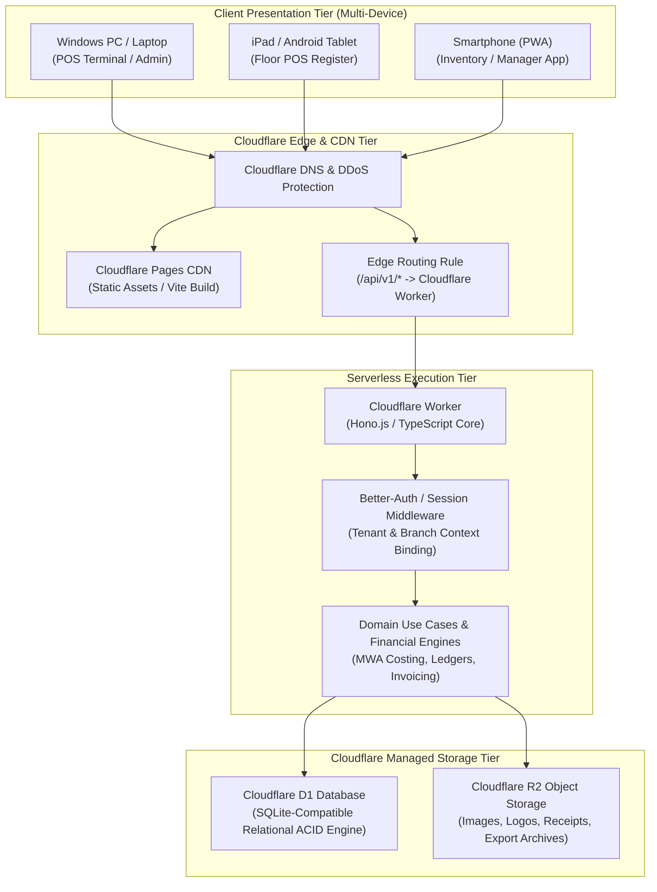
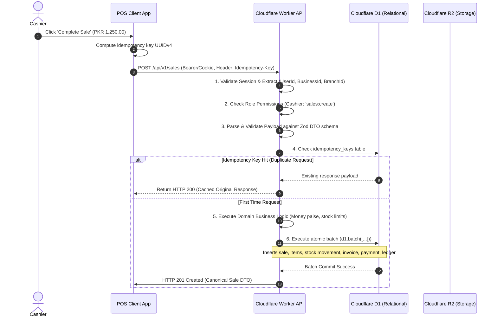

# Backend Architecture & Cloudflare Integration Blueprint

## Document Overview
- **Document ID**: `ARCH-SPEC-11.8-01`
- **Status**: Production Blueprint / Step 11.8 Architecture Finalization
- **Target Platform**: Cloudflare Serverless Architecture (Pages, Workers, D1, R2)
- **Domain**: Multi-Tenant, Multi-Device Point of Sale (POS) Engine
- **Audience**: Principal Architects, Cloudflare Engineers, Security Auditors, DevOps

---

## 1. System Context & Cloudflare Ecosystem Architecture

The Northstar POS platform transitions from a client-only browser demo to an enterprise-grade, edge-computed, serverless architecture running entirely on Cloudflare's global network.



### 1.1 Cloudflare Component Responsibilities

| Component | Technology | Primary Responsibility | Boundary Rules |
| :--- | :--- | :--- | :--- |
| **Hosting Tier** | Cloudflare Pages | Serves React + Vite PWA static bundles, assets, icons, and client routes. | Immutable asset caching (`Cache-Control: public, max-age=31536000, immutable`). Serves `index.html` with `no-cache`. |
| **API Compute Tier** | Cloudflare Workers | Request routing, auth validation, tenant isolation, atomic transaction orchestration. | Zero long-running server state. Stateless CPU execution. Max duration per request conforms to Workers standard limits. |
| **Relational Database** | Cloudflare D1 | Primary transactional datastore (SQLite dialect) storing entities, ledger records, audit logs. | Accessed **exclusively** via Worker D1 binding (`env.DB`). No public external port or direct client connection. |
| **Object Storage** | Cloudflare R2 | Unstructured file storage: product images, receipt PDFs, database snapshot exports. | Private by default. Client access handled via temporary presigned URLs or authenticated Worker streaming proxies. |
| **Client Offline Store** | IndexedDB (Dexie) | Local device cache for offline catalog browsing, queueing offline transactions, and local receipt printer drivers. | Syncs with Worker APIs via idempotent command replay protocol. |

---

## 2. Request Lifecycle & Routing Architecture

### 2.1 Same-Origin Routing Strategy
To eliminate cross-origin resource sharing (CORS) complexity, preflight latency (`OPTIONS` overhead), and third-party cookie restrictions, the production environment serves both frontend and API from a unified domain:
- **Frontend SPA**: `https://pos.northstarmarket.pk/*`
- **Worker API**: `https://pos.northstarmarket.pk/api/v1/*`

This is accomplished via Cloudflare Dashboard / `wrangler.toml` route triggers:
```toml
# Production route binding
routes = [
  { pattern = "pos.northstarmarket.pk/api/v1/*", zone_name = "northstarmarket.pk" }
]
```

### 2.2 End-to-End Request Flow Sequence



---

## 3. Multi-Environment Topology

The system maintains three completely isolated environments with dedicated Cloudflare resources:

| Feature | Local Development (`dev`) | Staging (`staging`) | Production (`prod`) |
| :--- | :--- | :--- | :--- |
| **API Base URL** | `http://localhost:8787/api/v1` | `https://staging-api.northstarmarket.pk/api/v1` | `https://pos.northstarmarket.pk/api/v1` |
| **Frontend URL** | `http://localhost:5173` | `https://staging-pos.northstarmarket.pk` | `https://pos.northstarmarket.pk` |
| **Compute Engine**| Miniflare / Wrangler local | Cloudflare Workers (Staging) | Cloudflare Workers (Production) |
| **D1 Database** | Local SQLite `.wrangler/state` | D1 Instance: `pos-db-staging` | D1 Instance: `pos-db-prod` |
| **R2 Storage** | Local filesystem mock | R2 Bucket: `pos-files-staging` | R2 Bucket: `pos-files-prod` |
| **Auth Mode** | Mock session or test tokens | Full Auth / Test accounts | Production Auth with 2FA / SSO |
| **Data Scope** | Synthetic mock fixtures | Sanitized staging dataset | Live business transactions |

---

## 4. Architectural Invariants & Non-Negotiables

1. **Zero Database Access from Browser**: The client never communicates with D1 directly; all mutations traverse the Worker domain layer.
2. **Integer Monetary Storage**: All money in D1 and API DTOs is represented in 64-bit signed integer minor units (paise, PKR 1 = 100 paise). Floating-point currencies are prohibited.
3. **Multi-Tenant Scoping**: Every D1 table except global system tables carries `business_id` and, where applicable, `branch_id`. Queries must include tenant predicates.
4. **Centralized Timezone Authority**: Business days (`business_date_key`) are computed based on `Asia/Karachi` (`UTC+05:00`), protecting shifts from client clock skew.
5. **Idempotent Mutations**: All mutating operations (checkout, receiving, payments, adjustments) require client-generated idempotency keys.

