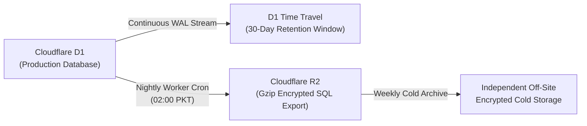

# Backup, Disaster Recovery & Business Continuity Runbook

## Document Overview
- **Document ID**: `BCP-SPEC-11.8-11`
- **Status**: Production Operational Runbook / Step 11.8
- **Core Technologies**: Cloudflare D1 Time Travel, Cloudflare R2 Export Archives, Off-Site Storage
- **Audience**: Site Reliability Engineers, Database Administrators, Store Owner

---

## 1. Recovery Objectives & Backup Matrix

| Metric | Target Objective | Technology Mechanism | Operational Impact |
| :--- | :--- | :--- | :--- |
| **Recovery Point Objective (RPO)** | **$\le 15$ Minutes** | Cloudflare D1 Time Travel continuous WAL replication. | Minimal lost transaction data in an outage. |
| **Recovery Time Objective (RTO)** | **$\le 30$ Minutes** | Point-in-time database snapshot restoration. | Fast restoration of cash register operations. |
| **Secondary RPO (Cold Disaster)** | **$\le 24$ Hours** | Daily automated encrypted logical SQL export in R2. | Complete protection against Cloudflare account lock or catastrophic corruption. |

---

## 2. Multi-Tiered Backup Architecture



### 2.1 Tier 1: Continuous D1 Time Travel
Cloudflare D1 natively tracks every committed mutation in its transaction log:
- **Retention**: Up to 30 days on Workers Paid tier.
- **Use Case**: Immediate rollback of accidental bulk deletion, failed schema migration, or cashier database corruption.
- **Critical Caution**: `wrangler d1 time-travel restore` **overwrites the entire database**. It cannot selectively restore single rows.

### 2.2 Tier 2: Daily Logical SQL Dumps (Automated Cron)
A scheduled Worker cron job (`cron = "0 21 * * *"`, 02:00 AM Pakistan Time) triggers a full SQL logical export:
1. Generates `pos_prod_dump_YYYYMMDD.sql`.
2. Encrypts archive using AES-256-GCM.
3. Uploads archive to private R2 bucket (`system-backups/d1-logical-exports/`).
4. Retention policy: Retains 90 daily snapshots, then auto-prunes.

### 2.3 Tier 3: Off-Site Weekly Cold Copy
Every Sunday, an encrypted copy of the weekly export is mirrored to independent off-site storage to protect against catastrophic account compromise.

---

## 3. Step-by-Step Disaster Recovery Procedures

### 3.1 Scenario A: Accidental Data Corruption or Bad Migration (Time Travel)
**Trigger**: A buggy migration or unauthorized bulk query corrupts product or customer records.

```bash
# 1. Immediately switch Worker to maintenance mode
npx wrangler secret put MAINTENANCE_MODE --text="true"

# 2. Inspect available Time Travel bookmarks
npx wrangler d1 time-travel info pos-db-prod

# 3. Restore to safe timestamp (e.g. 10 minutes prior to event)
npx wrangler d1 time-travel restore pos-db-prod --timestamp="2026-11-08T12:00:00Z"

# 4. Verify database health and record counts
npx wrangler d1 execute pos-db-prod --command="SELECT count(*) FROM sales;"

# 5. Disable maintenance mode
npx wrangler secret put MAINTENANCE_MODE --text="false"
```

### 3.2 Scenario B: Catastrophic D1 Loss (Cold Restore from R2)
**Trigger**: Complete database corruption where Time Travel is unavailable.

```bash
# 1. Download latest encrypted SQL export from R2
aws s3 cp s3://r2-pos-files-prod/system-backups/d1-logical-exports/backup_latest.sql.gz ./latest.sql.gz --endpoint-url https://<account_id>.r2.cloudflarestorage.com

# 2. Decompress and inspect SQL dump
gunzip latest.sql.gz

# 3. Create clean replacement D1 database
npx wrangler d1 create pos-db-recovered

# 4. Ingest SQL dump into recovered database
npx wrangler d1 execute pos-db-recovered --file="./latest.sql"

# 5. Update wrangler.toml D1 binding ID to recovered database
# 6. Deploy Worker with new binding
npx wrangler deploy
```

---

## 4. Post-Restore Financial & Inventory Integrity Audit

Before resuming active retail checkout:
1. **Ledger Equation Audit**:
   $$\sum \text{Customer Debits} - \sum \text{Customer Credits} \equiv \sum \text{Customer Balances}$$
2. **Stock Valuation Audit**: Compare inventory valuations before and after restoration to detect any unrecorded in-flight sales.
3. **Store Manager Sign-Off**: The store manager must inspect cash drawer totals against the restored system balance before reopening registers.

