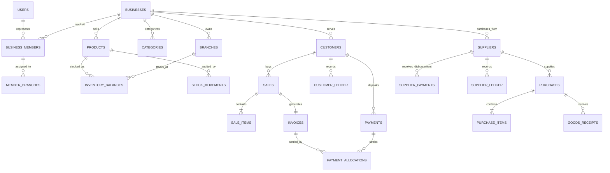

# Cloudflare D1 Relational Schema Design & Architecture

## Document Overview
- **Document ID**: `D1-SPEC-11.8-02`
- **Status**: Production Schema Specification / Step 11.8
- **Engine**: Cloudflare D1 (SQLite 3 Dialect with ACID Batch Guarantees)
- **Monetary Unit**: Minor Currency Units (Paise - INTEGER, 1 PKR = 100 paise)
- **Audience**: Database Administrators, Backend Engineers, Security Architects

---

## 1. Relational Entity Structure Overview

The schema is organized into 9 logical domains totaling 28 normalized tables:



---

## 2. Multi-Tenant & Branch Isolation Design

### 2.1 Multi-Tenancy Principles
1. **Tenant Boundary Guarantee**: Every business-scoped record carries an indexed `business_id TEXT NOT NULL REFERENCES businesses(id)`.
2. **Branch Scoping**:
   - **Business-Wide Entities**: `categories`, `products`, `customers`, `suppliers`, `business_settings`. (Shared across all branches of the business to prevent duplicate product cataloging and fragmented customer accounts).
   - **Branch-Specific Entities**: `sales`, `invoices`, `payments`, `purchases`, `goods_receipts`, `inventory_balances`, `stock_movements`, `stock_counts`, `expenses`, `device_registrations`.
3. **Foreign Key Integrity**:
   - Foreign key relationships incorporate `business_id` to guarantee records cannot cross business boundaries:
     ```sql
     FOREIGN KEY (business_id, branch_id) REFERENCES branches(business_id, id)
     ```
4. **Initial Deployment Topology**: Single business (`business-default`) with a single branch (`branch-main`). The schema is natively architected for multi-branch without requiring structural migrations later.

---

## 3. Entity Specifications by Domain

### 3.1 Business, Identity & RBAC
- **`businesses`**: Root tenant container. Stores legal entity details, NTN tax numbers, base currency (`PKR`).
- **`branches`**: Physical outlets, stores, or warehouses.
- **`users`**: Global authentication accounts managed by Better-Auth (email, hashed password, phone, profile).
- **`business_members`**: Binds a `user_id` to a `business_id` with a specific operational role (`owner`, `admin`, `manager`, `cashier`, `accountant`, `inventory_manager`).
- **`member_branches`**: Maps which physical branches a member has authorization to operate within.
- **`business_settings`**: Key-value JSON store for store-specific configurations (receipt templates, tax percentage, negative inventory policy).

### 3.2 Product Catalog & Inventory
- **`categories`**: Product taxonomy hierarchy.
- **`products`**: Sellable items with `sku`, `barcode`, `unit` (`piece`, `kg`, etc.), `selling_price_minor`, `purchase_price_minor` (current moving average unit cost in paise), `track_inventory`.
- **`inventory_balances`**: Physical stock levels partitioned by `(business_id, branch_id, product_id)`. Tracks `quantity_on_hand`, `quarantine_quantity`, `allocated_quantity`.
- **`stock_movements`**: Immutable append-only transaction ledger for every physical item delta (`opening_stock`, `sale`, `purchase_receipt`, `adjustment_in`, `adjustment_out`, `stock_count_adjustment`, `return_restock`, `return_damaged`, `return_discard`).
- **`stock_adjustments`**: Header record for shrinkage, breakage, or manual stock corrections.
- **`stock_counts` & `stock_count_items`**: Physical stocktake audit sheets with system quantity, physical counted quantity, and variance.

### 3.3 Customers & Receivables Ledger
- **`customers`**: Customer master profiles with phone, NTN, `opening_balance_minor`, `credit_limit_minor`.
- **`customer_ledger_transactions`**: Double-entry subledger recording every debit (invoice) and credit (payment/return), running balance, and `business_date_key`.
- **`payments`**: Header record for incoming customer cash/bank payments, storing `amount_minor`, `unallocated_amount_minor`, and cashier ID.
- **`payment_methods`**: Payment method breakdown (`cash`, `card`, `bank_transfer`, `digital_wallet`).
- **`payment_allocations`**: Sinks payment amounts against specific sales invoices.

### 3.4 Suppliers & Payables Ledger
- **`suppliers`**: Vendor master profiles with contact information and `opening_payable_minor`.
- **`supplier_products`**: Vendor SKU mapping and negotiated purchase cost.
- **`supplier_ledger_transactions`**: Double-entry subledger recording bills (credits) and disbursements (debits).
- **`supplier_payments` & `supplier_payment_allocations`**: Outgoing payments settling purchase orders or held as supplier advances.

### 3.5 Sales, Invoicing & Returns
- **`sales`**: Finalized checkout transactions with cashier snapshot, customer snapshot, subtotal, discount, tax, total, paid, and change returned (all in paise).
- **`sale_items`**: Line items containing historical price and cost snapshots (`unit_price_minor`, `unit_cost_minor`, `discount_minor`, `tax_minor`, `line_total_minor`, `returned_quantity`).
- **`invoices`**: Legal billing document linked 1:1 to sales.
- **`sale_returns` & `sale_return_items`**: Reverse logistics tickets referencing original sales, tracking stock disposition (`restock` vs `damaged` vs `discard`) and refund method.

### 3.6 Purchases & Receiving
- **`purchases`**: Purchase orders issued to suppliers.
- **`purchase_items`**: PO line items tracking ordered and received quantities.
- **`goods_receipts` & `goods_receipt_items`**: Physical arrival records triggering stock increment and moving weighted average cost recalculation.

### 3.7 Expenses, Audit & System Controls
- **`expense_categories` & `expenses`**: Operating expenses (utilities, rent, salaries).
- **`audit_logs`**: System-wide security and mutation audit trail.
- **`idempotency_keys`**: Prevents double-submitting critical mutations.
- **`device_registrations`**: Enrolls physical POS hardware (terminals, receipt printers) with authorized device keys.

---

## 4. Financial & Integrity Constraints

1. **Monetary Precision**: Stored strictly as signed 64-bit `INTEGER` minor units (paise). `REAL` is disallowed for currency.
2. **Non-Negative Constraints**:
   - `selling_price_minor >= 0`
   - `purchase_price_minor >= 0`
   - `subtotal_minor >= 0`
   - `discount_minor >= 0`
   - `total_amount_minor >= 0`
   - `amount_paid_minor >= 0`
3. **Uniqueness Constraints**:
   - `UNIQUE(business_id, sku)`
   - `UNIQUE(business_id, barcode)` WHERE barcode IS NOT NULL
   - `UNIQUE(business_id, receipt_number)`
   - `UNIQUE(business_id, invoice_number)`
   - `UNIQUE(business_id, purchase_number)`
   - `UNIQUE(business_id, operation, idempotency_key)`
4. **Historical Snapshots**: Transaction line items copy product title, SKU, unit, and unit price/cost at the exact moment of creation to guarantee past invoices never change when master products are updated.

---

## 5. High-Performance Indexing Strategy

| Index Name | Target Table | Columns | Optimized Query Pattern |
| :--- | :--- | :--- | :--- |
| `idx_sales_biz_branch_date` | `sales` | `(business_id, branch_id, business_date_key)` | Daily sales reports, shift summaries |
| `idx_sales_customer` | `sales` | `(business_id, customer_id, created_at)` | Customer purchase history |
| `idx_invoices_lookup` | `invoices` | `(business_id, invoice_number)` | POS receipt search, reprint lookup |
| `idx_products_sku` | `products` | `(business_id, sku)` | Barcode / SKU scanner lookups at POS |
| `idx_products_category` | `products` | `(business_id, category_id)` | POS catalog grid navigation |
| `idx_stock_mov_product_date`| `stock_movements` | `(business_id, product_id, business_date_key)` | Inventory ledger / audit trail |
| `idx_cust_ledger_history` | `customer_ledger_transactions` | `(business_id, customer_id, business_date_key)` | Customer ledger statement generation |
| `idx_supp_ledger_history` | `supplier_ledger_transactions` | `(business_id, supplier_id, business_date_key)` | Supplier account statement generation |
| `idx_idempotency_lookup` | `idempotency_keys` | `(business_id, operation, idempotency_key)` | Duplicate mutation prevention at edge |

