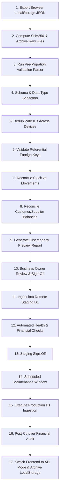

# Client Data Migration & Production Cutover Strategy

## Document Overview
- **Document ID**: `MIG-SPEC-11.8-09`
- **Status**: Production Migration Specification / Step 11.8
- **Scope**: Transition from Browser LocalStorage / In-Memory Mock Data to Cloudflare D1
- **Audience**: Data Engineers, Technical Architects, Store Proprietor

---

## 1. Current State Data Classification & Inventory

The audit identified that current application data is fragmented across static code fixtures and browser `localStorage` keys:

| Data Category | Current Source / Storage Key | Canonical D1 Destination | Migration Treatment |
| :--- | :--- | :--- | :--- |
| **Catalog Masters** | `src/features/products/data/productMockData.ts` | `products` | Baseline seed dataset. Convert prices to integer paise (`selling_price_minor`, `purchase_price_minor`). |
| **Category Taxonomy** | `src/features/categories/data/categoryMockData.ts`| `categories` | Baseline seed dataset. Generate stable slug and parent hierarchy. |
| **Customer Profiles** | `src/features/customers/data/customerMockData.ts`| `customers` | Validate phone/email. Extract `openingBalance` into `opening_balance_minor`. |
| **Supplier Profiles** | `src/features/suppliers/data/supplierMockData.ts`| `suppliers` | Extract `openingPayable` into `opening_payable_minor`. |
| **Stock Balances** | `localStorage['northstar.inventory-balances.v1']` | `inventory_balances` | Snapshot per product for `branch-main`. Validate against stock movements. |
| **Stock Movements** | `localStorage['northstar.inventory-movements.v1']`| `stock_movements` | Ingest movement history. Map movement types to canonical enum. |
| **Sales & Receipts** | In-memory demo sales / local mock | `sales`, `sale_items`, `invoices`| **Do not import demo transactions as live sales**. Seed fresh or import only verified real sales records. |
| **Customer Ledgers** | Derived in-memory from mock payments | `customer_ledger_transactions` | Initialize initial ledger entry for opening balance; record genuine payment events. |

---

## 2. 17-Step Safe Migration & Cutover Protocol

To prevent corrupted financial balances, orphaned transactions, or double-counted inventory:



### 2.1 Critical Safety Rules
1. **Never Merge Multi-Device LocalStorages Blindly**: If two store tablets ran the frontend offline with identical mock IDs, their transactions must be segregated and re-keyed with distinct UUIDs to prevent primary key collisions.
2. **Never Treat Sample Demo Fixtures as Genuine Debt**: Synthetic customers generated for UI demo (e.g. fictitious test debts) must be purged or excluded unless explicitly certified by the store owner as genuine receivables.
3. **Preserve Original Raw Exports**: Raw browser JSON exports must be archived in Cloudflare R2 (`backups/legacy-exports/`) with SHA-256 hashes prior to any data transformation.
4. **Zero Tolerance for Unexplained Ledger Drift**:
   $$\Delta \text{Balance} = |\text{Source Balance} - \text{Imported Ledger Balance}| \equiv 0$$
   Any non-zero discrepancy halts the cutover immediately.

---

## 3. Data Reconciliation Report Template

During Step 12 execution, the migration tool must generate this audit verification table:

```text
================================================================================
NORTHSTAR POS — PRE-CUTOVER DATA RECONCILIATION REPORT
Date: [YYYY-MM-DD HH:MM:SS]
Source Devices: [Device01, Device02]
Target Database: pos-db-prod (D1)
================================================================================

1. ENTITY RECORD COUNTS:
   - Categories:          Source: 8       Imported: 8       Rejected: 0
   - Products:            Source: 386     Imported: 386     Rejected: 0
   - Customers:           Source: 25      Imported: 25      Rejected: 0
   - Suppliers:           Source: 12      Imported: 12      Rejected: 0
   - Inventory Balances:  Source: 386     Imported: 386     Rejected: 0
   - Stock Movements:     Source: 142     Imported: 142     Rejected: 0

2. FINANCIAL RECONCILIATION:
   - Total Customer Opening Receivables:  Source: PKR 186,400.00  D1: PKR 186,400.00  (Diff: 0.00)
   - Total Supplier Opening Payables:     Source: PKR 245,000.00  D1: PKR 245,000.00  (Diff: 0.00)
   - Total Inventory Valuation (MWA):     Source: PKR 1,842,500.00 D1: PKR 1,842,500.00 (Diff: 0.00)

3. INTEGRITY & ORPHAN CHECKS:
   - Orphaned Stock Movements: 0
   - Missing Product References: 0
   - Duplicate SKUs: 0
   - Duplicate Barcodes: 0

VERDICT: PASS — APPROVED FOR PRODUCTION CUTOVER
================================================================================
```

