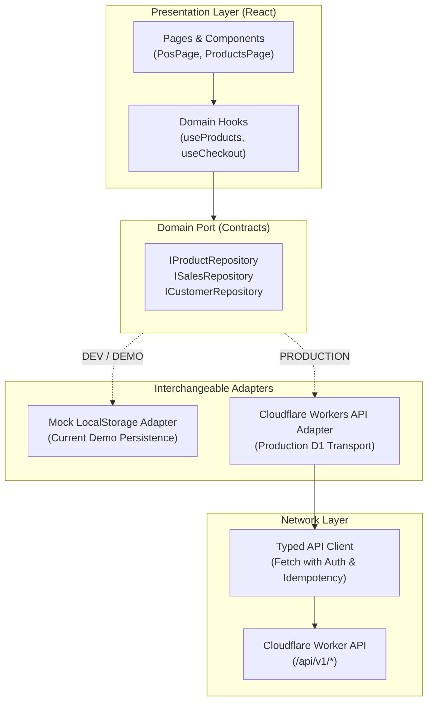

# Frontend API Integration Design & Repository Adapter Architecture

## Document Overview
- **Document ID**: `INT-SPEC-11.8-08`
- **Status**: Production Integration Specification / Step 11.8
- **Design Pattern**: Hexagonal Ports and Adapters
- **Audience**: Frontend Leads, React Developers, Quality Assurance Engineers

---

## 1. Architectural Decoupling: The Dual-Adapter Pattern

To guarantee that existing frontend screens, forms, and mock demonstrations continue working seamlessly while preparing for the Cloudflare API, data access is decoupled behind abstract repository interfaces:



### 1.1 Invariant: UI Components Never Depend on HTTP
- React components **never** call `fetch` or Axios directly.
- React components **never** know whether data originates from `localStorage` or Cloudflare D1.
- All monetary conversions (integer minor units in API $\longleftrightarrow$ major display values in UI) occur strictly inside the API repository adapter.

---

## 2. Server State vs Client State Separation

### 2.1 TanStack Query (Server State Authority)
All entity data residing in Cloudflare D1 is managed exclusively via **TanStack Query (v5)**:
- Products, Categories, Suppliers, Customers.
- Sales, Invoices, Payments, Purchases.
- Inventory Balances, Stock Movements, Reports.

### 2.2 Zustand (Transient Client UI State Only)
Zustand is strictly restricted to ephemeral, browser-local UI state:
- Active POS cart lines (`currentCartLines`).
- Active cashier scanner mode / drawer toggles.
- Filter and sorting bar selections.
- Modal open/close visibility states.

> [!IMPORTANT]
> **Zero Duplication Rule**: Server entities (e.g. `Product[]`, `Customer[]`) must **never** be cached or stored in Zustand stores. TanStack Query is the single source of truth for all remote server state.

---

## 3. Query Key Conventions & Cache Invalidation

Query keys follow a standardized factory pattern to ensure predictable cache invalidation:

```typescript
export const queryKeys = {
  products: {
    all: ['products'] as const,
    lists: () => [...queryKeys.products.all, 'list'] as const,
    list: (filter: Record<string, unknown>) => [...queryKeys.products.lists(), filter] as const,
    detail: (id: string) => [...queryKeys.products.all, 'detail', id] as const,
  },
  sales: {
    all: ['sales'] as const,
    lists: () => [...queryKeys.sales.all, 'list'] as const,
    list: (filter: Record<string, unknown>) => [...queryKeys.sales.lists(), filter] as const,
    detail: (id: string) => [...queryKeys.sales.all, 'detail', id] as const,
  },
  inventory: {
    all: ['inventory'] as const,
    balances: () => [...queryKeys.inventory.all, 'balances'] as const,
    movements: (filter: Record<string, unknown>) => [...queryKeys.inventory.all, 'movements', filter] as const,
  },
  customers: {
    all: ['customers'] as const,
    ledger: (id: string) => [...queryKeys.customers.all, 'ledger', id] as const,
    balances: () => [...queryKeys.customers.all, 'balances'] as const,
  },
}
```

### 3.1 Mutation Invalidation Matrix

| User Action / Mutation | Mutating API Endpoint | Invalidated TanStack Query Keys |
| :--- | :--- | :--- |
| **Complete POS Sale** | `POST /api/v1/sales` | `['sales']`, `['products']`, `['inventory']`, `['customers', 'ledger']`, `['reports']` |
| **Receive Goods (PO)**| `POST /api/v1/purchases/:id/receipts` | `['purchases']`, `['products']`, `['inventory']`, `['suppliers', 'ledger']` |
| **Customer Payment** | `POST /api/v1/payments` | `['payments']`, `['customers']`, `['invoices']`, `['reports']` |
| **Supplier Payment** | `POST /api/v1/supplier-payments` | `['supplier-payments']`, `['suppliers']`, `['purchases']` |
| **Stock Adjustment** | `POST /api/v1/stock-adjustments` | `['inventory']`, `['products']`, `['reports']` |
| **Sale Return** | `POST /api/v1/sales/:id/returns` | `['sales']`, `['inventory']`, `['customers', 'ledger']`, `['reports']` |

---

## 4. Environment-Driven Adapter Switching Strategy

In Step 12, the application provider will inject repository implementations based on Vite environment variables:

```typescript
// src/app/providers/RepositoryProvider.tsx
const dataSource = import.meta.env.VITE_DATA_SOURCE || 'mock'

export const repositories = {
  product: dataSource === 'api' ? new ApiProductRepository() : new MockProductRepository(),
  sales: dataSource === 'api' ? new ApiSalesRepository() : new MockSalesRepository(),
  customer: dataSource === 'api' ? new ApiCustomerRepository() : new MockCustomerRepository(),
  supplier: dataSource === 'api' ? new ApiSupplierRepository() : new MockSupplierRepository(),
  inventory: dataSource === 'api' ? new ApiInventoryRepository() : new MockInventoryRepository(),
}
```
This guarantees that local development and browser testing can toggle between mock data and the live Cloudflare Worker API with a single environment flag, avoiding any breaking changes to current workflows.

