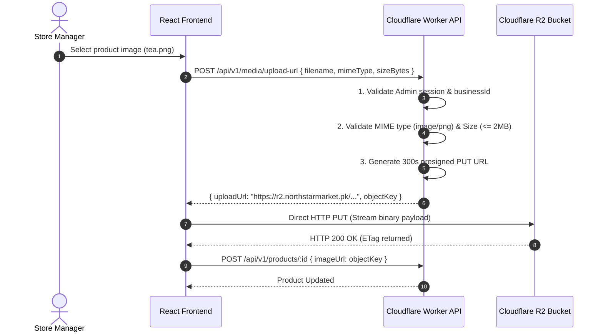

# Cloudflare R2 Object Storage Architecture & Media Security

## Document Overview
- **Document ID**: `R2-SPEC-11.8-10`
- **Status**: Production Storage Architecture Specification / Step 11.8
- **Technology**: Cloudflare R2 (S3-Compatible Zero-Egress Storage)
- **Audience**: Storage Architects, Security Engineers, Backend Developers

---

## 1. Storage Topology & Multi-Tenant Bucket Layout

To guarantee complete tenant isolation, all unstructured assets are partitioned by `business_id` inside private R2 buckets:

```text
r2-pos-files-prod/
│
├── businesses/{businessId}/
│   ├── branding/
│   │   ├── logo.webp                       # Business logo (receipts & app bar)
│   │   └── favicon.png
│   │
│   ├── products/{productId}/
│   │   ├── original.webp                   # Master product photo (max 2MB)
│   │   └── thumbnail.webp                  # POS grid optimized thumbnail (128x128)
│   │
│   ├── invoices/{invoiceNumber}/
│   │   └── receipt.pdf                     # Archived printable legal invoice PDF
│   │
│   └── documents/
│       ├── supplier-bills/{purchaseId}.pdf # Attached vendor paper invoice
│       └── tax-records/{fiscalYear}.pdf
│
└── system-backups/
    ├── d1-logical-exports/{businessId}/
    │   └── backup_{YYYYMMDD_HHMMSS}.sql.gz # Encrypted logical SQL dump
    └── manifest.json
```

---

## 2. Security Boundaries & Authorization Model

### 2.1 Private-by-Default Bucket Policy
- **No Public Read Access**: Direct public access to the R2 bucket (`pub-*.r2.dev`) is **strictly disabled**.
- **Worker Gateway**: All requests for files must be validated against the caller's session permissions.

### 2.2 Presigned URL Workflow for File Uploads
To prevent file uploads from tying up Worker execution CPU, uploads bypass the Worker process using time-limited S3 Presigned URLs:



### 2.3 Upload Validation Parameters

| File Category | Permitted MIME Types | Max File Size | Presigned TTL | Access Rule |
| :--- | :--- | :--- | :--- | :--- |
| **Product Image** | `image/webp`, `image/png`, `image/jpeg` | 2.0 MB | 5 Minutes (300s) | Authorized staff / Cashiers |
| **Store Logo** | `image/webp`, `image/png` | 1.0 MB | 5 Minutes (300s) | Store Manager / Owner |
| **Invoice / Receipt PDF**| `application/pdf` | 5.0 MB | 15 Minutes (900s) | Cashier / Customer with token |
| **Vendor Documents** | `application/pdf`, `image/jpeg` | 10.0 MB | 10 Minutes (600s) | Inventory Manager / Accountant |

---

## 3. Retention & Media Lifecycle Policies

1. **Product Soft-Deletion**: When a product is archived, its images are not immediately destroyed. They remain retained in R2 for 90 days to allow receipt printing and audit historical queries, after which an automated Worker cron cleans up unreferenced assets.
2. **Zero-Egress Cost Benefit**: Because Cloudflare R2 charges \$0 for outbound bandwidth (zero egress fees), media-rich product browsing on mobile POS devices incurs no variable network transfer costs.

