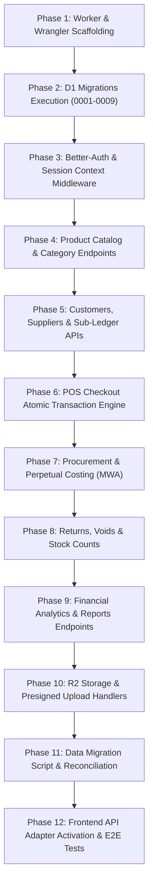

# Step 12 Backend Implementation Roadmap & Execution Sequence

## Document Overview
- **Document ID**: `ROD-SPEC-11.8-13`
- **Status**: Production Implementation Roadmap / Step 11.8
- **Target Phase**: Step 12 (Cloudflare Workers, D1, R2, Auth & Frontend Integration)
- **Audience**: Engineering Leads, Backend Developers, Project Managers

---

## 1. Master Phase Execution Flow

Step 12 transitions Northstar POS from design blueprints to working serverless infrastructure across 12 structured phases:

---

## 2. Phase-by-Phase Technical Specifications

### Phase 1: Worker & Wrangler Scaffolding
- Initialize Hono.js / TypeScript Cloudflare Worker project in `backend/` or `workers/`.
- Configure `wrangler.toml` with D1 (`DB`) and R2 (`MEDIA_BUCKET`) bindings.
- Validate local Miniflare runtime execution.

### Phase 2: D1 Migrations Execution
- Generate SQL migration scripts (`0001_business_and_auth.sql` through `0009_indexes_and_constraints.sql`) from [`d1-schema-draft.sql`](file:///c:/projects/pos-system/docs/backend-preparation/d1-schema-draft.sql).
- Apply migrations sequentially to local D1 emulator (`--local`).
- Verify table constraints and foreign-key integrity.

### Phase 3: Better-Auth & Session Context Middleware
- Initialize Better-Auth with Cloudflare D1 adapter.
- Implement session extraction, cookie validation, and `X-Business-Id` membership resolution.
- Enforce RBAC permission guard middleware.

### Phase 4: Product Catalog & Category Endpoints
- Implement `GET /api/v1/products` (with pagination, barcode/SKU search).
- Implement `POST /api/v1/products` and `PUT /api/v1/products/:id`.
- Ensure prices are accepted and returned in integer minor units (paise).

### Phase 5: Customers, Suppliers & Sub-Ledger APIs
- Implement Customer profile CRUD with opening balance initialization.
- Implement Supplier profile CRUD with opening payable initialization.
- Implement paginated subledger endpoints (`/api/v1/customers/:id/ledger`).

### Phase 6: POS Checkout Atomic Transaction Engine
- Implement `POST /api/v1/sales` using `d1.batch()`:
  - Idempotency key lookup.
  - Insert `sales` and `sale_items` with snapshot unit cost.
  - Decrement `inventory_balances.quantity_on_hand`.
  - Insert `stock_movements` (type: `sale`).
  - Insert `invoices`, `payments`, and `payment_allocations`.
  - Update `customer_ledger_transactions` if credit sale.

### Phase 7: Procurement & Perpetual Costing Engine
- Implement Purchase Order creation and confirmation.
- Implement Goods Receipt endpoint (`POST /api/v1/purchases/:id/receipts`):
  - Increment stock quantity.
  - Recalculate moving weighted average unit cost.
  - Post credit to `supplier_ledger_transactions`.

### Phase 8: Returns, Voids & Stock Adjustments
- Implement same-day sale void protocol with supervisor validation.
- Implement line-item sales returns with stock disposition (`restock` vs `damaged` vs `discard`).
- Implement physical stocktake confirmation and automatic variance adjustment generation.

### Phase 9: Financial Analytics & Reports Endpoints
- Implement sales summaries, cash drawer collections, aged receivables, aged payables.
- Implement gross profit reports using locked-in sale snapshot COGS.

### Phase 10: R2 Storage & Presigned Upload Handlers
- Implement `POST /api/v1/media/upload-url` generating 300s presigned S3 URLs.
- Implement media serving proxy with authentication checks.

### Phase 11: Data Migration Script & Reconciliation
- Execute migration utility to parse browser `localStorage` exports.
- Ingest master records and baseline balances into staging D1.
- Run automated reconciliation checks (zero ledger and inventory drift).

### Phase 12: Frontend API Adapter Activation & E2E Tests
- Activate `ApiProductRepository`, `ApiSalesRepository`, etc., via `VITE_DATA_SOURCE="api"`.
- Run comprehensive End-to-End Vitest and Playwright regression test suite.

---

## 3. Step 12 Quality Gates & Exit Criteria

Step 12 will be certified complete only when:
1. 100% of API endpoints pass automated integration test suites.
2. All financial balances (Customer Receivables, Supplier Payables, Stock Valuation) reconcile to zero discrepancy.
3. Concurrent checkout tests confirm that double-spending or race condition stock corruption is impossible.
4. The React frontend operates identically in both `mock` and `api` data source modes.

---

## 4. Final Certification Status: Step 12.8 Complete

- **Execution Date**: 2026-11-09
- **Status**: **VERIFIED LOCAL RELEASE CANDIDATE**
- **Test Baseline**: 40 test files, 308 tests passing (100% green).
- **TypeScript & Linter**: Zero blocking errors.
- **Documentation**: All 8 Step 12.8 runbooks and audit reports generated in `docs/backend-setup/`.

---

## 5. Step 13 Offline Architecture & Catalog Caching Status (Steps 13.1–13.3 Complete)

- **Execution Date**: 2026-11-09
- **Stage 13.1 (Architecture & Design)**: 100% Complete. 6 design specifications in `docs/offline/`.
- **Stage 13.2 (Dexie Database Foundation)**: 100% Complete. IndexedDB stores, synthetic device ID, storage manager, health check, scoped queries.
- **Stage 13.3 (Product & Category Offline Caching)**: 100% Complete. Paginated catalog sync engine, wholesale cost stripping, atomic candidate snapshot activation, network-first fallback services, offline status pill/banner UI, and Service Worker app shell caching.
- **Stage 13.4 (Outbox Foundation)**: 100% Complete. Outbox store in Dexie schema v2, strict registry blocking financial mutations.

---

## 6. Step 13.5 Multi-Device Synchronization & Conflict Handling Status (Complete)

- **Execution Date**: 2026-11-09
- **Status**: **VERIFIED COMPLETE**
- **Capabilities Delivered**:
  - Device Registration, Heartbeat, Scoped Listing, and Instant Access Revocation (`devices` table).
  - Server Change Feed (`sync_change_log`) recording atomic catalog and stock deltas with monotonic sequence ordering.
  - Zero Wholesale Cost Leakage: wholesale purchase costs are completely stripped from change log payloads and local client storage.
  - Optimistic Concurrency Control (Anti-LWW): Monotonic `version` tracking and `409 Conflict` detection for concurrent edits.
  - Cursor-based pull API (`GET /api/v1/sync/changes`, `POST /api/v1/sync/ack`).
  - Frontend Multi-Device Sync Engine (`SyncClient`, `SyncScheduler`, `isVersionConflict`, `BroadcastChannel`).
- **Test Baseline**: **48 test files, 347 tests passing (100% green)**.
- **Builds**: Worker (`npm run build:worker`) and Frontend (`npm run build`) compile with 0 errors.
- **Database Status**: Local D1 migrations up to date (`0012_sync_and_devices.sql` applied, 0 pending).

