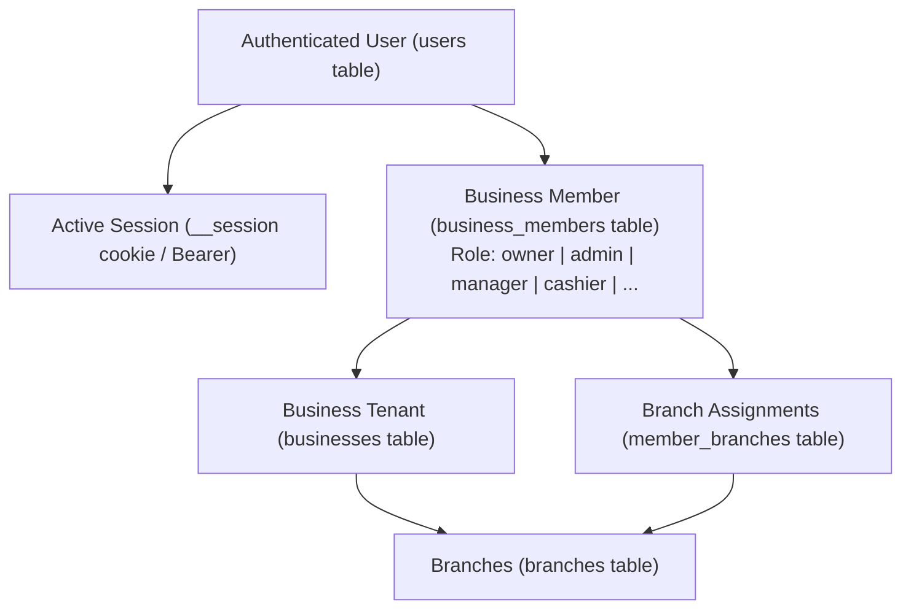

# Step 12.2: Business & Branch Multi-Tenant Isolation

## 1. Zero-Trust Invariant

The POS architecture adheres to a strict Zero-Trust principle:

> **Core Rule**: A client never dictates permissions, roles, business ownership, or branch assignments. The backend never trusts client-supplied identifiers without explicit database membership verification against the active session.

Passing arbitrary `user_id`, `role`, or tenant IDs in headers or request bodies cannot elevate privileges or access foreign tenant data.

---

## 2. Multi-Tenancy Hierarchy

---

## 3. Request Resolution Protocol

Every protected endpoint resolves tenant and branch context via the following pipeline:

### 3.1 Authentication Resolution (`requireAuth`)
1. Extract session token from `__session` cookie or `Authorization: Bearer <token>`.
2. Query `sessions` table joined with `users`.
3. Reject if session expired or user status is `inactive` or `banned`.
4. Attach `{ user, session }` to `ctx.auth`.

### 3.2 Business Context Resolution (`requireBusinessContext`)
1. Read incoming `X-Business-Id` header:
   - **Header Present**: Query `business_members` for `business_id = ? AND user_id = ? AND is_active = 1`. If not found, return `403 FORBIDDEN` (`Access to specified business is denied`).
   - **Header Omitted**:
     - Query all active business memberships for `ctx.auth.user.id`.
     - If user belongs to **exactly 1** business: auto-select that business.
     - If user belongs to **multiple** businesses: return `400 VALIDATION_ERROR` with message `"Multiple businesses accessible. Specify target business via X-Business-Id header."` and return the list of accessible businesses.
2. Attach verified business and user's role to `ctx.tenant`.

### 3.3 Branch Context Resolution (`requireBranchContext`)
1. Read incoming `X-Branch-Id` header:
   - Verify that the target branch belongs to `ctx.tenant.business.id` and has `status = 'active'`.
   - If role is `owner` or `admin`, grant access to all active branches within the business.
   - For store operator roles (`manager`, `cashier`, `inventory_manager`, `accountant`):
     - Query `member_branches` joined with `branches`.
     - If branch is not assigned to this member, return `403 FORBIDDEN` (`Access to specified branch is denied or branch does not belong to business`).
2. Attach verified branch to `ctx.branch`.

---

## 4. Role-Based Access Control (RBAC) Matrix

Permissions are enforced via `requirePermission(permissionName)` middleware before executing business logic:

| Operation / Capability | Permission Name | Owner | Admin | Manager | Cashier | Inv. Mgr | Accountant |
| :--- | :--- | :---: | :---: | :---: | :---: | :---: | :---: |
| Store Settings & Tax Rules | `manage_settings` | Yes | Limited | No | No | No | No |
| Staff Management & Invites | `manage_staff` | Yes | Yes | No | No | No | No |
| View Product Catalog | `catalog_read` | Yes | Yes | Yes | Yes | Yes | Yes |
| Create / Edit Products & Prices | `catalog_write` | Yes | Yes | Yes | No | Yes | No |
| Complete In-Store POS Sale | `pos_sale` | Yes | Yes | Yes | Yes | No | No |
| Collect Customer Payments | `collect_payments` | Yes | Yes | Yes | Yes | No | Yes |
| Manual Stock Adjustments | `stock_adjustment` | Yes | Yes | Yes | No | Yes | No |
| Confirm Physical Stocktake | `stocktake_confirm` | Yes | Yes | Yes | No | Yes | No |
| Issue Purchase Orders (PO) | `purchase_order` | Yes | Yes | Yes | No | Yes | No |
| Receive Goods Shipments | `receive_goods` | Yes | Yes | Yes | No | Yes | No |
| Disburse Supplier Payments | `disburse_payments` | Yes | Yes | Limited | No | No | Yes |
| Financial & Profit Reports | `reports_view` | Yes | Yes | Limited | No | No | Yes |
| Full Database Backup Export | `export_backup` | Yes | No | No | No | No | No |

---

## 5. Multi-Tenant Query Isolation Guarantee

All future business queries (Products, Sales, Invoices, Customers, Purchases) MUST filter by `business_id = ctx.tenant.business.id` and, where applicable, `branch_id = ctx.branch.id`.

A foreign tenant's database ID cannot be accessed because the `business_id` is supplied directly from the server-validated session context, never accepted from user input.

