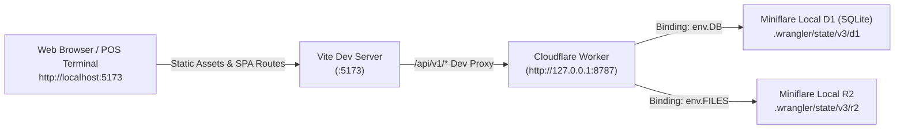

# Local Development Runbook — Cloudflare Workers, D1 & Frontend

## Document Overview
- **Document ID**: `SETUP-LOCAL-12.1-01`
- **Scope**: Step 12.1 Cloudflare Backend Local Foundation & Tooling
- **Engine**: Cloudflare Workers + Local Miniflare D1 & R2 + Vite Dev Proxy
- **Audience**: Full-Stack Developers, DevOps Engineers, QA Engineers

---

## 1. Prerequisites & Environment Requirements

| Requirement | Supported Version | Verified in Project |
| :--- | :--- | :--- |
| **Node.js** | `>= 20.0.0` (LTS recommended) | `v26.13.0` |
| **npm** | `>= 9.0.0` | `11.20.0` |
| **Cloudflare Wrangler**| `^4.158.0` | `4.158.0` (installed in `devDependencies`) |
| **Operating System** | Windows, macOS, Linux | Windows 11 (PowerShell) |

---

## 2. Architecture & Port Mapping

During local development, the frontend and backend run as coordinated companion processes:



- **Frontend Application Port**: `http://localhost:5173`
- **Cloudflare Worker API Port**: `http://127.0.0.1:8787`
- **Vite Proxy Route**: All requests to `http://localhost:5173/api/v1/*` automatically proxy to `http://127.0.0.1:8787/api/v1/*`.

---

## 3. Step-by-Step Local Setup

### 3.1 Install Dependencies
```bash
npm install
```

### 3.2 Initialize Local D1 Database Migrations
Run the versioned migrations (0001 through 0009) against the local D1 instance:
```bash
npm run db:migrate:local
```
Expected output:
```text
🌀 Executing on local database pos-system-local (...) from .wrangler\state\v3\d1:
🚣 9 migrations executed successfully.
```

Verify migration status:
```bash
npm run db:status:local
```
Expected output: `✅ No migrations to apply!`

---

## 4. Starting the Development Stack

### Terminal 1: Start the Backend Worker
```bash
npm run dev:worker
```
Starts Wrangler on `http://127.0.0.1:8787` with local D1 and R2 emulation.

### Terminal 2: Start the Frontend Application
```bash
npm run dev
```
Starts Vite on `http://localhost:5173`.

---

## 5. Verifying Health and Connectivity

You can test connectivity directly in a third terminal or web browser:

### 5.1 Worker Health Check (Direct)
```bash
curl http://127.0.0.1:8787/api/v1/health
```
Response:
```json
{
  "success": true,
  "data": {
    "status": "healthy",
    "service": "pos-system-api",
    "version": "v1"
  },
  "requestId": "..."
}
```

### 5.2 Worker Readiness Check (Database Heartbeat via `SELECT 1`)
```bash
curl http://127.0.0.1:8787/api/v1/ready
```
Response:
```json
{
  "success": true,
  "data": {
    "status": "ready",
    "database": "connected"
  },
  "requestId": "..."
}
```

### 5.3 Health Check via Frontend Proxy (End-to-End)
```bash
curl http://localhost:5173/api/v1/health
```
Confirms the Vite server proxy successfully forwards `/api/v1/*` to Wrangler.

---

## 6. Inspecting and Querying Local D1 Database

You can query the local SQLite database directly through Wrangler without external tools:

```bash
# List all tables created by migrations
npx wrangler d1 execute pos-system-local --local --command="SELECT name FROM sqlite_master WHERE type='table';"

# Check schema migrations table
npx wrangler d1 execute pos-system-local --local --command="SELECT * FROM d1_migrations;"

# Query products table
npx wrangler d1 execute pos-system-local --local --command="SELECT count(*) FROM products;"
```

---

## 7. How to Reset Local Test Data Safely

If you ever need to reset local development data to a pristine state:
1. Delete the local state folder:
   ```powershell
   Remove-Item -Recurse -Force .wrangler\state
   ```
2. Re-apply all migrations:
   ```bash
   npm run db:migrate:local
   ```
> [!CAUTION]
> This command only affects local `.wrangler` files on your workstation. It does not touch remote Cloudflare environments.

---

## 8. Preventing Accidental Remote Operations

- **Zero Cloudflare Login Requirement**: Local development never requires running `wrangler login` or connecting to a Cloudflare account.
- **Strict Prohibition on `--remote`**: Never run `npx wrangler ... --remote` during local development. All project scripts in `package.json` are explicitly locked to `--local`.
- **Secrets Isolation**: Secrets for local development are stored in `.dev.vars` (ignored by Git). Never commit real API secrets.

---

## 9. Troubleshooting Common Issues

| Symptom | Root Cause | Solution |
| :--- | :--- | :--- |
| `DATABASE_UNAVAILABLE` on `/api/v1/ready` | Migrations have not been applied to local D1. | Run `npm run db:migrate:local`. |
| Port 8787 already in use | Another Wrangler process is running in the background. | Kill the existing Node process or specify `--port 8788`. |
| `VITE_API_BASE_URL is not configured` | Missing `.env.local` or environment variable. | Ensure `.env.local` contains `VITE_API_BASE_URL=/api/v1`. |
| Vite proxy returns 504 / ECONNREFUSED | Worker is not running. | Start Worker in Terminal 1 using `npm run dev:worker`. |

