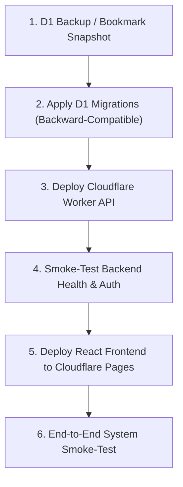

# Step 12.8 Deployment and Rollback Runbook

> [!WARNING]
> This runbook is a deployment preparation package. **DO NOT EXECUTE REMOTE DEPLOYMENT COMMANDS** without explicit written authorization from the system proprietor.

---

## 1. Release Preconditions & Checklist

Prior to staging or production cutover, ensure the following gates are satisfied:

1. [ ] **Automated Tests**: 100% green (`npm test` passes 40 test files, 308 tests).
2. [ ] **Worker Compilation**: Clean build (`npm run build:worker` passes with 0 errors).
3. [ ] **Frontend Production Build**: Clean build (`npm run build` passes with 0 errors).
4. [ ] **Linter Check**: Zero blocking errors (`npm run lint`).
5. [ ] **Cloudflare Subscription Tier**: Confirmed Workers Paid plan for PBKDF2 100k iteration support.
6. [ ] **Secrets Prepared**: Cryptographically secure `AUTH_SECRET` (minimum 32 random bytes).

---

## 2. Resource Provisioning Instructions (Execute in Order)

### 2.1 Staging Environment Provisioning
```bash
# 1. Create Staging D1 Database
wrangler d1 create pos-system-staging-d1
# Note: Record the database_id printed by wrangler and update wrangler.jsonc env.staging

# 2. Create Staging R2 Bucket
wrangler r2 bucket create pos-system-staging-files

# 3. Configure Staging Secrets
wrangler secret put AUTH_SECRET --env staging
# Paste random 32-character secret when prompted

# 4. Apply Database Migrations (0001 through 0011)
wrangler d1 migrations apply pos-system-staging-d1 --remote --env staging
```

### 2.2 Production Environment Provisioning
```bash
# 1. Create Production D1 Database
wrangler d1 create pos-system-prod-d1
# Note: Record the database_id printed by wrangler and update wrangler.jsonc env.production

# 2. Create Production R2 Bucket
wrangler r2 bucket create pos-system-prod-files

# 3. Configure Production Secrets
wrangler secret put AUTH_SECRET --env production

# 4. Apply Database Migrations
wrangler d1 migrations apply pos-system-prod-d1 --remote --env production
```

---

## 3. Deployment Execution Sequence



### Step 1: Pre-Deployment D1 Bookmark Snapshot
Record current database bookmark prior to any schema changes:
```bash
wrangler d1 time-travel info pos-system-prod-d1 --remote
```

### Step 2: Apply Migrations
```bash
wrangler d1 migrations apply pos-system-prod-d1 --remote --env production
```

### Step 3: Deploy Worker API
```bash
wrangler deploy --env production
```

### Step 4: Deploy Frontend to Cloudflare Pages
```bash
# Build frontend with live API configuration
npm run build
# Deploy to Cloudflare Pages (via GitHub Actions or wrangler pages)
wrangler pages deploy dist --project-name=pos-system-frontend
```

---

## 4. Post-Deployment Verification Smoke-Tests

Execute the following smoke-tests immediately after cutover:

1. **System Health Check**:
   ```bash
   curl -I https://api.yourdomain.pk/api/v1/health
   # Expected: HTTP 200 OK
   ```
2. **Owner Authentication**:
   - Access login screen; authenticate with owner credentials.
   - Verify active session cookie `__session` is received.
3. **Multi-Tenant Context**:
   - Verify business name and branch list populate accurately in header.
4. **Catalog Smoke-Test**:
   - Verify product listing loads with live inventory counts.
5. **POS Cash Sale Smoke-Test**:
   - Perform test cash sale of 1 unit of a test item.
   - Verify invoice displays and receipt prints.
   - Verify stock deducts by exactly 1 in inventory.
6. **Reports Smoke-Test**:
   - Verify Dashboard metrics reflect test sale.
7. **R2 File Upload Smoke-Test**:
   - Upload sample product image; verify thumbnail renders via `/api/v1/files/:id/content`.

---

## 5. Migration-Safe Rollback Protocol

> [!CRITICAL]
> **Worker Code Rollback Does Not Revert D1 Schema or Data**.
> Reverting Worker code to a previous version while D1 retains a newer schema will cause unexpected runtime SQL errors if database tables or columns are missing.

### 5.1 Backward-Compatible Migration Rules (Expand / Contract)
- **Always Expand First**: Never drop tables or remove columns in the same release as code changes.
- **New Columns**: Must be declared `NULL` or provide a valid `DEFAULT` value.
- **Preserve Compatibility**: Keep old columns active until all client and worker versions are migrated.

### 5.2 Rollback Scenarios
1. **Scenario A: Code Defect (Schema Unchanged)**:
   - Roll back Worker deployment immediately:
     ```bash
     wrangler rollback --env production
     ```
2. **Scenario B: Database Schema Incompatibility**:
   - **Forward-Fix Preferred**: Deploy a corrective forward-fix migration or hotfix release.
   - **Database Restoration**: If data corruption occurred, restore D1 to the pre-deployment Time Travel bookmark:
     ```bash
     wrangler d1 time-travel restore pos-system-prod-d1 --bookmark="<PRE_DEPLOY_BOOKMARK>" --remote
     ```
     Then roll back the Worker code:
     ```bash
     wrangler rollback --env production
     ```

