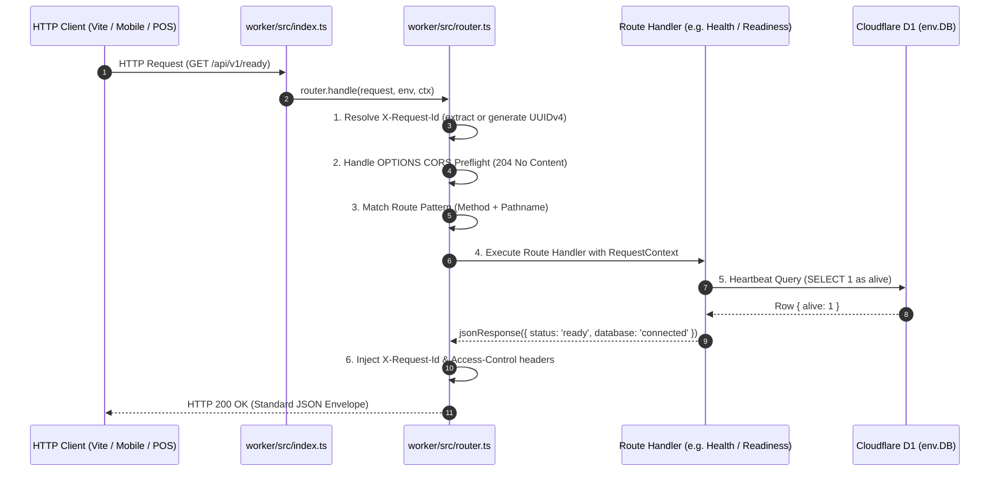

# Cloudflare Worker Technical Architecture & Execution Model

## Document Overview
- **Document ID**: `ARCH-WORKER-12.1-02`
- **Scope**: Step 12.1 Cloudflare Worker Architecture & Internal Structure
- **Target Runtime**: Cloudflare Workers (V8 Isolate Edge Runtime)
- **Audience**: Backend Developers, Software Architects, Security Engineers

---

## 1. Directory Structure

```text
worker/
├── migrations/
│   ├── 0001_businesses_and_branches.sql
│   ├── 0002_catalog.sql
│   ├── 0003_customers_and_suppliers.sql
│   ├── 0004_sales_and_invoices.sql
│   ├── 0005_payments_and_ledgers.sql
│   ├── 0006_purchases_and_goods_receipts.sql
│   ├── 0007_inventory_and_costing.sql
│   ├── 0008_expenses_and_audit_logs.sql
│   └── 0009_indexes_and_constraints.sql
│
├── src/
│   ├── index.ts                      # Worker entrypoint (export default { fetch })
│   ├── router.ts                     # Lightweight typed HTTP request router
│   │
│   ├── config/
│   │   └── environment.ts            # Environment extraction & defaults
│   │
│   ├── db/
│   │   ├── client.ts                 # Database connectivity & query helpers
│   │   └── types.ts                  # D1 health check & query interfaces
│   │
│   ├── lib/
│   │   ├── errors.ts                 # Standardized HttpError class & error codes
│   │   ├── response.ts               # JSON & error envelope response helpers
│   │   └── validation.ts             # Safe JSON payload validation helpers
│   │
│   ├── middleware/
│   │   └── requestId.ts              # Request correlation ID resolver (UUIDv4)
│   │
│   ├── routes/
│   │   └── health.routes.ts          # /api/v1/health & /api/v1/ready handlers
│   │
│   └── types/
│       └── environment.d.ts          # Env binding declarations (DB, FILES, vars)
│
└── wrangler.jsonc                    # Local Wrangler configuration
```

---

## 2. Request Pipeline & Lifecycle

Every incoming HTTP request processed by the Worker follows a strict middleware and routing pipeline:



---

## 3. Environment Bindings

Defined in [`worker/src/types/environment.d.ts`](file:///c:/projects/pos-system/worker/src/types/environment.d.ts):

| Binding Key | Type | Description |
| :--- | :--- | :--- |
| `DB` | `D1Database` | Primary SQLite-compatible relational database instance. |
| `FILES` | `R2Bucket` | S3-compatible object storage bucket for images and receipts. |
| `ENVIRONMENT` | `string` | Active environment flag (`local`, `staging`, `production`). |
| `TIMEZONE` | `string` | System timezone anchor (`Asia/Karachi`). |
| `SERVICE_NAME` | `string` | Service identifier string (`pos-system-api`). |
| `API_VERSION` | `string` | API release tag (`v1`). |

---

## 4. Response & Error Envelopes

All responses emitted by the Worker adhere to the standardized API contracts defined in Step 11.8:

### 4.1 Success Envelope
```json
{
  "success": true,
  "data": {
    "status": "healthy",
    "service": "pos-system-api",
    "version": "v1"
  },
  "requestId": "550e8400-e29b-41d4-a716-446655440000"
}
```

### 4.2 Error Envelope
```json
{
  "success": false,
  "error": {
    "code": "DATABASE_UNAVAILABLE",
    "message": "Database connectivity check failed."
  },
  "requestId": "550e8400-e29b-41d4-a716-446655440000"
}
```

### 4.3 Security & Information Leakage Invariant
Internal stack traces, SQLite database paths, SQL query texts, and environment secrets are **never** returned in HTTP error payloads. Unhandled errors log to the server console while returning a generic `INTERNAL_SERVER_ERROR` with a traceable `requestId`.

