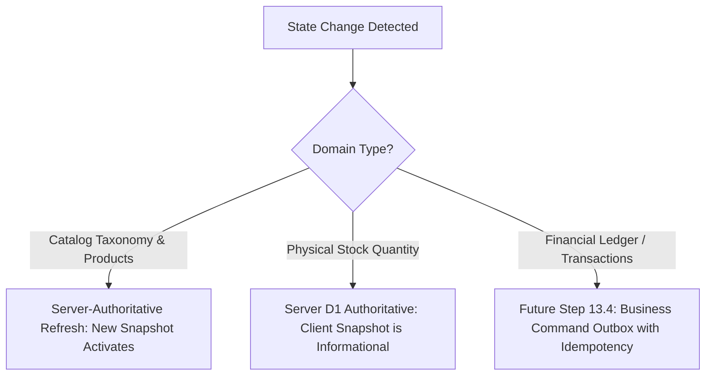

# Step 13.1 Conflict Resolution and Synchronization Policy

## 1. Conflict Domains and Authority Rules

In a distributed offline-capable POS system, conflicts arise across three distinct domains: catalog metadata, physical inventory, and financial accounting. Northstar POS rejects simplistic "last-write-wins" (LWW) resolution in favor of **domain-specific authoritative rules**.

---

## 2. Domain-Specific Resolution Policies

### 2.1 Catalog Master Data (Products & Categories)
- **Authority**: Central Server (Cloudflare D1).
- **Policy**: **Server Authority via Atomic Replacement**.
- **Mechanism**:
  - The server manages canonical product descriptions, SKUs, and prices.
  - When a device syncs, it downloads the latest complete catalog into a new snapshot.
  - If a product was updated or archived on the server, the new snapshot replaces the old snapshot locally.
  - Offline catalog modifications are **strictly disallowed**, preventing client-side catalog divergence.

### 2.2 Physical Stock Balances (Branch Inventory)
- **Authority**: Central Server (Cloudflare D1).
- **Policy**: **Informational Client Replica with Server-Side Validation**.
- **Mechanism**:
  - Cached stock quantities in Dexie (`cachedBranchStock`) represent the stock level **at the moment of the last sync**.
  - UI explicitly displays: *"Last known stock — synchronized at [date/time]. Informational only."*
  - The client **never** commits offline balance changes.
  - When the register goes online and executes a sale, the server verifies current real-time stock in D1 during the atomic transaction.

### 2.3 Financial Transactions (Sales, Invoices, Payments, Receipts)
- **Policy**: **Strict Anti-LWW Invariant**.
- **Rule**: Financial records must NEVER be merged, overwritten, or synchronized using generic client timestamps.
- **Future Outbox Specification (Step 13.4+)**:
  - Offline transactions will be encapsulated as immutable **Business Intent Commands** (e.g. `CreateSaleCommand`, `PostPaymentCommand`).
  - Each command will carry a unique client-generated UUID `Idempotency-Key`.
  - When reconnected, commands will be delivered in sequence to Cloudflare D1.
  - The server will execute each command through its atomic `d1.batch()` engine, validating stock and generating double-entry ledger entries.

---

## 3. Exceptional Conflict Scenarios

| Scenario | Conflict Type | Resolution Strategy |
| :--- | :--- | :--- |
| **Concurrent Product Price Change** | Head office changes price from PKR 500 to PKR 550 while a device is offline. | Device displays cached PKR 500 for browsing. In Steps 13.1–13.3, offline checkout is disabled, preventing price mismatch. On reconnect, catalog sync refreshes price to PKR 550. |
| **Duplicate Sale Submission** | Operator taps "Submit" repeatedly during intermittent network flap. | Frontend generates single `Idempotency-Key` UUID per cart ticket. Worker returns original HTTP 201 response with zero duplicate ledger or stock entries. |
| **Session Revocation Mid-Sync** | User's role or membership is revoked on the server while client is synchronizing. | API returns HTTP 401/403. Client rejects candidate snapshot, clears in-memory context, and redirects to login. |
| **Storage Quota Exceeded** | Browser storage quota reached during multi-page catalog sync. | Sync catches `QuotaExceededError`, prunes unactivated candidate snapshot records, and preserves existing active snapshot without corruption. |

