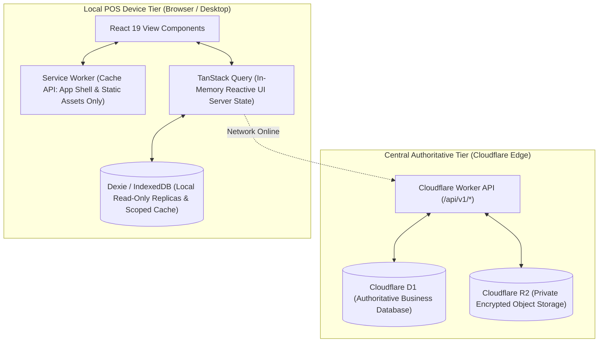

# Step 13.1 Offline-First Architecture Specification

## 1. System Overview & Core Philosophy

The Northstar POS offline architecture introduces high-reliability, edge-aligned offline resilience for retail operations in environments with intermittent connectivity (e.g. broadband drops, cellular instability, market outages in Pakistan).

### 1.1 Single Source of Truth Hierarchy

- **Cloudflare D1**: The **sole authoritative database** for all business data, inventory balances, financial ledgers, audit logs, and catalog definitions.
- **Dexie / IndexedDB**: A **local, partitioned, read-only cache** of approved catalog data, category trees, and informational branch stock snapshots. Dexie is **never** a secondary authoritative financial source.
- **Service Worker / Cache API**: Reserved exclusively for the **Application Shell** (HTML entry point, fingerprinted JS/CSS bundles, fonts, and SVG icons). The Service Worker Cache API **must never store API responses, customer records, transactions, or private media**.
- **TanStack Query**: In-memory reactive state manager. When online, it coordinates fresh network requests and writes snapshots to Dexie. When offline, it hydrates from Dexie with `isCached: true` and `isStale: true` metadata.

---

## 2. Layer Responsibilities & Boundaries

| Architecture Layer | Technology | Operational Responsibility | Prohibited Activities |
| :--- | :--- | :--- | :--- |
| **Central Authority** | Cloudflare D1 | Canonical sequence numbers, moving weighted average (MWA) costing, atomic ledger transactions, global unique constraints. | Never allows client-dictated inventory or ledger overwrites. |
| **API Gateway** | Cloudflare Workers | Edge authentication, CSRF checks, business/branch authorization, payload validation, idempotency caching. | Never accepts unauthenticated or multi-tenant-incompatible requests. |
| **App Shell Cache** | Service Worker (`Cache API`) | Offline loading of static assets (`index.html`, `assets/*.js`, `assets/*.css`, manifest, icons). | **Strictly prohibited from caching `/api/v1/*`**, sessions, or R2 file blobs. |
| **Structured Local Cache** | IndexedDB via Dexie.js | Fast local catalog querying (search by name, SKU, barcode, category filter) and informational branch stock snapshots. | **No transaction generation**, no offline financial mutations in Steps 13.1–13.3. |
| **Reactive Client State** | TanStack Query | Query caching, background refetching, cache hydration, UI loading/error states. | Never presents cached offline data as server-confirmed live data. |
| **Future Outbox (Step 13.4)**| Dexie `syncOutbox` (Deferred) | Queuing offline business commands with client-generated idempotency keys. | Not implemented in Steps 13.1–13.3. |

---

## 3. Strict Boundary Rules

1. **Zero Last-Write-Wins (LWW) for Financials**: Generic timestamp-based LWW is permanently prohibited for sales, invoices, payments, adjustments, and ledgers. All financial mutations in future steps must use explicit, auditable business command events.
2. **Read-Only Catalog in Steps 13.1–13.3**: Offline mutations (product creation, editing, category archiving, POS sales checkout) are disabled when offline.
3. **Multi-Tenant Separation**: All Dexie stores use compound primary keys prefixed by `[userId, businessId, branchId]` to eliminate any cross-tenant data leakage on shared hardware.
4. **Gated Demo Mode Preservation**: `VITE_DATA_SOURCE=mock` retains mock data in memory. In `api` mode, API failures must fail visibly or fall back to Dexie cache with clear stale badges; silent fallback to fake demo data is forbidden.

