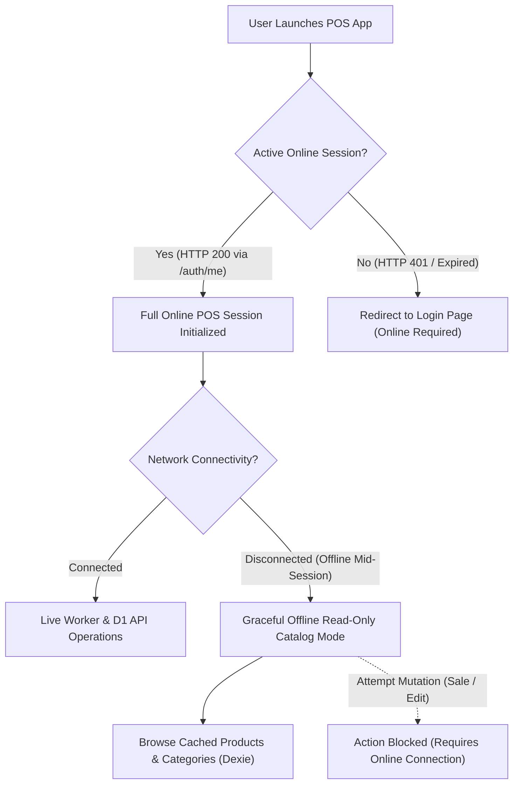

# Step 13.1 Offline Security Model

## 1. Authentication Boundaries & Policy

A primary architectural principle of Northstar POS is that **offline capabilities must never degrade or bypass the security boundaries established in Step 12**.

---

## 2. Core Security Invariants

### 2.1 No Offline Authentication Bypass
- The user **must authenticate online** with the Cloudflare Worker API to establish a valid server session.
- `ProtectedRoute.tsx` relies strictly on the authenticated session state managed in `AuthContext.tsx`.
- **Zero Faked Auth**: The application will **never** fake a 200 OK response from `GET /api/v1/auth/me`.
- **Zero Credential Persistence**: Passwords, hashes, and session tokens are **never** stored in IndexedDB or localStorage.

### 2.2 Offline Cold-Start Invariant
- If an operator launches the POS application while already disconnected (cold start without an existing authenticated session in memory):
  1. The app shell loads via Service Worker.
  2. The session check fails because the server is unreachable.
  3. The user is presented with an honest message: **"Authentication requires an active internet connection. Please connect to continue."**
  4. The local catalog cache remains dormant and inaccessible.
- **Rationale**: Permitting unauthenticated cold-start access to catalog data on shared hardware would allow unauthorized personnel to inspect store inventory and prices.

### 2.3 Session Expiration & Sign-Out Behavior
- If an active session expires while offline, or if the user explicitly signs out:
  1. The in-memory auth context is cleared immediately.
  2. TanStack Query cache is purged.
  3. Subsequent navigation is redirected to `/auth/login`.
  4. Cached Dexie catalog data remains partitioned under its scoped key, inaccessible to any other user account.

---

## 3. Threat Modeling & Mitigations

| Threat | Attack Vector | Mitigation in Step 13.1–13.3 |
| :--- | :--- | :--- |
| **Physical Hardware Theft** | Laptop or POS tablet stolen from shop floor. | No financial records, ledger entries, or customer PII are in Dexie. Disk encryption (BitLocker) recommended for hardware. |
| **Cross-Tenant Data Snooping** | User A logs in on shared PC, then User B logs into a different business. | Dexie compound keys enforce `[userId, businessId]`. Queries strictly filter by the active user's session context. |
| **Malicious Request Tampering** | Attacker tampers with Service Worker cache to fake API responses. | Service Worker is strictly forbidden from caching any `/api/v1/*` routes. Cache API contains only static assets. |
| **Forged Offline Transactions** | Rogue cashier attempts to fabricate a sale while offline. | Offline sales creation is hard-disabled in UI and services. No sync outbox exists in this stage. |

