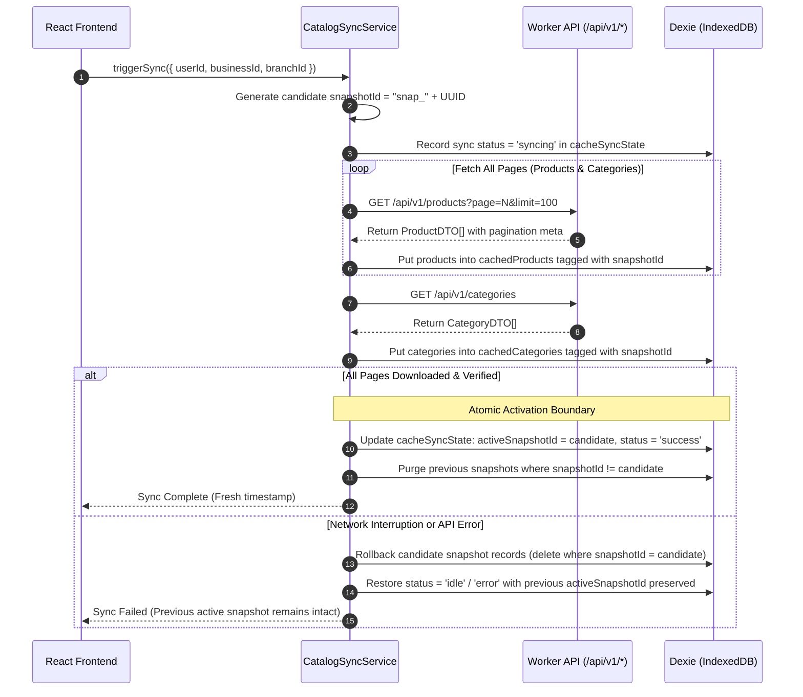

# Step 13.1 Catalog Synchronization Protocol Design

## 1. Overview & Snapshot Strategy

Catalog synchronization brings authorized product and category definitions into local IndexedDB storage so that store operators can search, view, and scan products when connectivity is unavailable.

Because partial catalog downloads would lead to incomplete catalog views (e.g. missing products or incorrect category filters), Northstar POS implements an **Atomic Snapshot Activation Strategy**.

---

## 2. Snapshot Lifecycle & Activation

### 2.1 The Invariant of Snapshot Completeness
- An offline catalog is either **100% complete as of its synchronization timestamp** or **not activated at all**.
- The client generates a candidate `snapshotId` (e.g. `snap_8f92a10b...`).
- Downloaded records are inserted with this candidate `snapshotId`.
- The active snapshot pointer in `cacheSyncState` is swapped **only after the last page has been successfully received, parsed, and stored**.
- Under no circumstances is a partial download activated.

### 2.2 Transaction Boundary Rules
Following Dexie's documented best practices:
- **Never hold an IndexedDB transaction open across `fetch()` network calls**. IndexedDB transactions automatically commit or abort if no database request is made on a microtask turn.
- Each page of catalog data is ingested in its own short-lived, synchronous Dexie write transaction.
- The snapshot activation and old snapshot cleanup occur in a final isolated write transaction.

---

## 3. Synchronization Phases

### 3.1 Initial Synchronization
- Triggered automatically on successful online authentication and context hydration (business and branch selection).
- Progress is surfaced via an unobtrusive sync indicator.

### 3.2 Manual Refresh
- Operators can tap the "Refresh Catalog" button in the catalog or settings view when online.
- Forces a complete fetch cycle to capture changes made on other registers or the back-office portal.

### 3.3 Reconnection Synchronization
- When the application detects transition from offline to online (`window.addEventListener('online')` + successful API ping), a background catalog refresh is scheduled.

### 3.4 Interrupted Sync & Failure Recovery
- If connectivity drops during page 3 of 10:
  1. The candidate snapshot records for pages 1–2 are pruned asynchronously.
  2. The previous active snapshot remains active and untouched.
  3. The operator continues using the last-known valid catalog.
  4. The error is logged without disrupting active POS browsing.

---

## 4. Incremental Sync vs Full Snapshot Audit

### Backend Capability Assessment (Step 12 API Contract)
- `GET /api/v1/products` currently supports pagination (`page`, `limit`), `search`, `categoryId`, and `status`.
- **Missing Incremental Metadata**: The Step 12 Worker endpoints do not currently supply change cursors, high-water mark revision IDs, or `updated_since` query parameters.
- **Protocol Decision**: Steps 13.1–13.3 implement **Full Snapshot Synchronization**. Incremental delta synchronization is deferred until backend change-feed endpoints are approved and built.

