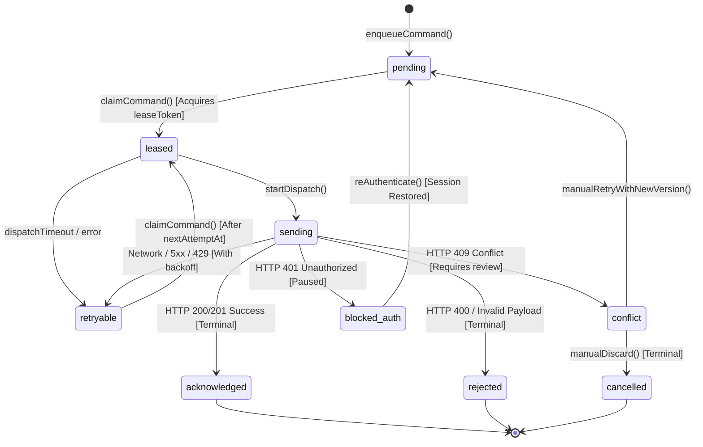

# Outbox Command Lifecycle & State Machine

## 1. State Machine Definition

The outbox enforces a formal, deterministic state machine with 9 distinct statuses:



---

## 2. Status Transition Matrix

| Source Status | Target Status | Trigger | Guard Conditions |
|---|---|---|---|
| `*` | `pending` | Initial Enqueue | Valid command type, version, and payload hash. |
| `pending` | `leased` | Dispatcher Claim | `status == 'pending'`, `nextAttemptAt <= now()`. |
| `retryable` | `leased` | Dispatcher Claim | `nextAttemptAt <= now()`, `attemptCount < maxAttempts`. |
| `leased` | `sending` | Network Dispatch Start | `leaseToken` matches and `leaseExpiresAt > now()`. |
| `sending` | `acknowledged` | Server 200/201 OK | Valid server response; stores `serverResultId` & `acknowledgedAt`. |
| `sending` | `retryable` | Network / 5xx / 429 | Error is retryable; computes `nextAttemptAt` with exponential backoff. |
| `sending` | `conflict` | Server 409 Conflict | Concurrency collision; preserves payload intact. |
| `sending` | `blocked_auth` | Server 401 / Session Expired | Pauses dispatch without modifying payload. |
| `sending` | `rejected` | 400 / Unregistered / Max Retries | Permanent failure; records `lastErrorCode`. |
| `blocked_auth` | `pending` | User Login / Session Refresh | Active user matches command `userId`. |
| `conflict` | `cancelled` | User Action | User discards conflicting draft. |

---

## 3. Terminal State Invariants

- **`acknowledged`**: The command has been processed by Cloudflare D1 and idempotently recorded. It will never be re-dispatched.
- **`rejected`**: The command suffered a permanent failure (e.g. invalid entity reference, max retries exhausted). It cannot be automatically retried.
- **`cancelled`**: The user explicitly cancelled a conflicting command. It is preserved for audit purposes.

*Critical Invariant: Terminal records (`acknowledged`, `rejected`, `cancelled`) are strictly immutable and can never silently transition back to `pending`.*

---

## 4. Crash Recovery Protocol

If the user closes the browser or the browser crashes while a command is in `leased` or `sending`:
1. The command retains its `leaseExpiresAt` timestamp (default: 30 seconds from lease grant).
2. While `leaseExpiresAt > now()`, other tabs will not claim it.
3. Once `leaseExpiresAt <= now()`, the command is considered an **abandoned lease**.
4. The claiming engine queries for:
   ```ts
   (status === 'leased' || status === 'sending') && leaseExpiresAt <= now()
   ```
5. The recovering tab generates a new `leaseToken`, increments `attemptCount`, and safely restarts the dispatch lifecycle.

