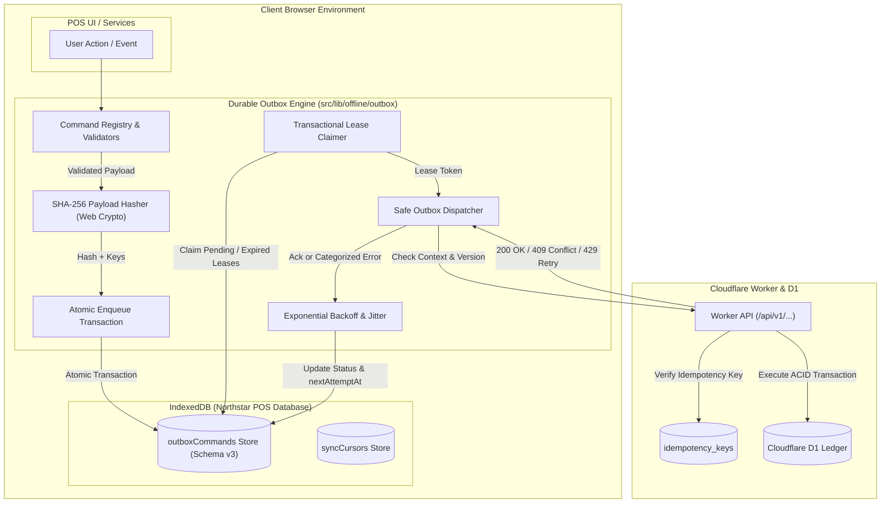

# Step 13.4 — Durable Synchronization Outbox Architecture & Design

## 1. Executive Summary

The Durable Synchronization Outbox is an enterprise-grade, crash-resilient asynchronous command queue built on top of IndexedDB (via Dexie.js) inside the Northstar POS client. It provides the foundation for future reliable offline transaction queuing without compromising data integrity, tenant isolation, or financial safety.

### Core Architectural Invariants:
1. **Single Source of Truth**: Cloudflare D1 remains the authoritative ledger. The outbox is purely a transport mechanism for queued commands to reach D1.
2. **Strictly No Offline Financial Mutations in Step 13.4**: Production business commands (sales, invoices, payments, refunds, purchases, goods receipts, stock adjustments, and stock counts) are strictly blocked from execution by the command registry.
3. **Payload Immutability & SHA-256 Fingerprinting**: Once enqueued, command payloads cannot be modified. Any retry must reuse the exact same command ID, idempotency key, and payload hash. Any modification requires generating a new logical command with a new idempotency key.
4. **Anti-Last-Write-Wins (Anti-LWW)**: No generic timestamp overwriting. Concurrency is guarded by server-side monotonic revisions and explicit version constraints.
5. **Multi-Tab Concurrency Control**: Cross-tab command processing conflicts are prevented via transactional claiming (`leased` state with lease tokens and timeouts) and optional Web Locks API coordination.

---

## 2. Outbox Topology



---

## 3. Storage Model & Schema v3

The `outboxCommands` table in Dexie is defined with compound indexes to enable high-throughput queries:

```ts
outboxCommands: 'id, [userId+businessId+status], [userId+businessId+status+nextAttemptAt], idempotencyKey, commandType, status, nextAttemptAt, leaseExpiresAt, createdAt'
```

### Table Record Contract:
```ts
export interface OutboxCommandRecord {
  id: string                     // Unique command UUID (e.g. "cmd_...")
  userId: string                 // Authenticated user scope
  businessId: string             // Tenant scope
  branchId: string | null        // Branch scope
  deviceId: string               // Stable terminal installation ID
  commandType: string            // Explicitly registered command identifier
  commandVersion: number         // Schema version of the command payload
  idempotencyKey: string         // Cryptographic unique idempotency key
  payload: Record<string, unknown> // Immutable JSON command payload
  payloadHash: string            // SHA-256 hexadecimal digest of canonical payload
  status: OutboxCommandStatus    // State machine status
  createdAt: string              // ISO 8601 creation timestamp
  updatedAt: string              // ISO 8601 update timestamp
  attemptCount: number           // Cumulative execution attempts
  nextAttemptAt: string | null   // Bounded exponential backoff target timestamp
  lastAttemptAt: string | null   // Timestamp of the most recent dispatch attempt
  leaseToken: string | null      // UUID fencing token held by the executing tab
  leaseExpiresAt: string | null  // ISO 8601 lease expiration timestamp
  lastErrorCode: string | null   // Categorized error code (e.g. "NETWORK_ERROR", "CONFLICT")
  lastErrorAt: string | null     // ISO 8601 timestamp of last failure
  serverResultId: string | null  // Authoritative server entity ID upon 200 OK
  acknowledgedAt: string | null  // ISO 8601 acknowledgement timestamp
  expiresAt: string | null       // Optional command policy TTL
}
```

---

## 4. Multi-Tab Safety & Lease Fencing

To ensure that multiple browser tabs open to the same application cannot dispatch or mutate the same command concurrently:

1. **Transactional Leasing**:
   - Tab queries eligible commands with status `pending` or `retryable` where `nextAttemptAt <= now()`.
   - In a Dexie read-write transaction, the tab generates a cryptographically random `leaseToken` (UUID) and sets `leaseExpiresAt = now() + 30_000ms`.
   - The command status transitions atomically to `leased`.
2. **Lease Verification**:
   - Before any status transition (to `sending`, `acknowledged`, `retryable`, `conflict`), the tab verifies that its in-memory `leaseToken` matches the stored `leaseToken`.
   - If the lease expired and another tab took over, the first tab's write is rejected, preventing split-brain writes.
3. **Web Locks API Coordination**:
   - In supporting browsers, `navigator.locks.request('pos_outbox_dispatcher_lock', ...)` is used to elect a single active worker tab for background processing, avoiding redundant polling.

