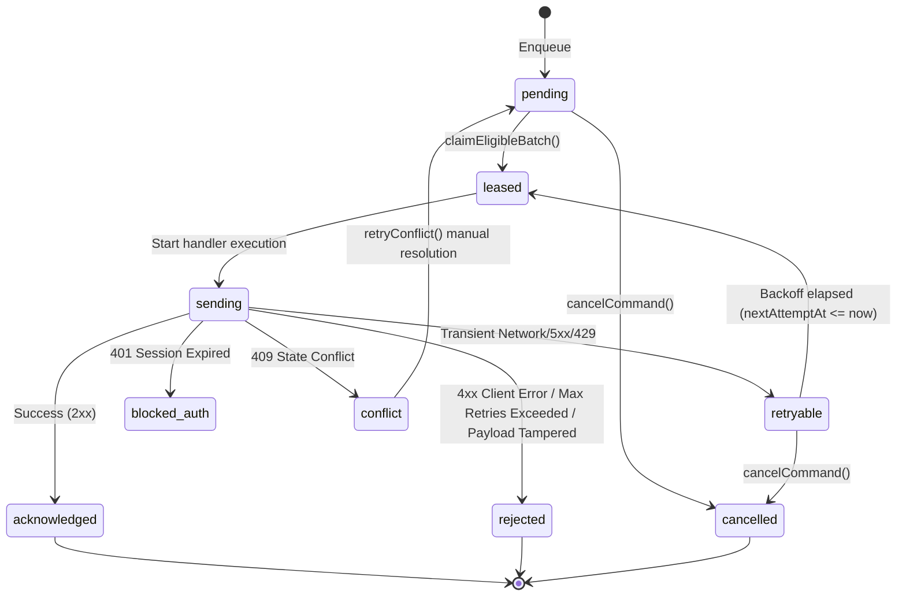

# Step 13.4 — Durable Synchronization Outbox Implementation

## 1. Executive Summary

Step 13.4 establishes a durable, crash-recoverable command outbox using the browser's IndexedDB engine (via Dexie.js v4). The outbox acts as an asynchronous, transactional staging buffer for mutations that need authoritative processing by the Cloudflare Worker backend and persistence in Cloudflare D1.

> [!IMPORTANT]
> **Strict Operational Boundary**:
> Offline execution of financial and inventory mutations (`create_sale`, `void_sale`, `record_customer_payment`, `allocate_advance`, `record_stock_adjustment`, `record_stock_count`, `confirm_stock_count`, `create_purchase_order`, `receive_goods`, `record_supplier_payment`) remains **strictly disabled**. Attempting to register or execute authorized handlers for these commands in Step 13.4 throws an unrecoverable security violation.

---

## 2. Dexie Schema Version 3 Upgrade

The local database (`POS_OFFLINE_DB`) was upgraded from Schema Version 2 to Version 3:

```typescript
// src/lib/offline/database.schema.ts
export const CURRENT_OFFLINE_SCHEMA_VERSION = 3

export const OFFLINE_SCHEMA_DEFINITIONS: Record<number, Record<string, string>> = {
  1: { /* ... */ },
  2: { /* ... */ },
  3: {
    // Preserves existing stores:
    cachedProducts: 'id, [businessId+branchId], [businessId+branchId+status], ...',
    cachedCategories: 'id, businessId, ...',
    syncState: 'key',
    syncLog: '++id, entity, ...',
    // Upgraded durable outbox store with compound indexes:
    outboxCommands:
      'id, [userId+businessId+status], [userId+businessId+status+nextAttemptAt], idempotencyKey, commandType, status, nextAttemptAt, leaseExpiresAt, createdAt',
  },
}
```

### Store Indexes & Rationale

1. `id`: Primary key (deterministic or UUID-prefixed string `cmd_<uuid>`).
2. `[userId+businessId+status]`: Compound index for instant multi-tenant candidate querying without table scans.
3. `[userId+businessId+status+nextAttemptAt]`: Compound index for efficient exponential backoff scheduling.
4. `idempotencyKey`: Fast lookup for deduplication and payload conflict validation.
5. `status`, `nextAttemptAt`, `leaseExpiresAt`: Direct single-attribute indexes for garbage collection and lease cleanup.

---

## 3. Command Data Contract (21 Metadata Fields)

Each queued outbox entry strictly conforms to `OutboxCommandRecord`:

| Field Name | Type | Description |
|---|---|---|
| `id` | `string` | Unique command identifier (`cmd_<uuid>`) |
| `userId` | `string` | Active user ID claiming ownership |
| `businessId` | `string` | Business ID scope partition |
| `branchId` | `string \| null` | Optional branch location partition |
| `deviceId` | `string` | Persistent installation identifier |
| `commandType` | `string` | Whitelisted command identifier (e.g. `test_ping`, `sample_future_command`) |
| `commandVersion` | `number` | Schema version of the command contract |
| `idempotencyKey` | `string` | Deterministic/UUID idempotency key |
| `payload` | `Record<string, unknown>` | JSON-serializable command arguments |
| `payloadHash` | `string` | Cryptographic SHA-256 hash of payload |
| `status` | `OutboxCommandStatus` | One of 9 state machine states |
| `createdAt` | `string` | ISO 8601 creation timestamp |
| `updatedAt` | `string` | ISO 8601 last update timestamp |
| `attemptCount` | `number` | Monotonically increasing attempt counter |
| `lastAttemptAt` | `string \| null` | ISO 8601 timestamp of most recent dispatch |
| `nextAttemptAt` | `string \| null` | ISO 8601 scheduled backoff wake-up |
| `leaseToken` | `string \| null` | Opaque lease token held by worker |
| `leaseExpiresAt` | `string \| null` | ISO 8601 expiry of current processing lease |
| `serverResultId` | `string \| null` | Upstream transaction confirmation ID |
| `acknowledgedAt` | `string \| null` | ISO 8601 confirmation timestamp |
| `lastErrorCode` | `string \| null` | Machine-readable failure classification |

---

## 4. Finite State Machine & Transition Rules

The outbox enforces an 9-state state machine:



### Invariant Rules
- **Terminal States**: `acknowledged`, `rejected`, and `cancelled` are terminal. No worker can re-claim, lease, or dispatch commands in these states.
- **Idempotency Protection**: Enqueueing with an existing `idempotencyKey` returns the existing record if `payloadHash` matches (deduplication); if `payloadHash` differs, it throws `OutboxConflictError`.
- **Payload Tampering Defense**: Before executing, the dispatcher re-calculates SHA-256 of `payload`. If it does not match `payloadHash`, the command is permanently rejected with `PAYLOAD_TAMPERED`.

---

## 5. Multi-Tab Fencing & Transactional Leasing

To safely support multiple browser tabs without duplicate submissions or race conditions:

1. **Transactional Leasing (`claimEligibleBatch`)**:
   - Queries candidates matching `userId` and `businessId` in `pending`, `retryable` (where `nextAttemptAt <= now`), or abandoned `leased`/`sending` (where `leaseExpiresAt <= now`).
   - Atomically generates a secure `leaseToken` and sets `leaseExpiresAt = now + 30,000ms`.
   - Transitions record to `leased` and increments `attemptCount`.
2. **Lease Token Fencing (`updateWithLeaseCheck`)**:
   - All state updates during dispatch require passing the `leaseToken`.
   - If another worker reclaimed an abandoned lease or if the lease expired, the update is rejected with `OutboxLeaseExpiredError`.
3. **Cross-Tab Synchronization (`BroadcastChannel`)**:
   - Outbox state transitions emit events over `BroadcastChannel('pos_outbox_events')`, notifying open tabs to refresh UI badges and status counts.

---

## 6. Backoff, Jitter & Rate Limiting

- **Bounded Exponential Backoff**: $\text{delay} = \min(\text{maxDelay}, \text{baseDelay} \times 2^{\text{attemptCount}})$.
- **Full Jitter**: Uniform random delay between $500\text{ms}$ and $\text{backoffCap}$ to avoid thundering-herd spikes.
- **HTTP 429 Handling**: Server `Retry-After` header is honored directly (converted to seconds and applied as `delayMs`).
- **Maximum Retry Limit**: After 5 failed attempts, the command transitions to `rejected` with error code `MAX_ATTEMPTS_EXCEEDED` without record deletion, preserving diagnostic history.

---

## 7. Security & Isolation Architecture

1. **Strict Typed Registry**: Arbitrary HTTP URLs, headers, or verbs cannot be enqueued. Every command must match a pre-registered `CommandDefinition` in `CommandRegistry`.
2. **Prohibited Financial Commands**: All 10 financial and inventory commands are registered with `isAuthorized: false`. Any attempt to register an authorized handler throws an uncatchable security exception.
3. **Session & Tenant Isolation**: Queries strictly isolate by `[userId+businessId]`. When a user logs out or switches accounts, pending commands of the previous user are quarantined and never dispatched under the new user's credentials.
4. **Offline Detection**: Dispatching aborts immediately if `navigator.onLine === false`, preserving lease state.

---

## 8. Directory & File Manifest

| File Path | Description |
|---|---|
| `src/lib/offline/database.schema.ts` | Dexie schema version 3 definition |
| `src/lib/offline/database.ts` | Dexie database instance registration |
| `src/lib/offline/database.types.ts` | `OutboxCommandRecord` type and status definitions |
| `src/lib/offline/outbox/outbox.types.ts` | Outbox domain types, inputs, results, and events |
| `src/lib/offline/outbox/outbox.errors.ts` | Categorized error hierarchy and HTTP mapping |
| `src/lib/offline/outbox/outbox.lease.ts` | Lease token generation and validity fencing |
| `src/lib/offline/outbox/outbox.retry.ts` | Backoff, jitter, and Retry-After calculator |
| `src/lib/offline/outbox/outbox.events.ts` | Event bus with BroadcastChannel cross-tab notifications |
| `src/lib/offline/outbox/outbox.registry.ts` | Typed command registry and financial prohibition whitelist |
| `src/lib/offline/outbox/outbox.repository.ts` | Dexie transaction operations and atomic enqueue/claim |
| `src/lib/offline/outbox/outbox.dispatcher.ts` | Safe dispatch loop with tamper verification |
| `src/lib/offline/outbox/outbox.service.ts` | High-level orchestration service |
| `src/lib/offline/outbox/commandRegistry.ts` | Re-export alias for backward compatibility |
| `src/lib/offline/outbox/outboxManager.ts` | Re-export alias for backward compatibility |
| `src/lib/offline/outbox/index.ts` | Public outbox exports |
| `src/components/common/useOutboxStatus.ts` | Reactive React hook for outbox metrics |
| `src/components/common/OutboxStatusIndicator.tsx` | Minimal UI indicator component |

