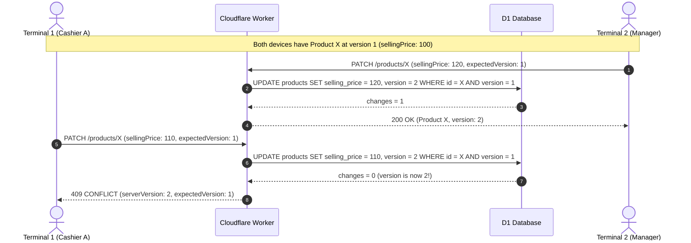

# Multi-Device Conflict Handling & Optimistic Concurrency Guide

## 1. Concurrency Policy by Data Domain

| Domain | Concurrency Mechanism | Conflict Behavior | Authoritative Store |
|---|---|---|---|
| **Products (Pricing, Names, SKUs)** | Version numbers + `expectedVersion` | HTTP 409 Conflict on stale version | Cloudflare D1 |
| **Categories (Names, Display Order)** | Version numbers + `expectedVersion` | HTTP 409 Conflict on stale version | Cloudflare D1 |
| **Sales & Invoices** | Append-only sequence | Never conflicts (unique sale numbers) | Cloudflare D1 |
| **Inventory Balances** | Centralized Ledger Sums (`stock_movements`) | Linear delta updates via ACID transactions | Cloudflare D1 |
| **IndexedDB Cache** | Snapshot & Change Log application | Overwritten with latest server sequence | Dexie (Read replica) |

---

## 2. Optimistic Concurrency Protocol



---

## 3. HTTP 409 Conflict Payload Contract

When an update is rejected due to a concurrent modification, the Worker responds with:

```json
{
  "success": false,
  "error": {
    "code": "CONFLICT",
    "message": "Product was modified by another device. Expected version 1, current server version is 2.",
    "details": {
      "resourceId": "prod_101",
      "expectedVersion": 1,
      "serverVersion": 2
    }
  },
  "requestId": "req_847192"
}
```

---

## 4. Frontend Conflict Resolution Flow

When a user encounters an optimistic concurrency conflict:
1. The frontend `apiClient` or service catches the HTTP 409 error.
2. `isVersionConflict(error)` returns `true`.
3. `extractConflictDetails(error)` extracts `expectedVersion`, `serverVersion`, and `resourceId`.
4. The user's in-progress form inputs are preserved in local component state.
5. A modal or banner alerts the user:
   > *"This product was updated on another terminal while you were editing it. Please review the updated server values before saving."*
6. If the user decides to proceed, the form re-submits with `expectedVersion: serverVersion`.

