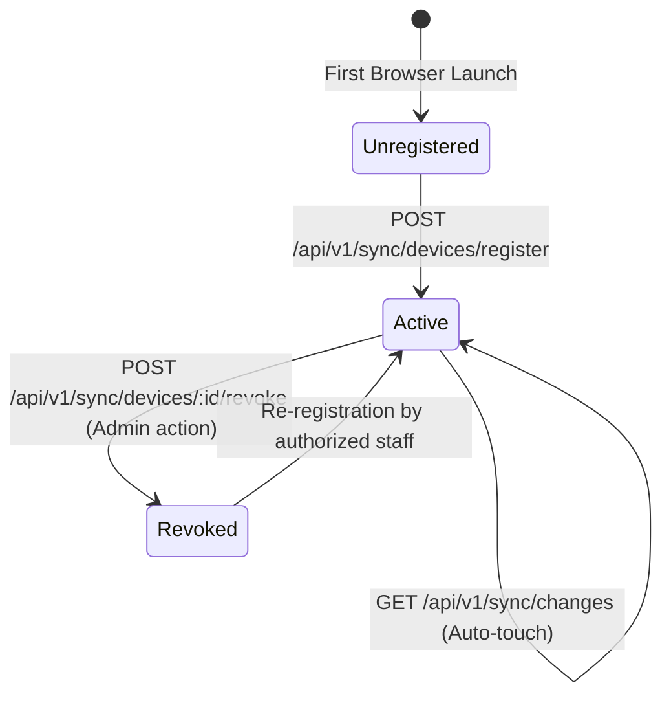

# Device Management & Lifecycle Guide

## 1. Device Registration Lifecycle

Each physical terminal, tablet, or browser running Northstar POS maintains a stable installation identifier generated on initial launch and persisted in IndexedDB (`deviceMetadata` store).



---

## 2. Uniqueness & Deduplication

In Cloudflare D1, the `devices` table enforces uniqueness across:
```sql
UNIQUE(business_id, user_id, installation_id)
```
- Re-registering from the same device under the same user profile updates `last_seen_at` and label without generating duplicate records.
- If a tablet is handed over to a different cashier user on the same terminal, a distinct device session is registered for that user profile, preserving accurate audit trails.

---

## 3. Role-Based Permissions for Devices

| Operation | Endpoint | Owner / Admin | Cashier / Staff |
|---|---|---|---|
| Register Device | `POST /sync/devices/register` | Allowed | Allowed |
| Send Heartbeat | `POST /sync/devices/heartbeat` | Allowed | Allowed |
| List Devices | `GET /sync/devices` | All devices in business | Only devices registered by themselves |
| Revoke Device | `POST /sync/devices/:id/revoke` | Any device in business | Only own registered device |
| Pull Changes | `GET /sync/changes` | All branches | Authorized branch stock only |

---

## 4. Immediate Access Revocation

When a device is marked `revoked`:
1. Worker middleware checks device status in `devices` table before processing `/api/v1/sync/changes`.
2. If `device.status === 'revoked'`, the request is terminated immediately with:
```json
{
  "success": false,
  "error": {
    "code": "FORBIDDEN",
    "message": "Device access has been revoked."
  }
}
```
3. No further sequence events or catalog delta records are delivered to the device.

