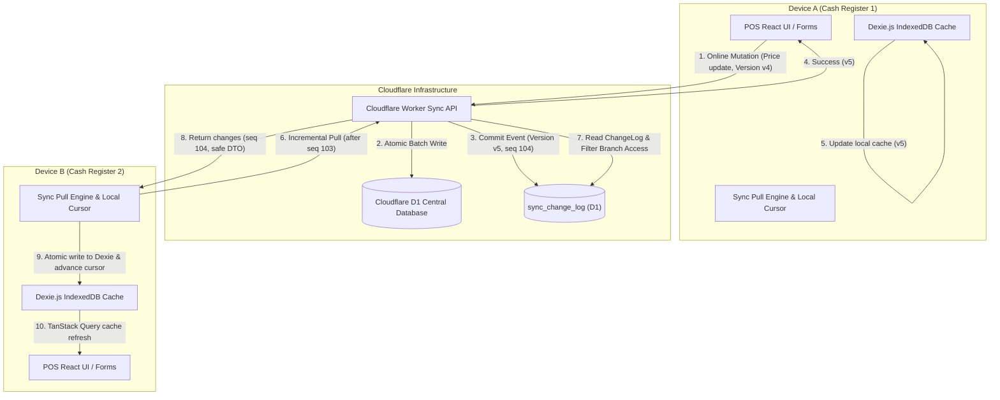

# Step 13.5 — Multi-Device Synchronization Architecture

## 1. System Topology & Responsibilities

The Northstar POS multi-device synchronization protocol enables changes committed by one authorized terminal or browser tab to propagate to all other authorized devices in the merchant's business without leaking cross-tenant or cross-branch data.

---

## 2. Core Architectural Invariants

1. **Single Source of Truth**: Cloudflare D1 is the sole authoritative state holder. Local IndexedDB is an authorized, device-local read replica.
2. **Anti-Last-Write-Wins (Anti-LWW)**: No client can blindly overwrite server data. Version conflicts return `409 Conflict` requiring user review.
3. **No Financial Mutations Offline**: Offline checkout, payments, purchases, and manual stock movements remain strictly disabled (deferred to Step 13.6).
4. **Scope-Bound Cursors**: Cursors are bound to `[userId + businessId + branchId + stream]`. A cursor from Business A or Branch 1 cannot pull data from Business B or Branch 2.
5. **No Long-Running Transactions Across Network**: Network requests never hold open IndexedDB transactions. Responses are fully downloaded, verified, and applied in a micro-transaction.
6. **Wholesale Margin Privacy**: The synchronization feed strips all wholesale purchase prices before sending data to client devices.

