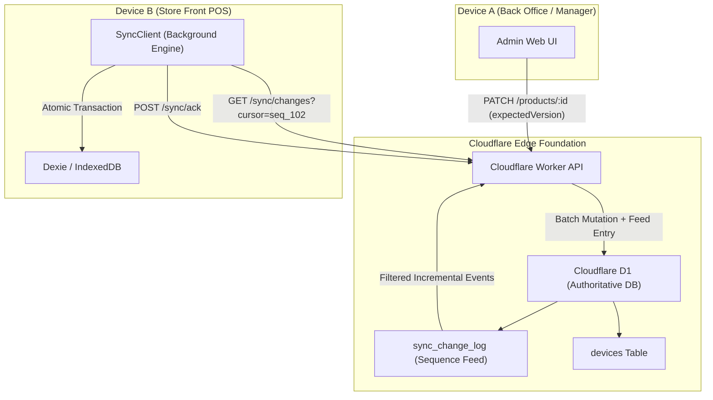
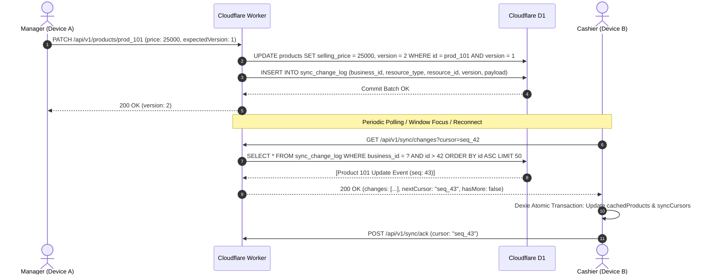

# Step 13.5 — Multi-Device Synchronization & Conflict Handling Implementation

## 1. Executive Summary

Step 13.5 establishes a multi-device synchronization engine and optimistic concurrency conflict-handling protocol for Northstar POS. The system enables real-time catalog changes (prices, names, categories, archived items) and authoritative branch stock levels made on one terminal or back-office device to propagate automatically to all peer terminals while upholding data isolation, financial security, and zero cost leakage.

### Architecture Invariants Maintained:
- **Cloudflare D1 is the Single Source of Truth**: IndexedDB/Dexie remains strictly a read replica for the terminal. No terminal writes directly to another terminal.
- **Strictly No Offline Mutations for Financials & Stock**: Sales checkout, payments, purchases, goods receipts, and stock adjustments remain online-only authoritative mutations executed against Cloudflare D1 with ACID transactions.
- **Optimistic Concurrency Control (Anti-LWW)**: Generic "Last-Write-Wins" is forbidden. All catalog mutations carry monotonic version numbers. Edits passing a stale `expectedVersion` are rejected with HTTP `409 Conflict`.
- **Zero Merchant Wholesale Cost Leakage**: Wholesale purchase costs (`purchasePriceMinor`) are stripped from `sync_change_log` payloads and excluded from IndexedDB client storage.
- **Tenant & Branch Scoping**: Changes are segregated by `business_id` and filtered by authenticated user branch access rights.

---

## 2. System Architecture & Topology

---

## 3. Endpoints Implemented

| Method | Endpoint | Description | Auth & Scoping |
|---|---|---|---|
| `POST` | `/api/v1/sync/devices/register` | Registers or re-activates terminal installation | Authenticated, scoped by business + user |
| `GET` | `/api/v1/sync/devices` | Lists registered devices | Owner/Admin sees all, Staff sees own |
| `POST` | `/api/v1/sync/devices/heartbeat` | Updates `last_seen_at` | Active registered device |
| `POST` | `/api/v1/sync/devices/:id/revoke` | Revokes terminal access | Admin or device owner |
| `GET` | `/api/v1/sync/changes` | Pulls sequence-ordered change stream | Device registered, branch-filtered |
| `POST` | `/api/v1/sync/ack` | Acknowledges cursor consumption | Updates device `last_sync_at` |

---

## 4. Multi-Device Propagation Flow

---

## 5. Security & Isolation Matrix

1. **Session Precedence**: Every sync request must carry a valid Bearer token.
2. **Business Isolation**: Change queries strictly require `business_id = ?`. Cross-business change retrieval is mathematically impossible.
3. **Branch Filtering**: Stock change events are filtered using the caller's authorized branch assignments via `resolveAuthorizedBranchIds()`.
4. **Device Revocation**: When an administrator revokes a lost or compromised terminal, any subsequent calls to `/api/v1/sync/changes` return HTTP `403 FORBIDDEN`.

