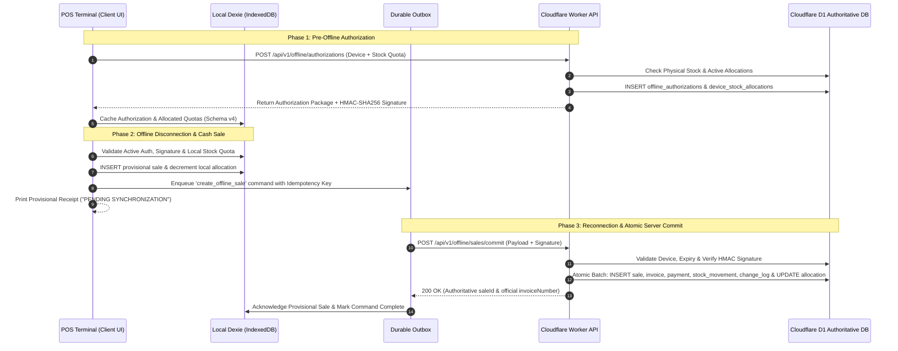

# Step 13.6 — Offline POS Architecture & Data Flow

## 1. Architectural Overview

The Step 13.6 Offline POS architecture introduces controlled, safe offline cash sales without compromising central financial authority or inventory consistency. 

Authoritative state resides in Cloudflare D1. When connectivity is interrupted, authorized POS terminals operate in a provisional offline cash mode backed by Dexie.js (IndexedDB) and cryptographic authorization packages issued by the Cloudflare Worker backend.

---

## 2. Core Architectural Components

### 2.1 Cryptographic Offline Authorization Package
- **Issuer**: Cloudflare Worker backend (`POST /api/v1/offline/authorizations`).
- **Algorithm**: Canonical HMAC-SHA256 over canonicalized key-value pairs:
  `canonicalPayload = "authorizationId:...|businessId:...|branchId:...|deviceId:...|expiresAt:...|pricingVersion:1|userId:..."`
- **Validity Window**: Maximum 24 hours (default 8 hours). Terminals cannot execute offline sales once expired.
- **Revocation**: Server device revocation immediately invalidates all authorizations issued to that device.

### 2.2 Device Stock Allocations (`device_stock_allocations`)
- Prevents double-spending of stock across concurrent terminals and online transactions.
- Central physical balance remains authoritative in `inventory_balances`.
- Online sales deduct active unconsumed device allocations from available stock:
  `Available to Sell = MAX(0, physical_balance - sum(active_unconsumed_allocations))`
- The central D1 database enforces a strict SQL check constraint:
  `CHECK(consumed_quantity <= allocated_quantity)`
  Any commit attempting to overconsume allocated quota immediately triggers an ACID rollback of the entire batch.

### 2.3 Local Dexie Schema Version 4
- Upgraded Dexie database with dedicated stores:
  - `offlineSales`: Provisional sales records with status (`provisional`, `syncing`, `acknowledged`, `rejected`).
  - `offlineAuthorizations`: Server authorization packages and HMAC signatures.
  - `offlineAllocations`: Device-allocated stock quotas with consumed and remaining tracking.

### 2.4 Server Atomic Commit (`POST /api/v1/offline/sales/commit`)
Executes an atomic D1 batch transaction consisting of 11 distinct statements:
1. `INSERT INTO sales` with `sale_number`, walk-in customer snapshot, and total minor.
2. `INSERT INTO sale_items` for each sold line item.
3. `UPDATE inventory_balances` reducing physical `quantity_on_hand`.
4. `INSERT INTO stock_movements` with reference to sale ID and audit notes.
5. `UPDATE device_stock_allocations` incrementing `consumed_quantity`.
6. `INSERT INTO sync_change_log` emitting stock delta events for multi-device synchronization.
7. `INSERT INTO invoices` linking invoice to sale and customer.
8. `INSERT INTO payments` recording cash tender.
9. `INSERT INTO payment_methods` recording tender method ('cash').
10. `INSERT INTO payment_allocations` matching payment to sale and invoice.
11. `INSERT INTO idempotency_keys` storing canonical request hash and response payload.

---

## 3. Boundary & Scope Guarantees
- **Payment Method**: Strictly CASH ONLY. Card, online payment, and ledger credit are strictly prohibited offline.
- **Customer Scope**: Strictly Walk-in Customers. Customer creation and debtor balance modifications are prohibited offline.
- **Discounts & Pricing**: Manual price overrides and unapproved discounts are prohibited offline. Fixed catalog prices only.
- **Isolation**: Every store, cache key, and API parameter is explicitly scoped by `business_id` and `branch_id`.

