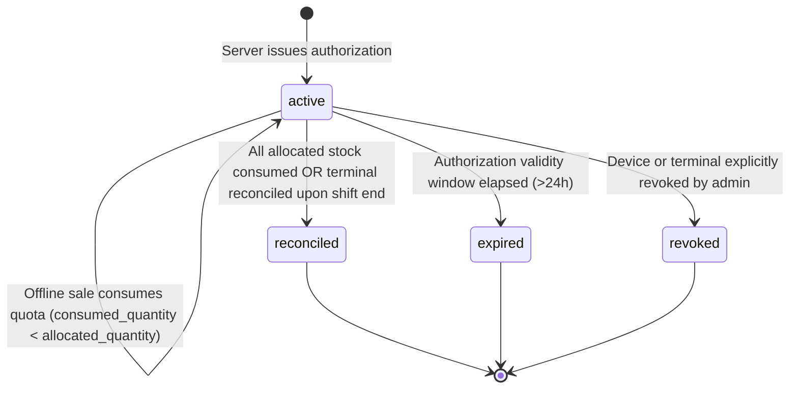

# Step 13.6 — Device Stock Allocations & Concurrency Control

## 1. Concurrency Problem & Solution

In multi-terminal offline environments, two disconnected registers could independently sell the same physical unit, causing inventory discrepancies upon reconnection.

The POS system prevents this through **Pre-Allocated Stock Quotas**:
1. When online, a device requests an authorization package specifying exact product quantities it is authorized to sell offline.
2. The server checks physical inventory and deducts any already active allocations on other devices.
3. If sufficient stock exists, the server records the allocation in `device_stock_allocations` with `consumed_quantity = 0`.
4. Online sales and other terminals treat allocated unconsumed stock as reserved, preventing online overselling.

---

## 2. Database Schema (`0013_offline_pos_and_allocations.sql`)

```sql
CREATE TABLE IF NOT EXISTS device_stock_allocations (
  id TEXT PRIMARY KEY,
  authorization_id TEXT NOT NULL REFERENCES offline_authorizations(id) ON DELETE CASCADE,
  business_id TEXT NOT NULL REFERENCES businesses(id) ON DELETE CASCADE,
  branch_id TEXT NOT NULL REFERENCES branches(id) ON DELETE CASCADE,
  device_id TEXT NOT NULL REFERENCES devices(id) ON DELETE CASCADE,
  product_id TEXT NOT NULL REFERENCES products(id) ON DELETE RESTRICT,
  allocated_quantity REAL NOT NULL CHECK(allocated_quantity > 0),
  consumed_quantity REAL NOT NULL DEFAULT 0.0 CHECK(consumed_quantity >= 0),
  status TEXT NOT NULL CHECK(status IN ('active', 'reconciled', 'revoked', 'expired')) DEFAULT 'active',
  created_at TEXT NOT NULL DEFAULT (datetime('now')),
  updated_at TEXT NOT NULL DEFAULT (datetime('now')),
  CHECK(consumed_quantity <= allocated_quantity)
);
```

### 2.1 The Invariant Check Constraint
The SQL check constraint `CHECK(consumed_quantity <= allocated_quantity)` is the core mechanical guardrail.
When `commitOfflineSale` attempts to increment `consumed_quantity`, SQLite evaluates this constraint. If the update would push consumed above allocated, SQLite throws an `ERR_SQLITE_ERROR` constraint violation, rolling back the entire 11-statement atomic D1 batch.

---

## 3. Online Sales Coordination

In `worker/src/features/sales/sales.service.ts`, the online sale availability calculation queries both physical stock and active unconsumed device allocations:

```typescript
// Query physical inventory
const physicalRes = await this.db.prepare(
  `SELECT quantity_on_hand FROM inventory_balances WHERE business_id = ? AND branch_id = ? AND product_id = ?`
).first();

// Query active device allocations
const allocRes = await this.db.prepare(
  `SELECT COALESCE(SUM(allocated_quantity - consumed_quantity), 0) as reserved_quantity
   FROM device_stock_allocations
   WHERE business_id = ? AND branch_id = ? AND status = 'active' AND product_id = ?`
).first();

const availableToSell = Math.max(0, (physicalRes?.quantity_on_hand || 0) - (allocRes?.reserved_quantity || 0));
if (requestedQuantity > availableToSell) {
  throw new HttpError(422, 'INSUFFICIENT_STOCK', `Requested quantity exceeds available stock after deducting offline allocations.`);
}
```

---

## 4. Allocation Lifecycle & Reconciliation



### 4.1 Reclaiming Unused Quota
When an offline shift ends or an authorization expires, unconsumed stock (`allocated_quantity - consumed_quantity`) is returned to the sellable pool by marking the allocation `reconciled` via `POST /api/v1/offline/allocations/reconcile`.

