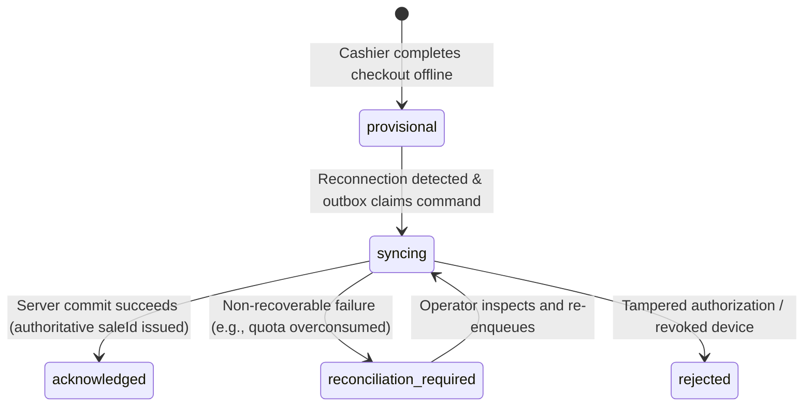

# Step 13.6 — Provisional Sales & Reconciliation Protocol

## 1. Provisional Sales Model

Offline sales are treated as **provisional** until committed and acknowledged by the Cloudflare Worker backend. 

### 1.1 Local Provisional Receipt Identification
Provisional offline receipts follow a deterministic sequence format:
`OFF-{deviceShortId}-{sequenceNumber}`
Example: `OFF-E4B2-0042`

### 1.2 Mandatory Receipt Disclaimer
Every paper or electronic receipt issued while offline MUST print the prominent disclaimer:
```
*** PENDING SYNCHRONIZATION — NOT AN OFFICIAL TAX INVOICE ***
```
This protects the business against tax auditing discrepancies while ensuring the customer has proof of purchase and payment.

---

## 2. Provisional Sale State Machine



| Status | Description |
|---|---|
| `provisional` | Stored in local Dexie `offlineSales`. Stock deducted locally from device allocation quota. |
| `syncing` | Outbox command leased and currently in flight to `POST /api/v1/offline/sales/commit`. |
| `acknowledged` | Successfully committed to Cloudflare D1. Authoritative `saleId` and `invoiceNumber` attached. |
| `reconciliation_required` | Encountered an unresolvable server condition (e.g. allocation discrepancy). Operator review required. |
| `rejected` | Terminal rejection (e.g. invalid cryptographic signature or revoked device). |

---

## 3. Local Acknowledgement & Cleanup

When the server commit succeeds, the outbox dispatcher calls `offlineSalesRepository.acknowledgeSale(...)`:
1. The provisional record in `offlineSales` is updated with `authoritativeSaleId`, `authoritativeInvoiceNumber`, and status `acknowledged`.
2. The local device allocation in `offlineAllocations` is marked fully reconciled.
3. Acknowledged provisional sales are preserved locally for audit history and can be archived after 30 days.

