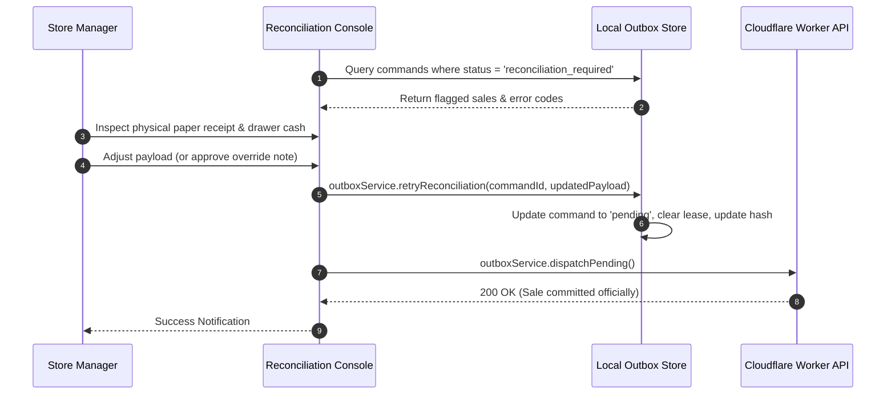

# Step 13.7 — Provisional Sale Reconciliation Protocol

## 1. When Does Reconciliation Occur?

Provisional offline sales normally sync automatically and immediately upon network reconnection without human intervention.
Reconciliation is only triggered when an automated invariant check fails on the server, such as:
1. **Quota Overconsumption**: A terminal somehow issued more quantity than authorized.
2. **Catalog Expiry / Shift Boundary**: Shift closed before sync completed.
3. **Cash Discrepancy**: Cashier noted a discrepancy between cash tendered and drawer contents.

---

## 2. Operator Reconciliation Flow

---

## 3. Financial Integrity Rules During Reconciliation

1. **Physical Cash Overrides**: If the cashier over-collected or under-collected cash, the manager logs a manual cash drawer variance record rather than silently editing product sales.
2. **Audit Preservation**: The original `provisionalSaleId` and `provisionalReceiptNumber` are permanently stored on the authoritative server `sales` record in column `customer_snapshot_json` and notes for audit traceability.
3. **Zero Financial Deletion**: Neither cashiers nor managers are permitted to delete provisional sales. A rejected or disputed provisional sale must be formally voided or written off.

