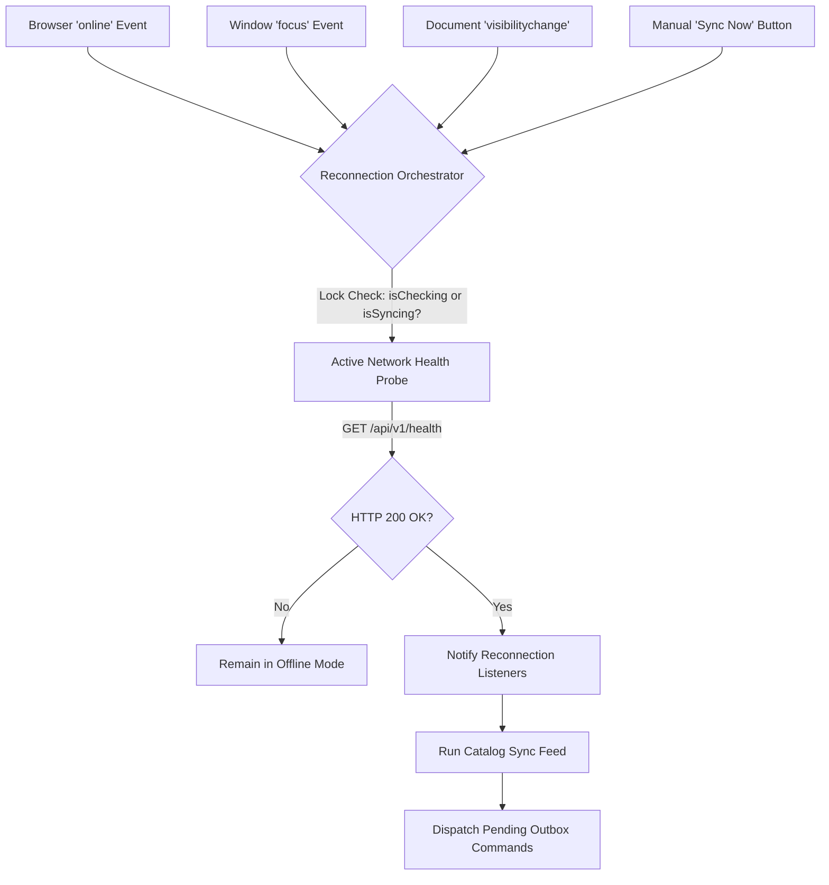

# Step 13.7 — Reconnection & Retry Architecture

## 1. Multi-Trigger Reconnection Detection

The POS system uses a multi-layered trigger mechanism to detect restoration of server connectivity rapidly and reliably without continuous high-frequency polling:

### 1.1 Trigger Channels
1. **`window.addEventListener('online')`**: Triggered when the browser OS detects network interface up.
2. **`window.addEventListener('focus')`**: Triggered when the user returns to the POS terminal tab/window.
3. **`document.addEventListener('visibilitychange')`**: Triggered when the POS tab transitions from background to foreground.
4. **Active HTTP Probe (`/api/v1/health`)**: Confirms genuine internet connectivity and Cloudflare Worker reachability, filtering out captive portals and dead Wi-Fi links.
5. **Manual Trigger**: Cashier or manager clicks the "Sync Now" button in the offline status pill.

---

## 2. Concurrency & Overlapping Execution Protection

The `ReconnectionService` implements strict internal mutex flags:
- `isChecking`: Prevents multiple concurrent health probe requests during simultaneous events (e.g. online event + window focus).
- `isSyncing`: Ensures only one catalog pull and outbox dispatch cycle runs at any given instant.
- Any secondary trigger received while checking or syncing is safely dropped without blocking or queue explosion.

---

## 3. Command Delivery & Exactly-Once Semantics

Offline sales dispatched during reconnection guarantee exactly-once execution:
1. **Client Fencing**: Outbox commands claim a 30-second lease token before making network requests.
2. **Server Idempotency**: The commit endpoint checks `idempotency_keys` in D1 using a SHA-256 hash of the canonical request.
3. **Response Recovery**: If a client commits a sale but loses connectivity before receiving the HTTP 200 response, its subsequent retry with the same idempotency key recovers the authoritative result without duplicating sales, payments, or stock deductions.

