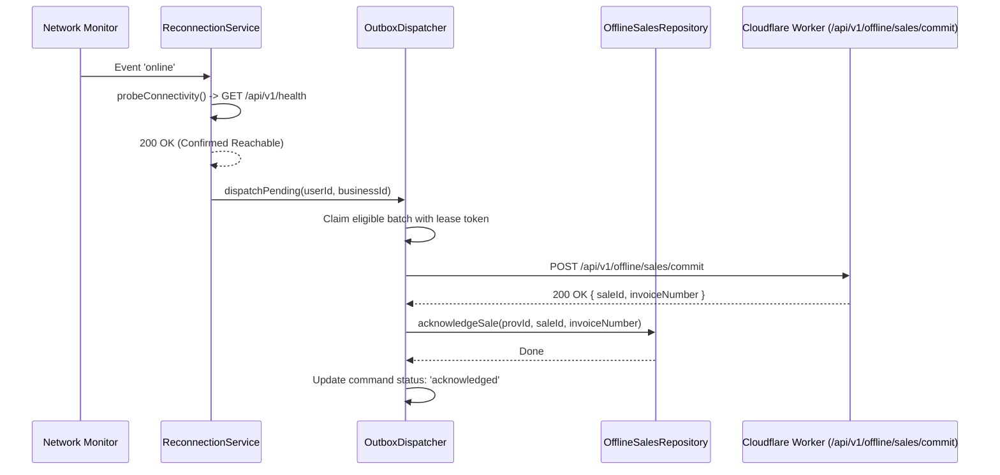

# Step 13.7 — Reconnection & Retry Implementation Details

## 1. Code Architecture

The reconnection and retry pipeline spans frontend orchestrators, outbox dispatchers, and worker verification routes:

| Module | Location | Purpose |
|---|---|---|
| `ReconnectionService` | `src/lib/offline/reconnectionService.ts` | Listens to online, focus, visibility events, runs health probe, and triggers sync. |
| `OutboxDispatcher` | `src/lib/offline/outbox/outbox.dispatcher.ts` | Claims eligible commands, handles leases, classifies errors, and schedules retries. |
| `OutboxService` | `src/lib/offline/outbox/outbox.service.ts` | Enqueues commands, provides stats, flags reconciliation required, and supports operator retries. |
| `OfflineSalesRepository` | `src/lib/offline/sales/offlineSales.repository.ts` | Persists provisional sales, decrements local stock allocations, and records acknowledgements. |
| `OfflineService` | `worker/src/features/offline/offline.service.ts` | Issues HMAC packages, verifies signatures, and executes atomic 11-statement D1 commits. |

---

## 2. End-to-End Reconnection Flow

---

## 3. Server Idempotency Recovery Implementation

When a transient network drop occurs after the server commits the transaction:
1. The server wrote the final JSON response into table `idempotency_keys`.
2. When the outbox retries, the server computes `computeCanonicalRequestHash(input)`.
3. The server queries `idempotency_keys` where `business_id = ? AND key = ? AND resource = 'commit_offline_sale'`.
4. Because the hash matches, the server returns the cached response with `{ isCached: true }` immediately, without touching `inventory_balances` or inserting duplicate invoices.

