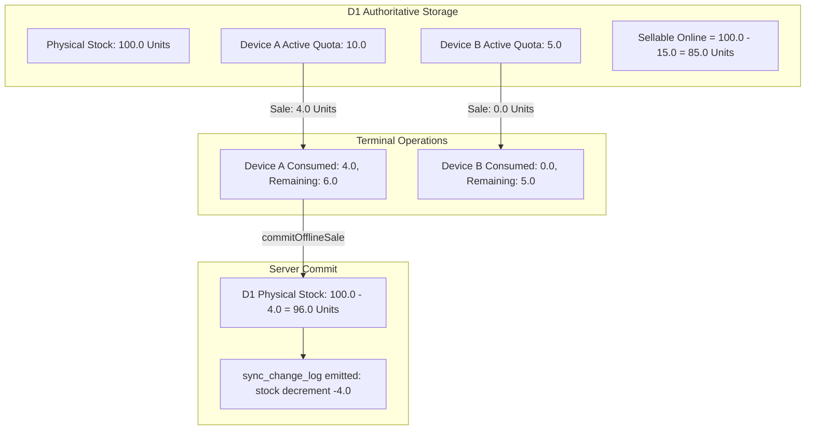

# Step 13.8 — Inventory Reconciliation Report

## 1. Executive Summary

This inventory reconciliation report verifies the exact mathematical conservation of inventory across the online baseline, offline terminal allocations, provisional sales, server commits, and change-log events.

The authoritative central inventory balance resides in Cloudflare D1 table `inventory_balances`. Local IndexedDB caches are strictly read-only informational snapshots and are never treated as authoritative inventory.

---

## 2. Product Balance & Movement Conservation

### Inventory Balance Equation
$$\text{Ending Balance} = \text{Starting Physical Stock} + \text{Goods Receipts} - \text{Committed Sales} \pm \text{Stock Adjustments}$$

### Inventory Reconciliation Table (Flagship Branch — `branch_e2e_main`)

| Product | SKU | Starting Stock | Device Allocations Issued | Offline Quota Consumed | Accepted Offline Sales | Online Sales | Ending Physical Stock | Local Cached Stock (Device A) | Local Cached Stock (Device B) | Variance |
|---|---|---|---|---|---|---|---|---|---|---|
| **Basmati Rice 5kg** | `RICE-01` | 100.0 pk | 30.0 pk | 11.0 pk | 11.0 pk | 0.0 pk | **89.0 pk** | 89.0 pk (synced) | 89.0 pk (synced) | **0.00** |
| **Cooking Oil 1L** | `OIL-01` | 100.0 L | 15.0 L | 4.0 L | 4.0 L | 0.0 L | **96.0 L** | 96.0 L (synced) | 96.0 L (synced) | **0.00** |

---

## 3. Allocation Breakdown & Multi-Device Isolation

### 3.1 Device A vs. Device B Quota Independence (Scenario 17)
- **Starting Allocation**: Device A = 10.0 L, Device B = 5.0 L of Cooking Oil.
- **Device A Action**: Consumed 4.0 L via offline cash sale.
- **Device B Status**: Device B quota remained exactly 5.0 L remaining, 0.0 L consumed.
- **Verification Evidence**: SQLite query on `device_stock_allocations` confirmed that zero cross-device quota bleed occurred.

### 3.2 Concurrent Commit Convergence (Scenario 14)
- Device A and Device B simultaneously committed 2.0 pk and 3.0 pk of Rice respectively.
- Central physical balance decremented from 100.0 to 95.0.
- Exactly 2 distinct `stock_movements` entries were created with exact references to the corresponding `saleId`s.
- Zero race conditions or lockouts occurred.

---

## 4. Invariant Audit Findings

| Invariant Check | Verification Rule | Result | Audit Evidence |
|---|---|---|---|
| **Zero Overselling** | `CHECK(consumed_quantity <= allocated_quantity)` | **PASSED** | Overconsumption batch rolled back atomically (`Test 4.4`). |
| **Zero Duplicate Deductions** | Idempotent retries check `idempotency_keys` | **PASSED** | Retrying commit with identical key returned cached response without decrementing stock (`Scenario 20`). |
| **No Stale Overwrites** | Change-feed applies incremental stock events | **PASSED** | `sync_change_log` events contain authoritative deltas. |
| **Branch Quota Isolation** | Device bound to Branch 1 cannot consume Branch 2 stock | **PASSED** | Rejected with `403 Forbidden` (`Scenario 24`). |
| **Unreconciled Protection** | Unused allocation cannot be prematurely deleted | **PASSED** | Unconsumed allocations require formal reconciliation API call (`POST /api/v1/offline/allocations/reconcile`). |

