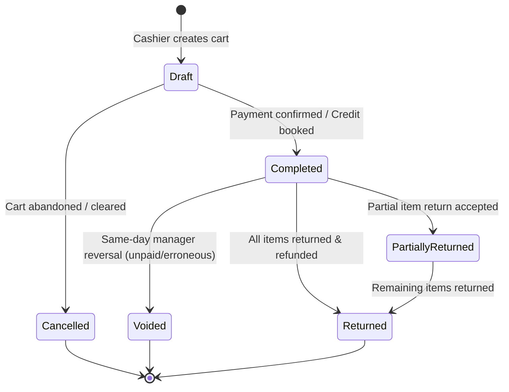
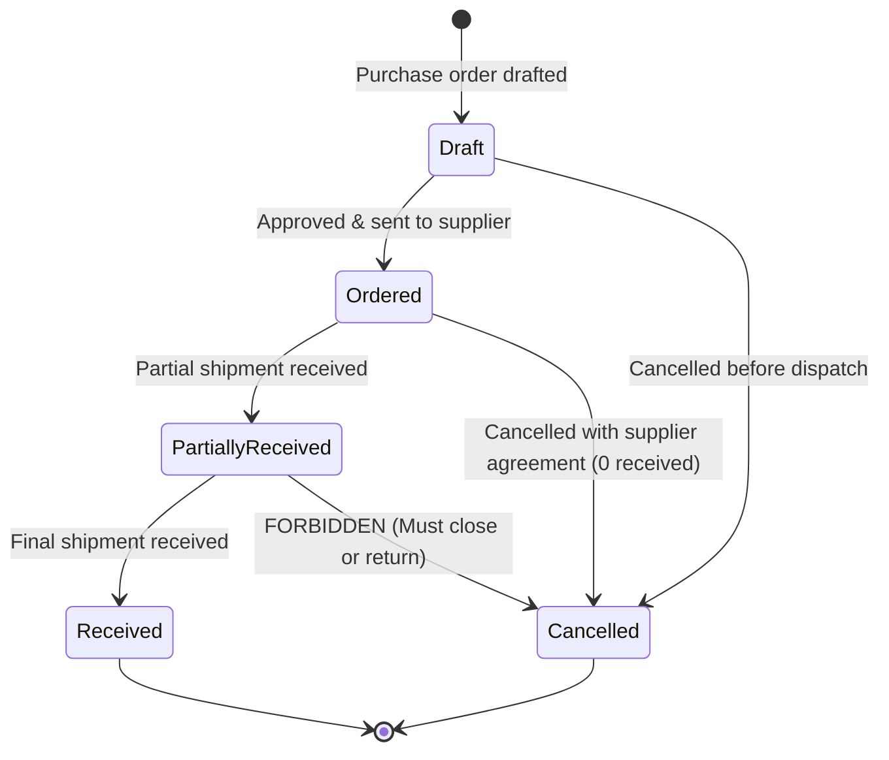

# POS System — Core Business Rules & Domain Workflow Specification

## Document Overview
- **Document ID**: `BR-SPEC-11.7-01`
- **Status**: Draft / Step 11.7 Architecture Finalization
- **Target Backend**: Cloudflare Workers + Cloudflare D1 + Cloudflare R2
- **Audience**: Technical Architects, Financial Systems Engineers, Backend Developers, Store Operations

---

## 1. POS Terminal & Checkout Rules

### 1.1 Terminal Session & Cashier Identity
1. **Cashier Binding**: Every transaction at point of sale must record the authenticated cashier's ID (`cashierId`) and display name (`cashierName`). Anonymous transactions are prohibited.
2. **Terminal / Register Identification**: Each transaction records the terminal device identifier (`registerId` / `terminalId`).
3. **Receipt Number Sequencing**:
   - Format: `REC-{YYYYMMDD}-{TERMINAL_ID}-{SEQUENCE:04d}` (e.g. `REC-20261108-POS01-0042`).
   - Sequence resets daily per terminal.
   - Receipt numbers are strictly monotonic and immutable once generated.
4. **Invoice Number Sequencing**:
   - Format: `INV-{YYYYMM}-{BRANCH_ID}-{SEQUENCE:05d}` (e.g. `INV-202611-B01-00128`).
   - Sequence runs monotonically across each billing month.

### 1.2 Checkout Validation Preconditions
1. **Cart Non-Empty**: A sale must contain at least 1 line item with positive quantity ($Q > 0$).
2. **Stock Verification**:
   - For products with `trackInventory = true`:
     - System warns if $Q_{\text{requested}} > Q_{\text{available}}$.
     - *Default Policy*: Negative stock is permitted with a prominent warning flag (`allowNegativeStockWithWarning = true`), to prevent checkout blocking during physical retail rush hours when stock intake might lag physical shelves.
     - *Owner Decision Pending*: Strict blocking vs warning mode (see `business-decisions-register.md`).
3. **Walk-In vs Named Customer**:
   - Walk-in customers (`isWalkIn = true`) do not have credit accounts. Full payment is strictly required at checkout ($\text{Amount Paid} \ge \text{Total Amount}$).
   - Named customers with credit status (`status = 'active'`) may take orders on credit up to their authorized credit limit.
   - Inactive or Archived customers cannot be selected for new sales.

### 1.3 Discount Rules & Authority Boundaries
1. **Line-Item Discount**:
   - Cashier role: Up to 10% per line item.
   - Supervisor / Manager role: Up to 50% per line item.
   - Store Owner: Up to 100% (free sample/goodwill).
2. **Cart-Level Discount**:
   - Fixed Amount or Percentage.
   - Total discount cannot exceed the cart gross subtotal ($\text{Discount} \le \text{Subtotal}$).
   - Disallowed on items already marked as promotional or zero-margin.

---

## 2. Sales Lifecycle & Order Statuses

### 2.1 State Transition Model
The canonical sale lifecycle follows these finite state transitions:

### 2.2 Status Definitions & Invalidation Rules
1. **`draft`**: In-progress cart stored locally on the terminal. Can be modified, cleared, or suspended. Does not decrement inventory or alter ledgers.
2. **`completed`**: Transaction finalized. Decrements inventory, generates invoice, generates ledger transaction, creates payment records. Immutable business record.
3. **`voided`**:
   - Permitted only within the same business day (`dateKey = current_dateKey`) and before shift closure.
   - Requires Supervisor or Manager authentication.
   - Used for immediate cashier error (e.g. incorrect payment method selected, double ringing).
   - Fully restores inventory balances and reverses ledger entries via offsetting contra-entries.
   - A sale with partial customer payments already settled to bank or collected cannot be voided; it must go through the formal Return & Refund workflow.
4. **`partially_returned`**:
   - One or more line items (or partial quantities) have been returned via a documented Return Note (`RET-{YYYYMMDD}-{SEQUENCE}`).
   - Remaining items remain valid.
5. **`returned`**:
   - 100% of the sale's quantity has been returned and refunded / credited.
   - Original sale document remains archived; linked to one or more Return records.

---

## 3. Customer Lifecycle & Archiving Policies

### 3.1 Customer Statuses
1. **`active`**: Full privileges: new sales, credit purchases, payment collection, quotes.
2. **`inactive`**: Temporary hold (e.g. customer request, unresponsive). Cannot initiate new credit sales. Can settle outstanding debts.
3. **`archived`**: Soft-deleted record. Hidden from default POS lookups.

### 3.2 Constraints on Archiving
1. **Zero Outstanding Balance Rule**:
   - A customer **CANNOT** be archived if $\text{Outstanding Receivable} \ne 0$ or $\text{Advance Balance} \ne 0$.
   - Any outstanding debt must be settled, paid, or formally written off as Bad Debt (`bad_debt_write_off`) before archiving.
   - Any unused advance balance must be refunded or absorbed before archiving.
2. **Historical Integrity**:
   - Deletion (`DELETE FROM customers`) is strictly prohibited. Only soft archiving (`status = 'archived'`) is allowed.
   - Past sales, invoices, and payments maintain foreign key integrity to the customer ID, preserving customer snapshots (`name`, `phone`, `taxNumber`).

---

## 4. Supplier Lifecycle & Archiving Policies

### 4.1 Supplier Statuses
1. **`active`**: Can issue Purchase Orders, receive goods, and disburse payments.
2. **`inactive`**: On hold (e.g. supplier dispute, discontinued relationship). Cannot issue new Purchase Orders. Goods on existing Purchase Orders can still be received, and outstanding payables can be settled.
3. **`archived`**: Soft-deleted record.

### 4.2 Constraints on Archiving
1. **Zero Outstanding Payable Rule**:
   - A supplier **CANNOT** be archived if $\text{Outstanding Payable} \ne 0$ or $\text{Advance Balance} \ne 0$.
   - All open Purchase Orders must be in terminal state (`received` or `cancelled`).
   - All outstanding bills must be paid or credit-adjusted.
2. **Referential Integrity**:
   - Historical purchases, stock movements, and payment records retain immutable reference to supplier ID.

---

## 5. Purchase Order Lifecycle & Cancellation Protocols

### 5.1 Purchase State Machine

### 5.2 Status Definitions & Cancellation Rules
1. **`draft`**: Editable purchase draft. Zero inventory impact. Can be deleted or cancelled at will.
2. **`ordered`**: Confirmed order sent to supplier. Expected delivery date tracked.
   - **Cancellation Allowed**: Permitted if and only if:
     - $\text{Total Received Quantity} = 0$.
     - $\text{Allocated Supplier Payments} = 0$.
     - If an advance payment was already allocated to this PO, the allocation must be unlinked/returned to unallocated advance before cancellation is allowed.
3. **`partially_received`**:
   - One or more items received at warehouse/store.
   - Stock has already been incremented and moving average cost updated.
   - **Direct Cancellation is STRICTLY FORBIDDEN**.
   - If the supplier cannot deliver remaining balance, the purchase order must be **Closed Short** (`status = 'received'` with notes) or excess received items returned via a formal **Purchase Return Note**.
4. **`received`**: All items fully received. Immutable.
5. **`cancelled`**: Terminal state. No inventory or financial ledger impact.

