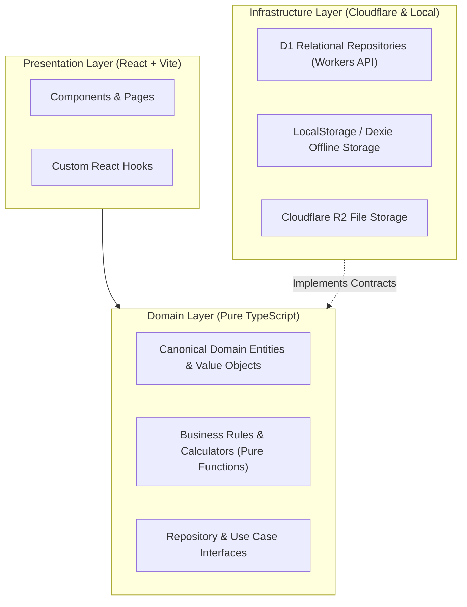

# POS System — Canonical Domain Model & Repository Contracts

## Document Overview
- **Document ID**: `DMC-SPEC-11.7-07`
- **Status**: Draft / Step 11.7 Architecture Finalization
- **Design Pattern**: Hexagonal / Clean Architecture (Domain Core decoupled from Infrastructure)
- **Audience**: Technical Leads, Software Engineers, Backend Integrators

---

## 1. Architectural Separation

The POS domain is structured into three clear architectural layers:



---

## 2. Canonical Value Objects & Domain Entities

### 2.1 Value Objects
```typescript
/**
 * Monetary Value Object
 * Always represented in integer minor units (paise).
 * e.g., PKR 12.50 = { amountMinor: 1250, currency: 'PKR' }
 */
export interface Money {
  amountMinor: number
  currency: 'PKR'
}

export type UnitType = 'piece' | 'box' | 'pack' | 'dozen' | 'kg' | 'gram' | 'liter' | 'meter'

export interface Quantity {
  value: number
  unit: UnitType
}
```

### 2.2 Canonical Product & Category
```typescript
export interface CanonicalProduct {
  id: string
  sku: string
  barcode?: string
  name: string
  description?: string
  categoryId: string
  unit: UnitType
  purchasePriceMinor: number // Current moving weighted average cost in paise
  sellingPriceMinor: number
  stockQuantity: number
  lowStockThreshold: number
  status: 'active' | 'archived'
  trackInventory: boolean
  createdAt: string
  updatedAt: string
}
```

### 2.3 Canonical Customer & Supplier
```typescript
export interface CanonicalCustomer {
  id: string
  customerCode: string
  name: string
  phone?: string
  email?: string
  type: 'individual' | 'business'
  companyName?: string
  taxNumber?: string
  address?: string
  city?: string
  openingBalanceMinor: number // Immutable baseline opening receivable (or credit if negative)
  creditLimitMinor: number
  status: 'active' | 'inactive' | 'archived'
  isWalkIn: boolean
  createdAt: string
  updatedAt: string
}

export interface CanonicalSupplier {
  id: string
  supplierCode: string
  name: string
  type: 'individual' | 'business'
  companyName?: string
  contactPerson?: string
  phone?: string
  email?: string
  address?: string
  openingPayableMinor: number // Immutable baseline opening payable
  status: 'active' | 'inactive' | 'archived'
  createdAt: string
  updatedAt: string
}
```

### 2.4 Canonical Sale, Invoice & Returns
```typescript
export interface CanonicalSaleItem {
  id: string
  saleId: string
  productId: string
  sku: string
  productName: string
  unit: UnitType
  unitPriceMinor: number
  unitCostMinor: number // Locked-in snapshot COGS at checkout
  quantity: number
  subtotalMinor: number
  discountMinor: number
  taxMinor: number
  lineTotalMinor: number
  returnedQuantity: number
}

export interface CanonicalSale {
  id: string
  saleNumber: string
  receiptNumber: string
  invoiceNumber: string
  customerId: string
  terminalId: string
  cashierId: string
  cashierName: string
  items: CanonicalSaleItem[]
  subtotalMinor: number
  discountMinor: number
  taxMinor: number
  totalAmountMinor: number
  amountPaidMinor: number
  remainingBalanceMinor: number
  changeReturnedMinor: number
  status: 'draft' | 'completed' | 'voided' | 'partially_returned' | 'returned'
  businessDateKey: string // Asia/Karachi YYYY-MM-DD
  createdAt: string
  updatedAt: string
}
```

---

## 3. Repository Interfaces (Ports)

Infrastructure implementations (Cloudflare Workers / D1 in production, LocalStorage/Dexie in demo) must conform to these pure repository contracts:

```typescript
export interface IProductRepository {
  findById(id: string): Promise<CanonicalProduct | null>
  findBySku(sku: string): Promise<CanonicalProduct | null>
  findByBarcode(barcode: string): Promise<CanonicalProduct | null>
  findAll(filter?: { categoryId?: string; status?: string }): Promise<CanonicalProduct[]>
  save(product: CanonicalProduct): Promise<void>
  updateStockAndCost(productId: string, quantityDelta: number, newAverageCostMinor?: number): Promise<void>
}

export interface ISalesRepository {
  findById(id: string): Promise<CanonicalSale | null>
  findByInvoiceNumber(invoiceNumber: string): Promise<CanonicalSale | null>
  findAll(filter?: { customerId?: string; startDateKey?: string; endDateKey?: string }): Promise<CanonicalSale[]>
  save(sale: CanonicalSale): Promise<void>
  updateStatus(saleId: string, status: CanonicalSale['status']): Promise<void>
}

export interface ICustomerRepository {
  findById(id: string): Promise<CanonicalCustomer | null>
  findByCode(customerCode: string): Promise<CanonicalCustomer | null>
  findAll(filter?: { status?: string; search?: string }): Promise<CanonicalCustomer[]>
  save(customer: CanonicalCustomer): Promise<void>
}

export interface ISupplierRepository {
  findById(id: string): Promise<CanonicalSupplier | null>
  findAll(filter?: { status?: string }): Promise<CanonicalSupplier[]>
  save(supplier: CanonicalSupplier): Promise<void>
}

export interface IInventoryRepository {
  recordMovement(movement: CanonicalStockMovement): Promise<void>
  getMovements(filter?: { productId?: string; startDateKey?: string; endDateKey?: string }): Promise<CanonicalStockMovement[]>
  getProductBalance(productId: string): Promise<{ quantity: number; unitCostMinor: number } | null>
}

export interface ILedgerRepository {
  recordCustomerEntry(entry: CanonicalCustomerLedgerEntry): Promise<void>
  getCustomerEntries(customerId: string): Promise<CanonicalCustomerLedgerEntry[]>
  recordSupplierEntry(entry: CanonicalSupplierLedgerEntry): Promise<void>
  getSupplierEntries(supplierId: string): Promise<CanonicalSupplierLedgerEntry[]>
}

export interface IUnitOfWork {
  executeInTransaction<T>(work: () => Promise<T>): Promise<T>
}
```

