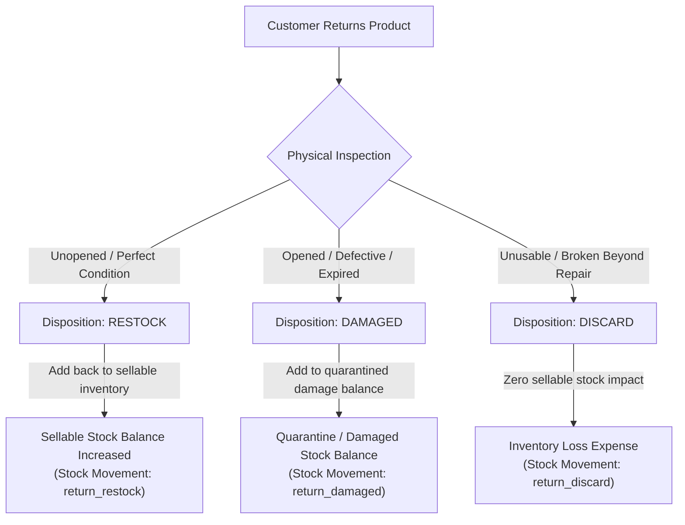

# POS System — Sales Voids, Returns, and Refunds Policy

## Document Overview
- **Document ID**: `RET-SPEC-11.7-03`
- **Status**: Draft / Step 11.7 Architecture Finalization
- **Domain**: Retail POS, Reverse Logistics, Customer Accounting
- **Audience**: POS Architects, Store Managers, Inventory Controllers, Backend Engineers

---

## 1. Distinction Between Voids and Returns

To maintain an immutable financial audit trail, the system draws a strict distinction between a **Void** and a **Return**:

| Dimension | Transaction Void (`voided`) | Sales Return (`sales_return`) |
| :--- | :--- | :--- |
| **Applicable Time Window** | Same business day before register close (e.g. within 30-120 minutes) | Any time within return window (e.g. 7, 14, or 30 days) |
| **Eligible Status** | Unpaid or erroneous immediate sale | Completed sale with issued receipt/invoice |
| **Cash Settlement** | No cash exchanged or immediate register rollback | Customer refund issued, credit note created, or ledger credited |
| **Original Record** | Status transitioned to `voided`; contra-ledger entry posted | Original sale remains `completed`; linked `SaleReturn` record created |
| **Stock Impact** | 100% full reversal to original stock | Flexible stock disposition per item (`restock` vs `damaged`) |
| **Authorization** | Requires Supervisor / Manager PIN or role | Standard Cashier with return slip or Manager approval |

---

## 2. Line-Item Return Validation Rules

### 2.1 Return Preconditions
1. **Receipt / Invoice Linkage**:
   - Every return must link to an authenticated `originalSaleId` and `originalInvoiceNumber`.
   - Blind returns (returns without a receipt) must be handled through a dedicated manager-approved "Unreferenced Return" workflow resulting in store credit only.
2. **Quantity Threshold Validation**:
   - For every return line item $i$:
     $$Q_{\text{return}, i} \le Q_{\text{sold}, i} - Q_{\text{already\_returned}, i}$$
   - Any attempt to return more than the net unreturned quantity must be rejected by the domain validator with a hard error: `ERR_RETURN_QTY_EXCEEDED`.

### 2.2 Pricing and Discount Proration
1. **Net Price Calculation**:
   - Customers must never be refunded the gross sticker price if a discount was applied at sale time.
   - For a line item with sticker price $P_{\text{gross}}$ and allocated line discount $D_{\text{line}}$:
     $$\text{Net Unit Refund Price} = \frac{(Q_{\text{sold}} \times P_{\text{gross}}) - D_{\text{line}}}{Q_{\text{sold}}}$$
   - When returning $Q_{\text{return}}$ units:
     $$\text{Line Refund Total} = \text{round}\left(Q_{\text{return}} \times \text{Net Unit Refund Price}\right)$$
2. **Proportional Tax Adjustment**:
   - Output VAT/GST originally charged on the returned item is reversed proportionally:
     $$\text{Tax Reversed} = \text{round}\left(\text{Line Refund Total} \times \frac{\text{Tax Rate}}{100 + \text{Tax Rate}}\right)$$

---

## 3. Stock Disposition Protocol

When items are returned to the store, the cashier or return clerk must classify the physical condition of each line item:

### 3.1 Disposition Definitions
1. **`restock`**:
   - The product is sealed, undamaged, and immediately sellable.
   - The product's sellable `stockQuantity` is incremented.
   - Moving average unit cost is preserved from the original sale's COGS.
2. **`damaged`**:
   - The product cannot be sold to retail customers.
   - It is routed to the "Damaged Goods" or "Supplier Return Claim" inventory ledger.
   - **Sellable stock is NOT incremented**.
3. **`discard`**:
   - The product is spoiled or destroyed.
   - Written off immediately to `Wastage Expense`.

---

## 4. Refund Payout Policies & Limits

### 4.1 Maximum Refund Rule
The cumulative refunds issued against a sale can never exceed the total cash/card amount actually paid by the customer on that sale:
$$\sum \text{Refunds Paid Out} \le \text{Total Cash/Bank Paid on Original Sale}$$

### 4.2 Refund Settlement Options
1. **Original Payment Method**:
   - If paid by Cash $\rightarrow$ Refund in Cash from register drawer (reduces drawer cash balance).
   - If paid by Card/Bank $\rightarrow$ Electronic refund or bank reversal reference.
2. **Customer Ledger Credit (For Account Customers)**:
   - If the original sale was charged on credit (`remainingBalance > 0`), the return first reduces the customer's outstanding balance:
     $$\text{Credit Note} \longrightarrow \text{Applied to reduce unpaid invoice balance}$$
   - No cash leaves the register drawer until the outstanding invoice is reduced to zero.
3. **Store Credit / Advance Balance**:
   - If the customer desires store credit or the return exceeds cash paid, an advance credit is posted to the customer's account for future purchases.

---

## 5. Audit Trail & Reporting Separation

1. **Non-Destructive Operations**:
   - The original `sales` record and `invoices` record are never modified in place.
   - A child `sale_returns` record is persisted with an array of `sale_return_items`.
2. **Financial Reporting Representation**:
   - Financial summaries report:
     $$\text{Gross Sales} = \sum \text{Original Completed Invoices}$$
     $$\text{Returns \& Allowances} = \sum \text{Sale Returns}$$
     $$\text{Net Sales} = \text{Gross Sales} - \text{Returns \& Allowances}$$
   - This ensures tax compliance and clear operational analytics for managerial review.

