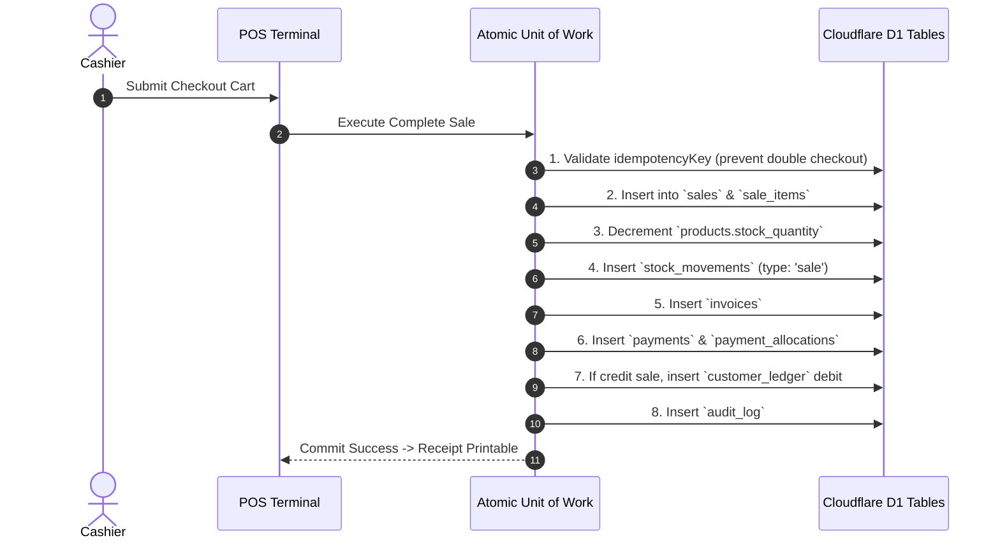

# POS System — Transaction Boundaries & Atomic Commit Guarantees

## Document Overview
- **Document ID**: `TXN-SPEC-11.7-06`
- **Status**: Draft / Step 11.7 Architecture Finalization
- **Database Engine**: Cloudflare D1 (SQLite-compatible relational engine with ACID transactions)
- **Audience**: Backend Engineers, Systems Architects, Database Administrators

---

## 1. Overview of Transaction Boundaries

In a distributed, multi-device POS environment, data corruption occurs when compound operations are executed as disconnected queries. If a network drops or a crash occurs midway, stock may decrement without a recorded sale, or cash may be logged without updating customer debt.

All core domain operations specified below must execute inside an **ACID Transaction Boundary** (e.g. `d1.batch()` or an explicit `BEGIN TRANSACTION ... COMMIT`).

---

## 2. Core Transaction Specifications

### 2.1 Complete POS Sale (`txn_complete_sale`)

- **Preconditions**:
  - `idempotencyKey` has not been previously committed.
  - Cart has at least 1 item with positive quantity.
  - Cash collected + electronic payments + credit amount $\equiv$ Total Amount.
  - If credit amount $> 0$, customer must be active and not exceed authorized credit limit.
- **Tables Mutated**: `sales`, `sale_items`, `products`, `stock_movements`, `invoices`, `payments`, `payment_allocations`, `customer_ledger_transactions`, `audit_logs`.
- **Failure Recovery**: Immediate rollback of all writes if any statement fails.

---

### 2.2 Goods Receipt (`txn_goods_receipt`)
- **Purpose**: Record arrival of purchased stock from supplier.
- **Preconditions**:
  - Purchase Order must exist with status `ordered` or `partially_received`.
  - For each line item: $Q_{\text{received\_now}} \le Q_{\text{ordered}} - Q_{\text{already\_received}}$.
  - Unit purchase costs are non-negative.
- **Mutations (Atomic)**:
  1. Insert `goods_receipts` header and line items.
  2. For each received product:
     - Increment `products.stock_quantity += quantityReceived`.
     - Recalculate and update `products.purchase_price` to new moving weighted average cost.
     - Insert `stock_movements` with `type: 'purchase_receipt'`, recording previous/new quantity and unit cost.
  3. Update `purchase_items.received_quantity += quantityReceived`.
  4. Update `purchases.status` (`received` if all lines complete, else `partially_received`).
  5. Post Credit to `supplier_ledger_transactions` for the invoice value of received goods.
- **Failure Recovery**: Complete rollback.

---

### 2.3 Customer Payment & Advance Allocation (`txn_customer_payment`)
- **Purpose**: Receive customer cash/bank payment, settle outstanding invoices, or hold remainder as advance.
- **Preconditions**:
  - Payment amount $> 0$.
  - Customer exists and is not archived.
  - Sum of invoice allocations $\le$ payment amount.
- **Mutations (Atomic)**:
  1. Insert `payments` header (`amount`, `unallocatedAmount`, `source`).
  2. Insert `payment_method_allocations` (cash, card, bank).
  3. For each invoice allocated:
     - Insert `payment_allocations` record linking payment to invoice.
     - Increment `invoices.paid_amount += allocatedAmount`.
     - Update `invoices.payment_status` (`paid` if fully satisfied, else `partial`).
  4. Post Credit entry to `customer_ledger_transactions`.
- **Failure Recovery**: Complete rollback.

---

### 2.4 Supplier Payment & Bill Allocation (`txn_supplier_payment`)
- **Purpose**: Disburse payment to supplier, settle purchase bills, or hold excess as supplier advance.
- **Preconditions**:
  - Disbursement amount $> 0$.
  - Supplier exists and is active or inactive (not archived).
  - Sum of purchase allocations $\le$ disbursement amount.
- **Mutations (Atomic)**:
  1. Insert `supplier_payments` header.
  2. For each purchase allocated:
     - Insert `supplier_payment_allocations` record.
     - Increment `purchases.paid_amount += allocatedAmount`.
  3. Post Debit entry to `supplier_ledger_transactions`.
- **Failure Recovery**: Complete rollback.

---

### 2.5 Stock Adjustment & Count Reconciliation (`txn_stock_adjustment`)
- **Purpose**: Manually adjust inventory or reconcile physical stock take.
- **Preconditions**:
  - Authorized manager/supervisor role.
  - Valid reason provided.
- **Mutations (Atomic)**:
  1. Update `products.stock_quantity = newQuantity`.
  2. Insert `stock_movements` with `type: 'adjustment_in' | 'adjustment_out' | 'stock_count_adjustment'`.
  3. Record stock adjustment audit record.
- **Failure Recovery**: Complete rollback.

---

### 2.6 Sale Void / Sales Return (`txn_sale_void_or_return`)
- **Void Protocol**:
  - Validates sale is within same business day and cashier shift.
  - Updates `sales.status = 'voided'`, `invoices.status = 'voided'`.
  - Reverses stock for all items with `stock_movements` (`type: 'adjustment_in'`, `reason: 'sale_void'`).
  - Posts contra-credit/debit in ledger.
- **Return Protocol**:
  - Validates return quantity $\le$ net unreturned quantity.
  - Inserts `sale_returns` and `sale_return_items`.
  - For items with disposition `restock`: increments `products.stock_quantity` and logs `stock_movements` (`type: 'return_restock'`).
  - For items with disposition `damaged` / `discard`: logs damage movement without incrementing sellable stock.
  - Inserts refund record or posts Credit Note to customer account.
- **Failure Recovery**: Complete rollback.

---

### 2.7 Purchase Order Cancellation (`txn_purchase_cancel`)
- **Purpose**: Cancel an unfilled purchase order.
- **Preconditions**:
  - Purchase status is `draft` or `ordered`.
  - Cumulative received items count $\equiv 0$.
  - Cumulative supplier payments allocated to this purchase $\equiv 0$.
- **Mutations (Atomic)**:
  1. Update `purchases.status = 'cancelled'`.
  2. Record cancellation audit record with timestamp and reason.
- **Failure Recovery**: Complete rollback.

